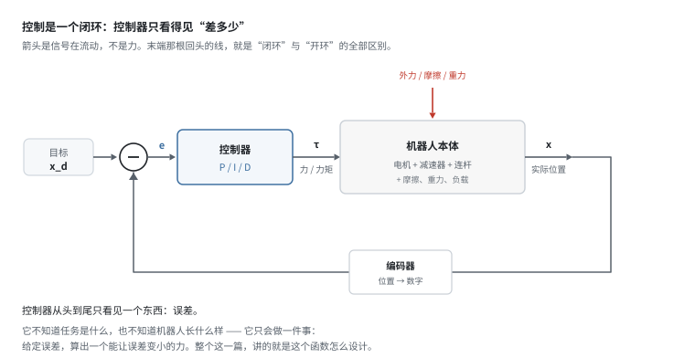
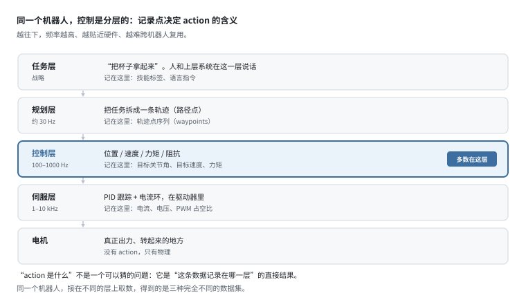
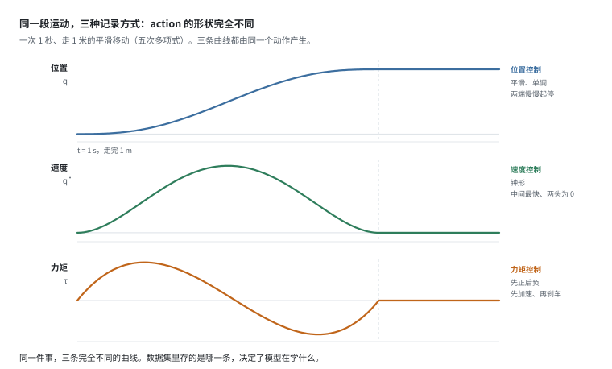
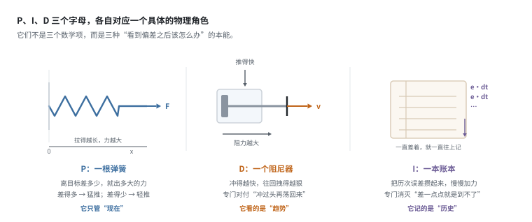
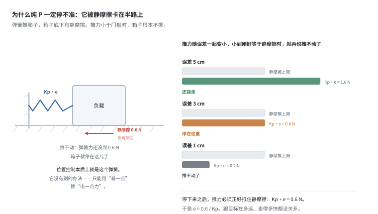
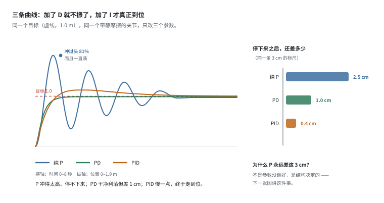
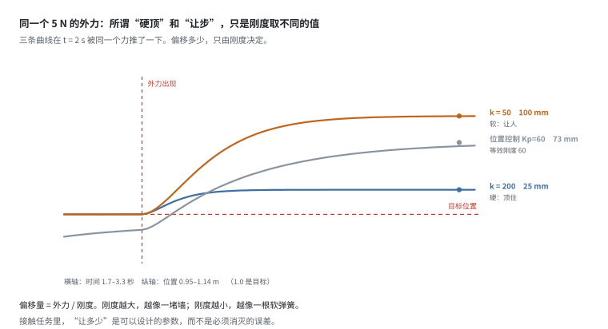
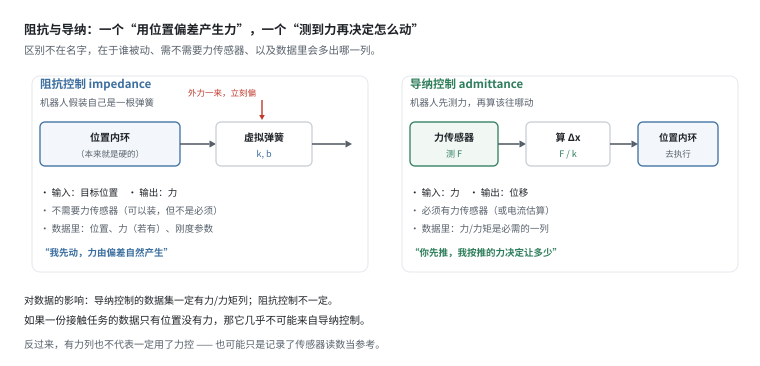
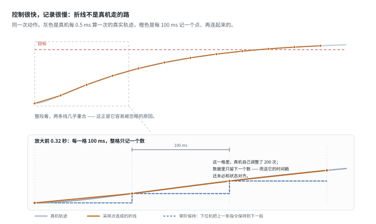
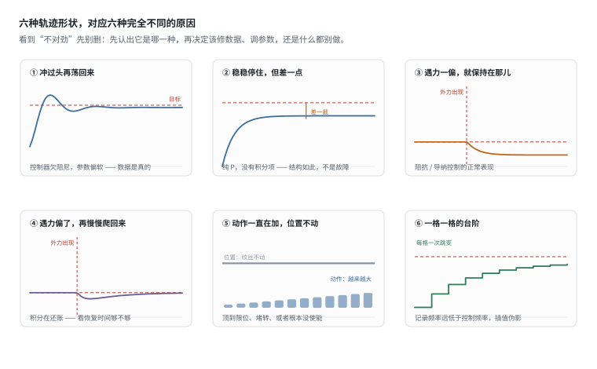

# 控制入门：控制模式决定数据形态

> 阶段 1 · 机器人最小集 ｜ 写作时间 2026-11
>
> 配套实验：[`examples/01_robotics_primer/04_pid_and_impedance.py`](../examples/01_robotics_primer/04_pid_and_impedance.py)
>
> 建议先读：[`dof-and-joints.md`](dof-and-joints.md)、[`kinematics.md`](kinematics.md)

## 1. 它解决什么问题

这一篇表面讲控制，实际讲的是**数据里的 `action` 到底是什么**。

因为同一个字段，在不同机器人、不同配置下代表的东西完全不同：可能是一个目标关节角，可能是一个目标速度，也可能是一个力矩。量纲都不一样，却被存在同一列里。

于是有三个问题必须回答：

- 拿到一份数据，怎么知道它的 `action` 是位置、速度还是力矩？
- 为什么把两种控制模式的数据混在一起训练，loss 正常但效果很差？
- 一条轨迹形状很奇怪，是数据脏了，还是控制器本来就这样？

这三个问题都能用一百多行纯 Python 复现。但先要把"控制"这件事本身看清楚。

## 2. 控制是什么：一个闭环



图里只有三个角色：

- **目标**：你想要的结果（位置、速度或力）。
- **被控对象**：机器人本体。它有质量、有摩擦、有关节间隙，还不断被外力打扰。
- **控制器**：中间那个方框。

关键在于：**控制器看不见目标，也看不见机器人，它只看得见"差多少"。**

比较点把目标和实际位置相减，得到一个误差 `e`，控制器拿这个误差去算该出多大力。力作用到机器人上，位置变了，误差跟着变，再算一次。这一圈每毫秒转一次，就是闭环。

这个结构解释了三件平时容易想不通的事：

**① 为什么"发一条指令"不等于"立刻到位"。** 指令只是把目标改了，实际位置要经过"出力 → 加速 → 移动 → 被传感器测到 → 误差变小 → 再出力"这一整圈，才能慢慢追上去。中间那段追赶的过程，就是你数据里看到的上升曲线。

**② 为什么会有超调。** 机器人有质量，追到目标时还带着速度，冲过去了；冲过头误差反向，控制器才往回拉。所以"冲过头再荡回来"是物理必然，不是控制器坏了。

**③ 为什么扰动这么难缠。** 外力、摩擦、负载变化都从图里那个红色箭头进来，它们不需要经过控制器就能改变位置。控制器唯一的应对方式是：**等误差出现了再去修**。它永远慢半拍 —— 这半拍在纯 P 控制里，就固化成那个永远消不掉的稳态误差。

> **开环和闭环的区别，就是那条回头的线。**
> 把它剪断，就是开环：出多大力全凭事先算好，算错了也没人管。老式洗衣机定时正反转就是开环。
> 接上它，就是闭环：不管算得准不准，只要结果不对就一直修。空调恒温是闭环。

真实机器人上几乎没有纯开环的控制 —— 因为负载永远在变。所以**你拿到的任何一条轨迹，都是"修正过的结果"，而不是"计划的执行"**。这句话后面会反复用到。

## 3. 分层：action 的四种含义从哪来



机器人的控制是分层的，每一层给下一层下指令，每一层的频率差一个数量级。

**数据记录在哪一层，`action` 就是那一层的输出。** 这是 `action` 语义的唯一来源，没有第二种解释。

绝大多数公开数据集记录在**控制层**（图中高亮那行），所以 `action` 是"目标关节角""目标速度"或"目标力矩"三者之一。

### 3.1 位置、速度、力矩：区别不在精度，在"谁负责"

| 控制模式 | 你告诉它什么 | 它自己负责什么 | 出事时的表现 | `action` 单位 |
|---|---|---|---|---|
| 位置控制 | 目标位置 | 怎么走、走多快、出多大力，全归它 | 顶住不动，力可能一直涨 | rad / m |
| 速度控制 | 目标速度 | 位置从哪来、力出多少 | 走过头，或者顶住 | rad/s |
| 力矩控制 | 关节力矩 | 什么都不管，位置你自己兜 | 松手就掉下去 | N·m |
| 阻抗控制 | 目标位置 + 刚度 | 力和位移的关系由你定 | 遇阻就退让 | 混合量纲 |

换个说法可能更好记：

- **位置控制**：你只说"去哪儿"，剩下的它全包。像一个很听话但很轴的司机。
- **速度控制**：你说"开多快"，它就一直开，撞墙了也不会停 —— 因为它只看速度，不看位置。
- **力矩控制**：你直接控制油门，方向盘和刹车都归你。灵活，但也意味着没有任何保护。

### 3.2 越往下越"听话"，也越"没有保护"

这一条是新手最容易忽略、真机上最容易出事的。

**位置控制遇到墙会怎样？** 位置误差一直存在（因为过不去），控制器就一直算出一个力去消除误差。这个力不会自己停，直到电机堵转发热、或者把东西压坏。所以工业上位置控制必须配限位、配力矩上限。

**力矩控制遇到墙会怎样？** 你给的力矩就那么大，墙挡住了就是不动，电机出力也不会变大。**本质上是安全的** —— 这也是为什么协作机器人、灵巧手更愿意在力矩层做接触任务。

代价是：力矩控制要自己补重力。否则一松手，机械臂就砸下来 —— 因为它不知道"应该"停在哪儿。

> 一句话总结：**位置控制是"结果导向"，力矩控制是"过程导向"。**
> 结果导向的控制器，在结果达不到时会一直加码；过程导向的控制器不会。

### 3.3 同一条运动，三种 action 长得完全不一样



这是同一段运动（1 秒走 1 米），如果分别记录在三层，得到的 `action` 序列：

- **位置**：一条平滑的 S 形曲线。单调、好看，信息量最少 —— 因为它把"怎么走"藏起来了。
- **速度**：中间高、两头为零的钟形。看形状就知道"起步加速、到点减速"。
- **力矩**：先正后负，中间过零。正的部分在加速，负的部分在刹车。

**这三条曲线描述的是同一件事，但模型看到的是三个完全不同的问题。**

第四种"阻抗控制"不在这三层里 —— 它是控制层的一个变体，`action` 里同时有位置和刚度两组参数，留到第 5 节讲。

这就解释了混用数据为什么危险：

> 一个是 `action = 0.5 rad`（目标角度），另一个是 `action = 0.5 N·m`（力矩）。
> 数值一样，物理含义毫无关系。模型只能学到一个"平均动作"，而 loss 看起来完全正常。

### 3.4 所以数据集必须声明记录点

不是"建议声明"，是**不声明就没法用**。至少要写清三件事：

1. 这条 `action` 是在哪一层记录的（规划 / 控制 / 伺服）。
2. 它的物理量是什么（角度、角速度、力矩、还是刚度参数）。
3. 它对应的是哪一时刻的状态（同时刻？还是提前一个控制周期？）

第 3 点特别隐蔽：如果 `action` 的时间戳和 `state` 差一个周期，模型学到的就是"错位一帧的因果"。在 1 kHz 下这是 1 ms，无所谓；在 10 Hz 下就是 100 ms，足以毁掉一条快速动作的学习。

## 4. PID：三个字母各自修一个问题



PID 不是三个数学项拼起来的公式，而是三种"看到偏差之后该怎么办"的本能。分开看，每个都很朴素。

### 4.1 P：一根弹簧

误差有多大，就出多大的力。误差 2 cm 出的力，正好是误差 1 cm 的两倍。

它只管**现在**。好处是立刻见效，坏处是——下面这一节。

### 4.2 为什么只有 P，就一定停不准



想象用弹簧推一个箱子。箱子底下有静摩擦：推力小于某个门槛（比如 0.6 N）时，箱子**根本不动**。

而 P 控制的推力是 `Kp × 误差`，误差越小，推力越小。按 Kp = 20 算，于是：

- 误差 5 cm，推力 1.0 N > 门槛，箱子还能走；
- 误差 3 cm，推力 0.6 N = 门槛，**卡住了**；
- 误差 1 cm，推力 0.2 N < 门槛，早就推不动了。

**箱子停下来的位置是确定的**：`Kp × e = 静摩擦`。所以

```
稳态误差 = 静摩擦 / Kp
```

这个结论很重要，因为它说明：**稳态误差不是"没调好"，是结构决定的。** 和目标在多远、走得多快、参数调得多细都没关系。

那加大 `Kp` 行不行？误差确实会变小（`f_c/Kp`），但有三条代价：

- **噪声被放大**：编码器的量化噪声乘上一个大 `Kp`，会变成明显的力矩抖动。
- **容易振荡**：刚度太大、阻尼不够，系统就开始叫。
- **发热和磨损**：一直在高频微调，电机和减速器都受不了。

所以工业上不会靠"把 Kp 拉到很大"来解决稳态误差 —— 而是加 I。

### 4.3 D：一个阻尼器

D 看的是**变化率**：误差正在快速缩小，说明冲得太猛，就提前刹车。

它对付的正是 P 造成的超调和振荡。P 是弹簧，D 就是弹簧旁边的减震器。

代价也有一个：微分会把噪声放大（噪声的变化率极大）。所以真实控制器里的 D 项几乎都带一个低通滤波，或者干脆用"测量值的微分"代替"误差的微分"。

### 4.4 I：一本账本

I 把历次误差累加起来：`∫e dt`。哪怕每次只差一点点，只要一直差着，账本就越记越多，输出越来越大，直到把最后那点误差顶掉。

它专门消灭"差一点点就是到不了"—— 也就是静摩擦造成的稳态误差。

代价是它记的是**历史**，而历史不会自己清零。这就引出下一节。

### 4.5 三个一起：看一条真实的曲线



同一个带静摩擦的关节，同一个目标，只改参数：

| | 超调 | 稳态误差 | 调节时间 | 一句话 |
|---|---|---|---|---|
| 纯 P（Kp=20） | 81% | 2.5 cm | 没稳住 | 又冲又荡，还停不准 |
| PD（Kp=60, Kd=18） | 0% | 1.0 cm | 1.18 s | 干净利落，但差一截 |
| PID（Kp=60, Ki=30, Kd=25） | 12% | 0.4 cm | 5.28 s | 终于到位，但慢 |

三行连起来看，就是一个完整的取舍故事：

- 加了 D，振荡没了（81% → 0%）；
- 加了 I，误差没了（1.0 cm → 0.4 cm），但超调回来了（0% → 12%），收敛也变慢了（1.18 s → 5.28 s）。

**积分和稳定性是一对天生的矛盾。** 想让它"一定要到位"，就得容忍它"到得慢一点、冲一点"。

顺便说一句：0.4 cm 而不是 0，是因为静摩擦下积分必须一直缓慢累积才能维持 —— 这也解释了为什么工业上还要再加一层摩擦前馈补偿。

### 4.6 积分的副作用：windup

积分是账本，而账本不会自己清零。这就带来一个很典型的翻车现场。

实验里模拟了这样一件事：目标 1.0 m，但 0.55 m 处有堵墙，2 秒后墙消失。

- 卡住的这 2 秒里，位置误差一直是 0.45 m，账本一直在往上记；
- 墙一消失，账本里积攒的"欠账"全部兑现 —— 机器人**报复性**地冲出去。

实测：不抗饱和，最高冲到 **1.406 m**（超调 41%）；加了"饱和时冻结积分"之后，只冲到 **1.198 m**（20%）。

差 21 cm。这在真机上足够撞坏东西。

> 真机上更常见的版本：机器人贴着关节限位等了几秒（比如等人、等指令），
> 一旦任务切换，它会突然冲出去。看起来像"失控"，其实是积分在还账。

工程上的解法叫**抗饱和**（anti-windup）：检测到输出已经饱和（力到了上限），就暂停积分；或者把积分项钳在一个范围内。

### 4.7 参数手感对照

调参的时候，记住这三句比记公式有用：

| 现象 | 该动谁 | 方向 |
|---|---|---|
| 太软、跟不上、被外力推着走 | Kp | 加大 |
| 冲过头、来回荡 | Kd | 加大 |
| 总是差一点、慢慢爬 | Ki | 加大 |
| 抖、嗡嗡响、电机发热 | Kp 或 Kd | 减小，或加滤波 |
| 到位后还要"回一下" | Ki | 减小，或加抗饱和 |

### 4.8 PID 的三个天花板

PID 很好用，但它有三个迈不过去的坎 —— 这三个坎正好对应后面三节：

1. **它只认位置**，不知道力。遇到接触就懵：位置到不了，它就使劲顶。
2. **它不知道"让步"是一种需求**。擦桌子时遇阻应该顺着走，PID 只会加大力。
3. **参数依赖负载**。空载调好的参数，抓上 2 kg 就变了。

第 1、2 条，是阻抗控制要解决的。

## 5. 接触任务：为什么需要阻抗控制

### 5.1 硬顶的代价

先看一个数：`力 = 刚度 × 位移`。

这条公式在接触任务里是致命的。位置控制本质上就是一根刚度等于 `Kp` 的弹簧。`Kp = 60` 意味着：位置差 1 cm，它就出 0.6 N；差 10 cm，就出 6 N。

如果它顶着一个不能动的物体（比如桌面），误差会一直存在，力就会一直涨 —— 直到物体变形、或者电机过流。

**在接触任务里，"精确到达"这个目标本身就是错的。** 因为"到达"意味着和物体重合，物理上不可能。

### 5.2 把刚度变成旋钮

阻抗控制做的事很简单：**把刚度从"藏起来的 Kp"变成"显式的参数 k"**。



同一个 5 N 的外力，三种设定的偏移：

| 设定 | 偏移 | 手感 |
|---|---|---|
| 阻抗 k = 200 N/m | 25 mm | 硬，像顶着桌沿 |
| 位置控制 Kp = 60 | 73 mm | 中等（等效刚度就是 60） |
| 阻抗 k = 50 N/m | 100 mm | 软，像扶着人的手 |

注意中间那行：**位置控制和阻抗控制不是两种东西**，位置控制只是"刚度固定、不可调"的阻抗控制。

顺带说一句表里的 73 mm：按 `5 N / 60 = 83 mm` 算，实测只偏了 73 mm，少掉的那 10 mm 是静摩擦帮忙顶住了 —— 又一次说明"仿真和真机的差距"往往就藏在摩擦这一项里。

所以那句常被当成口号的话，其实是个数学事实：

> "硬顶"和"让步"不是两种策略，是同一个公式 `偏移 = 外力 / 刚度` 里刚度的不同取值。

### 5.3 阻抗与导纳：谁被动



这两个词经常混用，但对做数据的人来说，它们的区别非常实际：

| | 阻抗控制 | 导纳控制 |
|---|---|---|
| 机器人像什么 | 一根弹簧 | 一个"测力再动"的伺服机构 |
| 输入 | 目标位置 | 力 |
| 输出 | 力（由位移偏差产生） | 位移 |
| 需要力传感器 | 不必须 | 必须 |
| 数据里多什么 | 可能没有力列 | **一定有力/力矩列** |
| 典型代表 | 协作机器人的"拖拽示教" | 大多数力控打磨、装配 |

这个区别直接影响你怎么判断一份数据：**如果一份接触任务的数据里没有力/力矩列，它几乎不可能来自导纳控制。**

反过来不成立：有力列不代表一定用了力控，也可能只是装了个传感器记录读数当参考。

### 5.4 刚度怎么选

接触任务里，"多软"是个设计参数，不是调出来的：

| 任务 | 刚度 | 理由 |
|---|---|---|
| 擦桌子、拖地 | 很低 | 遇到凸起要顺着走，硬顶会跳 |
| 插拔连接器 | 中低 + 力反馈 | 要能自动找正，但也不能太飘 |
| 拧螺丝 | 中 | 要传得上扭矩，又不能把螺纹啃坏 |
| 打磨、去毛刺 | 中高 | 要保证压力恒定 |
| 精确定位（无接触） | 很高 | 就是位置控制 |

一条通用规律：**越怕撞坏东西，刚度越低；越需要传递力，刚度越高。**

### 5.5 力控的三种实现

按复杂度从低到高：

1. **被动柔顺**：机械上装一个弹簧、或者用弹性材料做末端。零控制成本，但刚度不可调。
2. **阻抗控制**：软件里设定 `k`、`b`，用位置环实现。不需要力传感器也能跑（虽然不精确）。
3. **力位混合控制**：某些方向控位置、某些方向控力（比如擦玻璃：平面内控位置，法向控力）。需要六维力传感器。

机器人数据里遇到最多的是第 2 种。

## 6. 控制频率 vs 采样频率



控制器每秒算几百到几千次，数据往往只记几十次。这中间的差距不是"精度问题"，是**信息真的丢了**。

看那张图的下面一半：一格 100 ms，整格里真机自己调整了两百次，数据里只留下一个数。把相邻两个数用直线连起来，得到的折线**不是真机走的路**。

实验里量了不同记录频率下，折线与真实轨迹的最大偏差：

| 记录频率 | 折线最大偏差 | 单步最大跳变 |
|---|---|---|
| 50 Hz | 2.3 mm | 41 mm |
| 25 Hz | 7.2 mm | 81 mm |
| 10 Hz | 23 mm | 198 mm |

三个要点：

**① 偏差集中在动作最快的那一段。** 因为那里曲率最大。慢速段怎么采样都准。

**② 单步跳变比偏差更值得警惕。** 10 Hz 下相邻两点差 198 mm —— 这意味着回放时，控制器收到的是"瞬间移动 20 cm"的指令。

**③ 这不是噪声，滤波修不好。** 噪声可以在同一时刻反复测；而采样丢的是"两拍之间发生过什么"，信息在记录那一刻就不存在了。

对行为克隆的具体影响：模型学到的是**折线的拐点**，而真机执行的是连续跟踪。训练时 loss 很低（因为训练数据也是折线），上机后动作发飘、不到位、抖动。这类问题很难从 loss 上看出来。

**入库校验**：检查 `Δt` 是否与数据集声明的频率一致；检查位移序列是否出现"一步跨很大、紧接着几步几乎不动"的阶梯特征 —— 那是零阶保持的痕迹。

## 7. 从数据反推控制器



这是数据平台最实用的一张图。拿到一批轨迹，先认形状，再决定怎么处理：

| 形状 | 可能原因 | 该怎么办 |
|---|---|---|
| ① 冲过头再荡回来 | 控制器欠阻尼，参数偏软 | 数据是真的，别当噪声删 |
| ② 稳稳停住但差一截 | 纯 P，没有积分项 | 正常现象，归一化时要考虑偏移 |
| ③ 遇力一偏就保持 | 阻抗 / 导纳控制 | 接触任务的标准表现 |
| ④ 遇力偏了再慢慢爬回来 | 积分在还账 | 看恢复时间是否超出任务要求 |
| ⑤ 动作一直在加，位置不动 | 顶到限位、堵转、没使能 | 脏数据，可自动剔除 |
| ⑥ 一格一格的台阶 | 记录频率远低于控制频率 | 插值伪影，需重采样或标记 |

**最容易犯的两个误判：**

- 看到振荡就判定"采集质量差"。实际上数据完全真实，是控制器参数问题 —— 删掉它等于扔掉了真机上真实存在的工况。
- 看到"遇阻就停"就标成"任务失败"。实际上那是阻抗控制在正常工作，把它标成失败会直接教坏模型。

标注错误比数据噪声更难修复，因为它不会在 loss 上表现出来。

## 8. 自己跑一遍

```bash
python examples/01_robotics_primer/04_pid_and_impedance.py
```

八个部分，每个都能单独改参数：

| 想验证的事 | 怎么改 | 会看到什么 |
|---|---|---|
| 纯 P 加大刚度会怎样 | 把 `Kp` 从 20 改成 100 | 峰更高（1.81 → 1.93 m），8 秒了还在以 16 cm 的幅度振荡 |
| 积分饱和（windup） | 把 `[7]` 的 `block_until` 从 2.0 改成 4.0 | 堵得越久欠账越多：冲过头从 41% 涨到 75% |
| 软阻抗是什么手感 | 把 `impedance` 的 `k` 改成 20 | 5 N 就能推出去 250 mm |
| 静摩擦对控制的影响 | 把 `simulate` 的 `f_c` 改成 0 | 纯 P 的稳态误差消失，PID 的"爬行"也没了 |
| 采样率低到什么程度会出事 | 在 `[8]` 的频率列表里加一个 5 | 折线偏差从 23 mm 跳到 34 mm，肉眼可见地拐弯 |

建议先跑一遍原样，再一个个改。**改参数看曲线怎么变，比读公式快得多。**

## 9. 和数据平台有什么关系

1. **`action` 必须声明控制层级和物理量纲**（位置 / 速度 / 力矩 / 阻抗），否则跨数据集无法复用。这比维度对齐更根本 —— 维度对上了、语义错了，比维度不齐更危险。

2. **轨迹形状是控制器的指纹。** 异常轨迹要先判断是"数据脏"还是"控制器特性"，别一律当噪声删。删掉的每一条，都可能是模型需要学会的真实工况。

3. **接触任务的"让步"是特性，不是失败。** 标注规则里要写清楚，否则标注员会把阻抗控制的正常行为标成失败，而这种错误标注比噪声更难发现。

4. **控制频率与记录频率要匹配。** 不匹配产生的不是随机误差，而是系统性偏差 —— 模型学到的轨迹和真机执行的轨迹从形状上就不一样。入库时应检查 `Δt` 和阶梯特征。

5. **有力/力矩列的数据集，价值高一个档次。** 它意味着可以做力控相关的任务，也意味着这份数据大概率来自导纳控制或力位混合控制。

下一篇进入 [`02-sensor-data`](../02-sensor-data/) —— 各种传感器输出的数据到底是什么形态。
