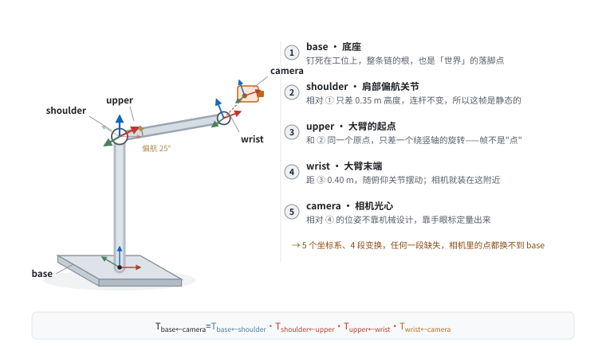
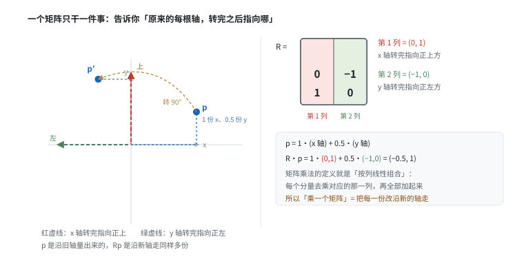
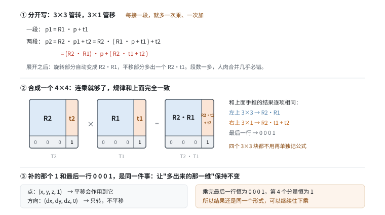
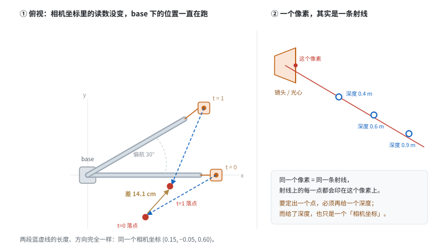
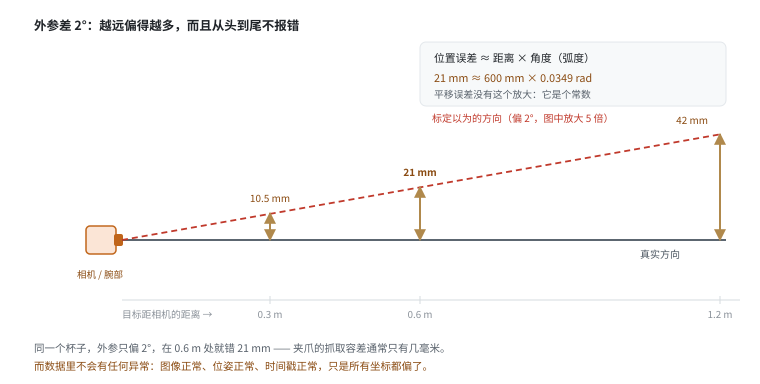
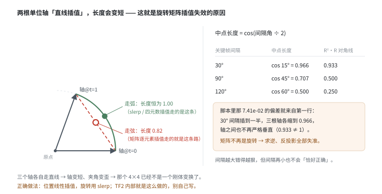

# 坐标系与 TF

> 阶段 1 · 机器人最小集 ｜ 写作时间 2026-11
>
> 配套实验：[`examples/01_robotics_primer/02_frames_and_transforms.py`](../examples/01_robotics_primer/02_frames_and_transforms.py)

## 1. 它解决什么问题

数据平台每天要回答的问题里，有一半是这个形式：

> 相机在 t = 0.5 s 拍到的那个杯子，在机器人基座坐标系下的坐标是？

这句话里有三个隐含要求，缺一个都算不出来：

1. **一条变换链**：camera → wrist → upper → shoulder → base
2. **每个变换都要带时间戳**：因为机器人在动，变换是随时间变化的
3. **外参是准的**：手眼标定错了，整条链的输出都错

这篇把这三件事逐个拆开，最后讲一个几乎所有人写第一版时都会踩的坑：**旋转不能线性插值**。

## 2. 一条变换链：五个坐标系，四段变换

先说清楚那条链上每个节点到底是什么。**坐标系（frame）不是"机器人上的某个点"，它是钉在某个零件上的一整套坐标轴**：一个原点 + 三根互相垂直的方向。相机坐标系的原点在光心，z 轴指向拍摄方向；腕部坐标系的原点在法兰面中心。同一个物理位置，用两套坐标系写出来就是两个不同的三元组。

配套脚本里这条链是这样的：



| 节点 | 钉在哪儿 | 相对上一节点的位姿从哪来 | 会不会变 |
|---|---|---|---|
| `base` | 底座，固定在工位上 | —— 它是根 | 不变 |
| `shoulder` | 肩部偏航关节的转轴中心 | 机械设计值：立柱高 0.35 m | **不变**（连杆是刚性的） |
| `upper` | 绕完偏航的那个坐标系，和整条大臂一起转 | 关节编码器读数（t=0 时 0°，t=1 时 30°） | 变 |
| `wrist` | 大臂末端，离 `upper` 0.40 m | 关节编码器读数（俯仰 −20°，偏航 0→10°） | 变 |
| `camera` | 相机光心 | **手眼标定**（0.08 m / 0.05 m / 偏航 −90°） | 静态，但会漂移 |

几个新手容易卡住的点，一次说清：

**① `shoulder` 和 `upper` 是同一个位置的两帧。** 原点重合，只差一个绕竖轴的旋转。这不是笔误——坐标系的核心是"朝向"，两个坐标系完全可以共用一个原点。所以"帧"不能当成"点"来理解。

**② 帧的名字没有强制语义。** `upper` 指的不是"大臂末端"，而是"转完偏航的那个坐标系"，物理上还在肩关节的位置。TF 里帧名只是给人看的标签，唯一可靠的语义是"它和父帧之间的变换"。看到一个陌生帧名，不要猜，去查 TF 树里它的父帧是谁。

**③ 四段变换的数字来自三个不同的地方。** 机械图纸、编码器、标定文件。这正是数据平台关心它的原因：**任何一段缺失，整条链都算不出来**，而且这三种数据在入库时的校验方式完全不同（图纸和标定要版本管理，编码器要检查时间戳连续性）。

**④ 连乘的顺序是从 base 往 camera 写。**

```text
T_base←camera = T_base←shoulder · T_shoulder←upper · T_upper←wrist · T_wrist←camera
```

记法 `T_A←B` 读作"把 B 坐标系里的点，变换到 A 坐标系"。下标从右往左读，和乘法从右往左作用是一致的：最右边的 `T_wrist←camera` 先把相机坐标变成腕部坐标，再依次往左走，最后变成 base 坐标。

**这条链在数据上的含义**：仓库里存的每一个点、每一个位姿，都必须能说清它是"哪一帧下的"。同一个杯子，写成 `(0.15, −0.05, 0.60)` 而不带帧名，这个三元组毫无意义。

上面这个公式里，每一段 `T` 都是一个 4×4 矩阵，"串起来"就是矩阵连乘。为什么是乘、为什么非得是 4×4，下一节说清楚。

## 3. 齐次变换：为什么要 4×4

先给结论：**4×4 不是为了多一个维度，而是为了把"旋转再平移"这个复合动作，塞进一次普通的矩阵乘法里。** 这样无论链条多长，都只是"连乘"，不用记住"先乘后加"的交替规则。

要理解这句话，得先理解 3×3 为什么能表示旋转。

### 3.1 旋转矩阵的每一列，就是一根轴转完之后的方向

拿二维举例（三维只是多一列）。把一个坐标系逆时针转 90°，写成矩阵是：

```
R = [ 0  -1 ]
    [ 1   0 ]
```

这个矩阵怎么读？**按列读**：

- 第 1 列 `(0, 1)` = 原来的 x 轴，转完之后指向正上方
- 第 2 列 `(−1, 0)` = 原来的 y 轴，转完之后指向正左方



现在看点 `p = (1, 0.5)` 是怎么被转过去的。这个点本身的意思是"**沿 x 轴走 1 份，沿 y 轴走 0.5 份**"：

```
p      = 1 · (x 轴) + 0.5 · (y 轴)
R · p  = 1 · (0, 1) + 0.5 · (−1, 0) = (−0.5, 1)
```

转完之后，它变成"沿新的 x 轴走 1 份（也就是向上），沿新的 y 轴走 0.5 份（也就是向左）"。

也就是说：**"乘一个矩阵"这件事，本质上就是"把每一份分量，改沿新的轴去走"**。这不是什么巧合，这就是矩阵乘法的定义——按列做线性组合：

```
R · p = x · (第1列) + y · (第2列) + z · (第3列)
```

所以一个矩阵能表示旋转，是因为它记录了"三根轴各自转到哪儿"；而它能作用到点上，是因为点本来就是"沿着三根轴各走多少"。

顺带一提，这个视角能解释两件常见困惑：

- **为什么旋转矩阵的逆就是转置？** 因为"把三根轴的新方向存成列"和"存成行"正好互为倒推。
- **为什么 `Rᵀ·R = I`？** 因为三根轴互相垂直且长度都是 1，两两点积为 0、自身点积为 1，写出来就是这个等式。

### 3.2 连着转两次，就是两个矩阵相乘

既然 `R·p` 是"转一次"，那转两次自然是：

```
先转 R1，再转 R2：   R2 · (R1 · p)
```

而矩阵乘法满足结合律，所以它等于 `(R2 · R1) · p`。于是"转两次"这件事，可以**预先合并成一次矩阵乘法** `R2 · R1`。

**但顺序不能交换。** 取 `p = (0, 1, 0)`：

| 做法 | 结果 |
|---|---|
| 先绕 x 转 90°，再绕 z 转 90° | `(0, 0, 1)` |
| 先绕 z 转 90°，再绕 x 转 90° | `(−1, 0, 0)` |

同一个点，两种顺序，落在完全不同的地方。所以记法要固定：**写在右边的先发生**。`R2 · R1 · p` 的意思是"先 R1，再 R2"。

### 3.3 平移一进来，写法立刻变丑

纯旋转可以只用一个 3×3，但真实变换还要平移：

```
p1 = R1 · p + t1              ← 一次矩阵乘，一次向量加
```

再接一段变换：

```
p2 = R2 · p1 + t2
   = R2 · (R1 · p + t1) + t2
   = (R2 · R1) · p + (R2 · t1 + t2)
```

注意最后这行：**旋转部分合并成 `R2·R1`，平移部分却多出一个 `R2·t1`**。这不是把两个平移直接相加，因为第二段的平移是在第一段转完之后的空间里发生的——它必须被第一段的旋转带着走。

三段、四段照此展开，式子会越来越长。而写代码时最危险的不是式子长，是**没有一个统一的写法**：每次都要"先乘、再加"，而且加法那一项到底要不要先转，全靠人记。

### 3.4 4×4 的做法：把上面那个模式预先算好

既然展开式里有一个稳定的模式，那就把它**直接写进矩阵里**。做法是给每个点补一个 1，变成 4 维：

```
               [ R  t ]   [ p ]     [ R·p + t ]
T · [p; 1] =   [      ] · [   ]  =  [         ]
               [ 0  1 ]   [ 1 ]     [    1    ]
```

一个 4×4 乘一个 4×1，出来的前三维正好是 `R·p + t`，第四维还是 1。**"旋转 + 平移"变成了一次乘法。**

关键在于两个 4×4 相乘的结果：



```
[ R2  t2 ]   [ R1  t1 ]     [ R2·R1   R2·t1 + t2 ]
[        ] · [        ]  =  [                      ]
[ 0   1  ]   [ 0   1  ]     [   0          1       ]
```

把右上角那个块和 3.3 节手推出来的 `(R2·R1)·p + (R2·t1 + t2)` 对一下：**一模一样**。`R2·t1 + t2` 正是那个"多出来的"平移项，它自动就出现了，不需要人再记一次。

这就是 4×4 存在的全部理由：**它不是新的数学，是把"先乘后加"的复合规律，提前折叠进"矩阵乘法"这一个动作里。** 于是接十段、二十段，写法都一样：

```text
T_base←camera = T1 · T2 · T3 · T4        # 一路乘下去
```

### 3.5 最后一行为什么必须是 `0 0 0 1`

三个作用，缺一不可：

1. **让第 4 个分量恒为 1。** 算完还得能继续当齐次坐标用，否则乘第二次就崩了。
2. **不让平移渗进旋转。** 如果最后一行不是 `0 0 0 1`，平移会污染左上角那个 3×3 块，乘几次之后"旋转"部分就不再是旋转了。
3. **保证可逆、且逆还是同一个形式。** 刚体变换的逆有闭式解：

```
T⁻¹ = [ Rᵀ   −Rᵀ·t ]
      [ 0      1    ]
```

转置一下、乘个负号就完了，不用跑通用矩阵求逆。

### 3.6 那 3×3 + 3×1 就不行吗

行，但代价是三样：

| | 3×3 + 3×1 | 4×4 齐次 |
|---|---|---|
| 组合两段 | 矩阵乘 + 向量加，且平移项要先转 | 一次矩阵乘 |
| 链上 N 段 | N 次乘、N 次加，顺序全靠人记 | 连乘 |
| 求逆 | 两套规则：`Rᵀ` 和 `−Rᵀ·t` | 一个闭式公式 |
| 代码里的写法 | `apply(mul(R2, R1), apply(...))` 层层嵌套 | `acc = mul(step, acc)` 一行 |

最后一行不是纸上谈兵。这个配套脚本的 `query` 就写反过一次方向：手写"先乘后加"时，谁作用于谁全靠人脑记，而人脑会记错。换成纯连乘之后，"谁先作用"变成了矩阵在乘法里的位置——位置错了，算出来的物理量就荒谬（杯子掉到肩关节下面去了），反而容易发现。

### 3.7 两个顺带的直觉

**① 第 4 个分量填 1 还是填 0，区分"点"和"方向"。**

```
点　：(x, y, z, 1)　→ 平移会作用到它
方向：(dx, dy, dz, 0)　→ 只转，不平移
```

这是齐次坐标最实用的一处：法向量、速度、光线方向都该用 `w = 0`，否则相机会"跟着平移"，光照就全错了。

**② 16 个数里只有 6 个自由度，所以随便填 16 个数得到的不是刚体变换。**

3 个旋转 + 3 个平移 = 6 个自由度，而矩阵里有 16 个数。多出来的部分是冗余，靠 `Rᵀ·R = I` 和最后一行 `0 0 0 1` 这两个约束锁死。**一旦约束被破坏，它就不再是刚体变换了**——这正好是第 6 节的主题。

### 3.8 代码里的三个函数

配套脚本里手写了这个实现，核心就三个函数：

```python
def matmul(a, b):        # 4x4 矩阵乘
def inverse(m):          # 刚体变换求逆：R^T 和 -R^T·t，有闭式解
def apply(m, point):     # 把 3D 点变换到目标坐标系
```

**注意 `inverse` 不要用通用矩阵求逆**。刚体变换的逆是 `[Rᵀ, −Rᵀ·t]`，闭式、精确、快一个数量级。用 `numpy.linalg.inv` 虽然结果对，但浪费且会引入不必要的数值误差——更糟的是，它会让你在矩阵被插值"弄坏"之后依然返回一个数字，从而掩盖问题（见第 6 节）。

## 4. TF 树：带时间维度的坐标系管理

TF2 是 ROS 里管理坐标系变换的标准库。它的数据模型很简单：

- 所有坐标系构成**一棵树**（有且只有一个根，通常叫 `base_link` 或 `world`）
- 每条边存储的是"子坐标系在父坐标系下的位姿"，**带时间戳**
- 查询时必须指定时刻，TF2 负责在关键帧之间插值

为什么必须是树而不是图？因为树保证任意两帧之间有**唯一路径**，不会有"从 A 到 B 走哪条路"的歧义。

```text
[1] TF 树结构
  base       -> shoulder    1 个关键帧  (t = [0.0])
  shoulder   -> upper       2 个关键帧  (t = [0.0, 1.0])
  upper      -> wrist       2 个关键帧  (t = [0.0, 1.0])
  wrist      -> camera      1 个关键帧  (t = [0.0])
```

静态边（`base -> shoulder`）只有一个关键帧，因为连杆长度不会变。动态边有两个关键帧，代表这一秒内关节在动。

### 4.1 为什么时间戳不可省

这里最容易被误读的一点是：**相机看到的从来不是"世界坐标"，而是"相机坐标"**。像素 + 深度给出的是"这个东西在我相机坐标系下的位置"，它要变成 base 坐标，必须过一次变换链。

假设某一帧里，杯子在**相机坐标系**下的坐标是 `(0.15, −0.05, 0.60)`——也就是落在同一个像素、同一个深度上，读数一秒内没有变化。但相机装在腕部，它在动：肩部这一秒转了 30°，腕部又转了 10°。

于是同一个三元组，落到 base 下就一直在跑：

```text
      时刻                         base 下坐标       相对 t=0 的位移
    0.00 (  0.2059,  -0.1500,   0.9711)         0.0000 m
    0.25 (  0.2257,  -0.1259,   0.9711)         0.0312 m
    0.50 (  0.2470,  -0.0995,   0.9711)         0.0651 m
    0.75 (  0.2698,  -0.0708,   0.9711)         0.1018 m
    1.00 (  0.2941,  -0.0397,   0.9711)         0.1413 m
```

一秒内偏移了 **14.1 厘米**。



看点：**z 一直是 0.9711，只有 x、y 在变**。这不是巧合——这一秒里动的两个关节（肩部偏航、腕部偏航）都是绕竖直轴转的，所以高度不变，只有水平面内的位置在扫。理解这一点，你就知道这张表在说什么了。

换个说法：**不是杯子在动，是"你看它的那套坐标轴"在动**。同一个三元组乘上不同时刻的外参，落到 base 下就是不同的点。

这就是为什么：**不带时间戳的变换查询是错的**。如果你的数据管线里有任何一步"用最新的 TF 去处理历史图像"，结果就是这十几厘米的系统性错位。

### 4.2 反过来也有坑：同一个像素 ≠ 同一个世界点

还有一种更常见的误解，方向正好相反：以为"看到同一个像素"就等于"同一个物体"。

一个像素其实约束的是**一条射线**——射线上任何一个点，都会印在同一个像素上。要定出一个点，必须再给一个深度；而给了深度，得到的也只是"相机坐标"，还得再经过一次带时间戳的变换，才是世界坐标。

```text
像素 + 深度 + 该时刻的 T_base←camera  →  base 下的一个点
少了任何一样，你手里的都不是坐标
```

## 5. 外参误差：不报错，但毁数据

先定义清楚"外参"这个词。

**内参（intrinsic）**描述相机自己：焦距、光心、畸变。**外参（extrinsic）**描述相机和**另一套坐标系**之间的相对位姿。机器人里说的"外参"，默认指相机相对腕部（或相对 base）的那个位姿，由**手眼标定（hand-eye calibration）**给出。

两种装法，外参的含义不同：

| 装法 | 相机在哪 | 外参是哪一段 |
|---|---|---|
| Eye-in-hand | 装在腕部，跟着手臂动 | `T_wrist←camera`，静态（但会漂） |
| Eye-to-hand | 固定在工作台上，不动 | `T_base←camera`，静态（但会漂） |

**外参误差 = 标定给出的那个变换，和真实变换之间的差。**

它由两部分组成，性质完全不同，这是理解它的关键：

| 成分 | 表现 | 后果 |
|---|---|---|
| **平移误差**（比如标歪了 5 mm） | 所有点整体平移 5 mm | 是个**常数**，可以事后补偿 |
| **旋转误差**（比如俯仰偏 2°） | 绕某个轴整体转了一点 | **随距离线性放大**，越远越错 |

为什么旋转误差会放大？因为旋转是"绕着一根轴转"，离轴越远的点，走过的弧长越长：



```text
位置误差 ≈ 距离 × 角度（弧度）

600 mm × 0.0349 rad ≈ 21 mm
```

配套脚本把外参的俯仰角故意弄错 2°，实测：

```text
[3] 外参错 2 度，会怎样？
  t=0.0  正确 ( 0.2059, -0.1500,  0.9711)  偏 2° 后 ( 0.1870, -0.1500,  0.9619)  误差 21.0 mm
  t=0.5  正确 ( 0.2470, -0.0995,  0.9711)  偏 2° 后 ( 0.2299, -0.1057,  0.9619)  误差 20.4 mm
  t=1.0  正确 ( 0.2941, -0.0397,  0.9711)  偏 2° 后 ( 0.2796, -0.0519,  0.9619)  误差 21.0 mm

  2° 的旋转误差，在 0.6 m 的距离上产生约 21 mm 的位置误差。
```

**2° → 21 毫米。** 夹爪的重复定位精度通常在 1 mm 量级，抓取容差也就几毫米。21 mm 已经足以让抓取系统性失败——而你的数据里没有任何异常提示。

### 5.1 为什么它不报错

因为它**在格式上完全合法**。变换链是完整的、矩阵是正交的、时间戳是对的、点也都算得出来。错的只是"那个矩阵比真实情况歪了 2°"，而没有任何一条自洽性检查能发现这一点——除非你拿一个**已知真实位置**的东西去核对。

这也是它比前面那些问题更危险的原因：缺边会抛异常，插值会破坏正交性（至少能测出来），而外参误差是**静默**的。

### 5.2 误差从哪来

不是"标定员手抖"这么简单：

- 标定过程本身的残差（标定板的位姿估计、采样点不够多、采样范围太集中）
- 机器人的**运动学误差**：标定时用的 FK 和真机不一致（DH 参数不准、连杆加工误差）
- 相机安装面的加工与装配误差，碰撞后的微小变形
- 温度变化、长时间运行的漂移

所以要记录的不只是"外参的值"，还有**标定的时间、方法、残差**。

### 5.3 怎么发现它

三个成本递增的办法：

1. **闭环校验**：把标定板放桌面上，用相机测出某点在 base 下的坐标，再用夹爪去碰它，比对两者。差几毫米就是误差量级。
2. **重投影残差**：标定时看每张图的重投影误差分布，别只看平均值——系统性偏移会表现为"所有点朝同一个方向偏"。
3. **长期监控**：定期重复上面两步，看外参是否在漂。漂移是有方向的，突然跳变通常意味着撞过。

**数据平台的对策**：

1. 标定结果必须作为数据集的**一等元数据**存储，不能只留在采集机器的配置文件里
2. 入库时做**完整性校验**：外参缺失就拒绝入库，不要"先用默认值顶着"
3. 记录标定的**时间和方式**，因为标定会随时间漂移（碰撞、温度、拆装都会影响）

## 6. 插值：TF 为什么要插值，以及旋转为什么不能用线性插值

这一节是整篇最重要的部分。但先得把"插值"这个词说清楚，因为很多人卡在这里。

### 6.1 什么是插值，为什么非要插

TF 存的是**关键帧**：某个时刻、某条边上的位姿。它不是一个连续函数，是一串离散的快照。

问题在于，**你要查询的时刻，几乎永远不会正好撞上一个关键帧**。相机 30 Hz 出图，TF 以 50–100 Hz 广播，而你的查询可能落在任意时刻。查到 t = 0.5，但手上只有 t = 0.0 和 t = 1.0 两帧，怎么办？

**插值就是"根据前后两帧，造出一个中间值"。** 就像你只知道上午 9 点和 11 点在哪儿，要回答"10 点在哪儿"，只能按这两点去推。

```text
关键帧 t=0.0  ────────────●────────────●──────────── 关键帧 t=1.0
                           ↑
                    查询 t=0.5：这里没有数据，必须造一个
```

不插值行不行？行，那就只能"用最近的那一帧顶着"。代价可以算出来：TF 30 Hz（间隔 33 ms），腕部速度 1 m/s，最坏情况用的是半帧之前（16.7 ms）的位姿 → 位置错 `1 m/s × 16.7 ms ≈ 17 mm`。这和上一节外参误差的量级一样大，而且**随速度线性增长**：手臂动得越快，错得越多。

所以插值是必须的。真正的问题是：**怎么插**。

### 6.2 位置可以线性插值，旋转不行

位置是个普通的三维向量，在两点之间连一条直线走过去就行。关键帧足够密时，误差小到可以忽略（误差量级 ≈ 加速度 × 帧间隔²）。

旋转不行。原因可以用一句话说清，但需要一张图：



**把两个旋转矩阵逐元素线性插值，等价于"把三根轴各自线性插值"。而两根单位向量之间的直线（弦）上的点，长度都小于 1。**

中点有多短？设两个方向的夹角是 θ，弦中点到原点的距离是 `cos(θ/2)`：

| 关键帧间隔 | 中点长度 cos(θ/2) | 平方 = `Rᵀ·R` 对角线 |
|---|---|---|
| 30° | cos 15° = 0.966 | 0.933 |
| 90° | cos 45° = 0.707 | 0.500 |
| 120° | cos 60° = 0.500 | 0.250 |

配套脚本故意保留了线性插值的实现（注释里写明是教学简化版），就是为了让你亲眼看到这个错误的量级：

```text
[5] 为什么旋转不能用矩阵线性插值
  R^T·R 与单位阵的最大偏差：7.41e-02

  非零 -> 插值出来的矩阵不是合法旋转（行列式不再为 1）。
```

**那 7.41e-02 是哪来的？** 把插值到一半的矩阵拿来算一下 `Rᵀ·R`：

```text
[  0.926   0.000   0.000 ]
[  0.000   0.935   0.024 ]
[  0.000   0.024   0.991 ]
```

先看非对角线上那个 `0.024`：它意味着第 2、3 根轴之间出现了一个很小的内积——两根轴不再垂直了（差了约 1.4°）。

对角线上的三个数则是三根轴各自的**长度平方**。开根号还原回去，三根轴分别缩到 `0.962 / 0.967 / 0.996`，都短了一截，而且**缩得不一样多**。最大偏差 0.074 就来自缩得最狠的那一根。

对照上表：如果只有肩部那条边在插值、间隔 30°，中点长度该是 `cos 15° = 0.966`。这里缩到 0.962，比 0.966 还短一点——因为腕部那条边（10°）也在同时插值，两条边的缩短叠加起来了。

所以那个"看起来很小"的 0.074，含义是：**你手里这个 4×4 已经不是刚体变换了**。它做的"旋转"会顺带把物体缩掉约 4%，而且缩多少取决于你插在哪一刻，所以误差是**随位置变化的系统性偏移**，不是随机噪声。

后果链条：

```text
插值出的"假旋转矩阵"
  → 求逆出错（inverse 的闭式解假设 R 正交）
  → 点变换出错
  → 反投影出错
  → 整个感知/训练管线偏移
```

### 6.3 正确做法

| 方法 | 说明 | 适用 |
|---|---|---|
| 四元数 slerp | 球面线性插值，沿弧走，长度恒为 1 | 主流选择，TF2 / scipy 都支持 |
| 轴角插值 | 插值旋转轴和角度 | 小角度时近似 slerp |
| 李群指数/对数映射 | 在 `log(R)` 上插值，理论上最干净 | 需要更严谨的动力学处理时 |

一句话记法：**位置走直线（可以），旋转走弧线（必须）**。

> 生产环境别自己写插值。用 `tf2_ros` 或 `scipy.spatial.transform.Rotation`。

## 7. 求逆的正确性验证

配套脚本最后验证了两件事。第一件是 `M · M⁻¹ = I`：

```text
[4] 变换求逆
  最大偏差：8.33e-17（浮点误差量级即为正确）
```

注意这里**必须用未插值的关键帧矩阵**。如果拿第 6 节那个插值出来的矩阵去求逆，闭式解 `[Rᵀ, −Rᵀ·t]` 会失效——因为 `R` 已经不正交了。

第二件是个更有意思的教训：**"往返一次应该回到原点"这个检查，抓不住方向写反的 bug**。

```text
  方向自检 query(base,camera)·query(camera,base) 与 I 的最大偏差：9.71e-17
  注意这条路走不通：两个方向同时写反时，乘积照样是 I。
  要抓方向 bug 只能看物理量：
  杯子在 base 下 z = 0.971 m，应当高于肩关节 0.35 m 而不是落在下方。
```

这个脚本的第一版就踩了：`query("base", "camera")` 返回的其实是反方向的变换。往返自检照样通过（因为两个都反了，乘起来还是单位阵），只有当你去看"杯子在 base 下多高"这种**物理量**时才暴露——它算出来落在肩关节下方，一台站着的机器人不可能把手伸到自己腰底下。

**所以验证变换链，永远要验一个能用手比划的物理事实**，不要只验代数恒等式。

## 8. 自己跑一遍

```bash
python examples/01_robotics_primer/02_frames_and_transforms.py
```

建议的改法：

| 想验证的事 | 怎么改 |
|---|---|
| 外参误差如何随距离放大 | 把 `cup_in_camera` 的 z 从 0.6 改成 1.2，看误差是否翻倍（约 42 mm） |
| 如果是平移误差而不是旋转误差 | 把 `bad_eye` 里的 `rpy(radians(2), ...)` 改回 `0`，同时把 `translation(0.08, ...)` 改成 `0.09`。对比：平移误差在任何距离上都是同一个数，旋转误差随距离放大 |
| 链上某一环缺失会怎样 | 删掉 `tf.add("wrist","camera",...)`，看 `query` 抛什么异常 |
| 插值误差跟角度有关，但不是干净的比例 | 把肩部关键帧的 30° 改成 10°，偏差从 7.4e-2 掉到 1.5e-2（约 5 倍）——因为腕部那条边也在同时插值，两条边的影响叠在一起 |
| 夹在两个关键帧之间查询 | 把 `_lookup_edge` 里的 `lerp` 注释掉、改成返回前一帧，对比姿态误差 |

## 9. 和数据平台有什么关系

1. **每个传感器数据都必须能追溯到它的坐标系**，没有坐标系的点云和图像坐标是无意义的。
2. **标定信息是一等元数据**，缺失即拒绝入库；标定时间也要记（漂移是有方向的）。
3. **插值必须用 slerp**。任何一个环节用矩阵线性插值，都会引入系统性偏移且不报错。
4. **变换链要做完整性校验**。运行时应该验证"任意两帧之间路径存在"，而不是等下游报错。
5. **验证要验物理量**。代数恒等式（往返、正交、行列式）能抓住"格式坏了"，但抓不住"方向反了""标定歪了"——那两类必须拿一个能用手比划的事实去核。

下一篇：[`kinematics.md`](kinematics.md) —— 正逆运动学与雅可比，看关节怎么变成末端。
