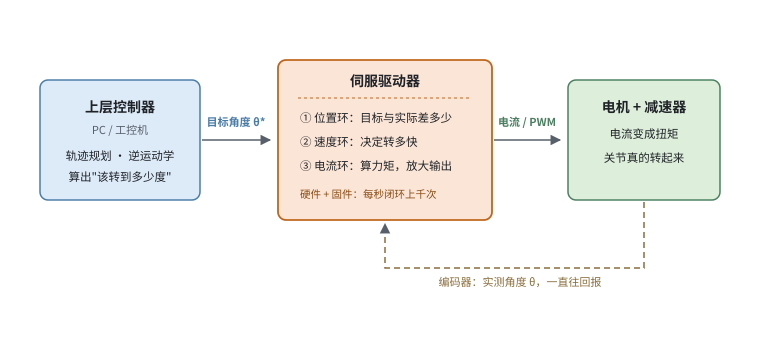
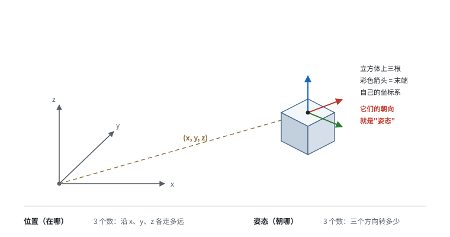
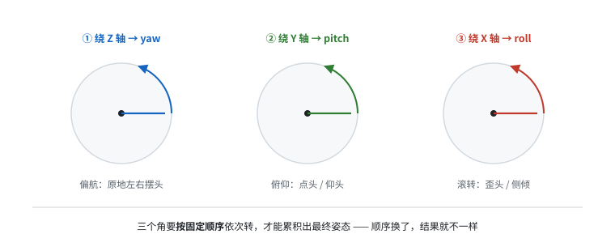
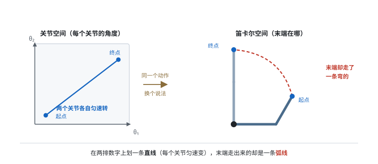
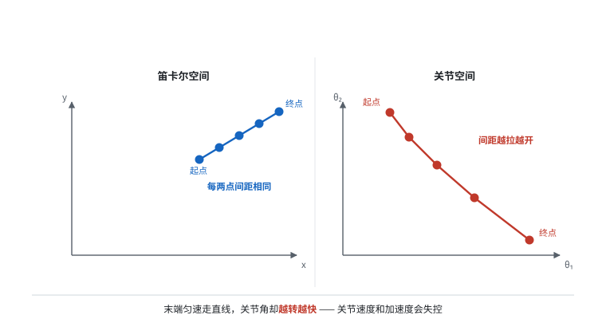
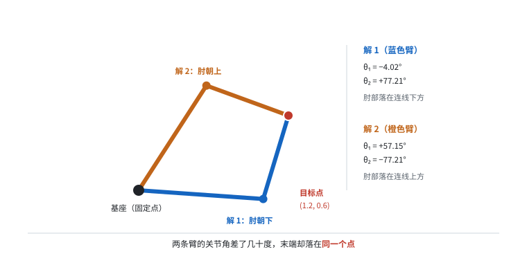
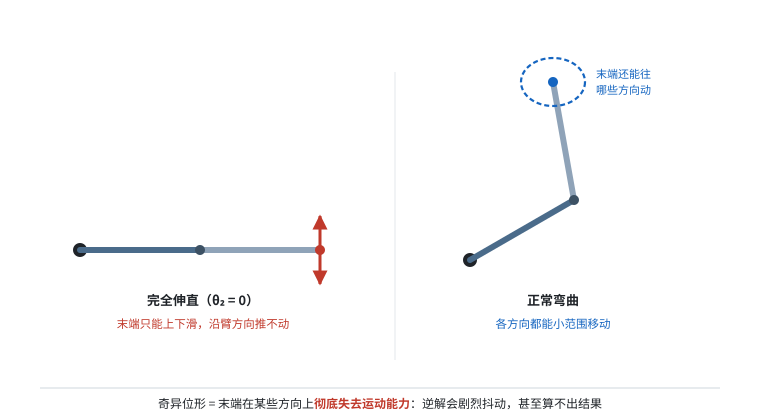

# 自由度与关节空间

> 阶段 1 · 机器人最小集 ｜ 写作时间 2026-11
>
> 配套实验：[`examples/01_robotics_primer/01_joint_space_vs_cartesian.py`](../examples/01_robotics_primer/01_joint_space_vs_cartesian.py)

## 1. 它解决什么问题

拿到一份机器人数据，第一个字段通常是 `qpos` 或者 `joint_states.position` —— 一个 7 维或 14 维的数组。

不懂这个数组的物理含义，会犯三类错误：

- 把它当成"位置"来做归一化和插值（它不是笛卡尔坐标，插值出来的姿态可能根本不可达）
- 只存末端位姿，丢掉关节角（信息不可逆地丢了）
- 拿不同机器人的 action 向量直接拼接（维度和语义都对不上）

这一篇要解决的就是：**关节空间和笛卡尔空间各自是什么、为什么数据里必须同时保留两者**。

配套脚本用 2 连杆平面臂跑一遍，所有结论都能自己验证。

## 2. 两个空间，两种描述

### 关节空间（joint space）

用每个关节的角度/位移来描述机器人姿态。7-DoF 机械臂就是 `[q1..q7]`，每维的量纲都是弧度。

特点：
- **维数 = 自由度**，一一对应每个电机
- **均匀**：每个维度独立、范围确定（由关节限位决定）
- **控制器的直接输入**：伺服驱动器收到的就是这个

#### 岔开一句：伺服驱动器到底是个什么

上面最后一条说的"伺服驱动器收到的就是这个"，新手很容易卡在这儿。把它拆开：



**它是硬件。** 一个金属盒子，装在电控柜里，或者直接挂在电机屁股后面。你摸得到、有型号、坏了要换。

**但它不是"纯"硬件。** 盒子里跑着固件，每秒上千次地执行三层闭环——

| 环 | 它在算什么 | 周期量级 |
|---|---|---|
| 位置环 | 目标角度和编码器实测角度差多少 | 1 kHz |
| 速度环 | 该用多快的速度去追这个差值 | 数 kHz |
| 电流环 | 该给电机多大电流才能产生需要的力矩 | 十几 kHz |

所以更准确的说法是：**伺服驱动器 = 一块带固件和功率电路的执行部件**。它接收的不是"往左转"这种模糊指令，而是一个**精确的目标角度**（或者目标速度、目标力矩），然后靠自己闭环把这件事做到。

为什么需要它，而不是让上层控制器直接控制电机？因为它要对抗的东西上层根本看不见：重力、摩擦、负载变化、传动间隙。这些扰动在毫秒尺度上发生，上层控制器的控制周期通常只有 100–1000 Hz，来不及响应。驱动器把这些脏活接了过去。

分工可以这样记：

- **上层控制器**（电脑/工控机）：负责"想"——轨迹规划、逆运动学，算出每个关节**应该**在什么角度
- **伺服驱动器**：负责"做到"——接收目标值，闭环控制，让关节**真的**到位
- **电机 + 编码器**：负责"动"和"报数"——把电流变成转动，把实际角度报回去

> **对数据的含义**：`qpos` 里的数字来自**编码器**（实测值），而 `action` 里如果记的是目标角度，那是**发给驱动器之前**的指令。两者永远不完全相等——中间的差值就是驱动器的跟踪误差。采集数据时把这两个混为一谈，训练出来的策略会学到"一个不存在的完美执行"。


### 笛卡尔空间（cartesian space）

用末端执行器在三维空间的位置 + 姿态来描述。位置 3 维 + 姿态 3 维（欧拉角/四元数）= 6 维。

特点：
- **维数固定为 6**，与机器人自由度无关
- **不均匀**：越靠近基座，同样的角度变化对应的末端位移越小
- **任务的自然描述**："把杯子放到桌上"、"往左 10 厘米"

#### 位置是"在哪"，姿态是"朝哪"

位置好理解：末端在空间里的一个点，三个数 (x, y, z) 就够了。

姿态说的是**朝向**。举两个例子：

- 手电筒：位置是它拿在手上哪个点，姿态是光往哪个方向照
- 螺丝刀：位置是刀头在哪，姿态是刀杆指向哪、以及绕刀杆自身转了多少

**同一个位置，姿态可以有无穷多种。** 杯子放在桌上不动，但你可以让它杯口朝上、朝下、朝左倒着——位置没变，姿态全变了。这就是为什么 6 维里必须留 3 维给姿态。



为什么姿态非得要三个数？因为三维空间里的朝向，需要绕三个互相垂直的轴各转一个角度才能唯一确定。飞机上的叫法最形象：**偏航（yaw，左右摆头）、俯仰（pitch，点头）、滚转（roll，歪头）**。

#### 欧拉角：三次旋转拼出一个朝向

欧拉角的思路很朴素——把"转到目标朝向"拆成三次旋转，一次绕一个轴：



三个角合起来就是一个姿态。但这里有个坑，叫**万向锁（gimbal lock）**：当中间那次旋转恰好转到 ±90° 时，第一个轴和第三个轴会重合，两个自由度塌缩成一个——你丢了其中一个方向的控制能力。这不是数学没写好，是"用三次旋转描述朝向"这套方法本身的天花板。

另外一个坑更隐蔽：**旋转顺序不能换**。绕 Z 转 30° 再绕 Y 转 20°，和绕 Y 转 20° 再绕 Z 转 30°，结果完全不同（试试转一本书就知道了）。所以欧拉角必须连着顺序一起说，光给三个数字是有歧义的。

#### 四元数：四个数，把死角绕过去

四元数用四个数 `(w, x, y, z)` 表示一个旋转。ROS 里 `geometry_msgs/Quaternion` 的顺序是 `(x, y, z, w)`，容易看漏。

四个数表示三个自由度，是因为多了一个约束：**模长必须等于 1**（`w² + x² + y² + z² = 1`）。真正独立的变化只有 3 个。

它换来的是三件事：

| 好处 | 具体是什么 |
|---|---|
| 没有万向锁 | 任何朝向都能正常表示，不会塌缩 |
| 插值平滑 | 两个朝向之间做球面插值（slerp），转出来的路径是均匀的、最短的 |
| 计算便宜 | 只要乘法和加法，没有三角函数 |

代价是**不直观**。给你 `(0, 0, 0.383, 0.924)`，你说不出它朝哪。所以工程上的惯例是：

- **存储和计算用四元数** —— 数据集里的 `orientation` 字段基本都是它
- **给人看用欧拉角** —— 调试界面、日志里转成 `roll/pitch/yaw` 显示
- **绝对不要对欧拉角或四元数直接做线性插值** —— 前者会穿过万向锁，后者插出来的不是旋转（要用 slerp）

两者的关系可以用一句话概括：

> 同一个姿态，**欧拉角有无穷多种写法**（换顺序、加减 360° 都算），**四元数有两种写法**（`q` 和 `-q` 表示同一个旋转）。它们描述的是同一个东西，只是坐标不同。


### 两者的关系：多对一 + 非线性

正向（关节 → 笛卡尔）是**确定的多对一映射**：给定一组关节角，末端位置唯一确定。

反向（笛卡尔 → 关节）是**一对多**：同一个末端位姿，通常有多组关节角能做到。

而且这个映射是**高度非线性的**。"非线性"不光是个形容词，它有具体的形状。先看图：



左边那个矩形，横轴是一个关节角、纵轴是另一个关节角。你在上面画一条直线——含义是**两个关节各自匀速转**。

右边是末端实际走过的路径：**一条弯的弧线，不是直线**。

两条路径的形状对不上，就这么简单。下面跑一下配套脚本，看这条弧线上的几个采样点：

```text
    theta1   theta2      末端 x      末端 y       |末端|
         0°        0°    1.7000    0.0000     1.7000
         0°       90°    1.0000    0.7000     1.2207
        30°       45°    1.0472    1.1761     1.5748
        60°       90°   -0.1062    1.2160     1.2207
        90°      -90°    0.7000    1.0000     1.2207
        45°        0°    1.2021    1.2021     1.7000
```

注意最后两行的对比：(0°, 90°) 和 (90°, -90°) 的关节角差别巨大，末端距离却完全一样（1.2207）。而 (0°,0°) 和 (45°,0°) 只差 45°，末端却从 (1.7, 0) 挪到了 (1.2, 1.2)。

**结论：关节空间里的"均匀变化"，在笛卡尔空间里不是均匀的。** 所以：

- 在关节空间做线性插值，末端轨迹不会平滑
- 在笛卡尔空间规划直线，关节轨迹会不规则
- 训练时如果对 action 做归一化，两个空间要分别处理

#### 这两句话到底在说什么

这两句是全文最容易被跳过去的地方，因为它们读起来像同义反复。它们其实说的是**两个不同的失败模式**，方向刚好相反。

**第一句：在关节空间做线性插值，末端轨迹不会平滑。**

场景是这样——机器人要从 A 点走到 B 点。最省事的做法：把 7 个关节角各自从起点到终点做线性插值，按比例混合。听起来很合理，数字确实是均匀变化的。

但末端不走直线。它走的是（上面那张图里的）一条弧线。如果任务恰好是"把销钉插进孔里"，这条弧线中途就撞到孔壁了。

还有速度问题：关节匀速转，末端速度却忽快忽慢。手臂弯着的时候，关节转一点，末端就挪一大截；手臂伸直的时候，关节转同样多，末端才挪一点点。人手也有同样的感觉。

**第二句：在笛卡尔空间规划直线，关节轨迹会不规则。**

反过来，你要求末端走一条笔直的线（焊接、涂胶、写字都得这样），就得在每个采样点上算一次逆运动学，反推关节角。这时候轮到关节角不均匀了：



左边五个点等距分布——末端匀速前进。右边是这五个点对应的关节角，落在 θ₁–θ₂ 平面上：**间距越拉越开**。

同样的时间间隔里，关节要转的角度越来越大。后果有两个：关节速度可能超过额定值；越靠近奇异位形，角度会突然暴增（下一篇细讲）。

> 所以这两句话说的是一枚硬币的两面：**两个空间之间不是"换个坐标系"那么轻，形状和速度都会变形。**

工程上的选择取决于任务在乎什么：

| 任务在乎什么 | 在哪规划 |
|---|---|
| 末端轨迹的形状（插孔、涂胶、写字） | 笛卡尔空间 |
| 关节平滑、不超限、避开障碍 | 关节空间 |
| 两者都要（实际绝大多数情况） | 笛卡尔规划路径点，再做时间参数化 |


## 3. 逆运动学的多解

同一个末端位置，2 连杆有 2 组解（肘上/肘下）。7-DoF 机械臂有无穷多组（冗余 1 维）。

先建立直觉：把手伸向桌上的杯子。你的**手**必须落在杯子上，但**肘**放哪其实没人规定——肘抬高一点、放低一点，手都还在杯子上。



两条臂的关节角差了几十度，末端却精确落在同一个点上。这就是"多解"的全部含义：**答案不止一个，而你只能选一个。**

```text
[2] 逆运动学：同一个末端位置，有两组关节角
  目标点：(1.2, 0.6)，距离 1.3416 m
  解 1: theta1=   -4.02°  theta2=   77.21°  -> 验证 FK = (1.2000, 0.6000)   肘下 (elbow down)
  解 2: theta1=   57.15°  theta2=  -77.21°  -> 验证 FK = (1.2000, 0.6000)   肘上 (elbow up)
```

两组解末端位置完全相同，但**臂的姿态完全相反**。在真机上，一组可能是"手肘朝上、避开障碍物"，另一组是"手肘朝下、撞到桌子"。

> **一个容易踩的坑**：判断"肘上/肘下"不能只看 `θ₂` 的正负。`θ₂` 是相对于大臂量的角度，它的符号只说明"小臂往哪边折"，并不代表肘在空间里的高低——目标点一旦离开 +x 轴，结论就会反过来；不同教材对 `θ₂` 零位的定义也不一样。脚本里的 `is_elbow_up()` 改用**叉积**判断肘点落在基座—末端连线的哪一侧，换个目标方向同样成立。你可以把脚本里的 `tx, ty` 改成 `(0.3, 1.2)` 再跑一次，标签会跟着几何关系变，不会错。

数据平台的含义很直接：

> 如果只存末端位姿，你无法还原机器人当时的姿态；如果只存关节角，你无法跨本体比较任务。

两者都要存，而且要能互相校验（用 FK 从关节角算出末端，和记录值比对，偏差大说明标定或记录有问题）。

#### 顺带说清：7-DoF 的"无穷多组"是怎么回事

上面 2 连杆只有 2 组解，因为它的自由度刚好够用，没有富余。

7-DoF 机械臂比"定位置 + 定姿态"需要的 6 维多出 1 维，多出来的这维叫**冗余（redundancy）**。

冗余的直接表现是：**末端锁死不动，整条手臂还能自己"绕一圈"**。把手指按在桌上不动，肘可以在一个圆弧上到处转——这类动作叫零空间运动（null space motion）。因为满足条件的构型是连续的一整族，所以解有无穷多个。

工程上这是好事：多出来的自由度可以拿去避开障碍、远离奇异位形、躲开关节限位。但它也意味着**逆运动学必须带一套"选解策略"**——同一个目标点，不同厂家、不同规划器选出来的构型可能完全不同。

> 于是数据上多一层麻烦：同一个任务、同一条末端轨迹，两台不同品牌或不同构型的 7-DoF 臂采出来的关节角可能毫无相似之处。跨本体训练时，别指望关节角能直接对齐。

## 4. 奇异性：为什么末端"动不了"

先说人话版：**奇异位形就是机器人"卡住"的姿态**。在这个姿态下，末端在某些方向上再怎么使劲也动不了；反过来，你让末端往那些方向挪一丁点，关节就得瞬间转极大角度。

最熟悉的例子是你自己的胳膊。**把手臂完全伸直，然后去推墙。** 手掌这时只能上下滑、左右滑——**沿着手臂方向你推不动**，因为再往前就要求手臂"更长"，而它已经到极限了。



这就是奇异。2 连杆的奇异位形有两个：

- **完全伸直**（θ₂ = 0）
- **完全折叠**（θ₂ = 180°）

数学上的说法是**雅可比矩阵降秩**。雅可比 J 是"关节速度 → 末端速度"的线性映射，负责把这个姿态下的微小关节运动，翻译成末端的微小位移。J 降秩（对 2 连杆就是 `det J = 0`）意味着：**存在某个方向，不管你怎样组合关节速度，末端在那个方向上都是零**——相当于有一根轴被压扁了。

```text
[3] 奇异性：theta2 -> 0 时，雅可比降秩
    theta2    |det J|        条件数   沿径向再走 1mm？
       90°    0.70000        2.1   可达
       45°    0.49497        5.0   可达
       10°    0.12155       23.6   可达
        5°    0.06101       47.3   可达
        2°    0.02443      118.3   不可达（已顶到边界）
        1°    0.01222      236.5   不可达（已顶到边界）
      0.1°    0.00122     2365.5   不可达（已顶到边界）
```

条件数从 2.1 涨到 2365，含义是：**逆问题变得极度敏感**。末端坐标上 1 毫米的测量误差，反推出来的关节角可能差几十度。

为什么误差会被放大到这种程度？用光斑想一下就明白了。你在几米外用激光笔照墙，想让光斑移动 1 厘米，手只需要转一个极小的角度。反过来——你看见光斑移了 1 厘米，想反推手转了多少度：手在正常范围内任何一点微小抖动，产生的光斑位移都比 1 厘米大。**正着算很稳，反着算就崩了。** 奇异位形就是那个"手离墙最远"的位置。

这对数据的影响是双重的：

1. **如果有 IK 环节**，接近奇异的样本会产生剧烈抖动的关节轨迹，看起来像"数据噪声"，实际是数学上的不可解
2. **如果是遥操作采集**，人操作到伸展极限时，关节会有明显抖动，这些样本质量很差

处理方式：入库时计算条件数，超过阈值（比如 100）就标记为"接近奇异"，训练时可以降权或剔除。

**一个容易踩的误解**：很多人以为奇异只发生在工作空间边界。对 2 连杆恰好如此，但对 7-DoF 冗余臂，奇异藏在工作空间**内部**——机器人看起来行动自如，某些方向上却已经失去能力。这也是为什么冗余臂的规划更难。

## 5. 工作空间

```text
  可达工作空间（半径 1.7 m 的圆盘，'.' 为可达点）
  +-------------------------------------------------------------+
  |                ............................                 |
  |            ....................................             |
  |        ............................................         |
  |      ................................................       |
  ...
  |..........................    O   ...........................|
  ...
  +-------------------------------------------------------------+
```

2 连杆的工作空间是一个**环**（外半径 L1+L2，内半径 |L1-L2|），不是圆盘中心实心。

`(0.2, 0.1)` 这种靠近基座的点反而不可达 —— 距离 0.224 m < |L1-L2| = 0.3 m，落在内部死区：

```text
[5] 够不着的点会怎样
  (1.8, 0.0)  距离 1.800 m  ->  不可达（超出最大伸展，太远）
  (2.0, 0.0)  距离 2.000 m  ->  不可达（超出最大伸展，太远）
  (0.2, 0.1)  距离 0.224 m  ->  不可达（落在内部死区，太近）
```

**做数据时要小心"内部够不着"这个反直觉的情况**：如果任务目标点在死区内，演示数据里的机器人会表现出"绕着走"或者"反复试探"，这些样本不该被当成正常行为学习。

## 6. 自己跑一遍

```bash
python examples/01_robotics_primer/01_joint_space_vs_cartesian.py
```

脚本里三个函数可以单独调用，建议改造它们做实验：

| 想验证的事 | 怎么改 |
|---|---|
| 换一个连杆长度比例，工作空间怎么变 | 改 `L1` / `L2`，观察死区大小 |
| 7-DoF 的冗余是什么感觉 | 把 `fk` 扩展到 3 连杆但只输出 2 维位置，用 `ik` 的数值版本 |
| 奇异附近的噪声放大有多严重 | 在 `ik` 的输入上加 ±1mm 随机扰动，看输出关节角的方差 |

## 7. 和数据平台有什么关系

1. **`qpos` 不是坐标，是关节角**。不要对它做笛卡尔式的插值和距离计算。
2. **末端位姿和关节角必须同时存**，互为校验，缺一个都会让数据无法被复用。
3. **条件数应该作为数据质量指标入库**，接近奇异的样本在训练前应该被识别。
4. **工作空间约束要写进元数据**，否则下游无法判断某些轨迹是"策略行为"还是"物理限制导致的绕行"。

下一篇：[`coordinate-frames.md`](coordinate-frames.md) —— 坐标系与 TF，数据对齐的地基。
