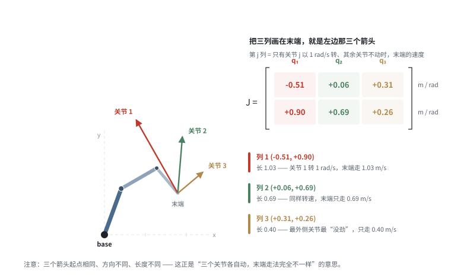
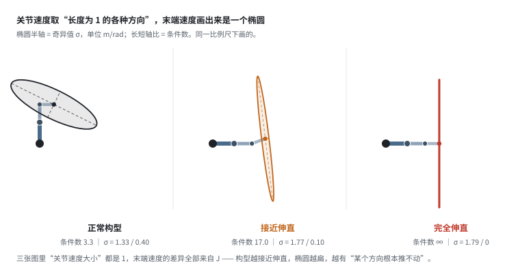
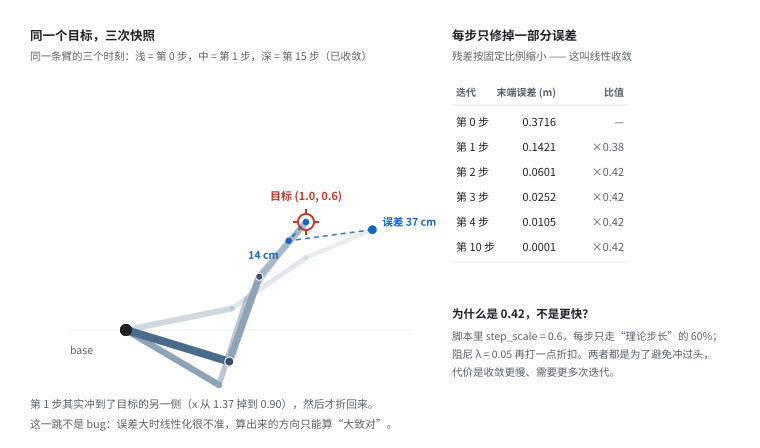
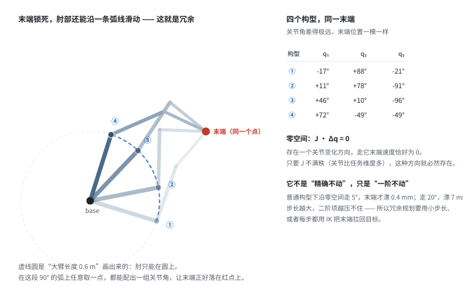
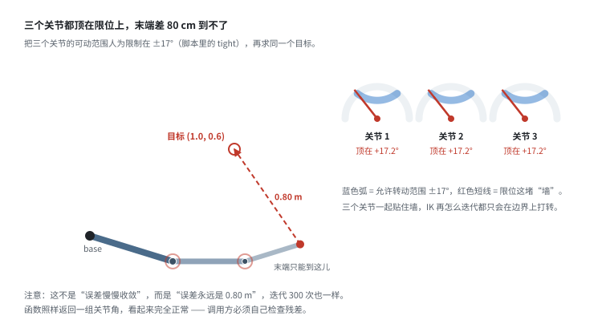

# 运动学：FK、IK 与雅可比

> 阶段 1 · 机器人最小集 ｜ 写作时间 2026-11
>
> 配套实验：[`examples/01_robotics_primer/03_ik_and_singularity.py`](../examples/01_robotics_primer/03_ik_and_singularity.py)
>
> 建议先读：[`dof-and-joints.md`](dof-and-joints.md)、[`coordinate-frames.md`](coordinate-frames.md)

## 1. 它解决什么问题

上一篇讲了"关节空间和笛卡尔空间是多对一关系"，这一篇讲**怎么在两个空间之间转换**，以及转换过程会怎么污染数据。

具体三个问题：

- 数据里同时有 `joint_states` 和末端位姿，它们对不上怎么办？（FK 校验）
- 遥操作时人给的是笛卡尔指令，机器人执行的是关节角，中间发生了什么？（IK）
- 为什么有些片段的关节轨迹抖得厉害，而末端轨迹很平滑？（冗余 + 奇异）

这三个问题都能用 100 行纯 Python 复现。先看清三个概念的分工：

| 概念 | 方向 | 回答的问题 | 性质 |
|---|---|---|---|
| FK | 关节 → 末端 | 这组关节角，末端在哪儿？ | 唯一解，便宜，永不失败 |
| 雅可比 J | 局部线性化 | 关节动一点，末端跟着动多少？ | 依赖构型，是 FK 的导数 |
| IK | 末端 → 关节 | 要去那儿，各关节该转到多少？ | 可能多解、可能无解、可能不收敛 |

**主线**：FK 是"算得出来的"，IK 是"猜得出来的"。这一节所有的麻烦——奇异、限位、多解、抖动——全长在 IK 那一侧。

## 2. 正运动学（FK）：关节 → 末端

给定关节角，算末端位置。**有唯一解，计算便宜，永远不会失败。**

对多连杆链，FK 就是把每段的变换连乘：

```
T_base_ee = T_base_l1(q1) · T_l1_l2(q2) · ... · T_ln_ee(qn)
```

配套脚本里用 3 连杆平面臂演示，代码只有十几行：

```python
def fk(q):
    x = y = 0.0
    acc = 0.0
    for l, qi in zip(L, q):
        acc += qi                        # 每个关节的角度累加到绝对角度
        x += l * math.cos(acc)
        y += l * math.sin(acc)
    return x, y
```

### FK 在数据平台里的作用：一致性校验

FK 是**验证数据自洽性**最便宜的工具。检查逻辑：

```
对每一帧：
    用记录的关节角 q 算 FK -> 得到末端位置 p_fk
    与数据里记录的末端位置 p_recorded 比较
    |p_fk - p_recorded| > 阈值  =>  这一帧有问题
```

超过阈值通常意味着：

- 标定参数过期了（连杆长度和实际不符）
- 关节角单位和预期不一致（弧度 vs 度）
- 数据采集时发生过碰撞或机械变形
- 混入了另一台机器人的数据

**这个校验应该跑在入库流水线里**，成本极低（一行 FK），但能拦住绝大部分"看起来正常其实不能用的数据"。

## 3. 雅可比：把"动一点点"翻译成矩阵

### 3.1 它只回答一个问题

想象机器人停在一个确定的姿态上（关节角 `q` 已知），你问：

> 让每个关节都以某个速度转起来，末端会以多快的速度、朝哪个方向走？

雅可比就是这个问题的答案：

```
ẋ = J(q) · q̇
```

左边是末端的 6 维速度（3 维线速度 + 3 维角速度；平面臂只有 2 维），右边是 `J` 乘关节速度。`q` 写在括号里是有意的——**J 不是常数，它随构型变**。换个姿态，整张矩阵就换了。

三条必须先建立的直觉：

1. **它是局部的。** 只说"此刻、动一点点"的换算比例，走远了就不准。
2. **它是线性的。** 关节速度翻倍，末端速度也翻倍，没有非线性项。
3. **它把"关节空间的一小步"换算成"任务空间的一小步"**，反过来也成立，但要解方程。

为什么非要这么一个东西？因为 FK 是一堆 `sin(q1+q2+q3)`，没法直接反解、也没法直接算速度。而在**一个点上做线性近似**，就能把问题变成线性代数——这是整个机器人学的通用套路。

### 3.2 一列 = 一个关节单独的贡献



这张图取了一个具体构型 `q = (70°, -40°, -80°)`。三根彩色箭头都从末端出发，颜色对应矩阵里的三列。

读法：**第 j 列 = 只有关节 j 以 1 rad/s 转、其他关节锁死时，末端的速度。**

- 列 1 = `(-0.51, +0.90)`：关节 1 转 1 rad/s，末端以 1.03 m/s 往左上走
- 列 2 = `(+0.06, +0.69)`：同样的转速，末端只走 0.69 m/s，方向更接近正上
- 列 3 = `(+0.31, +0.26)`：最外侧的关节最"没劲"，只有 0.40 m/s

三个箭头的长度差得远，方向也不一样。**这就是矩阵的含义：不同关节对末端的"杠杆"不一样。**

顺着这个思路再推一步，会得到一个特别好用的规律。对平面臂（所有关节轴都垂直于平面），第 j 列恰好等于：

```
J 的第 j 列 = 把"关节 j 指向末端"的向量，逆时针转 90°
```

也就是：**方向垂直于「关节→末端」这根杆，长度等于这根杆的长度。**

验一下上面那组数：关节 1 在原点，到末端的向量是 `(0.895, 0.507)`，长 1.029；逆时针转 90° 得 `(-0.507, 0.895)`——正好是列 1。最外侧关节到末端的杆长就是 0.4 m，所以列 3 的长度也正好是 0.400。

这个规律直接解释了"为什么离末端越远的关节越有劲"：**它到末端的杆更长。** 也解释了为什么关节 1 通常是全身最"轻快"的关节——杠杆最长，一点角速度就能换来很大的末端速度。

**但长杠杆是双刃的**：同样这一点末端力压下来，也是它要扛最大的力矩。3.6 的 `τ = JᵀF` 会说这件事——同一个"杆长"，在速度上是优势，在力上是负担。

（三维是同一个规律的推广：第 j 列 = 关节轴方向 × (末端位置 − 关节位置)。叉乘就相当于"垂直转 90°"。）

### 3.3 能手算，也能自己验证

偏导数的定义就在那儿：`∂x/∂q₁` 就是"q₁ 变一点点，x 变多少"。所以可以拿差分去验：

```python
eps = 1e-6
for j in range(3):
    q_plus = q.copy(); q_plus[j] += eps
    dx = (fk(q_plus)[0] - fk(q)[0]) / eps
    dy = (fk(q_plus)[1] - fk(q)[1]) / eps
    # 与 jacobian(q) 的第 j 列逐项比较
```

在 `q = (90°, 0°, -90°)` 上跑（换一个构型，是为了数字干净、便于手算），两边逐位对上：

```text
       解析 J 的列              有限差分
j=1   (-1.100000, +0.400000)   (-1.100000, +0.399999)
j=2   (-0.500000, +0.400000)   (-0.500000, +0.400000)
j=3   ( 0.000000, +0.400000)   (-0.000000, +0.400000)
```

每个分量都是 1.1 / 0.5 / 0.4 这种一位小数，肉眼就能核对。

差分验证不是学术练习。**雅可比写错是机器人代码里最常见的 bug 之一**，而它往往不"报错"，只表现为 IK 收敛慢、力控方向偏。五行代码做个自检，能省掉几小时的自责。

### 3.4 单位是 m/rad —— 混用度和弧度会静默出错

`J` 每个元素的单位是**米每弧度**，所以 `J · q̇` 出来是 m/s。

这条看着像废话，但它是最常见的静默错误来源：

- 关节角存的是**度**，却当弧度代进 `J · q̇`，算出来的末端速度差 `180/π ≈ 57.3` 倍
- 数据里 `action` 用度、模型内部用弧度、SDK 又要求弧度——三处只要有一处没转，就会出现"动作幅度大得离谱但看不出错在哪"
- 反过来从末端速度推关节速度时漏了 `π/180`，关节会转得极慢

**约定：内部一律弧度，只在展示层转成度。** 数据契约里显式写清单位，别靠约定俗成。

### 3.5 圆的像是一个椭圆：为什么有些方向"推不动"

到这里还差一块拼图：J 不只是"三个方向、三个长度"，它决定了一个整体的形状。

想一个思想实验：让关节速度取遍所有"长度为 1"的方向——三维关节空间里是一个球面，平面臂里是一个圆。把每个方向都按 `J` 映射出去，末端速度的集合是什么形状？

**是一个椭圆。**



椭圆的长半轴、短半轴就是 J 的**奇异值**（`σ_max`、`σ_min`），单位还是 m/rad。长短轴之比叫**条件数** `κ = σ_max / σ_min`。

物理含义一句话：**关节都使同样的劲，末端在某些方向跑得快，在另一些方向跑得慢；慢多少，看椭圆有多扁。**

| 构型 | σ_max | σ_min | 条件数 | 读起来是 |
|---|---|---|---|---|
| 正常 | 1.33 | 0.41 | 3.3 | 各方向都还行，最差只差 3 倍 |
| 接近伸直 | 1.77 | 0.10 | 17.0 | 已经有一个方向很难推动了 |
| 完全伸直 | 1.79 | 0.00 | ∞ | 那个方向彻底动不了 |

第三张图里，椭圆退化成一条线段——这就是**奇异**。落在直线方向上的运动做不到，给多少关节速度都没用。

反过来读这个椭圆还有个更有用的版本：**想让末端以固定速度走，哪个方向最费关节？** 短轴方向，费的程度正好是 `1/σ_min`。

这就是 IK 在奇异附近解出天文数字的几何原因。6.4 会把具体数字摆出来。

### 3.6 五个真实用途

前面说"它很重要"，但"重要"是句很空的话。下面是它在机器人代码里真正被用来干的事，每条都配脚本里的实测数字。

#### 用途 1：速度级控制（遥操作、手柄、鼠标）

人手给的通常是末端速度："往左 10 cm/s"。机器人要的是关节速度。转换就是乘伪逆：

```
q̇ = J⁺ · ẋ
```

脚本实测（`q = (70°, -40°, -80°)`，想让末端以 0.10 m/s 沿 +x 走）：

```text
q̇ = [-0.1048, +0.0848, +0.1372] rad/s = [-6.00°, +4.86°, +7.86°] /s
回代验算 J·q̇ = (+0.100000, -0.000000) m/s
方向是（反、正、正）—— 关节要互相配合，不是各转各的。
```

伪逆给的是**关节转速平方和最小**的那组解。这对遥操作很重要：同一个末端动作有无穷多种关节分法，选"总能耗最小"的最自然，也最不会把某个关节顶到限位。

#### 用途 2：IK 迭代的每一步

数值 IK 的核心就是"算出末端和目标的差，用 J 反推该补多少关节"。见 4.3，不重复。

#### 用途 3：静力映射（τ = JᵀF）

这个用途最容易被忽略，但它是力控和碰撞检测的基础。

末端被一个力 `F` 顶住时，各关节要出多大力矩才扛得住？

```
τ = Jᵀ · F
```

推导只有一行（虚功原理）：末端做的功 = 关节做的功，`Fᵀ·δx = Fᵀ·J·δq = (JᵀF)ᵀ·δq`，所以 `τ = JᵀF`。

脚本实测，末端被 10 N 往下压：

```text
τ = [-8.95, -6.90, -2.57] N·m
```

关节 1 扛得最多（8.95 N·m）——因为它离末端最远，杠杆臂最长。这和 3.2 里"列越长越有劲"是同一件事的两面。

**数据含义**：反过来用就是「从关节电流估算末端受力」。很多协作臂不装力传感器，碰撞检测靠的就是 `F ≈ (Jᵀ)⁺τ` 加上电流观测。这类数据入库时，`F` 的估计值值得单独存一列——它是判断"这段演示有没有撞到东西"的直接依据。

#### 用途 4：奇异判据

`σ_min` 或条件数就是奇异的量化指标。见 6.4。

#### 用途 5：数据自洽性校验（比 FK 更严）

FK 校验比的是位置，J 校验比的是**速度**：

```
对每一帧：
    从记录里取关节速度 q̇（相邻两帧差分即可）
    用 J(q) 预测末端速度 ẋ_pred = J·q̇
    与记录的末端速度（同样差分）比较
```

速度级校验比位置级严格得多：位置差 1 mm 可能只是噪声，速度对不上则说明"关节动的方式和末端动的方式不一致"——通常是时间戳错位、关节角和末端位姿不是同一时刻的、或者标定参数错了。

**但别把它放进硬性拦截。** 差分会放大噪声，速度级的误报率远高于位置级。合理的定位是：位置级做入库门禁，速度级做抽样体检和故障排查。

### 3.7 J 只在这一瞬间有效

最容易被忽略的一条，但对数据平台很实在：

**J 是构型的函数，不是机器人的属性。**

同一条机械臂，伸展姿态和折叠姿态下的 J 几乎没有任何相似之处。所以：

- 不能"离线算一次 J 然后复用"——每一帧都有自己的 J
- 也不必把 J 存进数据库：它可以从 `q` 和连杆参数重算，存了反而有版本不一致的风险
- **值得存的是由 J 导出的标量**：`σ_min`、条件数、`|q̇|` 的加权和。体积小、可直接用于筛选和降权

## 4. 逆运动学（IK）：末端 → 关节

### 4.1 为什么它天生比 FK 难

FK 是"代入公式算"，IK 是"解方程"。差别不在难度，在**性质**：

| | FK | IK |
|---|---|---|
| 解的存在性 | 一定存在 | 可能不存在（目标够不着） |
| 解的唯一性 | 唯一 | 可能有无穷多组 |
| 计算 | 一次连乘 | 迭代，可能不收敛 |
| 失败模式 | 无 | 卡死、震荡、安静地返回错解 |

三个困难各有各的来源：

1. **多对一 → 反推多解。** 3 个关节控 2 维位置，同一个末端有无数种构型（第 5 节）。
2. **工作空间有限 → 可能无解。** 目标超出臂展、或者被限位挡住，都无解。
3. **非线性 → 没有公式。** FK 里是一堆 `sin(q1+q2+q3)`，展开是高次三角方程。除极少数特殊结构，写不出闭式解。

### 4.2 解析解：只有特定结构才有

**2 连杆平面臂**是最经典的例子，余弦定理就能写完。

设两段长度 `L1`、`L2`，目标点 `(x, y)`，到原点距离 `r = √(x²+y²)`。三角形的三边是 `L1`、`L2`、`r`，余弦定理直接给出第二个关节角：

```
cos θ₂ = (r² − L1² − L2²) / (2·L1·L2)
```

`cos` 落在 `[-1, 1]` 内时有两解（`±θ₂`），这就是"肘上/肘下"。然后第一个关节角：

```
θ₁ = atan2(y, x) − atan2(L2·sinθ₂, L1 + L2·cosθ₂)
```

取 `L1 = 0.6`、`L2 = 0.5`、目标 `(0.9, 0.4)`（`r = 0.9849`）：

```text
cos θ₂ = 0.6000  →  θ₂ = ±53.13°

解 A: θ₁ =  0.00°,  θ₂ = +53.13°   FK 回代 = (0.900000, 0.400000)
解 B: θ₁ = 47.92°,  θ₂ = −53.13°   FK 回代 = (0.900000, 0.400000)
```

两个解都精确命中目标。A 是"肘在下"，B 是"肘在上"。

**能写成公式的结构很少。** 6-DoF 机械臂有闭式解的充要条件（Pieper 条件）是：**最后三个关节轴交于一点**（所谓球形腕）。原因是它能把 6 维问题拆成两半：

- 腕心位置只由前 3 个关节决定 → 先解 3 维位置
- 手腕姿态只由后 3 个关节决定 → 再解 3 维姿态

拆开之后每一步都是 3 元方程组，能解。UR、Panda、绝大多数工业六轴都属于这一类。

**不满足这个条件就没有闭式解。** 7-DoF 冗余臂更必然没有——解是一个连续族，不是有限个点。所以工程实践里：

- 6-DoF 球形腕：优先解析解（快、稳、不用迭代）
- 其他：数值解，或者用 IKFast 这类工具**离线生成**针对特定结构的 C++ 代码

### 4.3 数值解：从一维牛顿法开始

数值 IK 听起来玄，原理和中学解方程一样。

**一维版本**：要解 `f(q) = x_target`。当前在 `q`，差 `e = x_target − f(q)`。用切线近似，`f(q+Δq) ≈ f(q) + f'(q)·Δq`，令它等于目标：

```
Δq = e / f'(q)          q ← q + Δq
```

这就是牛顿法。**`f'(q)` 是什么？就是"关节动一点、末端动多少"——就是雅可比。** 一维时它是标量，多维时它是矩阵。

**多维版本**：`f` 从 3 维关节映射到 2 维位置，导数是 2×3 的 `J`。要解

```
J · Δq = e
```

这是**欠定方程组**（2 个方程、3 个未知数），解不唯一。取"长度最短"的那个解，分两步：先解

```
(J Jᵀ) · y = e
```

再把 `y` 映射回关节空间：

```
Δq = Jᵀ · y = J⁺ · e          J⁺ = Jᵀ(J Jᵀ)⁻¹，叫伪逆
```

伪逆的作用就是：**在所有能消掉误差的 Δq 里，挑长度最短的那一个。** 物理上是"关节转得最少"。

**问题来了**：算 `(J Jᵀ)⁻¹` 时，如果 J 接近奇异，`J Jᵀ` 就接近不可逆，这个逆会爆炸。解决办法是加阻尼：

```
Δq = Jᵀ (J Jᵀ + λ²I)⁻¹ · e
```

这就是**阻尼最小二乘**（DLS，也叫 Levenberg-Marquardt）。`λ²I` 往对角线加一个小量，保证矩阵永远可逆。

`λ` 的作用可以这么理解：

- `λ → 0`：退化成纯伪逆，精度最高，奇异附近爆炸
- `λ` 变大：矩阵更稳，但每步更保守，稳态误差也变大
- `λ → ∞`：退化成"沿梯度慢慢挪"，绝不炸，但慢得像蜗牛

**λ 是必须调的取舍，没有通用最优值。** 脚本用 `λ = 0.05`，配 `step_scale = 0.6`。

为什么还要 `step_scale`？因为线性化只在"小步"下成立。误差大时 `J` 描述的线性关系早就失效，直接走满步长会冲过头（4.5 的图里能看到）。打折走是廉价的保险。

### 4.4 四种解法，什么时候用哪个

| 方法 | 迭代式 | 优点 | 缺点 | 典型场景 |
|---|---|---|---|---|
| 雅可比转置 | `Δq = α·Jᵀe` | 最便宜，不用求逆 | 收敛慢，近奇异更慢 | 嵌入式、控制周期极短 |
| 伪逆 | `Δq = J⁺e` | 线性化意义下一步到位 | 奇异处数值爆炸 | 一般构型、离线规划 |
| 阻尼最小二乘 | `Δq = Jᵀ(JJᵀ+λ²I)⁻¹e` | 奇异附近稳定 | 奇异附近精度下降，要调 λ | 工业默认，最常用 |
| 非线性优化 | 解 `min‖f(q) − x‖²` | 能加约束（限位、避障） | 慢，要梯度/Hessian | 离线规划、TRAC-IK |

**工程现实**：几乎没人从零实现 IK。常用的是

- **KDL / MoveIt**：基于伪逆和 DLS，经典但不快
- **TRAC-IK**：同时跑两套（KDL + SQP），谁先收敛用谁，成功率明显更高
- **IKFast**：对特定结构生成闭式代码，微秒级
- **Pinocchio / PyBullet**：快速 FK/J，做自研求解器的底座

一个常被忽略的数字：**逐点 IK 的成功率通常在 90%~99% 之间，不是 100%。** 所以真机做轨迹跟踪没人"每个点独立解一次"，而是用带种子的连续求解（4.7）。

### 4.5 看一次真实收敛



```text
[1] 正常情况：目标可达，迭代收敛
  目标：(1.0, 0.6)   初始 q：[   11.5°,    22.9°,   -11.5°]
     迭代        末端误差(m)
      0       0.371595
      1       0.142139
      2       0.060078
      3       0.025202
      4       0.010462
      5       0.004317
  ...  （共 16 次迭代）
     15       0.000001

  收敛：True   解 q = [  -17.0°,    87.5°,   -21.0°]
  验证 FK：(1.000000, 0.600000)，误差 5.91e-07 m
```

三件事值得看。

**① 误差每步乘 0.42。** 0.3716 → 0.1421 → 0.0601 → 0.0252 → 0.0105，比值稳定在 0.38~0.42。这叫**线性收敛**：每步消掉的比例是常数。所以想再降一位精度，就得多迭代 5~6 步——`0.42^n < 1e-6` 需要 `n ≈ 16`。

**② 第一步冲过头了。** 末端 x 从 1.37 一步跳到 0.90，越过了目标 1.0 到了另一侧。原因很直接：起始误差 37 cm，线性化只在小误差下成立，`J` 给的方向只能算"大致对"。等误差小了，线性化准了，才老老实实收敛。

**③ 最后必须用 FK 反验证。** "迭代停了"和"到了"是两件事。最后那行 `误差 5.91e-07` 才是可信证据。

**这条应该写进流水线**：任何 IK 结果入库前，用 FK 回代一遍，残差超标就丢掉。开销是一次连乘。

### 4.6 三个坑

#### 坑 1：结果依赖初始值

同一个目标、同一台机器，只换初始构型，收敛到完全不同的解：

```text
[2] 冗余：同一个末端位置，无穷多组关节角
  目标固定为 (1.0, 0.6)，只改变初始 q，看会收敛到哪：
                                初始 q                          收敛解 q    迭代       条件数
      [   11.5°,    22.9°,   -11.5°] [  -17.0°,    87.5°,   -21.0°]    15      3.97
      [   28.6°,   -28.6°,    28.6°] [   56.2°,   -83.7°,    83.7°]    14      4.60
      [  -28.6°,    45.8°,   -22.9°] [  -15.9°,    89.3°,   -27.8°]    16      4.04
      [   57.3°,    57.3°,   -57.3°] [   11.9°,    76.6°,   -91.8°]    16      4.55

  两组解的关节角最大差异：70.8°
```

四组解的末端位置完全相同，关节角最多差 **70.8°**。

**数据含义**：如果采集链路里有 IK（遥操作、重定向、仿真回放），**必须把求解时的初始构型一起记下来**。否则同一段数据回放出来是另一组姿态，你永远对不上。

#### 坑 2：可能不收敛，而且不报错

```text
[3] 接近奇异：目标在最大伸展距离附近
  最大伸展 = 1.50 m。逐步把目标推向边界：
        目标半径      迭代次数      是否收敛       最终误差(m)        条件数
      0.7500        15         是      6.32e-07        2.4
      1.2000        15         是      5.34e-07        4.9
      1.4250        15         是      9.17e-07       11.2
      1.4850        19         是      9.99e-07       24.0
      1.4985        64         是      9.49e-07       78.3
      1.5000       299         否      4.37e-05      482.9
```

注意最后一行：跑满 299 次（撞上 `max_iter`），**函数照样返回一组关节角**。它不抛异常、不返回 `None`，看起来完全正常。

**所以调用方必须自己检查。** 检查方式就一条：拿返回的 `q` 跑 FK，看残差。这也是为什么工业代码里 IK 的返回值通常是结构体（`q`、`success`、`error`），而不是裸的 `q`。

#### 坑 3：在限位和奇异处震荡

目标落在限位边缘、或正好在奇异附近时，解会在边界两侧反复跳。表现是迭代次数暴涨、关节角序列呈锯齿状。

数据里的样子：**末端轨迹平滑，关节轨迹毛刺很重**。这类样本训练时应该剔除——策略会学到求解器的抖动，而不是任务本身。

### 4.7 真机上的 IK 还要加什么

教科书讲到 DLS 就结束了。真机上还有四层：

**① 种子（seed）**：用上一帧的解当初始值。省迭代是次要的，**保证连续**才是主要的——相邻两帧的解不会突然跳到另一个分支。这就是"轨迹级 IK"和"逐点 IK"的区别。

**② 解的选择**：多解时按代价挑：

- 离当前构型最近（关节位移最小）
- 离关节限位最远（留裕度）
- 离奇异最远（条件数最小）
- 不碰撞

前两条是刚需，后两条看场景。

**③ 冗余自由度利用**：把次要目标投影到零空间（5.3），在不影响末端的前提下顺手避障。这一层是 7-DoF 相对 6-DoF 的核心价值。

**④ 失败处理**：解不出来时怎么办？常见做法是

- 保持上一帧的关节角（"卡住不动"，而不是"乱动"）
- 退回最近一次成功的解
- 换种子重试

**数据含义**：如果一段数据里有"关节突然不动、但 action 仍在变"的片段，先别怀疑策略——很可能是 IK 在这一帧失败了，上游用了"保持上一帧"兜底。

## 5. 冗余：一个任务，无穷多种关节轨迹

### 5.1 定义

**冗余度 = 关节数 − 任务维数。**

- 3 连杆控 2 维位置：`3 − 2 = 1`，冗余 1 维
- 6-DoF 控 6 维位姿：`6 − 6 = 0`，不冗余——但在奇异处 J 会掉秩，等于临时冒出一个"白送的自由度"，这个自由度是废的，见 6.2
- 7-DoF 控 6 维位姿：`7 − 6 = 1`，冗余 1 维
- 人的手臂 7-DoF 控 3 维位置：`7 − 3 = 4`，冗余 4 维

**冗余度 > 0 就意味着"逆运动学有无穷多解"。** 不是"很多"，是真正的连续无穷——满足条件的构型构成一条（或一族）连续曲线。

### 5.2 先用手试一下

理解冗余最快的方式，不用任何数学：

> 把食指指尖按在桌面上，钉死不动。现在**只动肘**——你会发现整条手臂还能上下左右摆，肘可以绕一大圈。

指尖没动（任务没变），但肩、肘、腕的角度全变了。这就是冗余。

人的手臂有 7 个自由度，控制"指尖在哪里"只需要 3 个。多出来的 4 个，身体拿去干别的事了：绕过障碍、保持平衡、让姿势舒服。

**机器人也一样。** 7-DoF 机械臂伸到桌子后面抓东西时，末端路径可以完全一样，但 6-DoF 臂的肘会撞到桌沿，7-DoF 臂能把肘抬高绕过去。多出来那一个自由度就是干这个的。

### 5.3 零空间：那个"动了等于没动"的方向

冗余在数学上长这样：存在一个关节变化方向 `Δq`，使得

```
J · Δq = 0
```

也就是说：**关节在动，末端速度却精确为零。** 这个方向集合叫 J 的**零空间**（null space）。



图里四个构型把末端锁死在同一个红点上，肘部沿蓝色虚线弧滑了 90°。四个构型的关节角相差极大：

```text
    参数            关节角 q                 肘 (x, y)            末端
      0   [  -17.0°,    87.5°,   -21.0°]  (+0.574, -0.176)   (1.0000, 0.6000)
     80   [   11.1°,    77.6°,   -90.9°]  (+0.589, +0.116)   (1.0000, 0.6000)
    160   [   46.5°,     9.9°,   -95.5°]  (+0.413, +0.435)   (1.0000, 0.6000)
    240   [   72.5°,   -48.9°,   -49.0°]  (+0.181, +0.572)   (1.0000, 0.6000)
```

末端读数一位不差，肘部从右下绕到左上，第二个关节从 87.5° 一路减到 −48.9°。

**零空间的维数 = 冗余度。** 3 关节控 2 维 → 零空间是 1 维（一条线）；7-DoF 控 6 维 → 也是 1 维。如果任务只有 3 维位置（很多移动操作平台就是），7-DoF 臂的零空间是 4 维。

#### 一个必须强调的限定：零空间只是"一阶不动"

`J·Δq = 0` 说的是**速度级**。走有限步长时，末端会漂一点：

```text
      走多少            关节各变化多少         末端漂移
        5°  [  +1.63°,   -3.36°,   +3.32°]      0.44 mm
       10°  [  +3.27°,   -6.72°,   +6.65°]      1.76 mm
       20°  [  +6.54°,  -13.43°,  +13.30°]      7.04 mm
```

走 5° 漂 0.4 mm，走 20° 就漂到 7 mm——因为弧是弯的，直线走会偏出去（二阶项）。所以实际做法是：**每走一小步就用 IK 把末端拉回目标**，而不是一口气走完。

**数据含义**：这也解释了"零空间运动"在数据里看起来像"关节在乱动"。它不是乱动，是沿一条特定曲线在动，而这条曲线在关节空间里是弯的。

### 5.4 解到底有多少组

| 结构 | 任务 | 解的个数 | 说明 |
|---|---|---|---|
| 2R 平面 | 2D 位置 | 2 | 肘上/肘下，有闭式解 |
| 3R 平面 | 2D 位置 | ∞（1 维族） | 冗余 1，就是这一节的情况 |
| 3R 平面 | 2D 位置 + 末端朝向 | 有限（≤2） | 3 约束 3 未知数，不冗余 |
| 6R 球形腕 | 6D 位姿 | ≤ 8 | 工业六轴的典型情况 |
| 6R 一般结构 | 6D 位姿 | 最多 16，多数无闭式解 | 只能用数值解 |
| 7-DoF | 6D 位姿 | ∞（1 维族） | 冗余 1 |

**"无穷多"在工程上的真正含义不是"随便挑一个都行"，而是"求解器必须自己定一个规则"。** 不同规则给出不同结果：

- 最小关节位移 → 贴近当前构型
- 最小条件数 → 远离奇异
- 限位裕度最大 → 离墙最远

同一台机器、同一个目标、不同的库，解出来的关节角能差几十度。**这就是跨库复现困难的技术根源。**

### 5.5 冗余是好事，也是麻烦

**好处**（7-DoF 卖得比 6-DoF 贵，就贵在这）：

- **避障**：末端路径不变，肘绕开障碍
- **避限位**：某个关节快到头了，用零空间运动把它换回来
- **避奇异**：条件数变大时主动调整构型，离开奇异
- **省力**：让重力矩分布更均匀，减少关节负载
- **拟人**：人形机器人做出来的动作更像人

**麻烦**（对数据平台）：

- **同一个任务有多组"正确"的关节轨迹**，这类变异不是噪声，是真实的多峰分布
- **行为克隆会学到一个多峰映射**：同样的观测，不同示范给出不同动作；模型学成"平均"，而平均出来的动作往往物理上不成立
- **跨本体不可比**：两台 7-DoF 臂做同一个任务，关节角可能毫无相似之处

### 5.6 对动作表示的影响

这引出整个领域至今没解决的问题：**动作该用关节角，还是末端位姿？**

| action 用关节角 | action 用末端位姿 |
|---|---|
| ✅ 精确，能还原姿态 | ✅ 跨本体可比，语义统一 |
| ✅ 与硬件直接对应，执行无歧义 | ✅ 天然消掉冗余带来的多解 |
| ❌ 冗余导致同类任务轨迹差异巨大 | ❌ 丢失关节层信息，无法还原姿态 |
| ❌ 换一个机器人维度就对不上 | ❌ 无法做力控/避障相关的学习 |

这解释了为什么：

- **ALOHA / ACT** 用关节角（同一台机器人，采集一致，冗余不是问题）
- **Open X-Embodiment / RT-X** 用末端增量（跨本体，必须统一）
- **VLA 的 action 表示至今没定论**（两种都要，各有各的失败模式）

数据平台如果要做跨本体，就必须在**两端都留**：

- 存原始关节角（保真、可复现）
- 同时算出统一的末端表示（可比、可对齐）
- 再加一条：**存初始构型**。否则重放时会落到另一组解上

**还有一条更隐蔽的**：如果采集时有 IK 参与，那"选了哪组解"本身就是信息。同一段末端轨迹，两次采集可能落在不同分支上。这类差异在数据里表现为"看起来是两个专家，其实是一个专家加两个种子"。

## 6. 奇异与约束：数据质量的两个杀手

### 6.1 奇异：伸手推墙

先不定义，先感受。

> 站起来，把手臂完全伸直，手掌贴墙。现在试着**沿手臂方向**再往前推——推不动。
>
> 不是没力气。是你的肩、肘、腕全都"贡献"不到那个方向上：三个关节无论怎么转，手只能绕着肩画弧，沿半径方向一步都走不了。

这就是**奇异位形**（singularity）。再换两个日常的：

- **自行车脚踏板转到正上方**：这时往下踩，力全传给了中轴，轮子一点都不转。得等它转过这个点才有用。
- **膝盖完全伸直站着**：大腿和小腿共线，膝盖不能再往后弯，同时"用腿长调身高"这个能力也没了。

三个例子的共同点：**某个方向的运动能力被几何结构吃掉了。**

对 2 连杆平面臂，奇异就是"完全伸直"（`θ₂ = 0`）和"完全折叠"（`θ₂ = 180°`）。对 3 连杆，是三段共线。

### 6.2 奇异时到底发生了什么

三句话，是同一件事的三个说法。

**说法 1（从损失看）**：J 降秩。存在一个非零的 `Δq` 使 `J·Δq = 0`——关节在转，末端不动。这个方向也叫零空间，但它此时不是因为冗余，而是因为**任务方向少了一维**。

**说法 2（从代价看）**：某个任务方向上 `σ_min → 0`。想让末端沿那个方向动一点点，需要的关节速度趋于无穷大。

**说法 3（从图形看）**：3.5 里那个速度椭圆被压扁成一条线段。线段方向能走，垂直方向一步都走不了。

说法 1 说"动不了"，说法 2 说"要动就得付出无穷代价"——看着矛盾，其实是同一枚硬币：**那个方向的增益为零，所以要么不动，要么无穷快。**

**这就是 IK 在奇异附近解出几百度的关节速度的原因**，也是真机在奇异附近"关节突然猛抽一下"的原因。

判据有三个，彼此等价：

- `σ_min ≈ 0`
- 条件数 `κ = σ_max/σ_min → ∞`
- `det(J·Jᵀ) ≈ 0`

工程上很少直接用 `σ_min`（量纲不好定阈值），用条件数或 `det` 的相对值。

### 6.3 两种奇异：边界和内部

这个区分很重要，因为危险程度完全不同。

**边界奇异**：手臂伸到工作空间边缘，比如完全伸直去够最远的点。

- 可预期：目标到基座的距离接近臂展时，就该警惕
- 好处理：规划时留 5~10% 的工作空间余量，永远不去够最远处

**内部奇异**：在工作空间**内部**，甚至就在你正常干活的区域里。

最典型的是**腕奇异**：6-DoF 臂的第 4 轴和第 6 轴共线时，末端工具绕自身轴线的姿态变化，任何一个关节都无法单独实现。要让工具绕自身轴转一点，需要第 4、6 轴以无穷大速度反向转。

UR 机械臂经过腕奇异时会"手腕猛甩"（wrist flip）——操作员看到的是"手腕突然自己转了半圈"，实际是求解器在奇异点两侧的两个分支之间跳了过去。

还有**肩奇异**：腕心落在第 1 轴的轴线上时，第 1 关节转多少都不改变腕心位置。

**内部奇异更危险**，因为：

- 从外面看不出"快到了"——目标还在工作空间中间
- 它就长在正常任务路径上（拧螺丝、倒水这类需要手腕转动的动作必然经过）
- 数据里这类样本看着完全正常，只有条件数能暴露它

### 6.4 条件数怎么读

条件数不是"误差"，是"敏感度"：**最难的方向比最容易的方向难多少倍。**

下面这张表把"敏感"翻译成了"要多少关节速度"，比抽象的 κ 值好懂。用脚本那台臂展 1.50 m 的 3 连杆，让末端以 0.1 m/s 沿最难方向走（所需关节速度 = `0.1 / σ_min`）：

| 目标半径 | σ_min | 条件数 | 需要的关节速度 |
|---|---|---|---|
| 0.750 m | 0.371 | 2.4 | 15°/s |
| 1.200 m | 0.289 | 4.9 | 20°/s |
| 1.425 m | 0.151 | 11.2 | 38°/s |
| 1.485 m | 0.074 | 24.0 | 78°/s |
| 1.4985 m | 0.023 | 78.3 | **250°/s** |
| 1.500 m | 0.004 | 482.9 | **1542°/s** |

（多数机械臂的关节速度上限在 150~200°/s。）

读法：目标从 1.485 m 往外挪 1.35 cm，需要的关节速度就从 78°/s 涨到 250°/s（3.2 倍）；再往外挪最后 1.5 mm，又翻 6 倍到 1542°/s。

换句话说，**在 1.5 m 附近，这个方向上已经没有任何机械臂跟得上了**——250°/s 就已经超限，1542°/s 是纯粹的数学外推。这就是 4.6 那张表里 `1.4985` 要迭代 64 次、`1.5000` 迭代 299 次仍不收敛的原因。不是算法不行，是那个位置上数学本身病态。

**工程阈值**：条件数超过 100（有的用 50）就标为"接近奇异"。这类样本：

- 训练时降权或剔除——它们不代表策略能力，只代表数学上的病态
- 但**别全删**：如果任务本身就在奇异附近（"把抽屉完全推到底"），删了模型就学不会。正确做法是降权 + 单独标注

**条件数还有一个用途**：估算"测量噪声被放大多少"。κ = 100 时，末端位姿上 1 mm 的噪声，反推出来可能是几度的关节角摆动。很多"看起来像抖动"的数据，源头是标定和噪声，不是机器人真的在抖。

### 6.5 约束之一：关节限位

奇异是"几何上动不了"，限位是"物理上不让动"。两者的数据表现很像，成因完全不同。



脚本把三个关节都限制在 ±17° 内，再求同一个目标：

```text
[4] 关节限位会让 IK 卡在墙上
  把三个关节都限制在 ±0.3 rad（±17°）内，再求 (1.0, 0.6)
  结果 q = [  -17.2°,    17.2°,    17.2°]  末端 = (1.4553, -0.0591)  误差 0.8011 m
  收敛：False  -> 卡在关节限位上，误差无法消除
```

三个关节全部贴在边界上，末端差 80 cm。这不是"收敛得慢"，是"永远到不了"——迭代 300 次、3000 次都一样。

**这里有个容易踩的坑，值得单独说。**

误差 0.80 m 看着像"离目标很远"，但这个限位下离目标最近的可达点只差 **0.29 m**（在 `q = (16°, 17°, 17°)` 处）。为什么求解器停在 0.80 m 而不是 0.29 m？

因为脚本用的是"每步算完就截断到边界"这种最朴素的做法。截断会破坏迭代方向：某个关节一顶到墙，方向就被改掉，之后只能在墙角附近打转。

**对数据平台的含义**：

- "函数返回了 q"不等于"问题有解"
- 返回的解可能比真正的最优解差好几倍，而且**返回值不会告诉你**
- 唯一可靠的检查是：拿返回值跑 FK，看残差

真机上的表现：机械臂顶到限位，策略还在输出指令，但状态不再变化。这就是 6.7 那条检测规则的来源。

### 6.6 约束之二：速度上限

这条经常被忽略，但它制造出同一类型的脏数据。

即使构型不奇异，只要**靠近**奇异，需要的关节速度就可能超过电机上限。6.4 的表里，`1.4985 m` 就要 250°/s。

结果是什么？

- 求解器算出一个"数学上正确"的 `q̇`
- 驱动器执行不了，实际只跑到上限
- 末端跟不上目标，指令和状态开始脱节

表现和"顶到限位"一模一样：**指令在变，状态跟不上。** 区别在成因——限位是位置约束，速度上限是速率约束。检测规则可以共用，修复方式不同：限位要改目标，速度上限要降速。

### 6.7 自动检测规则

下面几条可以直接写进清洗流水线，成本极低：

```text
规则 1  顶到限位 / 堵转
  连续 N 帧内：
      关节角变化 < 阈值（几乎不动）
      但 action 指令变化 > 阈值（还在试图动）
  => 标记为"顶到限位/堵转"

规则 2  接近奇异
  每帧算 cond(J(q))
  cond > 100  => 标记，训练时降权

规则 3  IK 残差超标
  每帧用记录的 q 跑 FK，与记录的末端位姿比对
  残差 > 阈值（比如 5 mm）  => 标记为"IK 未收敛"或"标定错误"

规则 4  关节速度超限
  |q̇| 超过硬件上限的 95%  => 标记为"跟踪滞后"
```

四条里，**规则 1 最容易被忽略、也最容易见效**。它不需要任何标定、不需要雅可比，只要有 `q` 和 `action` 两列就能算。

**但也别照规则一刀切**：顶到限位在某些任务里是正常行为（"把抽屉推到底"）。规则应该输出标记而不是直接删，删不删由下游任务决定。

## 7. 自己跑一遍

```bash
python examples/01_robotics_primer/03_ik_and_singularity.py
```

| 想验证的事 | 怎么改 |
|---|---|
| 阻尼系数 λ 的作用 | 把 `ik_dls` 的 `lam` 从 0.05 改到 0.001，看奇异附近是否发散 |
| 步长对收敛的影响 | 改 `step_scale` 从 0.6 到 1.0，观察是否过冲 |
| 冗余度更高会怎样 | 把 `L` 改成 4 个连杆（冗余 2 维），看解的自由度多大 |
| 零空间真的"一阶不动"吗 | 把 [5]③ 的步长从 5° 改成 30°，看末端漂移如何非线性增长 |
| 解析解和数值解差多少 | 用 4.2 的余弦定理算 2 连杆，再和数值解对比 |

## 8. 和数据平台有什么关系

1. **FK 校验应该进流水线**：每帧比对记录的末端位姿和 FK 算出的值，偏差大即报警。成本一行代码。
2. **IK 残差也要检查**：数值 IK 会"安静地返回错误答案"，必须用 FK 回代验证。
3. **条件数入库**：作为每帧的质量标签，供训练时筛选和降权。不必存 J 本身（可由 `q` 重算），存标量很便宜。
4. **"动作在变、状态不变"是可自动检测的脏数据**：可能来自限位、堵转，也可能来自速度上限，必须标记或剔除。
5. **IK 的初始值和限位必须记录**：否则同一段数据无法复现——同一目标、不同种子，解出来的关节角能差 70°。
6. **冗余是动作表示两难的根源**：跨本体场景下，关节角和末端表示都要存，还要额外存初始构型。
7. **速度级校验比位置级严格，但误报率更高**：位置级做门禁，速度级做体检。

下一篇：[`control-101.md`](control-101.md) —— 控制模式，以及它如何决定数据的形状。
