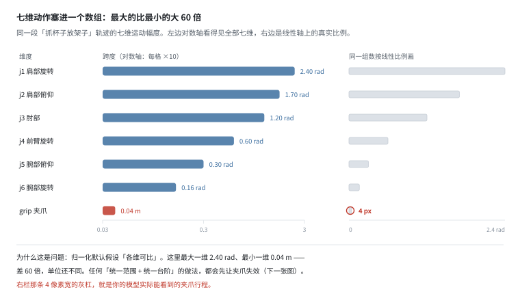
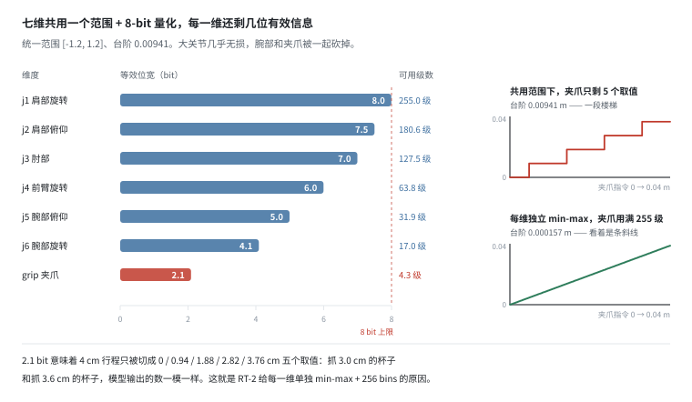
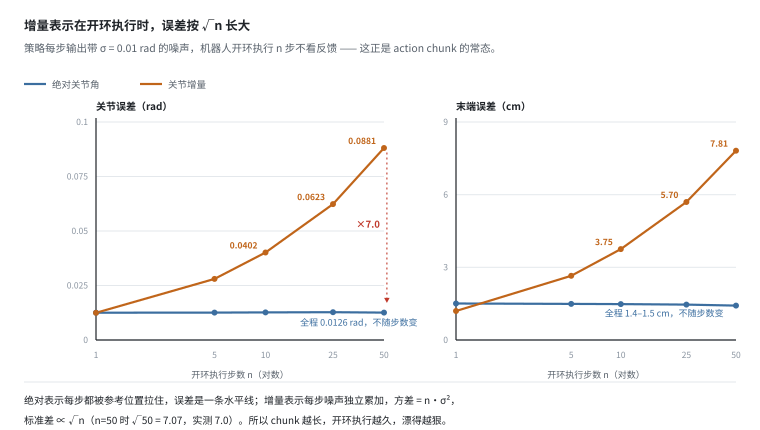
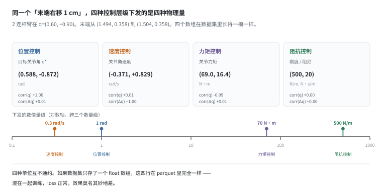
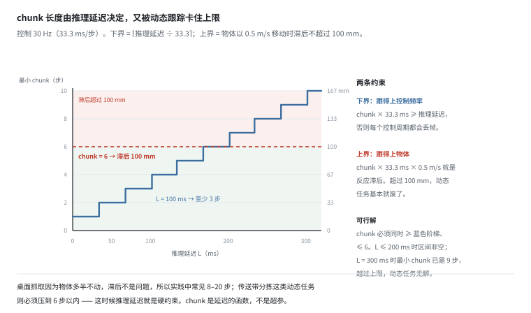
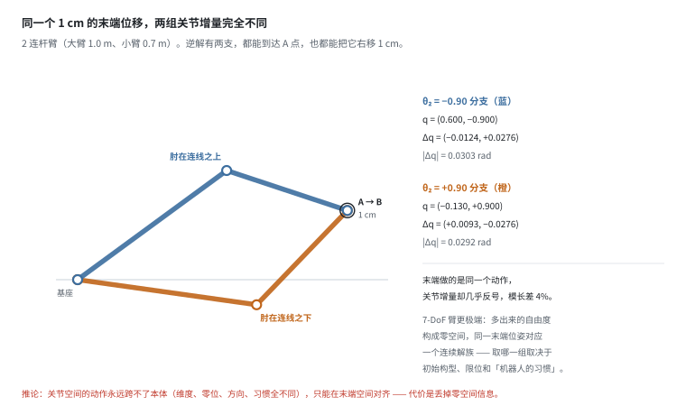

# 动作与状态：跨本体复用的真正卡点

> 阶段 2 · 传感器数据 ｜ 写作时间 2026-11
>
> 配套实验：[`examples/02_sensor_data/01_action_space.py`](../examples/02_sensor_data/01_action_space.py)

## 1. 它解决什么问题

前面五篇讲的都是**观测**。这一篇讲**动作**，它是数据里最特殊的一项，原因只有一句：

**观测错了，模型学到的是错的输入；动作错了，模型学到的是错的输出，而输出会被真的执行。**

一个归一化写错的图像，最多让模型看不清楚；一个归一化写错的夹爪指令，会让机械臂把玻璃杯捏碎。所以动作数据的 schema 比观测数据要求更高——它必须可执行、可复现、可跨本体解释。

动作向量的坑分三层，从浅到深：

| 层次 | 问题 | 症状 |
|---|---|---|
| 数值 | 7 维数组里混着弧度和米，量级差 60 倍 | 归一化后某一维彻底失效 |
| 语义 | 绝对还是增量？位置控制还是力矩控制？ | 换个控制器或换个本体就不能用 |
| 时间 | 一个动作是“一个时刻”还是“一段时间”？ | 训练和部署频率对不上，chunk 一改就要重切数据 |

这一篇把三层拆开。重点是第二、三层——它们是跨本体复用的真正卡点，也是我在 [07 章](../07-open-problems/) 里认为最难的问题。

## 2. 动作向量的解剖

一个 7-DoF 协作臂加平行夹爪，在“抓杯子放架子”这段任务里，各维的实际运动幅度：

```
  维度            单位      最小值    最大值     跨度    标准差
  j1 肩部旋转      rad   -1.2000   1.2000   2.4000   0.8485
  j2 肩部俯仰      rad   -0.8500   0.8500   1.6999   0.6002
  j3 肘部          rad   -0.6000   0.6000   1.1999   0.4262
  j4 前臂旋转      rad   -0.3000   0.3000   0.6000   0.2112
  j5 腕部俯仰      rad   -0.1500   0.1500   0.3000   0.1063
  j6 腕部旋转      rad   -0.0800   0.0800   0.1600   0.0582
  grip 夹爪        m      0.0000   0.0400   0.0400   0.0141
```

**最大跨度 2.400 rad，最小跨度 0.040 m，相差 60 倍，而且单位都不一样。**

这不是设计缺陷，是物理现实：肩关节要负责整条手臂的大范围摆位，腕关节只做末端姿态的微调，夹爪总共只有 4 厘米行程。



图里有两栏，画的是同一组数：

- **左栏是对数轴**，每格 ×10，七维都看得见；
- **右栏是线性轴**，按真实比例画——夹爪那一条只有 4 像素宽，等于看不见。

而你如果把这七维塞进“一个统一的归一化范围”，用的就是右栏这个比例。

### 换成增量，量级差异被压掉了

同一个任务，改存“相邻两步的差”：

```
  维度             增量标准差   占原跨度比例
  j1 肩部旋转       0.017741       0.74%
  j2 肩部俯仰       0.016235       0.96%
  j3 肘部           0.014677       1.22%
  j4 前臂旋转       0.009138       1.52%
  j5 腕部俯仰       0.005229       1.74%
  j6 腕部旋转       0.003138       1.96%
  grip 夹爪         0.000297       0.74%
```

所有维度都掉到原跨度的 1% 左右，量级差从 60 倍压缩到 5.7 倍（0.0177 / 0.0031）——一次性压掉一个数量级。

这是增量表示一个很容易被忽略的优点：**它天然对量纲不敏感**。因为差值抹掉了“这个关节本身有多大”这个信息——而那个信息恰恰是本体相关的。

代价在 §6，先说清楚：增量表示会漂。

## 3. 状态向量里该有什么

“状态”（state / proprioception）和“动作”是两回事，但在数据集里经常被塞进同一个数组，甚至被同一个归一化器处理。

一个 7-DoF 单臂的完整状态，通常长这样：

```
q[7]      关节角          必须
dq[7]     关节速度        需要
tau[7]    关节力矩/电流    建议
grip      夹爪开度        必须
pose      末端位姿        建议（由 FK 算出）
temp/enable  温度/使能    可选
```

逐项的理由：

| 项 | 是否需要 | 理由 |
|---|---|---|
| 关节角 | 必须 | 最基本的本体感知，其他一切都能从它推 |
| 关节速度 | 需要 | 判断动态、做速度前馈；差分算出来的速度噪声大得多 |
| 关节力矩/电流 | 建议 | 反映负载和接触，是最便宜的隐式力觉（见 [力/力矩](force-torque-tactile.md)） |
| 夹爪开度 | 必须 | 唯一能反映“抓到了没有”的量 |
| 末端位姿 | 建议 | 下游直接用，但它是推导量，不能替代关节角 |
| 温度/使能 | 可选 | 异常检测、数据清洗用 |

**关键原则：存原始测量，不要只存推导量。**

“存末端位姿而不存关节角”是明确的错误——末端位姿是关节角经正运动学算出来的，映射是多对一的（同一末端位姿对应无数组关节角），信息不可逆。反过来“关节角 + 末端位姿”都存是合理的：一个保证信息完整，一个方便下游，两者还能互相校验。

## 4. 归一化：三个必须避开的坑

归一化看起来是最机械的一步，但错的代价很大，而且**错得很安静**。

### 坑一：不分维度统一归一化

如果按“都是弧度”处理，七维共用一个 `[-1.2, 1.2]` 范围，再按 8-bit 量化，台阶 = 2.4/255 = 0.00941：

```
  维度            真实跨度   可用级数   等效位宽
  j1 肩部旋转      2.4000    255.0     8.0 bit
  j2 肩部俯仰      1.7000    180.6     7.5 bit
  j3 肘部          1.2000    127.5     7.0 bit
  j4 前臂旋转      0.6000     63.8     6.0 bit
  j5 腕部俯仰      0.3000     31.9     5.0 bit
  j6 腕部旋转      0.1600     17.0     4.1 bit
  grip 夹爪        0.0400      4.3     2.1 bit
```



**夹爪只剩 2.1 bit。** 整个 4 厘米行程被切成 5 个取值：0 / 0.94 / 1.88 / 2.82 / 3.76 cm。抓 3.0 cm 的杯子和抓 3.6 cm 的杯子，模型输出的数一模一样——它实际上退化成了一个开关。

这就是 RT-2 一类模型要给每一维单独 min-max 加 256 bins 的原因。不是多此一举，是不这么做夹爪就废了。

### 坑二：零方差维度

如果某个任务里腕部旋转全程没动（很常见，拧螺丝这种任务就不需要转腕）：

```
  span = 0.000000   std = 0.000000
```

归一化公式 `(x - min) / (max - min)` 分母为 0，结果要么直接崩，要么加了 `eps` 之后恒等于 0——这一维的信息彻底消失，而且不会报错。

**正确做法**：统计量里记录 `span`，当 `span < 阈值` 时改用固定物理范围，或者显式标记“该维在本数据集中恒定”，让下游知道这一维不该参与 loss。

### 坑三：训练集范围不覆盖部署范围

这是最隐蔽的一个。假设训练集里夹爪只见过 `[0.010, 0.035]` m（没抓过特别大的物体），部署时指令是 `0.040` m：

```
  裁剪后 0.035 m，损失 12% 行程
  表现：模型以为张到最大了，实际只张开 83%，抓不住。
```

**min-max 归一化的本质，是把训练集的统计量当作世界的边界。** 一旦部署超出这个边界，模型输出的动作会被静默裁剪——没有报错，没有警告，只有抓不住的杯子。

缓解办法：

- 用**固定的物理范围**（关节限位、夹爪最大开度），而不是训练集统计量
- 或在统计量上留 margin（通常 10–20%）
- 并且在数据集元数据里明确记录每一维用的是哪一种

## 5. 三种表示

同一个动作，至少可以写成三种东西：

| 表示 | 公式 | 物理含义 | 典型使用者 |
|---|---|---|---|
| 绝对关节角 | `a_t = q_t` | 此刻该处在什么姿态 | 大部分模仿学习数据集 |
| 关节增量 | `a_t = q_{t+1} - q_t` | 比上一刻多转多少 | action chunking、闭环策略 |
| 末端位移 | `a_t = p_{t+1} - p_t` | 手往哪走、走多少 | 遥操作、跨本体迁移 |

三者的取舍不是风格偏好，是结构性的：

**绝对关节角**——信息完整，单帧就能决定姿态，误差不累积。
缺点：绑定本体。7 维的绝对姿态换到 6 维的机器人上无法转换，甚至同一台机器换了零位定义就不能用。

**末端位移**——与本体无关（只要工作空间重叠），最接近“任务空间”。
缺点：丢掉了冗余自由度（同一末端轨迹对应无数组关节轨迹），而且执行时需要 IK。

**关节增量**——对本体差异鲁棒，换个机器人、初始位置不同也能用同样的增量。
缺点：误差累积（§6），且仍需知道初始绝对位置。

**现实中的选择**是折中：**动作头输出增量，但每 k 步用真实本体状态重新锚定。** k 通常等于一次 action chunk 的长度。锚定这一步把累积误差截断在 k 步之内——这正好是 §6 那张图要算的东西。

## 6. 增量为什么会漂

场景：策略每步输出带噪声（σ = 0.01 rad），机器人开环执行 n 步不看反馈。这就是 action chunk 的常态——chunk 内部是开环的。

```
  执行步数 n    绝对·关节    增量·关节    绝对·末端   增量·末端
        1      0.0125rad   0.0125rad    1.51cm    1.20cm
        5      0.0126rad   0.0280rad    1.49cm    2.65cm
       10      0.0126rad   0.0402rad    1.48cm    3.75cm
       25      0.0127rad   0.0623rad    1.46cm    5.70cm
       50      0.0126rad   0.0881rad    1.42cm    7.81cm
```



**n = 50 时，增量表示的关节误差是绝对表示的 7.0 倍**——理论值 √50 = 7.07，吻合。

原因就是随机游走。绝对表示每一步都是“重新说一遍目标在哪”，噪声不累积；增量表示每一步是“在上一步的基础上再走一点”，噪声按平方和累积：

```
  方差:  n · σ²      标准差:  √n · σ
```

看图能注意到两件事：

1. 蓝线（绝对）是一条**水平线**，从头到尾 0.0126 rad，不随 n 变化；
2. 橙线（增量）在**对数横轴**上看起来近似直线——因为 log(√n) = ½·log(n)，在对数坐标下就是斜率 ½ 的直线。

右图把同样两组误差换算成末端厘米，形状完全一致——关节上的漂移会直接变成手上的漂移，7.8 cm 在抓取任务里已经是抓空和抓住的区别。

**这不是说绝对表示更好。** 绝对表示要求模型输出精确的全局姿态，而这个要求本身在跨本体场景下就不成立。真实系统的做法是：增量输出 + 每 k 步重锚定，用 k 把漂移截断在可接受范围内。

所以 chunk 长度不是一个可以随便调的整数，它决定了误差的上限。

## 7. 控制层级：同一个动作，四种物理量

这是比维度更根本的问题，也是跨本体最硬的一层。

同一件事——“末端右移 1 cm”——在四种控制方式下，下发的 action 是完全不同的物理量：

```
  末端从 (1.494, 0.358) 到 (1.504, 0.358)：关节需要转 Δq = (-0.0124, +0.0276) rad

  位置控制    目标关节角 q*      rad         (0.588, -0.872)       量级 ≈1
  速度控制    关节角速度         rad/s       (-0.371, +0.829)      量级 ≈0.3
  力矩控制    关节力矩          N·m         (69.0, 16.4)          量级 ≈70
  阻抗控制    刚度/阻尼         N/m, N·s/m  (500, 20)             量级 ≈500
```



**从 0.3 到 500，跨三个数量级，四种单位互不通约。** 而这四行在 parquet 里长得完全一样：都是 7 个 float。

把它们混在一起训练，会发生什么？loss 会正常下降，模型会学会“输出一个 7 维向量”，然后在真机上做出莫名其妙的事：同一段视觉输入，一半数据说“往这儿动”（目标角 0.588），一半数据说“在这儿使 69 N·m 的劲”（力矩），两个值差 100 倍，而且方向还反着（corr = −0.99）。网络只能学到一个折中，而折中的结果既不是位姿，也不是力矩。

### 能不能从数据里反推控制模式？

一个自然的想法：看 action 和 state 的相关性。

```
  控制层级      corr(action, q)   corr(action, Δq)
  位置控制            1.00            0.01
  速度控制            0.01            1.00
  力矩控制           -0.99            0.01
  阻抗控制            0.00            0.00
```

结论很扫兴：

- 位置控制和力矩控制的 |corr| 都在 1 附近（−0.99 是因为这段轨迹里 q 在 0.2~1.0，cos(q) 近似线性），**绝对值分不出谁是谁**，只有符号能提供一点线索；
- 符号却取决于重力方向、零位定义这些外部约定，换个安装姿态就翻过来了；
- 阻抗控制是常数，方差为 0，相关系数无定义，一点信息都读不出来。

**所以“从数据反推控制模式”只能猜，不能作为可靠依据。唯一可靠的做法是：采集时就把 `control_mode` 写进元数据。**

顺带一句：阻抗控制这类“输出的是参数而不是位姿”的动作，连“动作是什么”这个定义都变了。它的执行结果依赖环境和接触，同一段 action 在空载和接触时走出的轨迹完全不同——这类数据如果不带上下文，几乎无法复用。

## 8. chunk 长度不是超参

action chunking 的做法是：模型一次输出 k 步动作，机器人开环执行 k 步，然后重新推理。

k 该取多少？很多论文把它当成超参调。其实它是由两个物理量夹出来的：

```
  控制频率 30 Hz（33.3 ms/步）

  推理延迟 L    chunk=1 的实际控制频率   需要的最小 chunk
      10 ms            30.0 Hz              1
      20 ms            30.0 Hz              1
      50 ms            20.0 Hz              2
     100 ms            10.0 Hz              3
     300 ms             3.3 Hz              9
```

**下界**：chunk × 33.3 ms 必须 ≥ 推理延迟，否则每个控制周期都要推理一次，推理跟不上控制，实际控制频率就会掉下来（100 ms 的模型只能跑 10 Hz，而不是 30 Hz）。

**上界**：chunk 越长，两次重规划之间的间隔越长，对运动物体的反应越滞后。物体以 0.5 m/s 移动时：

```
  chunk 长度    重规划周期    物体 0.5 m/s 时的滞后
       1          33 ms              17 mm
       2          67 ms              33 mm
       5         167 ms              83 mm
      10         333 ms             167 mm
      20         667 ms             333 mm
```



把两条约束画在一起：**chunk 必须 ≥ 蓝色阶梯，且 ≤ 6**（6 步 = 200 ms = 100 mm 滞后）。L ≤ 200 ms 时这个区间非空；L = 300 ms 时下界已经到 9 步，越过了上界，动态任务无解。

这解释了为什么实践中常见 8–20 步：桌面抓取的物体多半不动，滞后不是问题，上界很松；而传送带分拣、接球这类动态任务必须压到 6 步以内，此时推理延迟就是硬约束，慢模型直接出局。

**结论：chunk 长度是推理延迟和控制频率的函数，不是调出来的。** 所以它属于数据 schema：数据按 20 步切分，训练时想改成 10 步，等于把数据重新切一遍，不能只改个参数。

## 9. 跨本体：为什么关节空间的数据过不去

先看一个最小的例子。2 连杆臂（大臂 1.0 m、小臂 0.7 m），末端在 A 点，要右移 1 cm。



同一个 A 点，逆解有两支：

```
  构型                    起点 q                 终点 q                   Δq
  th2<0（肘在连线之上）  (+0.600,-0.900)   (+0.588,-0.872)   (-0.0124,+0.0276)
  th2>0（肘在连线之下）  (-0.130,+0.900)   (-0.121,+0.872)   (+0.0093,-0.0276)
```

末端做的是同一个 1 cm 的动作：

- 关节增量几乎**反号**；
- 模长 0.0303 rad vs 0.0292 rad，差 4%。

也就是说：**即使本体完全相同，只要初始构型不同，“同一个动作”在关节空间里就是不同的数组。** 而“取哪一支”取决于上一时刻的姿态、关节限位、以及控制器的习惯——这一层信息在末端位移里完全丢失了。

真实 7-DoF 臂比这更极端：多出来的自由度构成**零空间**，同一末端位姿对应一个连续的解族，不是两支而是无穷多组。

推论有三条：

1. **关节空间的动作数据永远跨不了本体。** 维度、零位、旋转方向、“姿态习惯”，每一层都不一样。
2. **只能在末端空间对齐。** 这是 Open X-Embodiment / RT-X 的选择：统一到“末端位姿增量 + 夹爪开度”，把关节角留给本体状态。跨本体时只需 IK，不需要维度对齐。
3. **代价是丢掉了零空间信息。** 同一末端轨迹有多组关节解，机器人原本的“姿态习惯”（比如肘部朝外以避开障碍）在末端表示里消失了。这是一个有意识的取舍：**牺牲单本体的最优性，换取跨本体的可聚合性。**

顺带一个常被忽略的坑：末端空间对齐要求两个本体的**工作空间重叠**。桌面 6-DoF 臂和 2 米高的人形，末端动作的数值范围差一个量级，归一化之后依然对不齐。

## 10. 和数据平台有什么关系

五条，按重要性排：

1. **action 必须存每一维的物理含义和单位**，不能只存一个 float 数组。schema 里至少要有 `names`、`units`、`control_mode` 三个字段。缺了 `control_mode`，这批数据就只能和同控制模式的数据混。

2. **归一化统计量是数据集的一部分**，要和数据一起版本化。训练时用错统计量，比没有统计量更糟——后者会报错，前者会静默退化。

3. **数据集必须记录 action 是绝对还是增量。** 这两种表示在数值上只差一次积分，在语义上是两回事。混着训练等于让模型同时学“位置”和“位移”。

4. **chunk 长度是 schema，不是超参。** 数据按 20 步切分，训练时要 10 步就得重切。把 chunk 长度写进元数据，下游才能判断这批数据能不能用于自己的控制频率。

5. **状态存原始测量，不要只存推导量。** 关节角必须存；末端位姿可以额外存，但不能替代。

> **反例的形状**：一个只有 float 数组的数据集，在平台上看起来是“能用”的——维度对得上、没有 NaN、loss 能降。但任何一个“换本体 / 换控制器 / 改控制频率”的需求，都会让它立刻作废，而且是在训练跑完之后才发现。

## 11. 自己跑一遍

```bash
python examples/02_sensor_data/01_action_space.py
```

六个部分，对应上面六张图：

| 输出 | 对应 |
|---|---|
| `[1]` 七维量级差异 | §2 |
| `[2]` 归一化三个坑 | §4 |
| `[3]` 增量误差累积 | §6 |
| `[4]` 四种控制层级 | §7 |
| `[5]` chunk vs 延迟 | §8 |
| `[6]` 逆解两支 | §9 |

有几处值得改参数自己试：

- `part2` 里把统一范围从 `[-1.2, 1.2]` 缩到 `[-0.1, 0.1]`：夹爪的等效位宽会从 2.1 bit 升到 5.7 bit，但 j1~j5 全部冲出范围被裁剪。**统一范围无论怎么设都不对**——要装下最大的关节，就必然牺牲最小的那一维；
- `drift_table(n_list=(100, 200))`，看增量误差是否还按 √n 长：200 步得到 0.176 rad（10.1°），是绝对表示的 14.0 倍，√200 = 14.14；
- `part5` 里把 `ctrl_hz` 从 30 改成 100：最小 chunk 变成 `ceil(L/10)`，100 ms 的模型需要 10 步——控制频率越高，同样的延迟要覆盖的步数越多。

---

上一篇：[时间同步](time-sync.md) ｜ 下一章：[数据流水线](../03-data-pipeline/)
