# RGB 与深度：一台相机输出的到底是什么

> 阶段 2 · 传感器数据 ｜ 写作时间 2026-11
>
> 配套实验：[`examples/02_sensor_data/02_camera_model.py`](../examples/02_sensor_data/02_camera_model.py)
>
> 建议先读：[`coordinate-frames.md`](../01-robotics-primer/coordinate-frames.md)（四乘四矩阵怎么用）

## 1. 它解决什么问题

机器人数据集里 95% 的体积是图像。但"存了图像"和"存了可用的图像"是两件事。

相机不会给你三维点，它给你两张二维数组：一张存颜色，一张存距离。要把这两张数组变成"机器人手该往哪儿走"，中间要过五道换算，每一道都可能悄悄错：

| 缺什么 | 会发生什么 | 会不会报错 |
|---|---|---|
| 内参 | 像素还原不成三维点，深度图变废纸 | 不会 |
| 畸变系数 | 画面边缘整体偏移，越靠边越离谱 | 不会 |
| 深度单位 | 不知道 1000 是 1 米还是 1 毫米 | 不会 |
| 外参（相机到末端／基座） | 点云和机器人对不上，抓取系统性偏 | 不会 |
| 时间戳来源 | 多传感器对齐全靠猜 | 不会 |

这张表的共同点不是"五个参数"，而是**全部静默**。你会在三个月后发现模型在真机上总是偏 2 厘米，然后花两周去查一个本该在采集时存下来的数字。

这一篇的主线是一条因果链：

> **相机给两张数组 → 想变成三维点，必须过针孔模型（除一个 Z）→ 但真实镜头不是针孔，要先纠畸变 → 而那个 Z 不是算出来的，是某种物理原理测出来的，每种原理都有自己的失效场景 → 测出来的 Z 精度随距离平方变差 → 有了内参和外参才有点云 → 而这一切还都有个时间维度 → 最后才轮到"怎么存"**

每一节都接着上一节的问题。走完这一遍，上面那张表里的每一项你都会知道它是从哪儿冒出来的。

## 2. 一台 RGB-D 相机，一次吐出两张数组

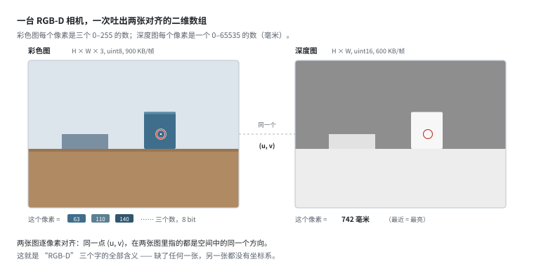

一台 RGB-D 相机（D435、Kinect、RealSense 这一类）每帧输出两样东西：

```
彩色图    H × W × 3   uint8     640×480 时 900 KB/帧
深度图    H × W       uint16    640×480 时 600 KB/帧
```

一帧 1.54 MB，30 fps 就是 46 MB/s —— 这个数字先记住，第 11 节会用到。

**它们最大的价值是"逐像素对齐"**：同一个 `(u, v)`，在彩色图里是杯子的把手，在深度图里就是那个把手的距离。有了这件事，"这个像素是什么颜色"和"这个像素有多远"才能拼成"这个三维点是什么颜色"。

如果两台相机不是同一个模组（比如外挂一个普通摄像头），这个对齐就得自己做：先按外参把深度图重投影到彩色图的视角上。这一步叫 **depth-to-color alignment**，D435 的 SDK 里是一个开关。开关关掉，你拿到的两张图看起来都正常，但像素对不上 —— 又是静默错误。

### 位深不是"精度"，是量程

`uint8` 每通道 0–255。新手容易把它理解成"颜色不够准"，其实它是**动态范围只有约 48 dB**：同一张图里既有背光的黑猫又有窗外的天空，8 bit 装不下，要么猫糊成一片，要么窗外全白。HDR 传感器就是为了这个，代价是每通道 2 字节起。

深度图的 `uint16` 更微妙：**单位是毫米，所以量程是 0–65.5 米，而量化台阶固定 1 毫米**。这意味着相对误差不是常数：

- 0.3 米处，1 毫米是 0.33%
- 5 米处，1 毫米是 0.02%

所以量化从来不是深度的瓶颈 —— 真正的误差来自测量过程本身，第 7 节会算给你看。

### 无效深度：0 还是 65535？

深度图上一定有大片"没有值"的区域（玻璃、镜面、黑色物体、超量程）。不同的设备／SDK 用不同的哨兵值表示它们：

- `0`（最常见，OpenNI 系）
- `65535`（把 uint16 当无符号最大值用）
- `NaN`（float 格式时）

**这件事必须查文档，不能猜。** 猜错的后果是：一片"0 米"的墙出现在点云里，而你以为那是贴着镜头的东西。

## 3. 针孔模型：为什么公式里要除以 Z

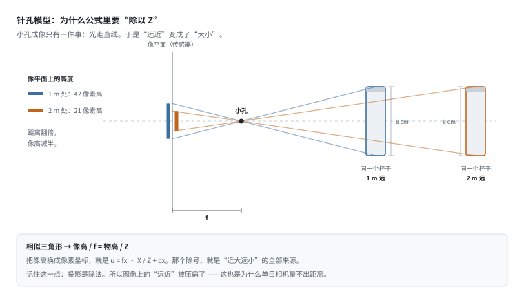

小孔成像只有一条物理规律：**光走直线**。

于是"远近"就变成了"大小"：同一个 8 厘米的杯子，1 米处占 42 个像素高，2 米处只占 21 个。原因是一组相似三角形 ——

```
像高 / f  =  物高 / Z
```

把它换成像素坐标，就得到整个计算机视觉里最基础的一行公式：

```
u = fx · X / Z + cx
v = fy · Y / Z + cy
```

反投影（像素 + 深度 → 三维点）：

```
X = (u - cx) · Z / fx
Y = (v - cy) · Z / fy
Z = Z          ← 这个 Z 是传感器测的，不是算出来的
```

**最后一行是理解后面所有问题的钥匙。** 反投影本身是纯代数、完全无损（实验里往返误差在 1e-16 量级），但它有个前提：你得先有 Z。而 Z 是测出来的。所以"像素 → 三维点"的精度，百分之百由深度精度决定。

还有个更本质的推论：**单目相机永远量不出距离**。因为投影是除法，一个三维点沿射线移动时，它的 `(u, v)` 完全不变 —— 无穷多个三维点对应同一个像素，图像里没有信息能区分它们。深度相机之所以能测距，是因为它多了"第二个视角"或"一束光的时间"，那是额外的物理信息，不是从这张图里算出来的。

### 两个"y 朝下"的约定

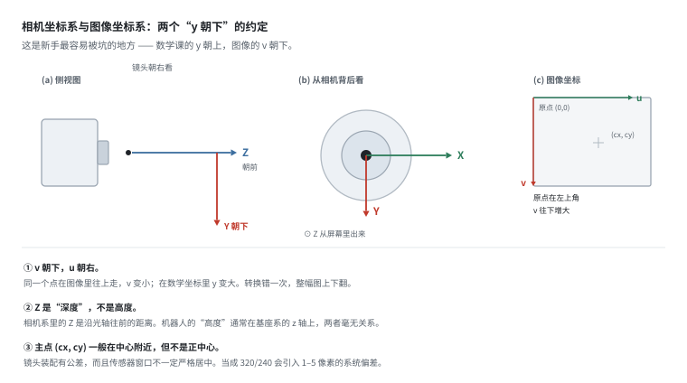

新手最容易栽在这儿。有三件事和数学课的习惯相反：

**① 图像坐标的 v 朝下。** 原点在左上角，`u` 向右，`v` 向下。所以"物体在图像里往上走"，对应的是 `v` 变小。

**② 相机坐标系的 Y 朝下、Z 朝前。** 这是 OpenCV 的约定（也是绝大多数 SDK 的约定）：`Z` 是沿光轴往前的距离，`X` 向右，`Y` 向下，构成右手系。机械臂基座系的 `z` 通常是"向上"，两者毫无关系 —— 把相机系的 `Z` 当成"高度"是经典错误。

**③ 主点 `(cx, cy)` 一般不在正中心。** 镜头装配有公差，传感器窗口也不一定严格居中。当成 `320/240` 会让所有点引入 1–5 像素的系统偏差 —— 在 1 米处就是 2–10 毫米，抓小物体时够呛。

> 一句话记住：**图像的 y 向下，相机的 Z 向前。** 这两个方向搞反，点云会上下颠倒或左右镜像，而图看起来完全正常。

## 4. 内参：四个数，各管什么

内参就四个数：

```
fx, fy    焦距，单位是"像素"
cx, cy    主点，光轴打在图像上的位置
```

### 为什么焦距的单位是像素

物理上焦距是毫米（镜片到传感器的距离），但公式里用的是"像素"。两者的换算只差一个数：**像元尺寸**。

```
fx[pixel] = f[mm] / pixel_pitch[mm]
```

一个 3.45 μm 像元、4.3 mm 焦距的模组：`fx = 4.3 / 0.00345 ≈ 1246`。所以"焦距 525 像素"不是在说镜片，而是在说"这个镜头在这个传感器上，把多少角度摊到了一个像素上"。这个说法更本质 —— 也是下一节 GSD 的来源。

### 焦距 = 视场，是一个取舍

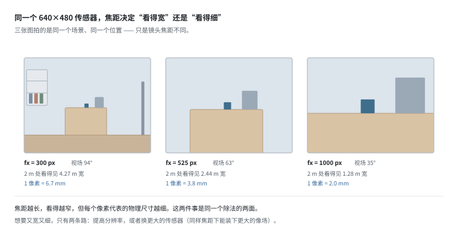

同一个 640×480 传感器，只用换焦距：

| fx | 水平视场 | 2 m 处看得见多宽 | 1 像素多大 |
|---|---|---|---|
| 300 px | 94° | 4.27 m | 6.7 mm |
| 525 px | 63° | 2.44 m | 3.8 mm |
| 1000 px | 35° | 1.28 m | 2.0 mm |

**看得宽和看得细，是同一件事的两面。** 想要又宽又细，只有两条路：提高分辨率，或者换更大的传感器（同样焦距下能装下更大的像场）。这就是为什么工业检测用高分辨率相机配长焦，而 SLAM 用广角配低分辨率 —— 任务要的东西不一样。

D435 这一类深度相机是 `fx ≈ 525`、`cx, cy = 320, 240`（640×480），对应水平 62.7°、垂直 49.1°，接近人眼单眼的感受。

### 像素是角度单位，不是长度单位

这是全篇最该记住的一句话。

```
1 个像素 = Z / fx      （单位：米）
```

随距离**线性**增长：

```
   距离 z    1 像素 =    整幅画面宽     每平米需要多少像素
   0.3 m     0.57 mm      0.366 m        306 万
   0.5 m     0.95 mm      0.610 m        110 万
   1.0 m     1.90 mm      1.219 m         27.6 万
   3.0 m     5.71 mm      3.657 m          3.1 万
   5.0 m     9.52 mm      6.095 m          1.1 万
```

所以"这个模型定位精度 5 像素"这句话本身没有意义，必须加上距离。同一个 5 像素误差：

- 0.5 米处是 **4.8 毫米** —— 抓取任务完全够用
- 3 米处是 **28.6 毫米** —— 已经超过大部分物体的尺寸

距离差 10 倍，同一个像素代表的**面积**差 100 倍。也就是说"分辨率"在空间上根本不均匀：1 米处画面覆盖 1.1 平方米、每平米 27.6 万像素；3 米处覆盖 10 平方米、每平米只有 3 万像素。

**推论**：同一个模型在近处和远处表现差好几倍，往往不是模型的问题，是任务本身的空间精度需求变了。评估时按距离分层报指标，比报一个平均值有用得多。

### 内参矩阵，以及为什么第三行是 0 0 1

工程上内参写成 3×3 矩阵：

```
      ⎡ fx   0   cx ⎤
K  =  ⎢  0  fy   cy ⎥
      ⎣  0   0    1 ⎦
```

第三行 `[0 0 1]` 是为了能用一次矩阵乘法同时完成"除以 Z"这件事。左乘 `(X, Y, Z, 1)` 得到的是齐次坐标 `(fx·X + cx·Z, fy·Y + cy·Z, Z)`，再除以第三个数就回到像素。所以 K 的第三行不是凑数的，它承担的就是那个除法。

`fx ≠ fy` 的情况通常来自非方形像元，或者出厂裁切过画面。两者的差值一般不大，但它不一定为零 —— 强行设成相等会引入一个固定的比例偏差。

### 分辨率变了，内参必须跟着变

这一点新手几乎都踩过。"同一台相机换个分辨率，内参不变吧？" —— 不对。内参是按像素算的：

| 分辨率 | fx | cx | 视场 |
|---|---|---|---|
| 640×480 | 525.0 | 320.0 | 62.7° |
| 320×240 | 262.5 | 160.0 | 62.7° |
| 160×120 | 131.2 | 80.0 | 62.7° |

规律：`fx, cx, cy` 全部按同一比例缩放，视场角不变。

这直接解释了"把图缩到 224×224 喂给模型"的代价：224 宽的图上 1 个像素 = 2.9 个原始像素，1 米处就是 5.4 毫米。如果你的任务需要毫米级精度，输入分辨率本身就是瓶颈，换更大的模型救不回来。

## 5. 畸变：为什么直线拍出来是弯的

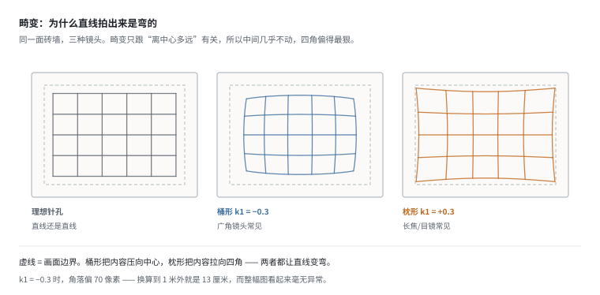

真实的镜头不是针孔。光线穿过镜片边缘时折得比中心多，于是"像点到中心的距离"会被非线性地缩放：

```
r_distorted = r · (1 + k1·r² + k2·r⁴)        r 是归一化像距
```

`k1 < 0` 是桶形（广角镜头常见），`k1 > 0` 是枕形。因为这是 `r` 的函数，**画面中心几乎不动，四个角偏得最狠**。

取一个典型广角镜头的 `k1 = -0.3`：

| 位置 | 归一化半径 | 畸变后偏移 | 1 m 处折合 |
|---|---|---|---|
| 画面中心 | 0.00 | 0 px | 0 mm |
| 下边中点 | 0.46 | 15 px | 29 mm |
| 右边中点 | 0.61 | 36 px | 68 mm |
| 右下角 | 0.76 | **70 px** | **133 mm** |

角落偏 70 像素听起来还行？**换算到 1 米外就是 13 厘米。** 抓一个 8 厘米的杯子，你会抓在空气上。

而且这张图看起来毫无异常：整个画面被平滑地拉伸，没有任何突兀的地方，只有拿直尺去量才发现直线弯了。这就是畸变最讨厌的地方 —— 它不像"模糊"或"过曝"那样一眼可见。

**去畸变没有解析逆**，工程上用不动点迭代逼近（实验里迭代 30 次，往返残差 3e-10 像素，完全可逆）。但前提是 `k1` 对。

**结论：内参和畸变系数必须成对存。** 只存 `fx/fy/cx/cy` 是不够的 —— 你拿到一张边缘有点弯的图，永远算不回正确的三维点。

> 一个实用判据：如果数据里能看到**长直边缘**（桌沿、门框、地砖缝），把它们拉直所需的角度就是畸变参数的粗略检验。如果没有直边，畸变错了你也看不出来。

## 6. 深度是怎么"测"出来的

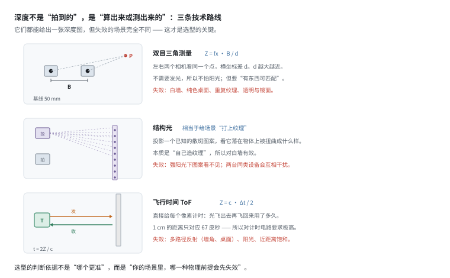

前面一直在说"Z 是测出来的"。怎么测？三条路线，物理原理完全不同，**失效场景也完全不同**。

### 6.1 双目三角测量：靠"视差"

两个相机隔一段距离（基线 B），同时看一个点。这个点在两张图上会落在不同的横坐标，差值叫**视差 d**。相似三角形给出：

```
Z = fx · B / d
```

不需要发光，所以不怕阳光；但需要"有东西可匹配"。**白墙、纯色桌面、重复纹理，都会让它失效** —— 这不是算法不好，是信息本身不存在。

### 6.2 结构光：自己造纹理

投影一个已知的图案（散斑、条纹、编码光），看它落在物体表面被扭曲成什么样。本质上是用投影仪"给场景打上纹理"，然后跑同一套三角测量。

所以它对白墙有效 —— 纹理是自己造的。代价是：强阳光下图案看不见（信噪比不够），两台同类设备同时开机会互相干扰（各自看到对方的图案）。

### 6.3 飞行时间（ToF）：直接计时

给每个像素计时：光飞出去再飞回来用了多久。

```
Z = c · Δt / 2
```

`c` 是光速。算一下量级：**1 厘米的距离只对应 67 皮秒**（1e-10 秒）。所以 ToF 的瓶颈从来不是光学，是计时电路和调制解调的精度。

失效场景也很特别：多路径反射（墙角、桌面这种"光弹两次才回来"的地方会算成更远）、阳光（环境光淹没了微弱的回波）、近距离饱和。

### 6.4 怎么选

判断依据不是"哪个更准"，而是**你的场景里，哪一种物理前提会先失效**：

| | 怕什么 | 擅长什么 |
|---|---|---|
| 双目 | 无纹理、重复纹理、弱光 | 室外、远距离、被动（不发光） |
| 结构光 | 强光、互相干扰、透明/镜面 | 近距离高精度、白墙、暗光 |
| ToF | 多路径、阳光、近处饱和 | 中距离、帧率高、体积小 |

**三类都怕的东西**：透明（玻璃、水面）、镜面（抛光金属）、吸光（黑色绒布、深色头发）。这三种情况下深度值是"没有"，不是"很远" —— 回到第 2 节那个"0 还是 65535"的问题。

## 7. 深度精度：为什么是"距离的平方"

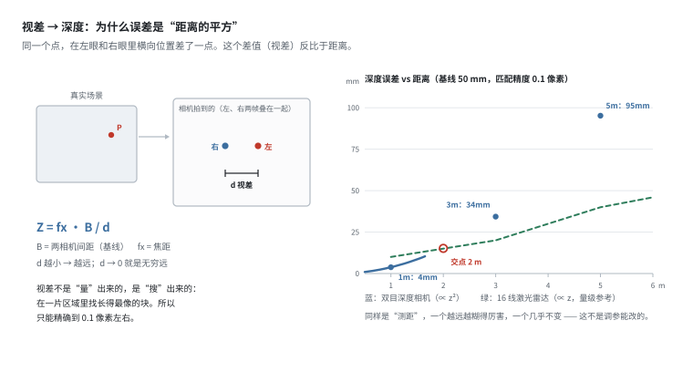

上一节的公式 `Z = fx·B/d` 里，`d` 是从图像上"搜"出来的：在一片区域里找"长得最像"的块。所以 `d` 永远有误差，通常能精确到 0.1 个像素左右。

把这个误差传下去（对 `d` 求导）：

```
σ_z  =  z² / (fx · B)  ·  σ_d
```

**误差正比于 z²。** 距离翻倍，误差变 4 倍。这不是这个型号不行，是几何决定的。

| 距离 | 视差 d | 视差**错 1 像素** → 深度差 |
|---|---|---|
| 0.3 m | 87.5 px | 3 mm |
| 0.5 m | 52.5 px | 10 mm |
| 1.0 m | 26.2 px | 38 mm |
| 2.0 m | 13.1 px | 152 mm |
| 3.0 m | 8.8 px | 343 mm |
| 5.0 m | 5.2 px | 952 mm |

注意最右列有多吓人：**3 米处视差匹配错 1 个像素，深度就错 34 厘米。**

换成更实际的 0.1 像素匹配精度：

| 距离 | 双目深度相机 | 16 线激光雷达（量级参考） |
|---|---|---|
| 1 m | 4 mm | 约 10 mm |
| 3 m | 34 mm | 约 20 mm |
| 5 m | 95 mm | 约 40 mm |
| 8 m | 244 mm | 约 60 mm |

两条误差曲线的**交点大约在 2 米**：2 米以内深度相机更细，以外激光雷达更稳。

这就是为什么抓取用深度相机、建图用激光雷达 —— 不是谁更先进，是**它们的误差随距离增长的方式不同**（平方 vs 近似线性）。ToF 走的是另一条路，`σ_z` 大致正比于 z（不是 z²），所以远处反而比双目好，近处却有饱和问题。

**实践结论**：深度相机是"近距仪器"。0.3–1.5 米是它的甜区，超过 3 米基本只能当"有没有东西"用，不能当"东西在哪"用。把 5 米外的深度数据喂给抓取模型，等于喂噪声。

## 8. 深度图上一定会出现的三种"假点"

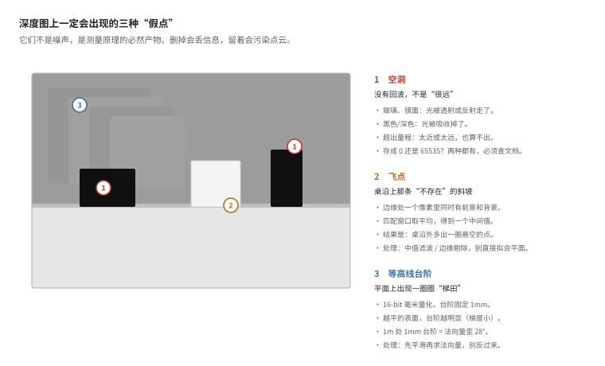

即使一切正常，深度图上也会稳定出现三类"不存在的点"。它们不是噪声，是测量原理的必然产物。

**① 空洞（invalid）** —— 没有回波，不是"很远"。

玻璃、镜面把光透射或反射走了；黑色把光吸收掉了；超出量程（太近或太远）也算不出来。结果是深度图上一片 0。**必须标记，不能填 0** —— 填 0 等于在镜头前面放了一个物体。

**② 飞点（flying pixels）** —— 桌沿上那条"不存在"的斜坡。

边缘处一个像素里同时有前景和背景。匹配窗口（3×3 或 5×5）取平均，得到一个中间值。于是桌沿外多出一圈悬空的点，看起来像物体边缘"融化"了。处理方式是中值滤波或边缘剔除 —— 但**不要在有意义的边缘上做**，那会把真实的锐利边缘也磨掉。

**③ 等高线台阶** —— 平面上出现一圈圈"梯田"。

第 2 节说过量化台阶固定 1 毫米。但台阶在图像上是否可见，取决于一个像素跨了多少深度：

```
dz/dpx = tan(倾角) × GSD(z)
```

**越平的表面，台阶越明显。** 对着墙（倾角接近 0°）拍，墙上会出现等高线；对着 30° 以上的斜面拍，反而很平滑，因为斜面一个像素跨越的深度本来就超过 1 毫米，量化误差被信号梯度盖住了。

这不只是"看起来不好看"。算一下它对法向量的影响：

| 距离 | 相邻像素间距 | 1 mm 台阶看起来是多大的倾角 |
|---|---|---|
| 0.5 m | 0.95 mm | 46° |
| 1.0 m | 1.90 mm | **28°** |
| 3.0 m | 5.71 mm | 10° |

1 米处，一堵完全平的墙上，相邻像素的深度差只要被量化成 1 毫米，求出来的法向量就歪了 28°。这就是为什么点云处理的第一步总是平滑或离群点滤波，而不是直接算法向量。

### 深度图还是点云？其实是同一份数据

把每个像素反投影，`H×W` 的深度图就变成了 `H×W×3` 的点云。这两者不是两种数据，是**两种视角**：

- 当你要做图像处理（检测、分割、学习），用深度图：它是网格，卷积核顺手。
- 当你要做几何计算（法向量、配准、碰撞检测），用点云：`(x, y, z)` 直接。

关键区别在于：**这个点云是有序的**。它保留了 `(u, v)` 的网格结构，所以"相邻像素"仍然有意义。激光雷达的点云是无序的，没有这个结构 —— 这是第 4 篇要讲的区别。

## 9. 外参：相机装在哪，决定了标定要解什么

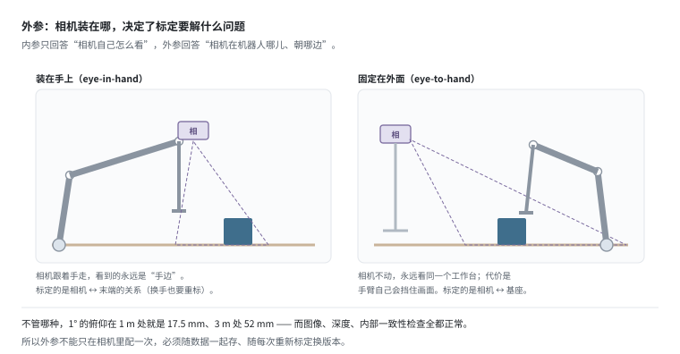

内参只回答"相机自己怎么看"，外参回答"相机在机器人哪儿、朝哪边"。

两种安装方式，标定的问题和数据的性格都不一样：

- **装在手上（eye-in-hand）**：相机跟着手走，看到的永远是"手边"。好处是分辨率用在关键处，坏处是每动一下视角就变，而且标定的关系是"相机 ↔ 末端"，换手也要重标。
- **固定在外面（eye-to-hand）**：相机不动，整个工作台永远在同一个画面里（这对学习类方法特别友好 —— 背景稳定）。坏处是手臂自己会挡住画面。

### 两类旋转，后果完全不同

外参是个 4×4 变换，但六个数的重要性差得很远：

- **绕光轴滚转（roll）**：整幅图旋转，深度分布不变 → 可以用一个旋转矩阵事后纠正，危害小。
- **绕 x/y 轴俯仰（pitch/yaw）**：所有点的位置整体平移，**且随深度线性放大**。

| 俯仰角 | 0.5 m 处 | 1 m 处 | 3 m 处 | 5 m 处 |
|---|---|---|---|---|
| 0.5° | 4.4 mm | 8.7 mm | 26.2 mm | 43.6 mm |
| **1.0°** | **8.7 mm** | **17.5 mm** | **52.4 mm** | **87.3 mm** |
| 2.0° | 17.5 mm | 34.9 mm | 104.8 mm | 174.6 mm |

1° 的俯仰，在 1 米处让**所有**点整体偏移 17.5 毫米（9.2 像素），3 米处放大到 52 毫米。在抓取任务里，17 毫米意味着你以为手在杯口上方，实际偏了半个杯口。

### 最麻烦的一点：无法自查

这个误差在数据里看不出来：

- 图像完全正常（只是整体平移了 17 毫米，没有畸变，人眼看不出来）
- 深度值完全正常
- 所有内部一致性检查都通过
- 只有把点云和机器人基座对齐时，才会发现系统性错位

**所以标定流程必须独立验证**：放一个标定板在已知位置，检查重建出来的点云和真值差多少。不能靠"看起来没问题"。

也正因此，**标定文件必须是数据集的元数据，不是相机的一份本地配置**。换了一台机器、重新标定过一次，历史数据的语义就变了 —— 如果标定参数没随数据存，那批数据就再也无法正确使用。具体怎么组织标定版本，见 [`calibration.md`](../03-data-pipeline/calibration.md)。

## 10. 时间：卷帘快门

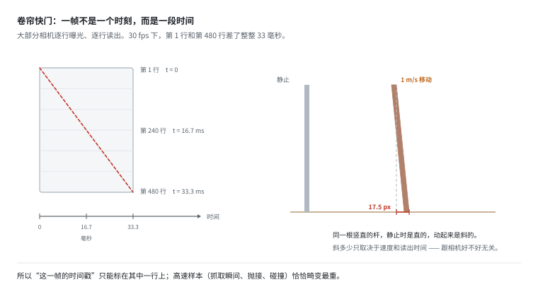

大多数消费级相机是**逐行**读出的：第 1 行先曝光读数，第 480 行最后读。30 fps 下，第 1 行和第 480 行相差整整 33 毫秒 —— 一帧内部就有 33 毫秒的时间跨度。

```
   横向运动速度   33.3 ms 内的位移   1 m 处折合像素
     0.1 m/s          3.3 mm            1.8 px
     0.5 m/s         16.7 mm            8.8 px
     1.0 m/s         33.3 mm           17.5 px
     2.0 m/s         66.7 mm           35.0 px
```

1 m/s 是机械臂典型的末端速度。这时一根竖直的杆子会被拍成倾斜约 18 像素 —— 在 640 宽的图里肉眼看得出。

**为什么这对数据平台重要：**

- "一帧 = 一个时刻"这个假设失效了。一帧是一条斜线，每行时刻都不同。
- 快速运动的样本（抓取瞬间、抛接、碰撞）畸变最严重 —— 而这些恰是最有价值的样本。
- 缓解手段有三条：全局快门相机（贵 3–5 倍）、提高帧率（缩短读出时间）、用 IMU 做逐行去畸变。

第三条是主流做法（VIO 里叫 rolling shutter correction），但它有个硬前提：**IMU 和相机必须硬件同步**，否则你不知道每一行对应哪个 IMU 采样。这又回到时间戳问题，见 [`time-sync.md`](time-sync.md)。

## 11. 存储：为什么机器人数据集都用视频编码

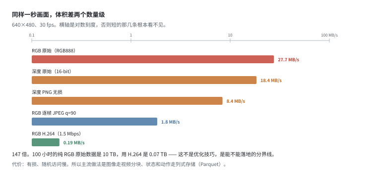

一段 30 秒的 episode，640×480、30 fps：

```
  格式                      每帧      每秒      30 秒总计
  RGB 原始 (RGB888)        900 KB   27.65 MB/s    829.4 MB
  RGB 逐帧 JPEG (q=90)      60 KB    1.84 MB/s     55.3 MB
  RGB H.264 (1.5 Mbps)       6 KB    0.19 MB/s      5.6 MB
  深度 原始 (16-bit)        600 KB   18.43 MB/s    553.0 MB
  深度 PNG 无损            273 KB    8.38 MB/s    251.3 MB
```

原始 RGB 和 H.264 差 **147 倍**。这不是优化技巧，是能不能落地的分界线：

- 100 小时纯 RGB 原始 = **10 TB**
- 100 小时 H.264 = **0.07 TB**

LeRobot / Open X-Embodiment 的选择是**图像走 H.264，低维数据走 Parquet**。两种格式各管一段，因为它们的访问模式完全不同：

| 数据 | 访问模式 | 合适格式 |
|---|---|---|
| 图像 | 顺序读整段、偶尔随机取帧 | 视频编码（帧间压缩效率高） |
| 状态/动作 | 随机取某几列、按条件筛行 | 列式存储（Parquet） |

**代价要说清楚**：视频编码是有损的，而且帧间编码让随机访问变慢（要从前一个关键帧解码）。所以数据集通常会记录关键帧间隔，训练时按 chunk 读取。

还有两个编码层的坑：

- **通道顺序**。从 H.264 解出来常是 BGR，从 PNG 解出来是 RGB，从 RealSense SDK 出来又是 RGB。混在一起训练，模型会学到"颜色通道顺序"这个伪特征 —— loss 正常，效果诡异。
- **色度抽样**。H.264 常用 YUV420，色度分辨率只有亮度的一半。做颜色相关的任务（比如分辨红色和橙色物体）时要留意。

**所以在采集时就要把编码定死，不要事后转。** 统一一次，比每次训练前转换可靠。

## 12. 和数据平台有什么关系

四条结论：

1. **内参、畸变系数、外参、深度单位、时间戳来源，必须随图像一起存。** 这五项组成了"图像的可解释性"。缺任何一项，图像就退化成一张图片。

2. **标定参数要版本化。** 每次重新标定产生新版本，历史数据绑定到当时的版本。没有这一条，半年后你无法回答"这批数据当时的相机装歪了没有"。

3. **深度数据要标记有效性，不要填 0。** 空洞、飞点、超量程是三种不同的东西，处理方式也不同。入库时就分成"有效／无效"两列，比事后猜要可靠一个数量级。

4. **深度相机的有效距离要写进元数据。** 同一份数据里，0.5 米处的点是毫米级精度，5 米处是厘米级 —— 如果下游不知道这个梯度，就会把远处的噪声当信号用。

## 13. 自己跑一遍

```bash
python examples/02_sensor_data/02_camera_model.py
```

十个小节，对应第 2–11 节的每一步。所有数字都能复现：

```
[1]  一帧数据到底是几个字节
[2]  一个像素有多大
[3]  投影 -> 反投影，能不能还原
[4]  分辨率改了，内参怎么变
[5]  镜头畸变：为什么直线拍出来是弯的
[6]  深度从哪来：视差 -> 距离
[7]  深度量化：台阶什么时候看得见
[8]  相机装歪 1 度会怎样
[9]  卷帘快门：静止的墙为什么会歪
[10] 数据量：为什么机器人数据集都用视频编码
```

改几个参数会有意思：把 `FX` 改成 300，看 GSD 表如何整体变大、视场角怎么跟着变；
把 `BASELINE` 改成 0.1（基线翻倍），看深度精度表整体变好一倍 —— `σ_z` 反比于基线，
但正比于距离的平方，所以加大基线救不了远处。

---

下一篇：[IMU 与本体感知](imu-and-proprioception.md) —— 为什么最便宜的传感器最难用。
