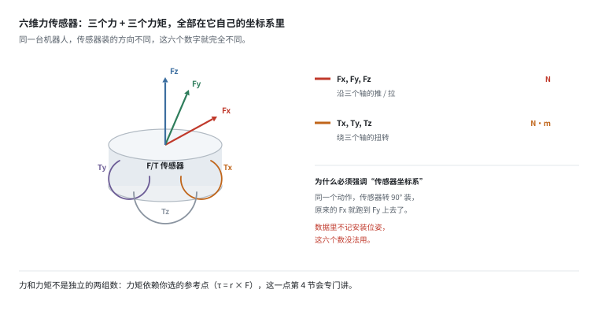
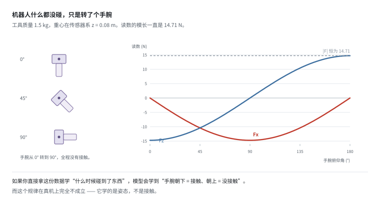
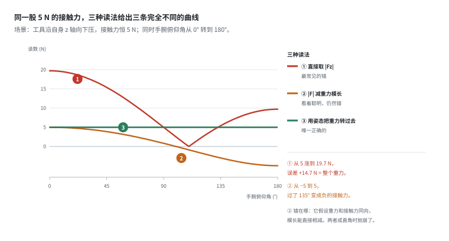
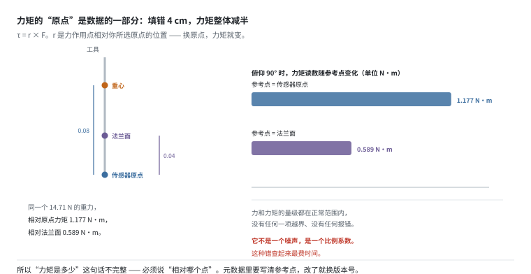
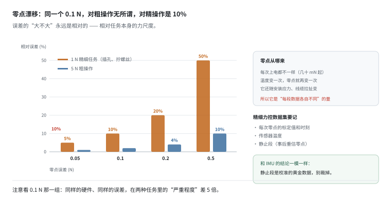
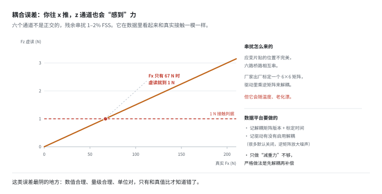
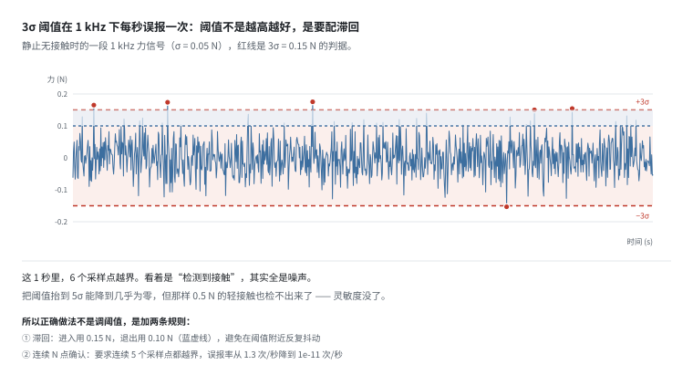

# 力/力矩与触觉：数值合理但物理上错

> 阶段 2 · 传感器数据 ｜ 写作时间 2026-11
>
> 配套实验：[`examples/02_sensor_data/05_force_torque.py`](../examples/02_sensor_data/05_force_torque.py)

## 1. 它解决什么问题

视觉告诉你"手在哪"，力觉告诉你"碰到了没有、用了多大劲"。

插孔、拧螺丝、擦桌子、开抽屉这类任务，差 2 mm 就插不进去，而视觉在 2 mm 这个尺度上不可靠 —— 遮挡、反光、标定误差，随便一项就吃掉这个余量。力觉是这类任务唯一的反馈源。

但力觉有一个别的模态都没有的特点：**它的原始读数里，一个数字都不是"接触力"。**

```
读数 = 工具自身重力（随姿态变）
     + 零点漂移（随温度、时间、安装应力变）
     + 通道之间的串扰（随另一路受力变）
     + 参考点带来的比例（固定，但填错就整体偏）
     + 真正的接触力（你想要的）
```

前四项全都在"合理量级"内，全都有单位、有小数点，看起来就是力。**这是所有模态里最隐蔽的一类数据污染：数值合理、量级合理、物理上错。**

而且它比 IMU 的零偏更危险，原因是一个反直觉的点：

> **IMU 的误差会漂，力觉的误差很稳定。**

漂移的误差，模型学不进去 —— 它前后矛盾，拟合不了。稳定的误差，模型会当成规律记住。所以 IMU 那篇的错误最终表现为"预测越来越歪"，你还看得出来；力觉的错误表现为"训练 loss 很好、验证集很好、一上真机换个姿态就废"，你根本看不出哪里错了。

**这一篇拆的就是这张账单上的每一笔。** 每一节对应其中一项，最后两节讲触觉为什么至今聚合不了、以及数据平台该怎么存。

## 2. 六维是什么，为什么强调"传感器坐标系"

腕部六维力传感器输出六个数字：

```
Fx, Fy, Fz     沿三个轴的力 (N)
Tx, Ty, Tz     绕三个轴的力矩 (N·m)
```



为什么需要力矩这三个数？因为**接触几乎从来不是一个点**。

一个点接触，力就够了。但手指、吸盘、夹具和物体之间是面接触或线接触，力落在接触面的哪一侧，决定了物体会不会翻、会不会滑。力矩就是"力偏到哪边去了"的那三个数。

插孔这个例子最能说明分工：

- **力**告诉你"顶到东西了"，但顶的是孔沿还是孔底，它不知道。
- **力矩**告诉你"顶在左边了"，于是控制器往右微调 0.5 mm。

所以精细任务里，**力矩通道常常比力通道更有用** —— 而它恰好是最容易搞错的那一路（第 5 节）。

从规格上看，典型六维传感器（ATI / 宇立 / Bota 一类）是这样：

| 指标 | 典型值 | 数据平台要注意 |
|---|---|---|
| 量程（力） | 100–500 N | 超过会永久损坏，且事后无法判断有没有超过 |
| 量程（力矩） | 5–30 N·m | 拧螺丝时最容易超 |
| 分辨率 | 0.01–0.1 N | 远好于精度，别被营销数字误导 |
| 耦合误差 | 1–2% FSS | 施加 Fx 会在 Fz 上产生读数（第 7 节） |
| 零点漂移 | 0.05–0.5 N/°C | 温度一变零点就变（第 6 节） |
| 采样率 | 100 Hz – 7 kHz | 高频才能抓到碰撞瞬间（第 8 节） |

注意"分辨率远好于精度"这一条。分辨率是"能显示到小数点后几位"，精度是"这个数离真值多远"。0.01 N 的分辨率配上 1–2% FSS 的精度（200 N 满量程就是 2–4 N），中间差了两三个数量级。

也就是说：**你能读出 0.01 N 的变化，但那个变化可能纯粹是串扰、温漂或者参考点带来的。** 分辨率给你的是"数字很细"的错觉，第 3 节那个 14.71 N 的重力更是比这个错觉大三个数量级。厂商在规格书首页写分辨率，在附录里写精度，是有原因的。

### 传感器坐标系：这六个数没有绝对含义

六个分量全部在**传感器自己的坐标系**下，不是世界系、不是末端系、不是基座系。

同一个动作，传感器转了 90° 安装，原来的 Fx 就跑到 Fy 上去了。所以**数据里不记传感器安装位姿，这六个数就没法用** —— 下游连"这 5 N 是往下压还是往侧推"都判断不了。

这一条听起来是常识，但它在公开数据集里被违反的比例高得吓人。原因很实际：传感器坐标系和末端法兰坐标系通常差一个固定变换，写采集脚本的人知道，读数据的人不知道，而这个变换写在了实验室的某个表格里，没进数据集。

## 3. 重力：读数里最大的那一笔

设末端工具质量 1.5 kg，重心在传感器系 `(0, 0, 0.08)` m。机器人什么都没碰，只是转动手腕：

```
   俯仰角    Fx(N)    Fz(N)   Ty(N·m)    |F|(N)   说明
     0°    -0.00   -14.71     0.000     14.71   纯竖直，力全在 z
    15°    -3.81   -14.21    -0.305     14.71
    30°    -7.36   -12.74    -0.589     14.71
    45°   -10.41   -10.41    -0.832     14.72
    60°   -12.74    -7.36    -1.019     14.71
    90°   -14.71    -0.00    -1.177     14.71   纯水平，力全在 x
   120°   -12.74     7.36    -1.019     14.71
   150°    -7.36    12.74    -0.589     14.71
   180°    -0.00    14.71    -0.000     14.71   倒过来，z 反号
```



看最后一列：**力的大小从头到尾都是 14.71 N。** 它一直是同一个重力，只是在传感器坐标系里换了方向。

Fz 从 −14.71 变到 +14.71，符号都反了。而这一整段时间里，机器人一次都没碰到东西。

如果你把这份数据直接喂给模型学"什么时候接触到了物体"，模型会学到一个完全错误的规律：

> 手腕朝下的时候"接触"，手腕朝上的时候"没接触"。

**这个规律在训练集上 100% 准确**（因为采集时手腕的动作就是这么设计的），在真机上 100% 失效。而且它藏在几十万条样本里，从 loss 曲线上一丝痕迹都看不出来。

### 重力补偿的三步

1. 知道传感器在世界系下的姿态 `R`（来自正运动学 + TF）
2. 世界系的重力 `(0, 0, -mg)` 转到传感器系：`F_g = Rᵀ · (0, 0, -mg)`
3. `F_ext = F_measured - F_g`，力矩同样减去 `r × F_g`

第 2 步依赖姿态，这是个硬约束：

> **每一条 F/T 数据都必须配一条同时刻的姿态。**

"同时刻"三个字很关键。姿态来自关节编码器 + 正运动学，力来自力传感器，两条流的时间戳差 10 ms，手腕以 90°/s 转动时就是 0.9° 的姿态误差 —— 折算成重力泄漏约 0.23 N。这个量级正好盖住精细任务的接触判据。

**这就是很多公开数据集里 F/T 数据不可用的根本原因：只存了六个数，没存姿态。** 事后想补也补不了 —— 重力投影完全由姿态决定，没有姿态，这六个数连"里面有多少是重力"都算不出来，只能整体丢弃。

### 顺手记一下：补偿前后都要存

补偿后的值是下游能直接用的，原始值是唯一能重新处理的。只存补偿后的，一旦发现补偿公式写错了（比如 `Rᵀ` 写成了 `R`），历史数据全部报废，没法重算。

代价只是体积，六个数乘以采样率，比图像小四个数量级。**这笔账在任何情况下都不该省。**

## 4. 三种读法：错得很隐蔽

知道有重力之后，"减掉它"这件事有三种常见做法，差距大得离谱。

场景：工具沿自身 z 轴向下按压，**真实接触力恒为 5 N**。机器人一边压一边改变手腕俯仰角。

- **读法①** 直接取 `|Fz|`
- **读法②** 取 `|F|` 再减重力模长
- **读法③** 用姿态把重力转到传感器系再减（第 3 节的三步）

```
   姿态       Fx       Fz     读法①   读法②   读法③
    0°     0.00   -19.71    19.71    5.00    5.00
   45°   -10.41   -15.41    15.41    3.87    5.00
   90°   -14.71    -5.00     5.00    0.83    5.00
  135°   -10.41     5.41     5.41   -2.99    5.00
  180°    -0.00     9.71     9.71   -5.00    5.00
```



真值那一列本该全是 5.00。实际：

- **读法①** 从 5.00 涨到 19.71 N，误差 +14.71 N —— 整个重力都被当成接触力了。这是最常见的错，因为垂直向下按压时"Fz 就是力"这个直觉在 0° 恰好成立。
- **读法②** 从 −5.00 到 5.00 N，**过了 135° 直接给出负的接触力**。这个更糟，因为它看起来"聪明"—— 用上了模长，还减了 `mg`，代码里写得很像那么回事。

读法② 错在哪：它假设**重力和接触力同向**，所以模长可以直接相减。一旦手腕转到某个角度让两者成直角（这里是 90° 附近），这个假设就彻底崩了 —— 模长是 `√(F_g² + F_ext²)`，压根不是加减关系。

读法① 在 0° 那行还歪打正着给出 19.71，读法② 在 0° 那行歪打正着给出 5.00。**两个错方法各有一个"看起来对"的点，这就是它们能活下来的原因。** 有人在 0° 验证了一下，发现对得上，就上线了。

## 5. 力矩的参考点是数据的一部分

力矩的定义里有位置：

```
τ = r × F
```

`r` 是力作用点相对**你所选的原点**的位置。所以"力矩是 0.83 N·m"这句话是不完整的 —— 必须说"相对哪个点"。



工具重心在传感器系 `z = 0.08` m，重力 14.71 N。传感器出厂标定时用的是传感器原点。如果有人把元数据里的参考点填成了法兰面（沿 z 偏 0.04 m）：

```
    角度     Fx(N)     Ty 原点0.08     Ty 原点0.04      比值
     0°     -0.00         0.000         0.000       —
    30°     -7.36        -0.589        -0.294   0.50x
    45°    -10.41        -0.832        -0.416   0.50x
    60°    -12.74        -1.019        -0.510   0.50x
    90°    -14.71        -1.177        -0.589   0.50x
```

看 45° 那一行：−0.832 变成 −0.416。**力和力矩的量级都还在正常范围内**，没有任何一项越界、没有任何报错、单位也对，只是力矩通道整体偏了一半。

这就是力觉数据里最难查的一类错误：**它不是噪声，是一个比例系数。**

噪声大了你会去滤波，会去看频谱，会怀疑线缆。系数错了你什么都不会怀疑 —— 数据光滑、稳定、可重复，看起来质量很高。用这样的数据做力控的后果很具体：控制器以为自己的力矩只有实际的一半，于是继续加力，目标 5 N·m 会实际压到 10 N·m 才读到 5。

工程做法三条：

- 力矩数据的元数据里写明**参考点**，不能只写"传感器系"，要写"相对传感器原点沿 z 偏多少"。
- 参考点变更必须换版本号，不能原地改。原地改会让新旧数据混在一起，事后无法分辨。
- 入库校验：静止时挂一个已知质量块，用 `r × mg` 反算力矩，和读数比对。这一条能在采集当天就抓住问题。

## 6. 零点漂移：每一段数据各自不同

力传感器每次上电零点都不一样（几十 mN 到几百 mN）。常见做法是开机空载归零。但温度一变、线缆动一下、安装应力变一点，零点又漂了。

零点误差的"严重程度"取决于任务本身的力尺度：

```
  零点误差   5N 接触时的相对误差   1N 精细操作的相对误差
   0.02N           0%                  2%
   0.05N           1%                  5%
   0.10N           2%                 10%
   0.20N           4%                 20%
   0.50N          10%                 50%
   1.00N          20%                100%
```



对 5 N 的粗操作，0.1 N 的零点误差只有 2%，无所谓。但对 1 N 的精细操作（插孔、拧螺丝），同样的误差是 10%；0.5 N 的误差直接就是 50% —— 接触力的数量级判断全废了。

注意这里的因果不是"传感器不好"，而是**精细任务的力尺度太小，把传感器的绝对值误差放大了**。同一个传感器，用在擦桌子任务上完全够用，用在插孔上就不够。所以规格书上的"精度 0.1 N"必须结合任务力尺度看。

精细力控数据集必须记录三样：

- 每次零点的标定值和标定时刻（不是"标定过"，是"标定出多少"）
- 传感器温度（多数驱动能读到，读不到也该在附近贴一个）
- 静止段（用来事后重新估计零点）

最后一条和 IMU 那篇的结论完全一致：**静止段是校准的黄金数据，别当废数据裁掉。** 很多清洗流程会"去掉开头几秒准备阶段"，恰好把唯一能重估零点的窗口删了。

## 7. 耦合误差：压 x 方向，z 通道也会动

六维传感器的六个通道不是正交的。应变片贴的位置不可能完美，六路桥路之间会相互串。厂家出厂时标定一个 6×6 解耦矩阵，典型残余耦合 1–2% FSS（FSS = full scale，满量程）。

假设满量程 200 N，残余耦合 1.5%，那么：

```
     施加 Fx       Fz 虚读      相当于 1 N 判据的
      10 N       0.15 N            15%
      50 N       0.75 N            75%
     100 N       1.50 N           150%
     200 N       3.00 N           300%
```



读法：插孔这类任务，接触判据常在 1 N 量级。只要你同时沿 x 方向推了 100 N（很常见 —— 按压的同时在侧向找孔），z 通道就凭空多出 1.5 N，足以让控制器误判"已经插到底了"。

而且这个误差**和真实的接触力完全无法区分**：同一个通道、同样的量级、同样的时间尺度、同样平滑。它不像噪声那样高频抖动，也和你的动作同步 —— 因为你推 x 的时候它才出现。

数据平台要做的：

- 记**解耦矩阵的版本和标定时间**。它会随温度漂、随使用老化，出厂矩阵用三年就未必准了。
- 记**驱动有没有启用解耦**。很多驱动的默认值是关闭的，因为逆矩阵会放大噪声 —— 这是个合理的工程取舍，但数据使用者必须知道。
- 只做"减法去重力"是不够的。严格顺序是**先解耦、再补偿**，反过来会把耦合项也搬进重力里。

## 8. 接触检测：阈值不是越高越好

最常见的接触判据：读数超过 `均值 + k·σ` 就算"碰到了"。

问题在于，**静止时噪声本身就会越过这条线，而且采得越快越容易撞上。**

假设静止时噪声 σ = 0.05 N，采样率 1 kHz：

```
       阈值          单点越界概率          每秒误报次数
     2.0σ       2.28e-02          22.8
     3.0σ       1.35e-03          1.35
     4.0σ       3.17e-05         0.0317
     5.0σ       2.87e-07       0.000287
```



3σ 在教科书里是"99.7% 都在范围内"的保守阈值。但 1 kHz 下每秒有 1000 个样本，1.35e-3 × 1000 = **每秒 1.35 次越界**。

如果按"任一通道越界就算接触"，六个通道加起来还要乘 6。也就是说机器人静止不动，每秒会有七八次"检测到接触"。

往上抬阈值行不行？4σ 降到 32 秒一次，5σ 降到约一小时一次。但**抬阈值的代价是灵敏度**：0.5 N 的轻接触（刚好碰到、还没压下去）根本到不了 5σ = 0.25 N 以上持续越界，检不出来。而按 4σ 的 0.2 N 判据，0.3 N 的轻碰也会被当成"没碰到" —— 触觉最有用的一段恰好就是这个轻碰阶段。

所以正确做法不是调阈值，是加两条规则：

1. **滞回**：进入阈值 0.15 N，退出阈值 0.10 N。避免在阈值附近反复抖动 —— 这和人造卫星的姿态控制用死区是同一个道理。
2. **连续 N 点确认**：要求连续 5 个采样点都越界。单点 3σ 的概率是 1.35e-3，5 点连着的概率是 **4.48e-15**，每秒误报降到 4.48e-12 次 —— 从"每秒一次"变成"宇宙寿命内不会发生"。

这两条都是**采集端**该做的事，因为：

> 事后从原始数据重算，你没法知道当时用的是哪个阈值、有没有滞回、确认了几个点。

所以接触状态应该作为一列独立数据存下来，同时把生成它的阈值参数写进数据集元数据。否则不同机器人采的数据，`contact` 这一列的含义完全不同 —— 一个用 2σ 单点判据，一个用 5σ 五点确认，两者的"接触"根本不是一件事。

## 9. 触觉为什么聚合不了

先看数据量。触觉是公认"数据量最小"的模态：

```
              方案        分辨率      帧率      原始带宽
        单点力传感器       1 点      1 kHz        4 KB/s
    16x16 阵列 (8-bit)     256 点     100 Hz      25 KB/s
    32x32 阵列 (8-bit)    1024 点     100 Hz     100 KB/s
    64x64 阵列 (16-bit)   4096 点      1 kHz    8000 KB/s
  视觉触觉 (GelSight)  320x240x3    30 Hz     6750 KB/s
      对比：RGB 相机   640x480x3    30 Hz    27000 KB/s
```

比相机小两三个数量级。按理说这种模态最容易聚合 —— 存储便宜、传输不难、算力需求低。

但事实相反：**触觉是所有模态里最碎片化的，而大规模聚合数据集里它基本是缺席的。**


原因不在数据量，在这三件事：

**1. 物理原理完全不同。** 压阻、电容、压电、光学、磁性。压阻测的是静态压力，压电测的是压力变化率 —— 两者的数据不能放进同一张表。这不是格式差异，是**物理量不同**。就像把温度计和麦克风的读数平均，没有意义。

**2. 没有统一的空间语义。** 16×16 的阵列贴在哪里、覆盖多大面积、每个单元对应皮肤上哪一块 —— 不同产品完全不可比。同一块 16×16 数据，贴指尖是"高分辨率指腹"，贴手掌是"低分辨率掌心"，而数据里看不出区别。

**3. 标定不可迁移。** 每个单元的一致性差异能到 20%，厂商的标定文件是私有格式，换个传感器就得重新标。所以你在 A 传感器上训的模型，换到 B 上等于从零开始。

把这三点和图像对比一下就清楚了：

| | 图像 | 触觉 |
|---|---|---|
| 统一坐标系 | 有：640×480 像素网格，三十年没变 | 无：贴哪儿、多大、每格对应哪块皮肤 |
| 统一物理语义 | 有：每个像素 = 那个方向射来的光的颜色 | 无：压阻测压力，压电测变化率 |
| 标定可迁移 | 基本可以（内参标一次能用很久） | 不行（每单元差 20%，换传感器重标） |

**图像能聚合，本质上是因为它有一个所有人都认的坐标系加一个所有人都认的语义。** 触觉两者都缺。缺了这两样，模型连"输入是什么形状、每个数代表什么"都无法统一 —— 这已经不是"模型再大一点就能解决"的问题了。

这是 [07 章](../07-open-problems/) 里我认为最值得做的开放问题之一：**如果触觉能定义出类似"皮肤坐标系"这样的统一语义（以接触面为参考、以法向和切向分解为物理量），整个领域的数据效率会翻倍。**

## 10. 和数据平台有什么关系

1. **F/T 数据必须和姿态成对存储。** 没有姿态，重力补偿无从下手，这六个数字就废了。而且必须是同一时刻的姿态，时间戳对齐误差要小于 1 ms 量级。

2. **补偿前后都要存。** 补偿后的值下游能直接用，原始值是唯一能重新处理的。只存补偿后的，一旦发现公式写错就无救。

3. **零点标定值、温度、参考点、解耦矩阵版本，都是元数据不是调试信息。** 它们要进数据集 schema，随分片一起存。缺了任何一项，这批数据在换任务时都不可复用。

4. **接触状态要么作为独立列存下来，要么把判定参数写进元数据。** 否则不同批次的数据里 `contact` 这一列含义不同。

5. **触觉的瓶颈是语义不统一，不是带宽。** 所以短期内不要指望"多模态大模型自动解决触觉" —— 它连输入格式都还统一不了。真要收触觉数据，先从"单点 + 明确标注贴装位置和面积"做起，比堆阵列有用。

## 11. 自己跑一遍

```bash
python examples/02_sensor_data/05_force_torque.py
```

八个小节，对应上面第 2–9 节：

| 小节 | 讲什么 | 关键输出 |
|---|---|---|
| `[1]` | 六维含义与规格 | 六个分量都在传感器系下 |
| `[2]` | 重力投影 | 转手腕时 Fz 从 −14.71 变到 +14.71，\|F\| 恒 14.71 |
| `[3]` | 三种读法 | ① 5→19.71 N，② 过 135° 变负，③ 恒 5.00 |
| `[4]` | 零点漂移 | 0.1 N 对 5 N 任务是 2%，对 1 N 任务是 10% |
| `[5]` | 触觉带宽 | 比相机小 3 个数量级，但仍然聚合不了 |
| `[6]` | 力矩参考点 | 0.08 → 0.04，力矩整体 0.50x |
| `[7]` | 耦合误差 | Fx=100 N → Fz 虚读 1.5 N |
| `[8]` | 接触阈值 | 3σ 下每秒 1.35 次误报；5 点确认后 4.48e-12 |

改几个参数会有意思（都在对应函数里，改完重跑即可）：

- 把 `part3_with_contact` 的 `contact_n` 从 `5.0` 改成 `50.0`：读法② 的负值区间消失了，读法① 的最大误差还是 14.71 N —— 但相对误差从 294% 降到 29%。**这解释了为什么"大力的任务里读法① 看起来还行"**：重力这笔账没消失，只是被更大的力稀释了。
- 把 `part6_torque_reference` 里的参考点改成 `COM[2]` 那个数（也就是 `0.04` 改成 `0.08`），看力矩是否翻倍 —— 同一股力，力矩完全由参考点定义。
- 把 `part8_contact_threshold` 的 `fs` 从 `1000.0` 改成 `100.0`：3σ 的误报率从 1.35 次/秒降到 0.135 次/秒，判定从"不可用"变成"勉强"。**误报率和采样率成正比**，这就是为什么高频力控必须配滞回。
- 把 `n_confirm` 从 `5` 改成 `2`：误报率回到 1.82e-3 次/秒（约 9 分钟一次），判定延迟从 5 ms 降到 2 ms。这是精度和延迟的正面权衡，没有免费的一边。

---

上一篇：[IMU 与本体感知](imu-and-proprioception.md) ｜ 下一篇：[点云](lidar-pointcloud.md)
