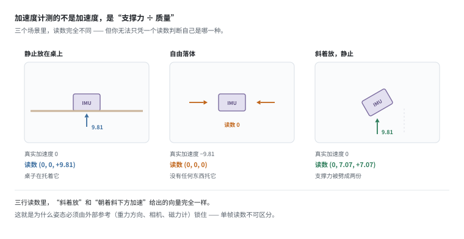
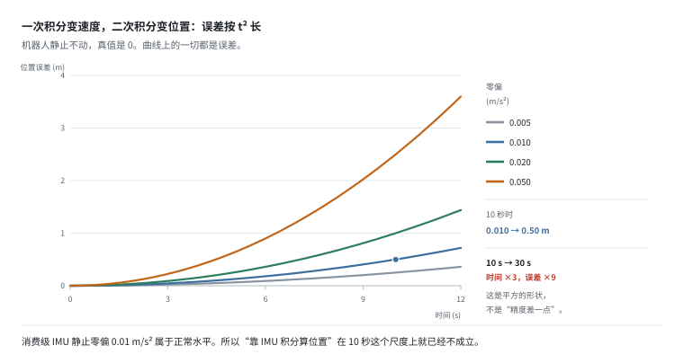
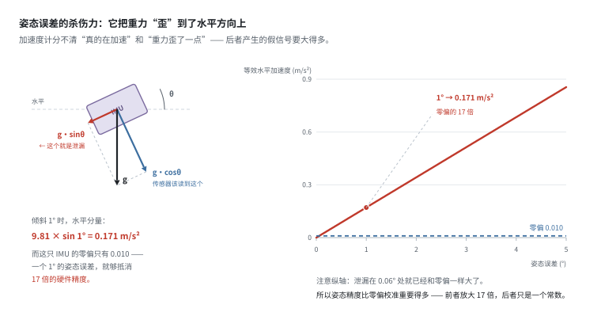
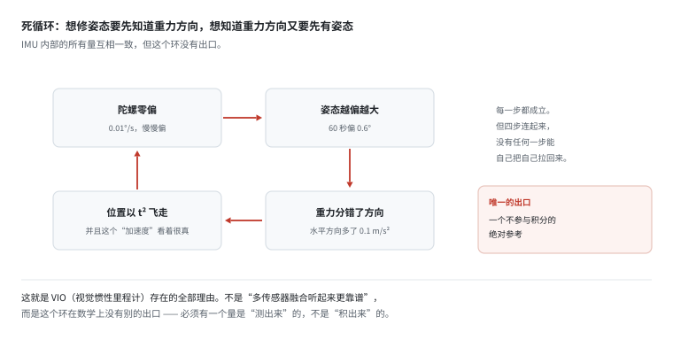
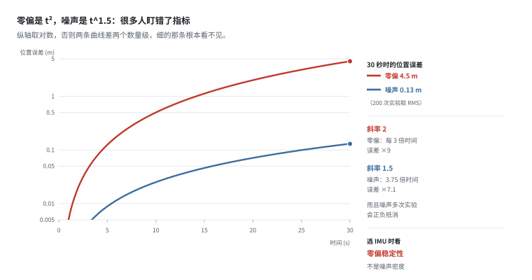
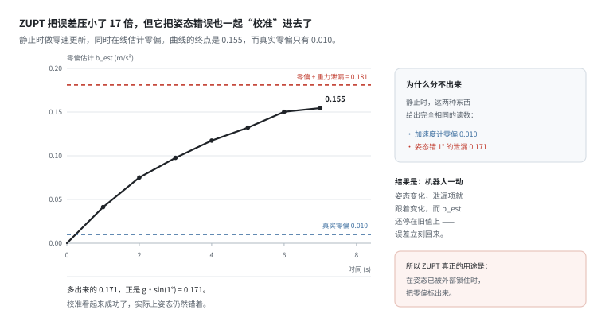
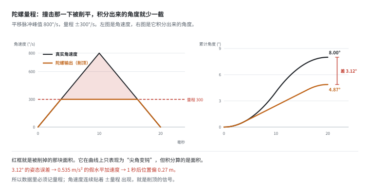
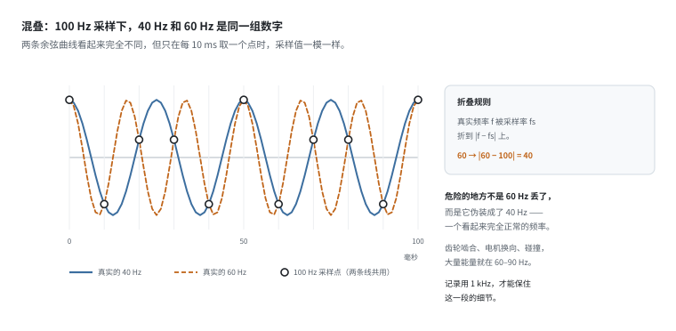
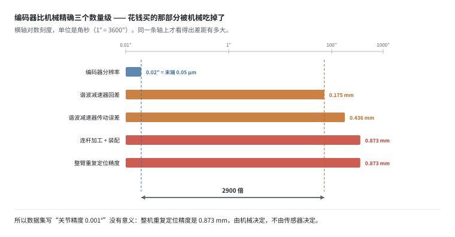
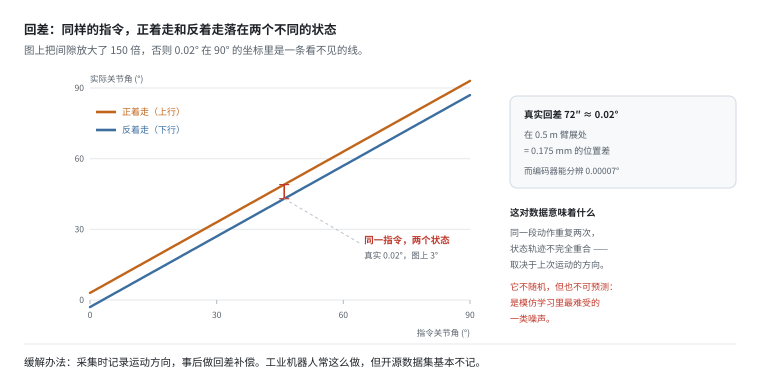

# IMU 与本体感知：最便宜的传感器，最难用的数据

> 阶段 2 · 传感器数据 ｜ 写作时间 2026-11
>
> 配套实验：[`examples/02_sensor_data/03_imu_drift.py`](../examples/02_sensor_data/03_imu_drift.py)

## 1. 它解决什么问题

IMU 是机器人上单价最低的传感器（几块到几百块），也是数据里最难用的一项。

拿到一份 IMU 数据，你面对的是三个数（加速度 xyz）乘以几千 Hz，看起来很朴素。但：

- 直接积分算位置，10 秒就能漂 0.5 米
- 不做姿态补偿，加速度计的读数里混着 1g 的重力
- 想做姿态融合，又发现姿态本身没有绝对参考

**这一篇要讲清楚的核心是：IMU 能自洽，但不能自证。** 它内部的所有量互相一致，但你无法只靠它自己知道“我现在的姿态对不对”。

这句话听起来抽象，但它有一个非常具体的后果，第 6 节会算给你看：**零速更新（ZUPT）能让漂移小 17 倍，可它同时会把姿态错误当成“零偏”标定进去 —— 校准看起来成功了，实际姿态仍然错着。**

后面还讲本体感知（关节编码器）。它看起来简单得多，但精度上限被机械结构卡住，不在传感器。

## 2. 它到底测什么：不是加速度，是“支撑力”

三个传感器，各管一件事：

| 传感器 | 测的物理量 | 单位 | 典型频率 | 数据平台要注意 |
|---|---|---|---|---|
| 加速度计 | 比力（真实加速度 − 重力） | m/s² | 100–1000 Hz | 记录量程，撞击会削顶 |
| 陀螺仪 | 角速度 | °/s 或 rad/s | 100–1000 Hz | 记录量程，同上 |
| 磁力计 | 地磁场方向 | μT | 10–100 Hz | 电机附近基本不可用 |

注意第一行：**它测的不是“加速度”，是“比力”（specific force）** —— 真实加速度减去重力。



静止放在桌上，真实加速度是 0，但读数是 `(0, 0, +9.81)`（z 轴朝上时）。因为它感受到了桌子的支撑力。自由落体时反而读 `0` —— 没有任何东西托着它。

这个定义上的细节是后面所有问题的源头：

> **你永远无法在单帧读数里区分“在加速”和“姿态变了”。**

第三个小图就是这个意思：斜着放（静止）和朝斜下方加速，给出的向量可以完全一样。想分开它们，必须引入重力方向的先验 —— 而重力方向本身就是姿态。这就是循环的开始。

**所以姿态从来不是“算”出来的，是“融合”出来的。** 后面几节都在讲这个融合为什么难。

## 3. 积分是原罪：一次变速度，二次变位置

先看最纯粹的情况：静止，但加速度计有一个恒定零偏 `b`。

```
v(t) = b · t
p(t) = 0.5 · b · t²
```



`b = 0.01 m/s²` 是消费级 IMU 静止时的典型零偏。**10 秒后位置误差 0.5 米。**

时间翻 3 倍（10s → 30s），误差翻 9 倍 —— 这就是 t² 的形状。

手机导航进隧道就废，不是算法差，是物理上不可能。这也是为什么“纯惯性导航”只存在于高精度军事场景：那里的 IMU 零偏能到 0.0001 m/s² 量级，加上温度控制和转台标定，才能撑几分钟。

**那 IMU 在机器人上到底还有什么用？** 它的价值不在“积分出位置”，在**短时间内的相对变化**：

- 相机 30 Hz，两帧之间 33 ms，这段时间里末端可能已经动了 3 cm。IMU 1 kHz，能填上这个空。
- 轮子打滑、碰撞瞬间、快速翻转 —— 这些事件在相机里是“模糊的一帧”，在 IMU 里是清晰的波形。
- 所以 VIO 里的标准做法是**预积分**：在两帧图像之间把 IMU 积分成一个相对约束，而不是积分出绝对位置。

一句话：**IMU 提供的是“两帧之间的增量”，不是“我在地图上的位置”。** 用错了地方，它的误差曲线就会像上图一样爆炸。

## 4. 姿态误差才是主角：它把重力“歪”到水平方向

陀螺零偏看起来很温和：0.01°/s 的偏差，60 秒才偏 0.6°。相比加速度计的二次爆炸，好像是个小事。

但姿态误差的后果不是“角度错了”，而是**重力分错了方向**。



```
g · sin(1°) = 9.81 × 0.01745 = 0.171 m/s²
```

**是 IMU 自身零偏（0.010）的 17 倍。**

而且注意右图的纵轴：泄漏在 **0.06°** 处就已经和零偏一样大了。换句话说，你花大价钱把零偏标到 0.005，只要姿态差 0.06°，这份钱就白花了。

于是形成死循环：



```
陀螺零偏 → 姿态慢慢偏 → 重力投影错 → 加速度计积分出虚假速度
    → 位置以 t² 飞走 → 而修正姿态又需要准确的重力方向
```

**出路只有一条：引入一个不漂的绝对参考。** 相机、激光、GPS、磁力计都行。这就是 VIO（视觉惯性里程计）存在的全部理由 —— 不是“多传感器融合听起来更靠谱”，而是这个环在数学上没有别的出口。

## 5. 噪声反而不是主要矛盾

很多人以为 IMU 的精度主要看噪声。实验证明不是：



```
场景 B：只有白噪声 σ=0.02 m/s²，零偏为 0（200 次实验取 RMS）
  8 秒后位置误差 RMS 0.018 m
  30 秒后位置误差 RMS 0.130 m  （时间 ×3.75，误差 ×7.1）
  理论外推 (30/8)^1.5 = 7.3 倍，实测 7.1 倍，吻合。
```

白噪声的积分是随机游走，位置误差 ∝ t^1.5，比零偏的 t² 温和得多，而且多次实验会正负抵消。

对比场景 A（纯零偏 0.01）：8 秒就是 0.317 m —— **是噪声的 17 倍。**

**所以 IMU 选型时，零偏稳定性（bias stability）比噪声密度（noise density）重要得多。** 规格书上通常两个都标，只盯着噪声买，会买到“很安静但一直偏”的传感器。

这一条对所有模态都成立，不只 IMU：**任何“系统性偏差”都比“随机噪声”难处理**，因为随机噪声多测几次就平均掉了，偏差不会。

## 6. 零速更新：能救速度，救不了姿态

零速更新（ZUPT, Zero Velocity Update）是 IMU 工程里最常用的技巧：知道机器人此刻静止，就把速度强制归零。

实验结果：

```
场景 C：零偏 + 噪声 + 姿态误差 1°        8 秒后误差 5.754 m
场景 D：同样条件 + 每秒一次 ZUPT         8 秒后误差 0.344 m  （小 17 倍）
```

效果很好。但真正有意思的是零偏估计的收敛过程：



```
t= 1.0s   b_est= 0.0413 m/s²
t= 2.0s   b_est= 0.0752 m/s²
...
t= 7.0s   b_est= 0.1546 m/s²
```

**b_est 最终会收敛到 0.181，而真实零偏只有 0.010。**

多出来的 `0.171` 正是姿态误差造成的重力泄漏（`g·sin 1°`）。它还能继续往上爬 —— 指数滑动平均（系数 0.2）7 次只走了 79%，所以 7 秒只到 0.155。

这说明了一件很深的事：

> 静止时，“加速度计零偏”和“姿态误差造成的重力投影”在数学上完全等价，传感器分不出来。

所以 ZUPT 把两者一起吸收进了零偏估计 —— **校准看起来成功了，实际上姿态仍然错着。** 机器人一动起来（姿态变化），泄漏项跟着变化，而 b_est 还停在旧值上，误差立刻回来。

**这就是“能自洽但不能自证”的具体含义。**

还有一个反过来的用途：如果姿态是对的（有外部参考锁住），那么 ZUPT 估计出来的偏差就是纯零偏，可以直接标定掉。于是形成一个耦合：

> **零偏标定的前提是姿态已知，姿态标定的前提是零偏已知。**

这个环只能靠“静止段 + 绝对参考”同时打破。所以 ZUPT 真正的用途不是“代替绝对参考”，而是**在已有绝对参考的前提下，把零偏标出来**。

## 7. 三个更容易被忽略的坑

前面讲的是“原理上会错”。这一节讲“实现上会错”，而且都不会报错。

### 7.1 陀螺量程：一次撞击就削掉一块角度

选陀螺量程时，直觉是按“正常运动”来：正常摆动 50°/s，选个 ±300°/s 就很宽裕了。

但撞击瞬间不是正常运动。



```
场景：手腕撞到桌子，20 ms 内被弹开 8°。真实角速度峰值 800°/s，量程 ±300°/s。

真实转角      8.00°
削顶后积分    4.87°
丢失          3.12°（39%）
这 20 ms 里 62% 的采样点顶在量程上
```

注意它在曲线上长什么样：**只是尖角变钝了。** 起点终点都对，整体形状还在。但积分算的是**面积**，尖顶被压平，面积就少了一大块。

后果：3.12° 的姿态误差 → 0.535 m/s² 的假水平加速度 → 1 秒后位置偏 0.27 米。

**工程做法：**

- 量程按最坏情况选，不按正常运动选
- 数据里记 `range` 字段，否则事后无法判断有没有削顶
- 入库校验规则：**角速度序列里出现连续多个恰好等于 ±量程 的采样点，就是削顶了**

### 7.2 采样率与混叠：你看到的频率可能不是真的

奈奎斯特说：采样率 `fs` 只能无歧义地表示低于 `fs/2` 的频率。高于它的成分不会消失，会**折叠**成一个更低的假频率。



```
fs = 100 Hz（很多机器人只在控制周期里顺手记一份 IMU）

真实频率    观测到的频率
  10 Hz       10 Hz
  40 Hz       40 Hz       ← 本身没问题
  60 Hz       40 Hz       ← 折叠：|60 − 100|
  90 Hz       10 Hz       ← 折叠：|90 − 100|
```

危险的地方不是“60 Hz 丢了”，而是**它伪装成了 40 Hz** —— 一个看起来完全正常的频率。而你看到一条 40 Hz 的振动时，无法判断它真实是 40 还是 60。

齿轮啮合、电机换向、碰撞冲击，大量能量就在 60–90 Hz。折叠之后正好掉进看起来完全正常的地方。

**所以“控制用 100 Hz 就够”和“记录用 100 Hz 就够”是两件事。** 控制关心低频跟随，记录要保住高频细节。很多机器人只在控制周期里顺手存一份 IMU，这就是混叠的来源。

### 7.3 温度：零偏慢慢爬，比噪声更顽固

加速度计零偏的温漂典型值约 0.15 mg/°C，合 0.0015 m/s²/°C。开机 25°C，跑 10 分钟后电机把 IMU 烤到 45°C：

| 时刻 | 温度 | 零偏 | 相对开机 | 10 s 位置误差 |
|---|---|---|---|---|
| 0 min | 25°C | 0.0100 | 1.0× | 0.5 m |
| 2 min | 29°C | 0.0160 | 1.6× | 0.8 m |
| 5 min | 35°C | 0.0250 | 2.5× | 1.2 m |
| 10 min | 45°C | 0.0400 | 4.0× | 2.0 m |

它不抖、不跳、不报错，只是稳定地偏大。**比噪声难发现得多，因为它在频谱上几乎看不见（频率接近 0）。**

这也是为什么“静止段”如此重要：只有在静止段里，你才能把当时的零偏量出来。但注意 —— **静止段量到的是“此刻温度下”的零偏，不是永远有效的常数。**

## 8. 本体感知：关节编码器

本体感知（proprioception）指机器人对自身状态的感知，核心是关节角度。

从原始数据到物理量，中间有几层转换：

```
编码器 tick  →  (减速比, 零位, 方向)  →  关节角（弧度）  →  末端位姿
```

每一步都可能出错，而错误通常不会报错，只是数值看起来“差不多”。

### 8.1 分辨率早就过剩了

一个 19-bit 绝对值编码器 + 100:1 谐波减速器：

```
电机端分辨率 = 360° / 524288 = 0.000687° / tick
关节端分辨率 = 0.000687° / 100 = 0.0000069°
在 0.5 m 臂展处，相当于末端 0.06 微米
```

对比机械侧的误差：



| 部件 | 典型误差（角秒） | 折合末端（0.5 m） |
|---|---|---|
| 编码器分辨率 | 0.02 | 0.00005 mm |
| 谐波减速器回差 | 72 | 0.175 mm |
| 谐波减速器传动误差 | 180 | 0.436 mm |
| 连杆加工 + 装配 | 360 | 0.873 mm |
| 整臂重复定位精度 | 360 | 0.873 mm |

**编码器比机械回差精确约 2900 倍 —— 三个数量级。**

也就是说：你花钱买的高分辨率编码器，精度被减速器回差吃掉了。整机的重复定位精度由机械决定，不由传感器决定。

**工程含义：**

- 数据集里标“关节精度 0.001°”是没有意义的。真实精度由机械决定，标 0.1° 更诚实。
- 同一个动作正着做和反着做，关节角读数会差一个回差量。这在数据里表现为“同样的指令、不同的状态”。

### 8.2 回差是“有规律但不可预测”的噪声



回差的讨厌之处在于它的**历史相关性**：当前读数取决于上一次运动的方向。不是随机的（所以平均不掉），也不是可预测的（除非你知道历史）。

这是模仿学习里最难受的一类噪声。缓解办法：采集时记录运动方向，事后做回差补偿模型。这是很多工业机器人的标准操作，但开源数据集基本不记。

### 8.3 存 tick 还是存弧度

| 方案 | 优点 | 缺点 |
|---|---|---|
| 存 tick（原始整数） | 无损，可重新标定 | 下游必须知道减速比、零位、方向符号 |
| 存弧度（物理量） | 直接可用 | 一旦标定参数变了，历史数据不可比 |

主流做法是**存弧度 + 把标定文件一起版本化**。标定文件包含：减速比、零位、方向符号、回差模型。这样历史数据永远可解释。

注意这里和 IMU 的取舍是同一个：**原始值可重算，物理量可直接用。** 稳妥的做法是两者都存，代价只是体积。

## 9. 和数据平台有什么关系

1. **IMU 原始数据要原样保留**，包括零偏、温度（很多 IMU 能读到）、量程设置。事后的任何补偿都需要原始值，而量程一旦丢了就永远无法判断有没有削顶。

2. **IMU 数据必须配绝对参考一起存。** 只有 IMU 的数据集，姿态是不可恢复的。至少要有相机或激光的同步数据。

3. **静止段是宝贵数据，不要裁掉。** 它是唯一能在线估计零偏的窗口。很多数据清洗流程会“去掉开头几秒的准备阶段”，恰好把最有校准价值的片段删了。

4. **记录频率要高过控制频率。** 100 Hz 的控制够用，100 Hz 的记录不够 —— 60–90 Hz 的能量会折叠成假频率，而且伪装得很好。

5. **报精度要按真实瓶颈写。** 关节精度写机械的（0.1°），不写传感器的（0.001°）。数据集的使用者会据此判断能不能做精细任务 —— 虚报的精度会让他们浪费几周时间。

## 10. 自己跑一遍

```bash
python examples/02_sensor_data/03_imu_drift.py
```

七个小节，对应上面第 3–8 节：

| 小节 | 讲什么 | 关键输出 |
|---|---|---|
| `[1]` | 零偏双积分 | 0.01 的零偏，30 秒 4.5 m |
| `[2]` | 重力投影 | 1° → 0.171 m/s²，17 倍 |
| `[3]` | 噪声 vs 零偏 vs ZUPT | t^1.5 vs t²；ZUPT 后 5.754 → 0.344 m |
| `[4]` | 编码器 vs 机械 | 差 2913 倍 |
| `[5]` | 陀螺削顶 | 8.00° → 4.87° |
| `[6]` | 混叠 | 60 Hz 变成 40 Hz |
| `[7]` | 温度 | 零偏 4 倍，10 秒 2 m |

改几个参数会有意思：

- 把 `part3_noise_and_zupt` 里的 `gyro_err_deg` 改成 `0`，看 ZUPT 的 `b_est` 是不是就收敛到 0.010 了 —— 这直接验证了“泄漏被当成零偏”。
- 把 `part5_gyro_saturation` 的 `limit` 改成 1000（大于峰值），看丢失角度是否变成 0。
- 把 `part7_temperature` 的 `tempco` 改成 0，看那张表是否变成一条水平线。

---

上一篇：[RGB 与深度](camera-rgbd.md) ｜ 下一篇：[力/力矩与触觉](force-torque-tactile.md)
