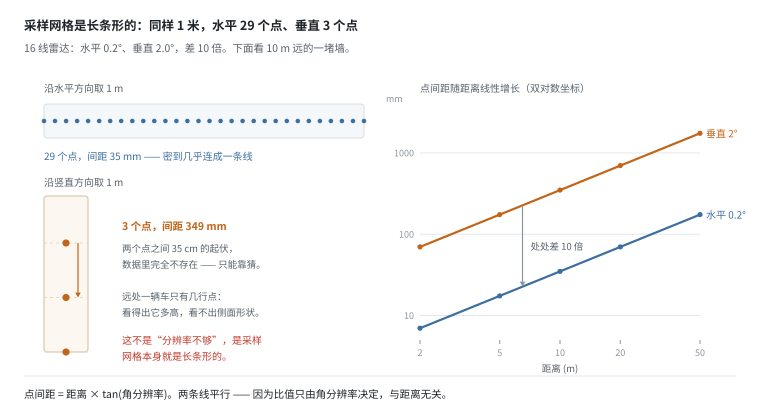
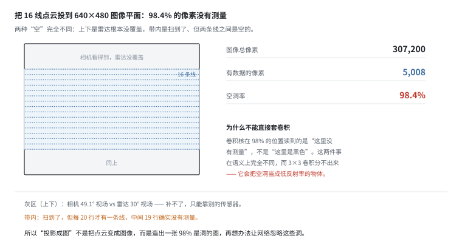
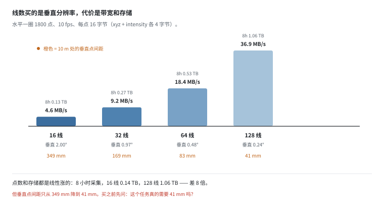
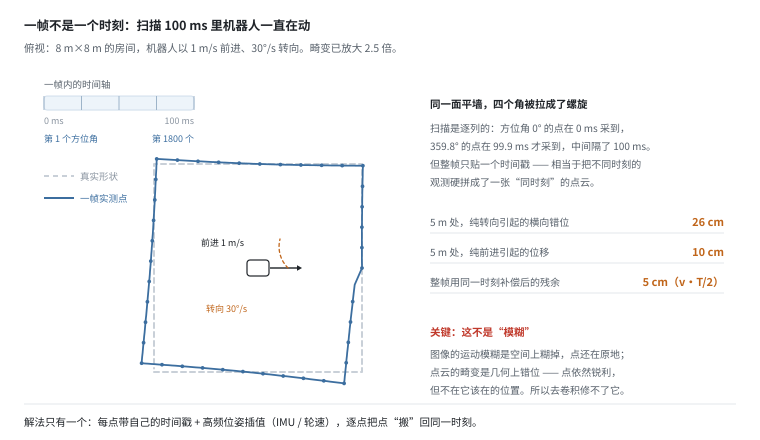
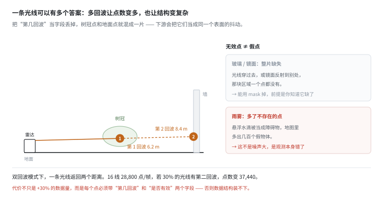
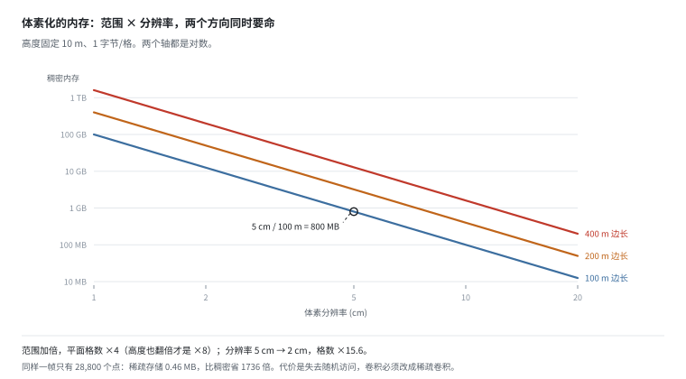
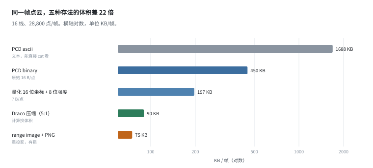

# 点云：稀疏、各向异性、而且一帧不是一个时刻

> 阶段 2 · 传感器数据 ｜ 写作时间 2026-11
>
> 配套实验：[`examples/02_sensor_data/06_pointcloud.py`](../examples/02_sensor_data/06_pointcloud.py)

## 1. 它解决什么问题

相机给你一张图，但那张图里没有距离。要知道"前面那面墙离我多远"，靠的是三角化、视差、或者训练出来的深度估计 —— 三种都有系统误差，而且在纹理缺失、反光、远距离时直接失效。

激光雷达给的是**直接测出来的距离**：一束光打出去，测往返时间，乘以光速除以二。误差是厘米级，和纹理、光照、材质基本无关。

这就是为什么移动机器人、自动驾驶、工业 AGV 上，雷达几乎是标配 —— 它提供的是"绝对尺度的几何"。

但代价在数据侧，而且代价比大多数人预估的大：

> **点云不是"三维的图像"，它是一组"带方向、带时刻、可能带多个回波"的射线测量结果。**

这句话里每一个定语都是一份责任：带方向 → 必须记安装位姿；带时刻 → 必须记逐点时间戳；多回波 → 必须记第几回波。**丢掉任何一个，这份点云就退化成"漂亮但用不了的点阵"。**

这一篇讲的就是这些定语，以及不理解它们会做出什么样的错误设计。

## 2. 它不是一张图：三个结构性差异

点云最容易被误判的地方：它能渲染成很漂亮的效果图，看起来就是一张图。但数据结构上完全不是：

| | 图像 | 点云 |
|---|---|---|
| 排列 | 固定网格，行列有序 | 无序集合，点的顺序没有意义 |
| 邻居 | 上下左右是确定的 | 要自己搜（KD-tree / 体素） |
| 每帧数量 | 恒定（640×480 永远是 307,200） | 可变（遮挡少一帧就多几千点） |
| 空洞 | 有值，哪怕是 0 | 那个位置**没有元素** |

第三条最关键：**图像的空洞是"值为 0"，点云的空洞是"不存在"。**

这个差别决定了后面所有工程选择：能不能用卷积（需要网格）、怎么压缩（需要有序）、怎么和图像融合（需要对应关系）。而且它没法事后补救 —— 格式定错了，模型再好也补不回来，只能重新处理整个数据集。

## 3. 角分辨率决定一切

机械式激光雷达的采样方式是：一圈一圈地扫。16 线雷达有 16 个激光发射器，装在一个旋转头上，水平转一圈、垂直 16 条线。

- 水平：转一圈，每 0.2° 打一个点 → 一圈 1800 个方位角
- 垂直：16 条线铺开 30° 视场 → 线间 2.0°

点间距就是简单的三角：

```
点间距 = 距离 × tan(角分辨率)
```



左边这张对比图是这一节的全部要点：**同样 1 米的长度，水平方向能放 29 个点，垂直方向只能放 3 个。**

因为 0.2° 和 2° 差 10 倍，而点间距和角度成正比。所以：

```
   距离    水平点间距    垂直点间距    各向异性比
    2m       7.0mm       69.8mm         10x
    5m      17.5mm      174.6mm         10x
   10m      34.9mm      349.2mm         10x
   20m      69.8mm      698.4mm         10x
   50m     174.5mm     1746.0mm         10x
```

两个观察：

**1. 点间距随距离线性增长。** 10 m 处水平 35 mm，50 m 处 175 mm —— 同一台雷达，远处就是更糊。

**2. 水平和垂直差 10 倍，而且这个比值和距离无关。** 右图两条线是平行的，因为它们只由角分辨率决定。所以"平均点间距"这个指标是没意义的：它把两个差一个数量级的方向平均成了一个数，谁也代表不了。

**这带来的直接后果**：远处一辆车只有几行点。你能看出"这里有个东西、大约多高"，看不出"它的侧面是什么形状"。这不是分辨率不够，是**采样网格本身就是长条形的** —— 加线数能改善垂直方向，但成本是线性的（下一节）。

## 4. 稀疏到什么程度：98.4% 是空的

把 16 线雷达的点投到 640×480 的图像平面上（相同视场），会得到：

```
  图像总像素             307,200
  有数据的像素             5,008
  空洞率                   98.4%
  水平：每几列一个点         2.0
  垂直：每几行一条线        19.6
```



**98.4% 的像素是空的。**

而且图里区分了两种"空"，这个区分很重要：

- **上下的灰区**：相机 49.1° 视场，雷达只有 30° —— 雷达根本没往那儿看。这块**补不了**，只能靠别的传感器或者干脆裁掉。
- **带内的空白**：雷达看了，但每 20 行才有一条线，中间 19 行确实没有测量。这块**也补不了**，但性质不同 —— 它是"分辨率不够"，不是"没覆盖"。

### 为什么不能直接套图像模型

很多人的第一反应是：投影成图，然后用 ResNet。这个思路的失败点非常具体：

> 卷积核在 98% 的位置上读到的是"这里没有测量"，不是"这里是黑色"。

这两件事在语义上完全不同。一个 3×3 卷积看到 9 个位置里 8 个是 0，它会认为"这里是一块低反射率的暗物体"，而实际上它应该说"这里我不知道"。网络学不到"不知道"这个概念，因为训练数据里 0 从来不表示"不知道"。

**所以投影成图不是"把点云变成图像"，而是造出一张 98% 是洞的图，然后再想办法让网络忽略这些洞。** 这个"想办法"就是 range image 那一支研究（用 mask、用稀疏卷积、用深度补全）在做的事。

## 5. 点云 vs 深度图：两个数字不能直接比

经常能看到"深度图每秒 900 万点，雷达只有 29 万点，所以深度图信息多 32 倍"这种说法。这个比较是误导的：

```
                    每帧点数    帧率      每秒点数
  16 线雷达         28,800     10       288,000
  640x480 深度图   307,200     30     9,216,000
```

| | 雷达 | 深度图 |
|---|---|---|
| 每个点的来源 | 独立的飞行时间测量 | 像素级相位差 / 立体匹配 |
| 噪声相关性 | 相互独立 | 空间上强相关（共享同一个光斑/匹配窗口） |
| 无效值 | 无（除镜面/超量程） | 10–30%（玻璃、黑色、过远） |
| 角覆盖 | 16 条线 | 完整二维视场 |

即使折算掉 20% 的无效像素，深度图还是 26 倍。但**这个折算本身仍然是误导的**：深度图的 307,200 个像素里，大量是内插/平滑出来的，独立自由度远小于像素数。相邻 10 个像素的误差几乎是同一个误差 —— 它们共享同一个结构光斑。

> **真正该比的是"每平方米多少独立测量"，不是"每秒多少点"。**

按这个标准：雷达稀疏，但每次测量相互独立；深度图稠密，但误差成片相关。所以两者的适用场景不同 —— 雷达适合远距离障碍物检测（要可靠的距离），深度图适合近距离抓取（要稠密的表面形状）。**这个差异从数据就注定了，不是算法能弥补的。**

## 6. 线数：买的是垂直分辨率，不是"更好的数据"

```
  线数    每帧点数    每秒点数    原始带宽*
   16     28,800     288,000    4.61MB/s
   32     57,600     576,000    9.22MB/s
   64    115,200   1,152,000   18.43MB/s
  128    230,400   2,304,000   36.86MB/s

* 每点 4 个 float32（x, y, z, intensity）= 16 字节
```



128 线是 16 线的 8 倍点数、8 倍带宽，换来的是垂直分辨率从 2.0° 提到 0.24°：10 m 处的垂直点间距从 349 mm 降到 41 mm。

**这就是激光雷达按线数卖钱的原因 —— 同时也是数据平台的成本。** 8 小时采集：16 线 0.14 TB，128 线 1.06 TB。加上两路相机和 IMU，一个下午的采集轻松过 2 TB。

买之前该问的问题不是"哪个更好"，而是"这个任务真的需要 41 mm 吗"：

- 远距离障碍物检测：16 线够用，垂直 349 mm 在 10 m 处已经能分辨"有墙"和"没有墙"。
- 地面坑洼检测：需要更密的线，或者换个俯仰安装角把线铺在路面上。
- 精细操作（抓取、插孔）：雷达根本不该是主力，那是深度相机和触觉的活。

## 7. 一帧不是一个时刻

这是点云最反直觉、也最容易被忽略的一条。

相机是**整帧同时曝光**（30 Hz 时所有像素在同一瞬间采样）。雷达是**逐列扫描**：10 Hz 转一圈，一圈 100 ms，1800 个方位角，相邻两列差 55.6 µs。

所以一帧点云里，第一个点和最后一个点相差 100 ms —— 而它们被贴上的是**同一个时间戳**。



假设机器人以 1 m/s 前进、30°/s 转向：

```
   方位角    被扫到的时刻    已前进    转向偏了    5m 处横向错位
     0°         0.0ms      0.0cm     0.00°        0.0cm
    90°        25.0ms      2.5cm     0.75°        6.5cm
   180°        50.0ms      5.0cm     1.50°       13.1cm
   270°        75.0ms      7.5cm     2.25°       19.6cm
   359.8°      99.9ms     10.0cm     3.00°       26.2cm
```

看最后一列：**同样是 5 m 远处一个静止的点，扫描靠后的那部分横向错了 26 cm。** 一面平直的墙，在这帧点云里会变成一段斜的、扭的曲面。

对这个"墙扭了"的直觉，初学者最容易犯的错是把它当成"运动模糊"。不是：

| | 图像的运动模糊 | 点云的畸变 |
|---|---|---|
| 表现 | 空间上糊掉，点扩散成一片 | 几何上错位，点依然锐利 |
| 信息 | 丢了高频细节 | 没丢细节，但位置错了 |
| 能不能修 | 去卷积可以改善 | 去卷积完全无效 |

**点云的畸变是"点不在它该在的位置"，只能靠运动补偿（de-skew）搬回去。**

### 补偿要求：每一点都有自己的时间

- **只存帧时间戳**：只能整体用一个时刻（帧首或帧中），残余误差 = `v·T/2` = 5 cm。对导航够用，对精细操作不够。
- **存逐点时间偏移**（PCD 的 `t` 字段、ROS `PointCloud2` 的 per-point time）：每点单独插值出当时的位姿，残余误差降到毫米级。

这也是为什么雷达数据必须和 IMU / 轮速计一起采：补偿要的是"扫描过程中每时每刻的位姿"，而这个位姿只能靠高频的惯性数据插值出来。**没有 IMU 的雷达数据，de-skew 只能靠匀速假设 —— 而机器人恰恰在加减速的时候最容易撞东西。**

## 8. 一条光线可以有多个答案

激光穿过树冠时，一部分能量被树叶反射回来，另一部分继续往前，打到后面的墙或地面再返回。双回波模式下，**同一条光线返回两个距离**。



16 线 28,800 点/帧，若 30% 的光线有第二回波，点数变成 37,440（+30%）。但代价不只是 30% 的数据量，而是**每个点必须带"第几回波"这个字段**：

> 否则树冠点和地面点混成一片，下游会把它们当成"同一个表面的两次抖动"，然后在地图里造出一个半透明的、位置飘忽的障碍物。

### 无效点 ≠ 假点

这是两个完全不同的问题，很多文档混在一起讲：

| 来源 | 典型比例 | 表现 | 怎么处理 |
|---|---|---|---|
| 玻璃 / 镜面 | 15–40% | 穿透或反射到别处，整片缺失 | mask 掉（前提是知道它缺了） |
| 雨雾 | 5–20% | 假点：悬浮水滴被当成障碍物 | 没法 mask，只能靠算法识别 |
| 黑色低反射面 | 5–15% | 距离跳变或直接丢失 | 同上 |
| 超量程 | 视场景 | 无回波 | 正常，如实标注 |

**"无效"是没有测量，"假点"是测量错了。** 前者能靠 mask 处理，后者会污染地图 —— 雨天的点云不是"噪声大"，是"多了几百个不存在的物体"。

### intensity 不是反射率

回波强度按 `1/d²` 衰减：5 m 和 20 m 差 16 倍。同一块白墙，近处 intensity 255，远处可能只有 16。

而且不同厂家给的 intensity 物理含义不同：

- 回波峰值功率（与距离强相关）
- 标定后的反射率（已做距离补偿）
- 0–255 归一化（厂家自己的映射）

所以跨设备拼接点云时，**intensity 通道基本不可比** —— 只能当边缘/纹理线索用，不能当"材质"用。数据集里要写清它到底是哪一种。

## 9. 两种表示：range image 与体素

点云要进模型，必须先变成某种结构。主流两条路：

### 方案 A：投影成 range image

按 `(方位角, 仰角)` 把点重排成 2D 网格，每个像素存距离，空洞填 0 或 NaN。

- **优点**：可以直接用 2D 卷积，计算量小，实时性好。这也是绝大多数车载雷达分割模型的做法。
- **缺点**：分辨率由角分辨率决定，远处仍然稀疏；而且"没有测量"被变成了一个需要特殊处理的数值（又是第 4 节那个问题）。

### 方案 B：体素化

把空间切成固定大小的格子（如 5 cm），每格标记占用/空。

- **优点**：空间结构规整，适合做碰撞检测和路径规划。
- **缺点**：内存随范围增长得极快。



```
  范围(边长)   高度   分辨率      格数      稠密内存(1B/格)
     100m     10m     5cm      8.00e+08        800 MB
     100m     10m     2cm      1.25e+10       12.5 GB
     200m     10m     5cm      3.20e+09        3.2 GB
     200m     10m     2cm      5.00e+10       50.0 GB
```

两件事同时发生：

- 范围加倍 → 平面格数 ×4（高度不变时；三维都变就是 ×8，这就是"三次方"的来源）
- 分辨率从 5 cm 到 2 cm → 格数 ×15.6

所以"200 m 范围 + 2 cm 精度"是 50 GB 的量级 —— 单车单帧根本不可能，必须用稀疏结构（哈希表 / 八叉树）。

而一帧其实只有 28,800 个点：稀疏表示只需要存非空的 28,800 个格子，0.46 MB，**比稠密省 1736 倍**。这就是为什么点云库（PCL / Open3D）里体素过滤器默认都是稀疏的。

代价是失去了"按索引随机访问"的能力 —— 卷积用不了，必须上稀疏卷积。

### 选哪种：这是 schema 决策，不是训练时的临时决定

range image 还是体素，**直接决定了下游能用什么模型**。而且改格式意味着重新处理整个数据集。

所以这个决策应该在**采集 schema 设计阶段**就定死，并且和"要不要保留原始点云"一起考虑（下一节）。

## 10. 存储：格式的影响比想象的大

一帧 28,800 点，10 fps：



```
                    格式      每帧      每秒      备注
               PCD ascii    1688KB   17.28MB/s    文本
      PCD binary (16B/点)     450KB    4.61MB/s    原始
    量化 16 位坐标 + 8 位强度    197KB    2.02MB/s    量化
        Draco 压缩（典型 5:1）    90KB    0.92MB/s    压缩
         range image + PNG      75KB    0.77MB/s    重投影
```

**PCD ascii 是灾难**：每点约 60 字节，是二进制格式的 4 倍。但它经常是默认选项（因为可以用文本编辑器打开调试），必须主动关掉。

### 量化几乎免费

坐标范围 ±100 m，量化到 16-bit：

```
分辨率 = 200 m / 65536 = 3.05 mm
```

对 10 m 处的点，3.05 mm 的量化误差远小于雷达自身的测距噪声（±20 mm）。**所以这一步几乎没有精度损失，带宽直接减半 —— 是点云压缩里性价比最高的一步。**

### 但量化后的坐标不能用于配准

ICP 一类多帧配准算法需要亚毫米精度，量化误差会让配准抖动、并随帧数累积成漂移。

**正确做法：原始精度用于配准，量化版本用于训练和存储。** 这意味着点云数据集通常要存两份，或者存"原始 + 预计算的配准位姿"。这个成本，比精度不够重新采一遍低得多。

## 11. 和数据平台有什么关系

1. **点云的网格是各向异性的。** 远距离的垂直稀疏是主要限制，不要用"平均点间距"描述数据集，要按距离段分别报（2/10/50 m 各一行）。

2. **点数不等于信息量。** 评估数据集规模时按"独立测量数"算，不按"点数"算。128 线 8 小时的 1.06 TB，信息量可能不如 16 线 8 小时的 0.14 TB —— 如果后者的场景更丰富。

3. **逐点时间戳是运动补偿的前提。** 丢了它就只能整体近似，残余误差 5 cm 起。而且这个字段一旦没存，永远补不回来。雷达数据要配 IMU / 轮速一起采。

4. **"第几回波"和"是否无效"要进 schema。** 不是可选字段 —— 缺了它们，多回波数据在结构上就装不下，玻璃和雨天的点也无法区分。

5. **投影方式要提前定死。** range image 还是体素，决定了下游能用什么模型。这个决策在采集 schema 阶段做，不是训练时临时决定。

6. **量化是第一步压缩，配准要用原始精度。** 两套数据的管理成本，比精度不够重采一遍低得多。

## 12. 自己跑一遍

```bash
python examples/02_sensor_data/06_pointcloud.py
```

八个小节，对应上面第 2–10 节：

| 小节 | 讲什么 | 关键输出 |
|---|---|---|
| `[1]` | 点间距 | 10 m 处水平 35 mm、垂直 349 mm，差 10 倍 |
| `[2]` | 线数与带宽 | 128 线 36.9 MB/s，8 小时 1.06 TB |
| `[3]` | 与深度图对比 | 点数差 32 倍，独立自由度远不到 32 倍 |
| `[4]` | 投影空洞 | 5,008 / 307,200 = 98.4% 空 |
| `[5]` | 存储与量化 | 1688 KB → 197 KB，量化误差 3.05 mm |
| `[6]` | 运动畸变 | 5 m 处横向错 26 cm；残余 5 cm |
| `[7]` | 多回波与无效点 | 点数 +30%；intensity 差 16 倍 |
| `[8]` | 体素内存 | 200 m/2 cm = 50 GB；稀疏省 1736 倍 |

改几个参数会有意思：

- 把 `part6_motion_distortion` 的 `w` 从 `30.0` 改成 `0.0`：横向错位归零，只剩直行带来的 10 cm —— 这能直接看出"转向比直行伤害更大"。
- 把文件开头的 `V_LINES` 从 `16` 改成 `64`：10 m 处垂直点间距从 349 mm 降到 83 mm，但带宽涨 4 倍。这就是第 6 节那个取舍的具体数字。
- 把 `part8_voxel_memory` 表里的 `0.05` 全部改成 `0.1`：格数直接除以 8（100 m/5 cm 的 800 MB 变成 100 MB）。分辨率降低一半、内存降一个数量级 —— 这个关系是体素化最容易被低估的地方。

---

上一篇：[力/力矩与触觉](force-torque-tactile.md) ｜ 下一篇：[时间同步](time-sync.md)
