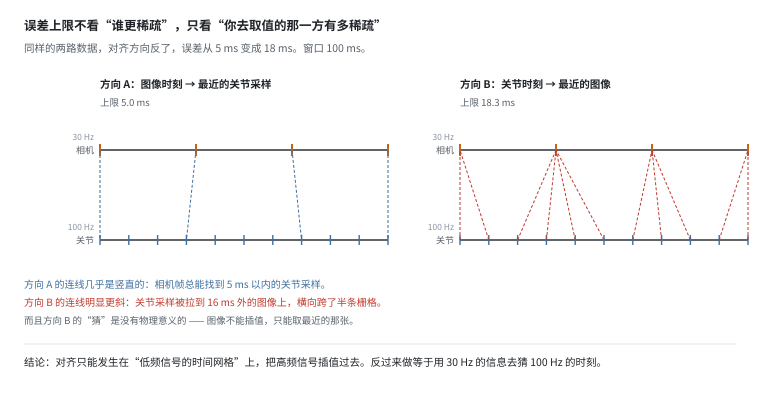
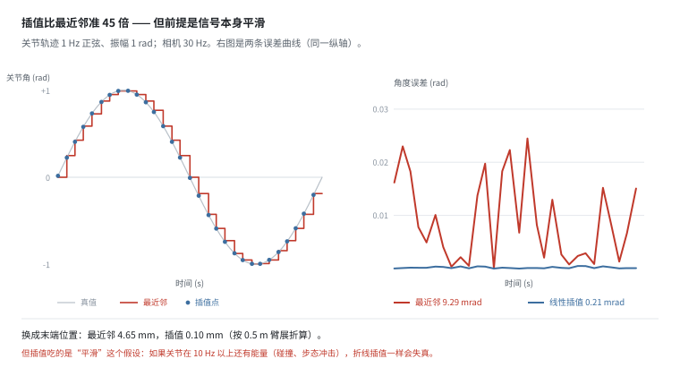
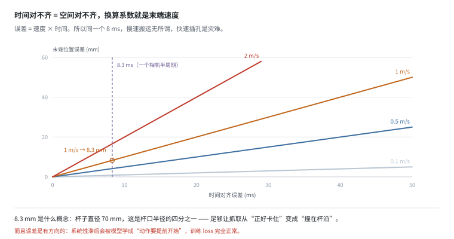
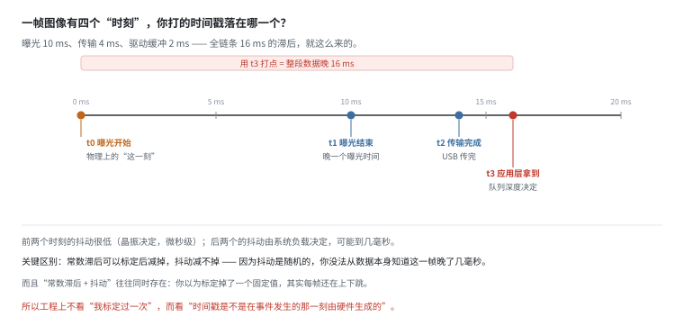
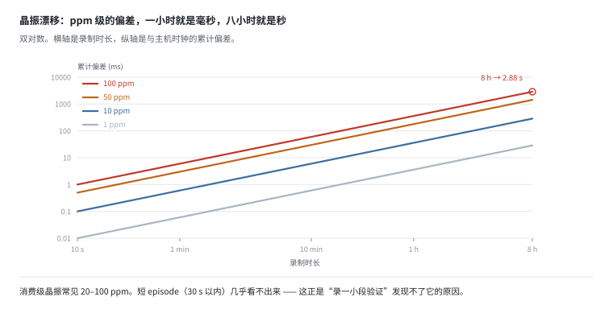
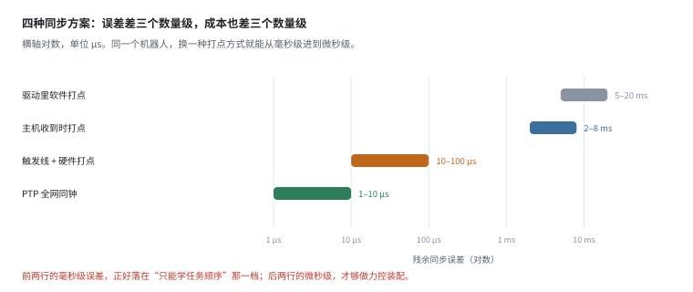
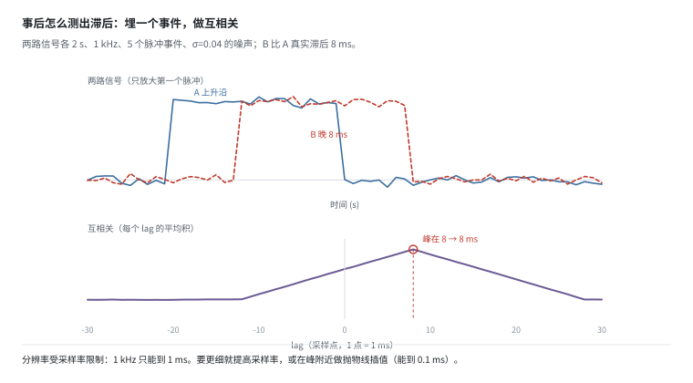

# 时间同步：数据的对齐精度，就是模型能力的上限

> 阶段 2 · 传感器数据 ｜ 写作时间 2026-11
>
> 配套实验：[`examples/02_sensor_data/04_time_sync.py`](../examples/02_sensor_data/04_time_sync.py)

## 1. 它解决什么问题

前面几篇讲的都是单个传感器。真实数据集要把它们拼成"同一时刻的一行"：

```
t=1.234s | camera: 640x480x3 | qpos: 7 维 | ft: 6 维 | imu: 12 维
```

这一行里的所有数字，理论上都应该来自同一个时刻。但物理上：

- 相机 30 Hz，每 33.3 ms 一张，还带 ±2 ms 抖动
- 关节 100 Hz，每 10 ms 一组
- IMU 200 Hz
- 力传感器 1 kHz

**它们没有共同的"同一时刻"。** 每一路都在自己的节奏上采样，所谓对齐，是在这些离散点之间做插值或取最近邻。

而这件事有一个别的章节都没有的特点：

> **错位不会在数据里留下任何痕迹。**

图片糊了你看得见，点云空洞你看得见，力传感器读数跳了你看得见。时间错位的表现是"训练正常、验证正常、上真机慢半拍" —— 你甚至没法确认是不是它。

这一篇量化六件事：对齐方向、插值能救回多少、时间和空间怎么换算、时间戳取哪一刻、晶振漂移、以及事后怎么自检。

## 2. 对齐只有一个正确方向

直觉上会认为"两种传感器采样率差多少，误差就有多大"。实际不是 —— **误差上限由"你去取值的那一方"决定**。



```
  相机 301 帧 @ 30Hz（半周期 16.67 ms）
  关节 1000 帧 @ 100Hz（半周期 5.00 ms）

  方向 A：每帧图像 -> 找最近的关节采样
    误差范围 [-5.00, +4.98] ms   平均 2.63 ms   最大 5.00 ms

  方向 B：每个关节采样 -> 找最近的图像
    误差范围 [-18.34, +18.18] ms   平均 8.43 ms   最大 18.34 ms
```

方向 A 的上限是 5 ms（关节的半周期），方向 B 是 16.7 ms（相机的半周期）。

看图就明白为什么：方向 A 的连线几乎是竖直的 —— 相机帧总能找到 5 ms 以内的关节采样；方向 B 的连线明显更斜 —— 关节采样被拉到 16 ms 外的图像上。

**为什么方向 B 不行，不只是"误差大"：** 图像不能插值。关节角是连续的物理量，中间时刻的值可以算出来；但"两张照片之间的画面"不存在，你只能取最近的那张。所以方向 B 的误差是硬误差，没有任何补救空间。

> **对齐只能发生在"低频信号的时间网格"上，把高频信号插值过去。**

顺便说一句相机抖动（围绕标称周期波动，不累积）会进一步撑大方向 B：

```
    抖动 σ=0ms -> 方向 A 最大  3.33 ms   方向 B 最大 16.67 ms
    抖动 σ=2ms -> 方向 A 最大  5.00 ms   方向 B 最大 18.34 ms
    抖动 σ=5ms -> 方向 A 最大  4.97 ms   方向 B 最大 24.48 ms
```

注意方向 A 几乎不受影响（5.00 → 4.97），因为它取的是关节，而关节没有抖动。这也是"往低频对齐"的另一个好处：**你顺手把抖动也甩掉了。**

## 3. 插值：能救回多少

正确做法：以图像时刻为基准，把关节角插值过去。

```
      对齐方式    平均角度误差    最大角度误差    末端位置误差*
      最近邻       9.29mrad       29.51mrad        4.65mm
      线性插值      0.21mrad        0.46mrad        0.10mm

* 按 0.5m 臂展、小角度近似折算
```



**插值比最近邻精确 45 倍。** 左图看得很清楚：最近邻是一条阶梯，每个台阶内保持"上一个采样点的值"，误差在台阶中点最大；插值点几乎贴着灰色真值曲线。

但注意这个 45 倍的前提：**这里的关节轨迹是 1 Hz 正弦。**

- 运动越慢、越平滑，插值越准（曲率小，折线贴得住）。
- 如果关节在 10 Hz 以上还有能量 —— 接触碰撞、步态冲击、齿轮啮合 —— 折线插值一样会失真，而且失真方向是不可预测的。

**所以插值前先看一眼信号的频谱。** 关节角在 10 Hz 以上的能量有多少，直接决定插值误差的量级。这也是为什么高频振动明显的平台（足式、协作臂碰撞）更依赖高采样率，而不是更聪明的插值算法。

## 4. 时间误差换算成空间误差

时间对不齐，等价于空间对不齐。换算系数就是末端速度：

```
  末端速度      1ms      5ms     8.3ms    16.7ms     33ms
   0.1m/s     0.1mm     0.5mm     0.8mm     1.7mm     3.3mm
   0.5m/s     0.5mm     2.5mm     4.2mm     8.3mm    16.5mm
   1.0m/s     1.0mm     5.0mm     8.3mm    16.7mm    33.0mm
   2.0m/s     2.0mm    10.0mm    16.6mm    33.4mm    66.0mm
   4.0m/s     4.0mm    20.0mm    33.2mm    66.8mm   132.0mm
```



末端 1 m/s 时，8.3 ms 的对齐误差 = 8.3 mm。**而杯子直径 70 mm —— 这已经是杯口半径的四分之一，足够让抓取从"正好卡住"变成"撞在杯沿"。**

这张图还说明了另一件事：**同一个时间误差，在不同任务上的严重程度差两个数量级。** 0.1 m/s 的慢速搬运，33 ms 才 3.3 mm，无所谓；4 m/s 的高速抛接，1 ms 就 4 mm，已经不可接受。

### 更要命的是误差的方向性

如果所有观测都**系统性滞后** 8 ms：

- 模型会学到"动作要提前 8 ms 开始"
- 训练 loss 正常，验证集也正常（因为训练和验证用的是同一份错位数据）
- 真机上表现为过冲或碰撞
- 换一个采样率不同的平台，模型立刻失效

**随机误差在训练时会被平均掉，系统性滞后会被学进去。** 后者才是真正危险的 —— 它不是"数据脏"，而是"数据里有一条假规律"。

## 5. 时间戳取哪一刻

一帧图像至少有四个可以打时间戳的时刻：



| 时刻 | 相对 t0 的滞后 | 抖动 | 说明 |
|---|---|---|---|
| t0 曝光开始（快门打开） | 0 ms | 低 | 物理上最有意义 |
| t1 曝光结束（快门关闭） | 10 ms | 低 | 比 t0 晚一个曝光时间 |
| t2 数据传输完成（USB 收到） | 14 ms | 中 | 传输时间不稳定 |
| t3 驱动交给应用层 | 16 ms | 高 | 队列深度影响 |

如果图省事用 t3（"收到数据就打个时间戳"），**所有观测会系统性滞后 16 ms，而且抖动最大。**

16 ms 在抓取任务里意味着 16 mm 的位置误差（1 m/s 时），比大多数操作任务的容差还大。

**这里有个容易混淆的点：常数滞后和抖动是两个不同的敌人。**

- **常数滞后**可以标定一次然后减掉。如果你确定它永远是 16 ms，那它其实不是问题。
- **抖动**减不掉。你怎么知道这一帧到底是 15 ms 还是 19 ms？从数据本身无从得知。
- 现实里两者同时存在，你以为标定掉了一个固定值，其实每帧还在上下跳几毫秒。

所以工程上看的不该是"我标定过一次"，而是"**时间戳是不是在事件发生的那一刻，由硬件生成的**"。

## 6. 晶振漂移：一小时后差多少

每台设备用自己的晶振计时。标称 30.000 Hz 的相机，实际可能是 30.00003 Hz。这个 ppm 级偏差会线性累积：

```
  晶振偏差    1 分钟    10 分钟     1 小时     8 小时
    1ppm      0.1ms      0.6ms      3.6ms     28.8ms
   10ppm      0.6ms      6.0ms     36.0ms    288.0ms
   50ppm      3.0ms     30.0ms    180.0ms   1440.0ms
  100ppm      6.0ms     60.0ms    360.0ms   2880.0ms
```



消费级晶振常见 20–100 ppm。**100 ppm 的相机，录 8 小时后和主机时钟差了 2.9 秒** —— 整段数据的时间轴全错位，而且不是整体平移（那样还能救），是**逐渐拉开**，前面几秒还对得上，后面越差越多。

短 episode（30 秒以内）基本不受影响 —— **这正是"录一小段验证一下"发现不了它的原因**。而做大规模数据采集（一次录几小时）时，它是致命的。

**校验方法**：录完检查两路数据的帧数比是否等于标称频率比。比如相机标称 30 Hz、录了 3600 秒，正确帧数应该是 108,000；如果实际是 108,050，说明晶振偏了 0.05%，累积漂移已经 1.7 秒。

这个校验只用帧数，不需要额外设备，**任何一段长数据都该跑一遍**。

## 7. 硬件同步的四个档位

"时间戳准不准"不是一个是/否问题，而是看你在哪一层打的点：



| 方案 | 典型残余误差 | 成本 |
|---|---|---|
| 驱动里软件打点（收到即记） | 5–20 ms | 免费 |
| 主机收到数据时打点 | 2–8 ms | 免费 |
| 触发线 + 硬件打点 | 10–100 µs | 几百元 |
| PTP / gPTP 全网同钟 | 1–10 µs | 几千元 |

注意后两行的量级：**微秒。** 这不是"好一点"，是换了一个数量级 —— 从"只能学任务顺序"进到"能做力控装配"。

**为什么软件打点救不回来：**

1. 从"传感器产生数据"到"你的代码拿到数据"，中间有内核缓冲、驱动队列、调度延迟，三者的延迟都随负载波动，不是常数。
2. 你能测的是"我收到它的时刻"，不是"它发生的时刻"。
3. 补偿一个常数延迟是可以的（标定一次），但补偿抖动不行 —— 抖动是随机的，你没法从数据本身知道这一帧晚了几毫秒。

所以唯一可靠的做法是：**让时间戳由硬件在"事件发生的那一刻"生成。** 相机用触发信号（strobe out）记曝光开始，雷达用 PPS 对齐角度起始，力传感器用同步采样时钟 —— 三者接同一个源，误差就只剩传播延迟（微秒级）。

相对于采集数据的成本（机器人 + 场地 + 人力），几百块的触发模块是最便宜的保险。

## 8. 事后怎么测出滞后：埋一个事件

前面说"系统性滞后你无法从数据本身发现" —— 这句话有个前提：**数据里没有可用于对齐的共同事件。**

如果采的时候埋了，事后就能测出来：



做法很简单：让机器人做一个"两路都看得见"的事件（敲一下桌面、闪一下 LED、撞一下限位），然后对两路信号做互相关，找峰值位置。

```
  互相关峰在 lag = 8 个采样点 = 8.0 ms
  分辨率 = 1 个采样 = 1.0 ms
```

三件事值得注意：

- **精度受采样率限制**：1 kHz 只能给到 1 ms。要更细，要么提高采样率，要么在峰附近做抛物线插值（能到 0.1 ms）。
- **事件必须两路都看得见**。相机和关节没有共同的物理事件，所以工程上常埋一个刻意的同步信号。
- **每段录制都要重新测**。延迟会随温度、负载、USB 拓扑变化，标定一次不能管一辈子。

**这就是数据平台该做的事：把"同步质量自检"做成采集流程的一部分** —— 每次录制自动跑一遍互相关，把测出来的偏移写进这段数据的元数据。用户拿到数据时能直接看到"这段的相机比关节晚 8.2 ms"，而不是自己去猜。

## 9. 对齐精度决定了你能学什么

```
    对齐误差    末端 1m/s 时的空间误差           能支持的任务
      1.0ms              1.0mm          力控装配、精密插孔、高速抛接
      5.0ms              5.0mm          常规抓取操作（主流 VLA 的区间）
     20.0ms             20.0mm          慢速搬运、开门、按按钮
     50.0ms             50.0mm          只能学任务顺序，学不到精细动作
    150.0ms            150.0mm          学到的策略在真机上会"慢半拍"
```

这是一条硬约束：**数据的对齐精度，就是模型能力的上限。**

模型再大也补不回来 —— 因为信息在采集时就已经错位了。你可以想象成"用 5 mm 精度的尺子量出来的一批数据，训练一个号称能做 1 mm 装配的策略"：不是模型不行，是输入里就没有那个信息。

这也解释了一个常见现象：**同一个开源模型，别人复现效果好，你复现效果差。** 差距往往不在训练配置，在你花在时间戳上的功夫 —— 而这一项在论文里几乎从不提。

## 10. 和数据平台有什么关系

时间同步是纯粹的基础设施问题，模型侧完全无能为力：

| 层次 | 能做什么 |
|---|---|
| 模型 | 无法修复时间错位 |
| 训练 | 无法检测时间错位（除非有外部真值） |
| 数据清洗 | 能发现明显的跳变，不能发现系统性偏移 |
| **采集系统** | **唯一能做对的地方** |

具体到 schema，该落盘的东西是：

1. **每路数据的原始时间戳**（不是"对齐后"的时间戳），以及它取自哪一层（t0/t1/t2/t3）。这样下游可以自己重新对齐。
2. **时钟源标识**：这一路是 PTP 还是本机晶振，属于哪个 clock domain。跨 domain 的数据不能直接比较时间。
3. **同步质量指标**：互相关测出来的偏移、抖动 σ、丢帧数。这是数据集的"体检报告"，比数据量更能预测可用性。
4. **对齐方法与参数**：用了哪个方向、插值还是最近邻、插值阶数。否则下游无法复现你的对齐结果。

**这四条应该写进任何机器人数据采集 SOP 的第一页。** 因为它们决定的不只是质量，而是这批数据"能不能用来学某个精度的任务" —— 而这个属性在采集完成那一刻就固定了，后面再怎么处理都改不了。

## 11. 自己跑一遍

```bash
python examples/02_sensor_data/04_time_sync.py
```

八个小节，对应上面第 2–8 节：

| 小节 | 讲什么 | 关键输出 |
|---|---|---|
| `[1]` | 最近邻的两个方向 | 方向 A 最大 5.00 ms，方向 B 最大 18.34 ms |
| `[2]` | 插值 vs 最近邻 | 9.29 → 0.21 mrad（45 倍） |
| `[3]` | 时间 → 空间 | 1 m/s 下 8.3 ms = 8.3 mm |
| `[4]` | 时间戳来源 | t0 0 ms / t3 16 ms |
| `[5]` | 晶振漂移 | 100 ppm，8 小时 2.88 s |
| `[6]` | 能学什么 | 1 ms → 力控，150 ms → 只能学顺序 |
| `[7]` | 四种同步方案 | 毫秒级 vs 微秒级，差三个数量级 |
| `[8]` | 互相关自检 | 峰在 8 ms，分辨率 1 ms |

改几个参数会有意思：

- 把 `part1_nearest_neighbor` 里的 `rate` 从 `100.0` 改成 `500.0`：方向 A 的上限从 5.00 ms 降到 1.00 ms，方向 B 反而略微变大（18.34 → 19.79 ms）—— 那只是样本变多、更接近理论上限。**提高高频那一路的采样率，只对方向 A 有用。**
- 把 `part4_timestamp_source` 的曝光时间从 10 ms 改成 1 ms：t3 的滞后从 16 ms 降到 7 ms。**缩短曝光是硬件工程师最便宜的一次"同步优化"**，但它治不了传输和队列的抖动。
- 把 `part5_clock_drift` 的 ppm 改成 20（消费级典型值）：8 小时是 0.58 s。仍然足够毁掉整段数据的时间轴。
- 把 `part8_cross_correlation` 的 `fs` 从 1000 改成 100：分辨率掉到 10 ms，8 ms 的滞后就测不准了（会读到 10 ms）。这是"采样率决定可测精度"的直接演示。

---

上一篇：[点云](lidar-pointcloud.md) ｜ 下一篇：[动作与状态](action-and-state.md)
