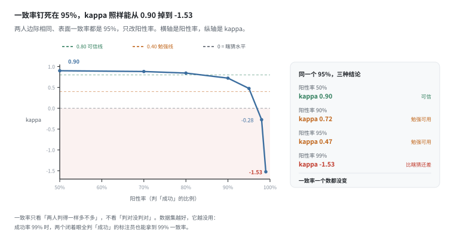
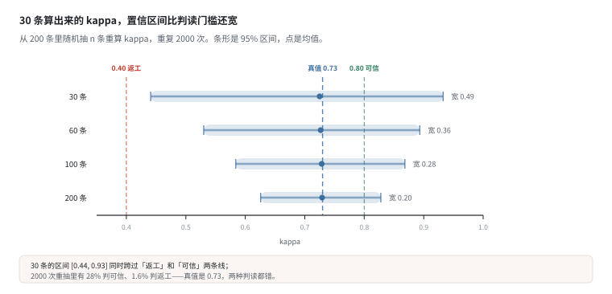
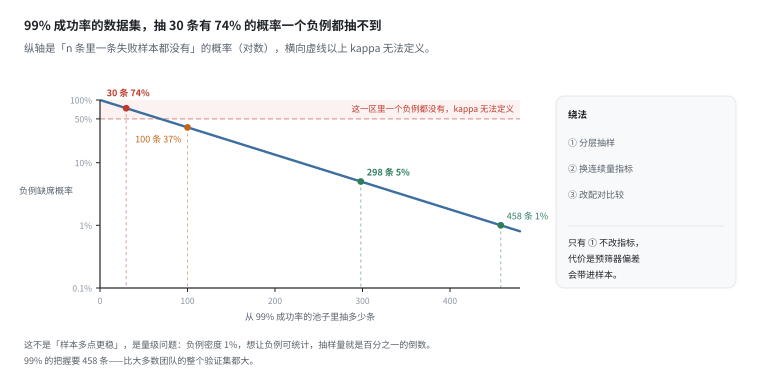
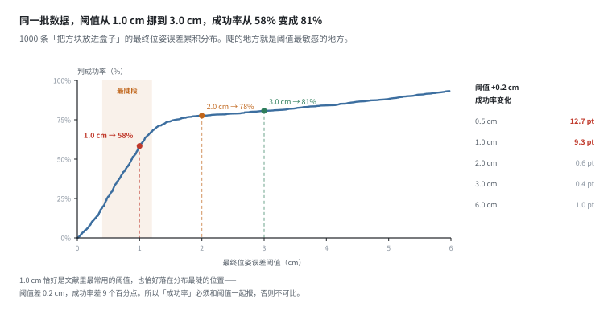
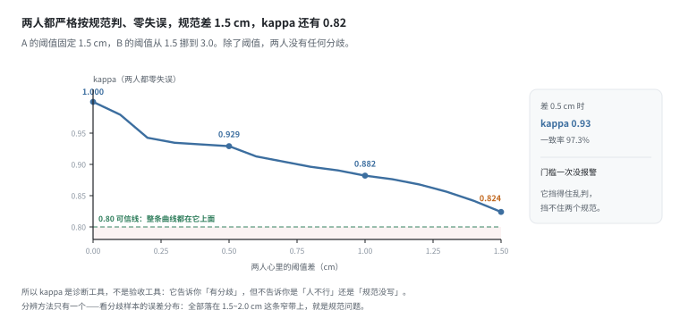
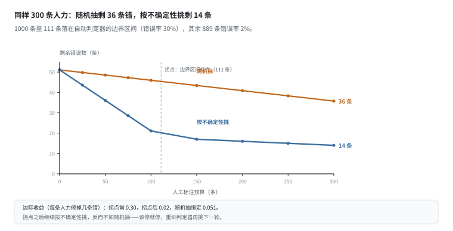
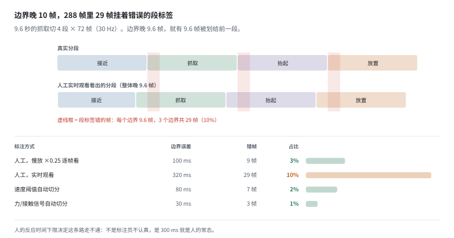
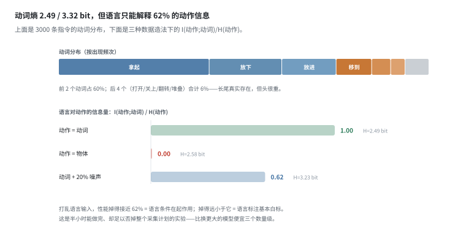

# 标注：把人的判断变成可复现的规则

> 阶段 3 · 数据流水线 ｜ 写作时间 2026-11
>
> 配套实验：[`examples/03_data_pipeline/06_annotation.py`](../examples/03_data_pipeline/06_annotation.py)

## 1. 它解决什么问题

标注最容易被当成一个"人力问题"：找人打标签，按条计费，花钱买时间。按这个理解，标注质量差就是"人不行"，解决办法是加钱、换人、加复核。

但把标注拆开看，里面能算的部分远比想象的多：

- 两个人判得一样多，就说明标注可信吗？——**不一致率和一致率都要扣掉"瞎猜也能对"的部分**，这是 kappa 干的事；
- 成功和失败在哪个误差上切？——这个数字决定整个数据集的**正负例比例**，而它经常没写进元数据；
- 一段抓取从哪一帧开始算"抓取"？——**人的反应时间**决定了这件事的精度上限，不是认真程度；
- 语言指令到底给模型提供了多少信息？——可以算出一个**上限**，而且有一个半小时就能做完的验证实验。

这些都能落到具体数字上。而算完之后的结论有点反直觉：**大部分"标注质量问题"其实是定义问题**。人没变、钱没少、流程没改，只是规范里那句"放进盒子里算成功"没写清楚"误差多少以内"。

这一篇按"先怀疑指标、再怀疑人、最后怀疑规范"的顺序走，每个结论都配着实跑的数字。

## 2. 一致率会骗人



两位标注员各判 200 条 episode 是成功还是失败。最直觉的质量指标是**表面一致率** `p_o`：两人判得一样的比例。

问题在于，`p_o` 里混着一部分"闭着眼也能对上"的一致。两个人都判 199 条成功，就算他们判的根本不是同一批 199 条，`p_o` 也有 99%。

Cohen's kappa 就是把这一部分扣掉：

```
kappa = (p_o - p_e) / (1 - p_e)
```

`p_e` 是"两人各自按自己的边际分布随机判"时的期望一致率。`p_e = 0.5` 时，kappa 和一致率差不多；`p_e → 1` 时，分母趋近 0，kappa 会被放大得面目全非——**可以是负的**。

四个场景，都是 200 条：

```
  场景                            表面一致率    期望一致率    kappa
  --------------------------------------------------------------------------
  均衡：两人各 100 成 / 100 败    95.0%         50.1%         0.900
  失衡但同步：190 成 / 10 败      98.0%         90.5%         0.789
  失衡且不同步：199 成 / 1 败     99.0%         99.0%         -0.005
  一人全判成功，另一人正常判      70.0%         70.0%         0.000
```

第二行和第三行放在一起看：一致率 98.0% vs 99.0%，kappa 0.789 vs **-0.005**。一致率更高的那一行，kappa 是负的——两人的分歧方向和各自的边际分布**对抗**，他们不但没有共同标准，还在系统性地反着来。

这不是构造出来的特例。把表面一致率**钉死在 95%**、两人边际相同，只改阳性率：

```
  阳性率      期望一致率    kappa       含义
  ----------------------------------------------------------------------
  50%         50.0%         0.900       可信
  70%         58.0%         0.881       可信
  80%         68.0%         0.844       可信
  90%         82.0%         0.722       勉强
  95%         90.5%         0.474       勉强
  98%         96.1%         -0.276      比瞎猜还差
  99%         98.0%         -1.525      比瞎猜还差
```

同样是 95% 的一致率，阳性率 50% 时 kappa 是 0.900，阳性率 99% 时是 **-1.53**。**一致率这个数字本身不能判断质量，它必须和类别分布一起读。**

推论有点反直觉：**数据集越好，一致率越没用**。成功率 99% 时，两个闭着眼全判"成功"的标注员也能拿到 99% 一致率，而这种标注对训练毫无价值。而机器人领域恰好到处是"成功率 95%+"的数据集。

kappa 的经验判读门槛（学界常用，不是硬标准）：

| kappa | 判断 |
|---|---|
| < 0.4 | 规范有问题，返工 |
| 0.4 ~ 0.6 | 勉强可用，下游指标会有噪声 |
| > 0.8 | 可信，可以当 ground truth |

## 3. 30 条算不出 kappa



几乎所有标注指南都有这句话："先让两人各标 30 条，算一次 kappa，不达标就改规范重标——此时只浪费 60 条。"

前半句是对的：早发现比晚发现好。后半句有问题：**30 条样本算出来的 kappa，不足以支撑"达标/不达标"这个判断**。

实验做法是标准的 bootstrap：先造 200 条两人判定（各自 93% 准确率），全量 kappa = 0.730，把这个当"真值"。然后从这 200 条里随机抽 n 条重算 kappa，重复 2000 次：

```
  抽样条数    kappa 均值    2.5% 分位   97.5% 分位  区间宽度
  ------------------------------------------------------------------------
  30 条       0.725         0.441       0.933       0.492
  60 条       0.727         0.530       0.893       0.363
  100 条      0.728         0.584       0.868       0.284
  200 条      0.729         0.626       0.828       0.202
```

抽 30 条时，95% 区间是 [0.44, 0.93]，宽度 **0.49**——比"返工线 0.4"到"可信线 0.8"的整个间距（0.4）还宽。这个区间同时跨过了两个门槛。

2000 次重抽里，**28% 落在"可信"**，**1.6% 落在"返工"**。而真实值是 0.730。也就是说，不管你拿到哪个结论，都是错的，只是错的方向不一样。

**「先标 30 条算一次 kappa」在数值上是不成立的。** 它只能回答"两人有没有系统性分歧"（看分歧集中在哪、是不是同一类错误），不能回答"够不够 0.8"。

需要多少条？宽度大致按 `1/√n` 缩：把 0.49 压到 0.2，需要约 `30 × (0.49/0.2)² ≈ 180` 条。实测 200 条时宽度是 0.202——刚好压线。

所以务实的读法是分两档：

- **30 条看方向**：分歧集中在某几条上，还是散在所有人身上？集中在某几条 → 规范缺个边界条件；散在所有人身上 → 大家对任务的理解不同。这两种要改的东西完全不一样；
- **200 条看数值**：够不够 0.8，敢不敢停，能不能当 ground truth。

混成一件就会出这种事故：标了 30 条，kappa 0.93，宣布达标，最后发现全量只有 0.73。

## 4. 负例去哪了



kappa 还有一个更硬的前提：**两个类别都得出现**。如果抽到的 30 条全是成功，`p_e = 1`，公式分母是 0——**不是 kappa 低，是根本没有这个数**。

失败率越低，抽不到负例的概率越高：

```
  抽样条数    一条失败都没有的概率      含义
  ----------------------------------------------------------------------------
  10 条       90.4%                     kappa 算不出来
  30 条       74.0%                     kappa 算不出来
  50 条       60.5%                     kappa 算不出来
  100 条      36.6%                     有风险
  300 条      4.9%                      基本能算
```

99% 成功率下，抽 30 条有 **74%** 的概率一条失败样本都没有。以 95% 的把握至少抽到一个负例，需要 **298 条**；99% 的把握要 **458 条**。

这不是"样本多一点更稳"的老生常谈，是量级问题：负例密度 1%，想让负例可统计，抽样量就得是密度的倒数再乘信心系数。458 条——比大多数团队的整个验证集都大。

三个绕法，代价不同：

1. **分层抽样**：先按"疑似失败"预筛，再在预筛池里抽。成功率立刻从 99% 降到 30~50%，30 条就够用。代价是预筛器的偏差会带进样本——所以预筛器要用**召回优先**，宁可多捞，别漏；
2. **换指标**：不问"成功吗"，问"位姿误差多少"。连续量不受稀有类影响，也不需要 kappa；
3. **换问题**：不问"成功吗"，问"这条比上一条好还是差"。配对比较把二分类变成了二选一，负例永远存在。

只有第 1 条不改指标。这也是"自动判定 + 人工抽检"在机器人数据里几乎成了标配的原因——它的价值不是省钱，是**让稀有类变得不稀有**。

## 5. 阈值是数据定义的一部分



1000 条"把方块放进盒子"，用最终位姿误差（cm）判成败。误差是双峰的：72% 来自"对准"那一簇（均值 0.7 cm），28% 来自"没对准"（均值 4.5 cm）。

扫一遍阈值：

```
  阈值      判成功      成功率      阈值 +0.2 cm 时成功率变化
  --------------------------------------------------------------------
  0.5 cm    264         26.4%       12.7 个百分点
  1.0 cm    583         58.3%       9.3 个百分点
  1.5 cm    742         74.2%       1.9 个百分点
  2.0 cm    776         77.6%       0.6 个百分点
  2.5 cm    790         79.0%       0.8 个百分点
  3.0 cm    807         80.7%       0.4 个百分点
  4.0 cm    842         84.2%       0.7 个百分点
  6.0 cm    933         93.3%       1.0 个百分点
```

阈值从 1.0 挪到 3.0，成功率从 58% 变成 81%——**同一批数据，差 22 个百分点**。

真正值得注意的不是这个总量，而是**敏感度的分布**：0.5~1.0 cm 这一段，每挪 0.2 cm 成功率就动 9~13 个百分点；3.0 cm 以外基本平了，每 0.2 cm 只动 0.4~1.0 个百分点。

而 1.0 cm 恰好是文献里最常用的那个阈值。也就是说，**"成功率"这个数在最有可比性的位置上最敏感**。两个实验室都报"成功率 75% 左右"，可能只是阈值差了 0.5 cm（1.5 vs 2.0：74.2% vs 77.6%）。

这不是学术争论，是可复现性问题：阈值必须写进数据集元数据、和标签一起存；报"成功率"必须带阈值，否则不可比；换阈值等于换数据集版本，不能悄悄改。

### 边界区间是人力该去的地方

```
  落在 1.2~2.4 cm 的有 111 条（11%）
```

这 11% 横跨了所有常用阈值，也是人和自动判定分歧最大的地方。它小得让人想"顺手全标了"，也大得足以制造麻烦：按下一节的自动判定器（区间内错误率 30%），这 111 条会错 33 条。

§7 会算这笔账：把这 111 条交给人工、其余交给自动判定，比随机抽 300 条人工划算多少。

## 6. 两个人心里有两个阈值



上一节的阈值如果没写进规范，会发生什么？

让 A 的阈值固定在 1.5 cm，B 的阈值从 1.5 挪到 3.0。两人都严格按自己心里的规则判——没有误判、没有走神、没有理解偏差。唯一的分歧来源就是那个阈值：

```
  A 的阈值    B 的阈值    一致率      kappa       结论
  ----------------------------------------------------------------------------
  1.5 cm      1.5 cm      100.0%      1.000       完全一致
  1.5 cm      2.0 cm      97.3%       0.929       可信
  1.5 cm      2.5 cm      95.6%       0.882       可信
  1.5 cm      3.0 cm      93.6%       0.824       可信
```

差 0.5 cm，kappa 从 1.000 掉到 0.929，一致率还有 97.3%——两个数都在"没问题"的范围里。

**关键在于：整张表没有一个值掉到 0.8 以下。** 差到 1.5 cm（1.5 vs 3.0），kappa 还是 0.824，还是"可信"。

也就是说，`kappa > 0.8` 这个门槛**挡不住阈值歧义**。它挡得住"两人判得乱七八糟"，挡不住"两人都在认真执行不同的规范"。而后者在生产中更常见，也更贵——因为它不产生任何异常信号。

这就是为什么 kappa 的正确用法是**诊断**，不是验收：

| 现象 | 诊断 | 该改什么 |
|---|---|---|
| kappa 低，分歧集中在某个数值区间 | 阈值/边界没说清 | 写规范，不是换人 |
| kappa 低，分歧散在所有样本上 | 对任务的理解不同 | 培训，或重新定义任务 |
| kappa 高，但下游指标抖 | 一致性不是瓶颈 | 别在标注上继续投入 |

分辨方法只有一个，而且不用算 kappa：**看分歧样本的误差分布**。如果所有分歧都落在 1.5~2.0 cm 这条窄带上，那答案就是把这句阈值写进规范，而不是换人。

## 7. 同样的人力，花在哪差别很大



1000 条待标，有一个自动判定器：边界区间外错误率 2%，区间内 30%。111 条落在边界区间，889 条在区间外。全靠自动判定错 51 条，即 5.1%。

现在给 300 条人工预算，两种花法：

```
  策略                    标了哪些                      剩余错误数    错误率
  ----------------------------------------------------------------------------------
  随机抽                  区间内 33 + 区间外 267        36 条         3.58%
  按不确定性挑            区间内 111 条（先吃满）       14 条         1.40%
```

同样 300 条人力，错误标签从 36 条降到 14 条，**2.6 倍**。区别只在于：人先标哪一批。

把预算从 0 扫到 300，两条曲线的形状不一样。随机抽是匀速下降的直线；按不确定性挑在最前面 111 条降得极快，然后拐平。

**拐点之后继续按"不确定性"挑，边际收益反而低于随机抽**：

```
  拐点前：每条人力修掉 0.30 条错（区间内错误率）
  拐点后：每条人力修掉 0.02 条错（区间外错误率）
  随机抽：每条人力修掉 0.051 条错，恒定
```

因为你只剩低密度区可挑，而随机抽还能顺带撞上一些边界样本。这才是"标到拐点就该停"的真正理由——不是钱花完了，是花得不如随机。

三件事跟着这条曲线走：

1. **拐点位置 = 边界区间的大小**。区间宽就多标，窄就少标，和总预算无关；
2. **拐点之后不要硬标，去重训判定器**。标一轮 → 重训 → 边界收窄 → 再挑，同样预算覆盖的有效样本更多；
3. **这个策略放大的是"判定器知道哪里不确定"，不是"判定器很准"**。判定器很差时它会均匀地错，策略退化成随机抽。

## 8. 阶段切分：人的精度上限



一段 9.6 秒的抓取切成「接近 → 抓取 → 抬起 → 放置」4 段，每段 2.4 s，30 Hz 下每段 72 帧，全段 288 帧。3 个内部边界。

边界晚 Δ 帧，就有 Δ 帧被划给前一段（早也是 Δ 帧，方向不重要）。所以每个边界错标 Δ 帧：

```
  标注方式                    边界误差    折合帧数    段标签错帧    占比
  ----------------------------------------------------------------------------------
  人工，慢放 ×0.25 逐帧看     100 ms      3.0 帧      9 帧          3%
  人工，实时观看              320 ms      9.6 帧      29 帧         10%
  速度阈值自动切分            80 ms       2.4 帧      7 帧          2%
  力/接触信号自动切分         30 ms       0.9 帧      3 帧          1%
```

实时观看的边界误差 320 ms = 9.6 帧。288 帧里有 29 帧挂着错误的段标签——**10%，每 10 帧就有 1 帧**。

这些样本在训练集里看起来完全正常：动作是对的，只是被切在了错误的位置。而且错的是**边界上连续的一整条**——零散的错还能靠统计平均掉，成条的错会被当成一个"短段"学进去。

这不是标注员不认真，是人的反应时间决定的：视觉感知延迟约 100 ms，加上判断和按键，300 ms 是常态。**任何需要帧级精度的边界，都不该指望纯人工。**

可用的组合策略：

1. 用信号（速度/力/夹爪开合）自动切出候选边界；
2. 人工只做"接受 / 移动几帧"的确认，不做从零标注；
3. 把人工的修正量记下来，反过来校准自动切分器的偏差。

第 3 步最容易被漏掉。如果人工总是把边界往后挪 3 帧，那是切分器的**系统性偏差**，该修它而不是每条手动改。修好之后人工的修正量应该变成零均值——那就是收敛的标志。在它收敛之前，你一直在用人力给一个 bug 打补丁。

## 9. 语言提供了多少信息



3000 条指令，动词分布：

```
  动词        出现次数    占比        累计
  ----------------------------------------------------
  拿起        1220        40.7%       40.7%
  放下        588         19.6%       60.3%
  放进        440         14.7%       74.9%
  移到        288         9.6%        84.5%
  推          154         5.1%        89.7%
  拉          116         3.9%        93.5%
```

动词熵 2.49 bit，上限 3.32 bit（10 个动词均匀分布），达 75%；前 2 个动词覆盖 60%。但熵只说明"指令有多单调"，不说明"语言对动作有没有用"——后者要算互信息：

```
  归一化互信息 = I(动作; 动词) / H(动作)
  1 = 语言完全决定动作，0 = 语言和动作无关
```

三种造法：

```
  动作 = 动词（理想）        H(动作) 2.49 bit，I 2.49 bit，归一化 1.00
  动作 = 物体（语言无关）    H(动作) 2.58 bit，I 0.01 bit，归一化 0.00
  动作 ≈ 动词 + 20% 噪声     H(动作) 3.23 bit，I 2.01 bit，归一化 0.62
```

第三行是真实系统的常态：语言有信息，但远不是全部。归一化 0.62 说明：**即使把语言用到极致，也只能解释动作熵的 62%**。剩下 38% 的信息在语言里根本不存在——它来自物体几何、初始位姿、抓取时的微小滑动。

这条结论直接给出那个最便宜的 sanity check：

**给模型打乱语言输入，看性能掉多少。**

- 掉得接近 62% → 语言条件真的在起作用；
- 掉得远小于它 → 语言标注基本白标，先别急着上更大的模型。

这是唯一一个能在半小时内做完、却足以否掉一整个数据采集计划的实验。它比"再加 100 小时数据"便宜三个数量级。

顺带一个推论：**语言的信息量上限由数据决定，不由模型决定**。如果 62% 是上限，换个更大的模型也只能从 40% 爬到 62%。想突破，只能改数据——加反例、加多种说法、加否定和约束：

1. **覆盖同一物体的多种动作**。只有"拿起红方块"的数据集学不会"不要拿红方块"，因为反例不存在；
2. **同一动作多种说法**。"把红方块拿起来"和"捡起红色积木"是同一个动作，让它学语义而不是背模板；
3. **记录否定和约束**。"把杯子放到盘子旁边，不要碰香蕉"才逼模型真的去读语言。

## 10. 标注规范怎么写

前面九节的所有结论，最后都要落到一份**能照着执行**的规范上。一份能用的规范长这样：

```
  每个标签字段必须有：
    · 定义：一句话说清"什么算"，不是"什么感觉"
    · 取值域：有限集合，不是自由文本
    · 阈值：带单位、带比较方向（≤ / <）、带精度（0.1 cm 还是 1 mm）
    · 边界样例：至少 3 条"差一点"的样本，标明判哪边
    · 冲突处理：谁仲裁、按什么规则；版本号：改规范 = 改数据集版本
```

对着前面几节，每条都能找到理由：

| 规范条目 | 不写会怎样 | 依据 |
|---|---|---|
| 阈值带单位和方向 | 成功率差 22 个百分点 | §5 |
| 边界样例 | kappa 0.93 但两人在判不同的事 | §6 |
| 版本号 | 新旧标签混训，指标抖动无从解释 | §5、§6 |
| 一致性用 kappa 且报类别分布 | 99% 一致率掩盖 0 共识 | §2 |
| 一致性样本 ≥ 200 条再定数值 | 30 条的区间跨过两个门槛 | §3 |
| 稀有类必须分层抽样 | 30 条里 74% 概率没有负例 | §4 |

还有两条属于"流程"而不是"规范"：**标完先看分歧样本的分布，再看 kappa**（分布告诉你原因，kappa 只告诉你有没有问题）；**段级标签不要纯人工切**（10% 的错帧率不是态度问题，是生理限制）。

## 11. 和数据平台有什么关系

标注在数据平台里不是一个独立模块，它和前面五篇是咬合的：

- **标注结果也是数据，要版本化**。换阈值等于换数据集版本——和 [`storage-and-versioning.md`](storage-and-versioning.md) 里的血缘是同一件事：一份标签必须能回答"谁在什么时候用什么规范标的"；
- **标注要能追溯到原始帧**。段标签的 29 个错帧如果定位不到具体时间戳，就没法重标，也没法在下游过滤；
- **阈值和单位要进 schema**。写在标注文档里的定义机器读不到，它得和 [`formats.md`](formats.md) 的元数据在同一个文件里、走同一套校验；
- **一致性指标要和标定一样被记录**。标定有残差曲线，标注也该有 kappa 随时间的曲线——掉下去的那一批，往往就是改了规范或换了人的那一批。

一句话：**标注质量不是"人努不努力"，是"定义清不清楚"加"样本够不够"**。前者靠写，后者靠算。

## 12. 自己跑一遍

```bash
python examples/03_data_pipeline/06_annotation.py
```

九节输出按 §2 到 §10 的顺序排：`[1]` 一致率与 kappa、`[2]` 置信区间、`[3]` 负例缺席概率、`[4]` 阈值扫描、`[5]` 阈值歧义、`[6]` 预算曲线、`[7]` 切分错帧率、`[8]` 熵与互信息、`[9]` 决策表。

有几处值得改参数自己试：

- `part2_sample_size(reps=20000)`：区间端点稳定到小数点后第三位，宽度几乎不动（200 条那行 0.202 → 0.198）。**宽度由样本量决定，不由重抽次数决定**——多抽几次只是把同一个区间量得更准；
- `part3_rare(prev=0.95)`：成功率从 99% 降到 95%，95% 把握所需的样本量从 298 条掉到 **58 条**。负例密度从 1% 变成 5%，量级立刻不同——这就是分层抽样为什么有效；
- `make_errors(ok_ratio=0.5)`：双峰变成各半，1.0 cm 处的敏感度从 9.3 降到 6.7 个百分点，但 1.0→3.0 的总差还是 22 个百分点。**同一个阈值，换了数据分布含义就变了**；
- `part6_budget(near_err=0.10)`：区间内错误率从 30% 降到 10%，按不确定性挑的优势从 2.6 倍掉到 1.4 倍。**这个策略的收益完全来自"边界区间确实更脏"**；
- `part8_language(noise=0.5)`：噪声过半，归一化互信息从 0.62 掉到 0.36。这时该问的不是"模型为什么学不好语言"，而是"语言标注是不是本来就没什么可学的"。

---

上一篇：[存储与版本](storage-and-versioning.md) ｜ 下一篇：[回到第三章目录](README.md)

延伸阅读：

- [storage-and-versioning.md](storage-and-versioning.md) —— 标签也需要版本化
- [02/action-and-state](../02-sensor-data/action-and-state.md) —— 动作空间定义影响标注粒度
