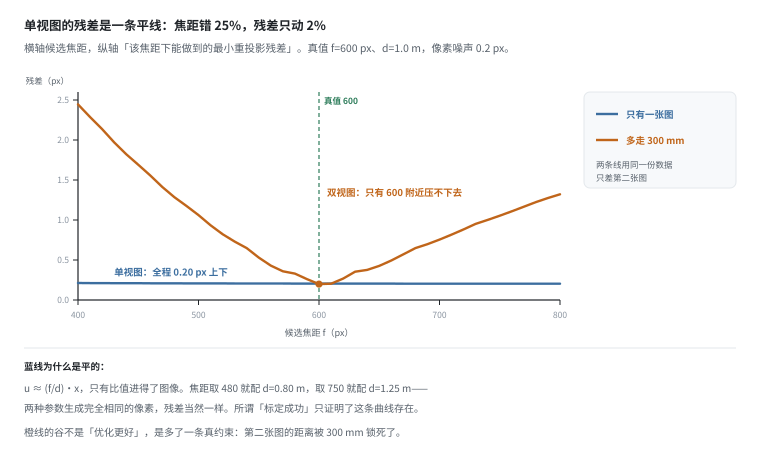
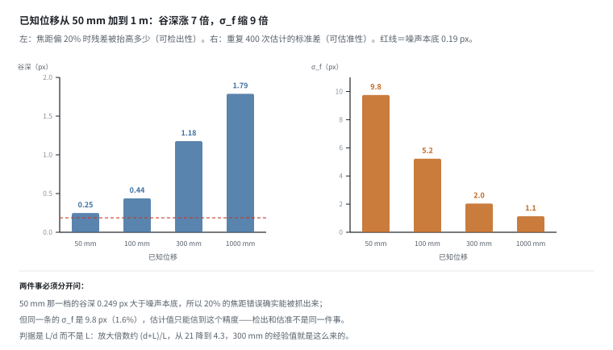
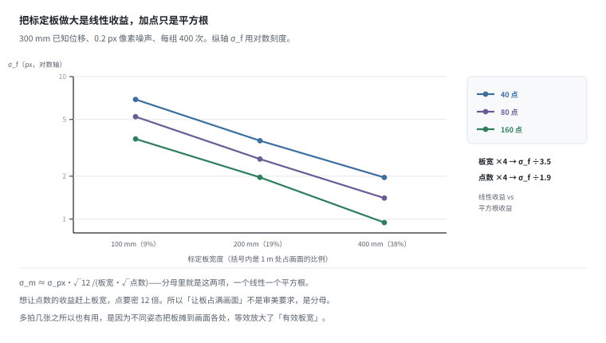
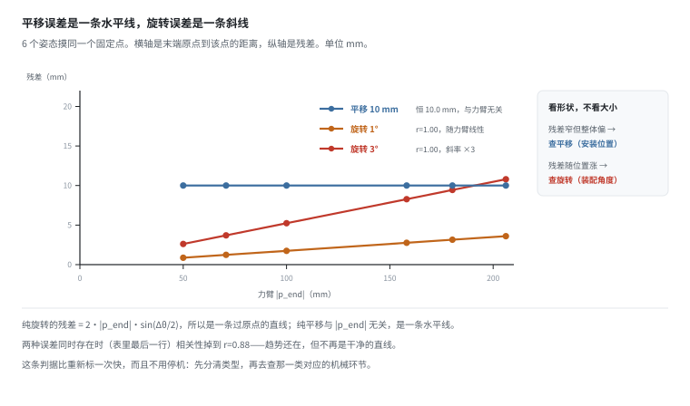
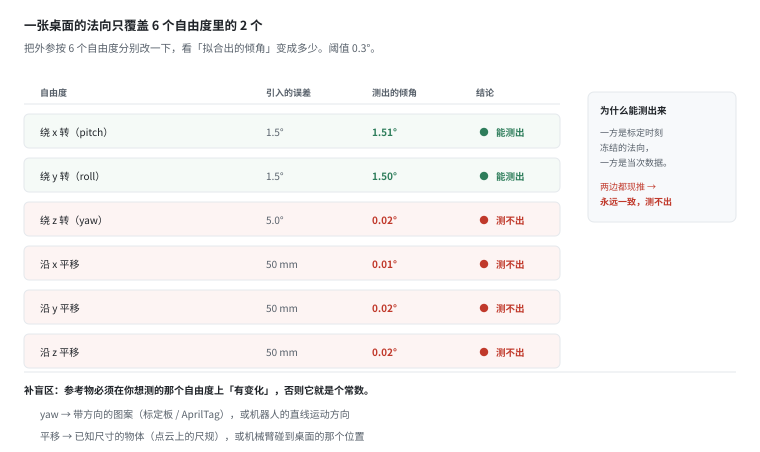
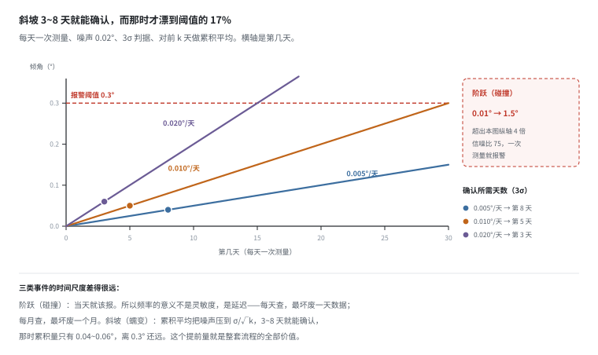

# 标定：残差 0.2 px 的标定，可能在任何地方都偏了 8 mm

> 阶段 3 · 数据流水线 ｜ 写作时间 2026-11
>
> 配套实验：[`examples/03_data_pipeline/03_calibration.py`](../examples/03_data_pipeline/03_calibration.py)

## 1. 它解决什么问题

[02 章的相机](../02-sensor-data/camera-rgbd.md)算过一笔账：外参偏 1°，1 米处就是 17.5 mm，而且**无法从数据自身发现**。那一篇停在了“这是个大问题”。

现在把这个问题摊开。你会遇到三个场景，它们在标定报告上长得一模一样：

1. 标定报告写着“重投影残差 0.2 px，内参标定完成”。
2. 三个月后，同一个工位的抓取开始时不时抓空，位移大约 8 mm。
3. 重新标一次，好了。没人知道这三个月发生了什么。

第三个场景最要命，因为它不产生任何告警。数据能采、图能看、模型能训——**错的只是一个你没在看的量**。

这一篇往前推三步：

1. 为什么“残差 0.2 px”这句话，几乎不构成任何证据
2. 外参错了，**残差的形状**能告诉你错在哪一类（平移还是旋转）
3. 标定漂了，能不能从数据里**自己发现**——能，但只覆盖 6 个自由度里的 2 个

先说结论，后面逐条给数：**标定有两个数字，一个是精度（残差多大），一个是可检测性（错了能不能发现）。报告只写前者，而掉数据的是后者。**

## 2. 残差 0.2 px 的时候，焦距可以错 25%



针孔模型只有一行：

```
u = f · x / (d + z) + cx
```

标定板是平的，所以 `z ≈ 0`，于是

```
u ≈ (f/d) · x + cx
```

**只有 `f/d` 这个比值进得了图像。**单张标定板图，永远解不出 `f` 和 `d` 各是多少。

实验里真值是 `f=600 px, d=1.000 m`，像素噪声 0.2 px。假装不知道 `f`，试一堆候选值，每个都配上让残差最小的距离：

```
  候选焦距    最优距离      f/d 比值      残差 RMS
  ------------------------------------------------------------
  480         0.801 m       598.9         0.208 px
  540         0.902 m       598.9         0.206 px
  600         1.002 m       598.9         0.205 px
  660         1.102 m       598.9         0.204 px
  750         1.252 m       598.9         0.204 px
```

焦距从 480 到 750，也就是 −20% 到 +25%，残差只在 **0.204 ~ 0.208 px** 之间动，变化 2.3%。

这不是“优化没收敛”，是**结构性退化**：整条 `f/d = 常数` 的曲线上，图像一模一样。优化器会随手停在某一点，然后报告一个很漂亮的残差。

所以“重投影残差 0.2 px”这句结论，准确的翻译是：**我找到了一条残差为 0.2 px 的曲线。**它没有说这条曲线上的哪个点是对的。这也是为什么单目标定必须配“已知尺度”——不是为了让优化收敛，是为了让问题有唯一解。

## 3. 打破退化的是一条已知长度，以及那条尺子本身



机器人正好擅长给长度：控制末端精确移动 300 mm，这个数是机械量，不依赖相机。拍第二张，第二视图的距离就被锁成 `d0 + 300mm`，两个自由度被两个方程卡住。

这里有两件事要分开看：**能检出**（20% 的错能被残差抓到）和**能估准**（估计值能信到几位）。

```
  已知位移 L    谷深        σ_f         σ_f / f
  ------------------------------------------------------
  50 mm         0.249 px    9.8 px      1.63%
  100 mm        0.437 px    5.2 px      0.87%
  300 mm        1.177 px    2.0 px      0.34%
  1000 mm       1.789 px    1.1 px      0.19%
```

最左边 50 mm 的谷深也有 0.25 px，是噪声本底 0.19 px 的 1.3 倍——**20% 的焦距错误确实能被抓出来**。但同一行的 σ_f 是 9.8 px（1.63%），你的估计值只能信到这个精度。

抬到 300 mm，σ_f 降到 2.0 px（0.34%）；抬到 1 m，才到 1.1 px。**能检出和能估准是两件事，工程上要的是后者。**

判据是“位移占工作距离的比例”，不是位移本身：谷深 ∝ 两视图之间的像差，而像差 ∝ L/d；估计精度的放大倍数同样约等于 (d+L)/L。L/d 从 0.05 提到 0.3，放大倍数从 21 降到 4.3——300 mm 这条经验值就是这么来的。

### 那把尺子本身有多准

估计量可以写成闭式：两个视图的斜率 `m1`、`m2`，`f_hat = m1·m2·L / (m1 − m2)`。`L` 直接乘在外面，所以 **L 的相对误差 1:1 变成 f 的相对误差**：

```
  300mm 尺子的误差    估出的焦距    偏差
  --------------------------------------------------
  +0 mm               601.2 px      +0.19%  (+1.2 px)
  +1 mm               603.2 px      +0.53%  (+3.2 px)
  +3 mm               607.2 px      +1.19%  (+7.2 px)
  +10 mm              621.2 px      +3.53%  (+21.2 px)
```

干净数据下估出 601.2 px（真值 600，误差 0.19%），说明这个估计量本身是对的。但尺子差 10 mm（3.3%），焦距就偏 3.5%。

**标定精度的天花板，往往不在相机，在你用来给尺度的那把尺子上。**所以工业标定臂会标定自己的长度，而“让机械臂随便走 30 cm”这件事，误差可能就有几毫米。

## 4. 「标定板要铺满画面」不是习惯，是 1/板宽



上面两条斜率的标准差是

```
σ_m = σ_px / √(Σ(x−x̄)²) ≈ σ_px · √12 / (板宽 · √点数)
```

所以：板宽翻倍 → 误差减半（线性）；点数翻四倍 → 误差减半（平方根）。实测（300 mm 已知位移、0.2 px 像素噪声、每组 400 次）：

```
  板宽      占画面    点数    σ_f         σ_f / f
  ----------------------------------------------------------
  100 mm    9%        40      6.9 px      1.15%
  100 mm    9%        160     3.7 px      0.61%
  200 mm    19%       40      3.6 px      0.59%
  400 mm    38%       40      2.0 px      0.33%
  400 mm    38%       160     0.9 px      0.16%
```

板宽 100 → 400 mm（4 倍），σ_f 从 6.9 px 降到 2.0 px（3.5 倍）；点数 40 → 160（4 倍），σ_f 从 6.9 px 降到 3.7 px（1.9 倍）。

一个是线性收益，一个是平方根收益。想让点数赶上板宽，点要密 12 倍。这就是所有标定教程都说“让板占满画面”的原因——它不是审美要求，是分母里那个 `板宽`。

顺带解释了另一件事：**多拍几张之所以有用，是因为它同时在放大有效板宽**（不同姿态把板摊到画面各处），而不只是“点多了一些”。

## 5. 外参：两种误差，两种指纹



外参错了，残差会变大。但**残差的形状比大小更有诊断价值**。

误差传播只保留一次项：

```
真值   p_cam = R · p_end + t
估计   p̂_end = R̂⁻¹ (p_cam − t̂),   R̂ = R·ΔR,  t̂ = t + Δt
代入   p̂_end = ΔR⁻¹ · p_end − ΔR⁻¹ · Δt
```

所以残差 = `|p̂_end − p_end|`：

- **纯平移**：与 `p_end` 无关，恒为 `|Δt|`
- **纯旋转**：等于 `2·|p_end|·sin(Δθ/2)`，随力臂增长

实验用 6 个不同姿态去摸同一个固定点，看残差和“力臂”（末端原点到该点的距离）的关系：

```
  误差类型              残差均值    残差范围          与力臂的关系
  ----------------------------------------------------------------------------
  无误差                0.0 mm      0.0 ~ 0.0 mm      无关（恒定）
  纯平移 10 mm          10.0 mm     10.0 ~ 10.0 mm    无关（恒定）
  纯旋转 1°             2.2 mm      0.9 ~ 3.6 mm      线性增长 r=1.00
  纯旋转 3°             6.7 mm      2.6 ~ 10.8 mm     线性增长 r=1.00
  平移 10mm + 旋转 3°   13.8 mm     7.2 ~ 20.8 mm     线性增长 r=0.88
```

指纹非常清楚：

| 现象 | 判断 |
|---|---|
| 残差范围很窄，但整体偏了一截 | 平移误差 |
| 残差随位置线性增长，范围被拉开 | 旋转误差 |

**这条判据比重新标一次更快，而且不用停机。**看到残差随距离变大，先查旋转（装配角度、支架变形）；看到所有位置偏一样多，先查平移（安装位置）。注意最后一行的 `r=0.88`——两种误差同时存在时，平移那部分把相关性拉低了，但仍然看得出趋势。

## 6. 同一个 1°，在不同距离上是不同的灾难

旋转误差被力臂放大，偏移 = `d·tan(Δθ)`：

```
  工作距离      1° 造成的偏移     2°
  ------------------------------------------------------
  0.1 m         1.7 mm            3.5 mm
  0.3 m         5.2 mm            10.5 mm
  0.5 m         8.7 mm            17.5 mm
  1.0 m         17.5 mm           34.9 mm
  2.0 m         34.9 mm           69.8 mm
```

所以“标定精度 1°”这句话没有意义，**必须带上工作距离**。1° 在 10 cm 处（指尖作业）是 1.7 mm，够用；在 1 m 处（桌面抓取）是 17.5 mm，比一个 40 mm 物体的半径还大——**抓空还是撞上去，取决于符号。**

## 7. 误差在融合里才显形

两个相机看同一块区域，各自出点云再拼起来。外参（相对位姿）有误差时，同一块表面会出现**双层**：

```
  外参角度误差    1m 处错位     视觉表现
  ------------------------------------------------------------------
  0.1°            1.7 mm        看不出来
  0.5°            8.7 mm        明显重影
  1.0°            17.5 mm       明显重影
  2.0°            34.9 mm       双层结构，不可用
  5.0°            87.5 mm       双层结构，不可用
```

0.5° 就是 8.7 mm，而“标定得还行”的行业标准经常就是 0.5° 量级。对抓取够用，对精细操作不够。

更重要的是：**这一档误差在单个相机的图里完全看不出来。**每张图都清晰、都对焦、都没有畸变——错的是两张图之间的**关系**。所以“我看了数据，觉得没问题”不能作为标定合格的判据，它测的只是单个传感器，而误差住在传感器之间。

## 8. 借重力：只能测 6 个自由度里的 2 个



上面所有内容都在讲“精度”。现在换问题：**漂了以后，能不能从数据自己发现？**

方法听起来很简单：拟合桌面平面，把它和**重力方向**比较。重力来自 IMU，是独立于相机的参考系——两个传感器不会一起错。这是检测成立的基础。

但有个必须说清的细节：比较的一方是**标定时刻冻结下来的那个法向**，不是当次现算的。如果两边都从当次数据里现推，它们永远一致，什么也测不出来。检测之所以可能，靠的是“一方是历史，一方是现状”。

把外参按 6 个自由度分别改一下，看拟合出的倾角变成多少：

```
  引入的误差              拟合出的倾角      能不能发现
  ------------------------------------------------------------------
  绕 x 转 1.5°（pitch）   1.51°             能
  绕 y 转 1.5°（roll）    1.50°             能
  绕 z 转 5.0°（yaw）     0.02°             **不能**（法向没动）
  沿 x 平移 50 mm         0.01°             **不能**（法向没动）
  沿 y 平移 50 mm         0.02°             **不能**（法向没动）
  沿 z 平移 50 mm         0.02°             **不能**（法向没动）
```

平板只能告诉你“法向歪了没有”。绕法向转（yaw）和平移都不改变法向，所以这 4 个自由度是**盲区**。要补上它们，参考物必须提供另一种信息：

- **yaw** → 一个带方向的图案（标定板、AprilTag），或机器人的直线运动方向
- **平移** → 一个已知尺寸的物体（点云上的尺规），或机械臂碰到桌面的那个位置

一句话：**参考物必须在你想测的那个自由度上“有变化”，否则它就是个常数。**这一条比灵敏度重要得多——灵敏度可以靠加点数买，可观测性买不到。

## 9. 灵敏度不是瓶颈

桌面真的水平（倾角 0），只有深度噪声。看测出来的倾角散布多大，那个散布就是分辨率下限：

```
  点数      σ_d=0.5mm     σ_d=2.0mm     σ_d=5.0mm
  ----------------------------------------------------
  16        0.030°        0.121°        0.254°
  32        0.018°        0.078°        0.168°
  64        0.012°        0.053°        0.122°
  256       0.006°        0.025°        0.068°
  1024      0.003°        0.011°        0.024°
```

点数翻 4 倍，散布减半（√N）；噪声翻 4 倍，散布也翻 4 倍（线性）。按 3σ 判据反推，2 mm 噪声下 **32 个点（3σ = 0.235°）就第一次低于 0.3° 的阈值**，1024 个点到了 3σ = 0.032°。

“每天拍 10 秒桌面”随便就是几万个点。所以分辨率从来不是短板。真正的短板是两个：

1. 上一节那 4 个测不出来的自由度；
2. **桌面本身是不是真的水平。**地板、桌腿、垫片加起来就是 0.1° 量级的偏差。

第二条决定了精度的下限：**你没法用一个 0.1° 不准的参考去测 0.01°。**这也是为什么这个方法的实用阈值是 0.3° 而不是 0.03°——不是测不出来，是参考物只到那个量级。

## 10. 热胀到不了 0.3°，所以 0.3° 都是机械事件

一个常见猜测是“温度变化让支架慢慢变形，标定就漂了”。算一下量级：支架两端有温差时，角变形 ≈ `α·ΔT`（长度在比值里消掉了，所以与支架多长无关）。

```
  材料                  α             10 K 温差的角漂移     要 0.3° 需要
  ------------------------------------------------------------------------
  铝                    23 ppm/K      0.013°                228 K
  钢                    12 ppm/K      0.007°                436 K
  ABS / PLA 打印件      90 ppm/K      0.052°                58 K
  碳纤维（沿纤维）      2 ppm/K       0.001°                2618 K
```

最“能胀”的 3D 打印件也要 58 K 的温差才胀得出 0.3°，铝要 228 K。而 10 K 温差下，最坏的那个材料也只漂 0.052°——比阈值小一个量级。

平移也一样：100 mm 铝支架、10 K 温差，伸 23 µm，在 1 m 处相当于 0.023 mm 的视差，对抓取完全无所谓。

结论很硬：**这个量级的漂移不可能是热胀，只能是机械事件**——碰撞、螺丝松动、卡扣没卡到底。而机械事件是**阶跃**，不是斜坡。这个区别决定了检测节奏。

## 11. 检测节奏：每天 10 秒，而不是每月重标



两类事件，两种检法。

**阶跃（碰撞）**：倾角从 0.01° 一步跳到 1.5°，信噪比 75。一次测量就报。所以频率的意义不是灵敏度，是**延迟**：每天查一次，最坏是一天的数据废掉；每月查一次，最坏是一个月。

**斜坡（松动蠕变）**：每天 0.010° 这种量级，单次测量完全看不出来（信号 0.01° 小于 3σ = 0.06°）。但累计均值可以把噪声压下去：

```
  每天漂移      检出天数    检出时累积      同期单次测量能不能看到
  --------------------------------------------------------------------------
  0.005°/天     8 天        0.040°          看不到（0.005° < 3σ=0.06°）
  0.010°/天     5 天        0.050°          看不到（0.010° < 3σ=0.06°）
  0.020°/天     3 天        0.060°          看不到（0.020° < 3σ=0.06°）
```

每天 0.010° 的蠕变，5 天就能确认（累计 0.05°），而阈值是 0.3°——**它在漂到阈值的 17% 时就被发现了**。

这就是“每天 10 秒”的全部理由：不是为了测得准（第 9 节说了，灵敏度早就够了），是为了**把发现时刻提前**。数据平台的成本在这里很不对称：一次 30 秒的检查，挡住的是从漂移发生到被发现之间的全部数据。

也顺便说明“重标一次”为什么不是解法：重标修的是当前状态，修不了“你不知道它已经漂了三个月”这件事。**可检测性比精度重要。**

## 12. 和数据平台有什么关系

五条，按重要性排：

1. **标定参数是数据，不是配置。**它必须进数据集、带时间戳、能追溯到具体哪一次标定。放在采集机器的本地 yaml 里等于没存——换台机器就丢了，而且丢得毫无痕迹。

2. **标定要有版本和有效期。**“2026-10-28 的标定”和“2026-11-03 的标定”是两个不同的数据版本。跨版本混合训练时，模型会学到标定差异（1 m 处 8.7 mm 的系统偏移）而不是任务——这是最难查的一类脏数据，因为每一帧单独看都是对的。

3. **质检要能查几何一致性。**哈希管字节对不对，对账管条数对不对，几何检查管**物理量对不对**。三层各管一段，缺一层就有一类事故进去之后永远出不来。

4. **把“每天 30 秒”写进采集流程，不要写成“定期检查”。**“定期”在工程上等于“不做”。这条要落到采集脚本里：开工前拍一段桌面，拟合倾角超过 0.3° 就不允许开始采集，并把结果写进当天的元数据。

5. **知道检测的边界，并把它写下来。**平面检查覆盖 pitch/roll，不覆盖 yaw 和平移。不写下来，半年后所有人都会以为“我们每天检查过标定”，包括那 4 个盲区。

> **反例的形状**：一个平台只存了 `calib.yaml` 的内容、没有存它的时间和来源。数据看起来完整，模型也能训，指标也不差。但某天有人换了一批新采的数据混进去训练，模型精度掉了 15%——因为两批数据的相机装得不一样，而元数据里两行 yaml 长得一模一样，没有任何字段能区分它们。**能证明“参数是什么”的字段，和能证明“参数是什么时候的”的字段，是两个字段。**

## 13. 自己跑一遍

```bash
python examples/03_data_pipeline/03_calibration.py
```

十一节输出，对应上面六张图：

| 输出 | 对应 |
|---|---|
| `[1]` 内参退化：五档焦距，一条残差曲线 | §2 |
| `[2]` 已知长度与尺子精度 | §3 |
| `[3]` 板宽 / 点数对 σ_f 的影响 | §4 |
| `[4]` 外参指纹：残差与力臂 | §5 |
| `[5]` 力臂放大表 | §6 |
| `[6]` 融合后的双层错位 | §7 |
| `[7]` 6 个自由度的可观测性 | §8 |
| `[8]` 灵敏度：点数与噪声 | §9 |
| `[9]` 热胀量级 | §10 |
| `[10]` 阶跃与斜坡的检出天数 | §11 |
| `[11]` 决策表 | §12 |

有几处值得改参数自己试：

- 把 `part9_thermal(threshold_deg=0.05)` 跑一遍：阈值收到 0.05° 之后，3D 打印件只要 **10 K** 温差就超标（铝要 38 K）。**这就是“精度定在哪”决定“谁是威胁”的例子**——0.3° 的阈值下热胀完全无关，0.05° 的阈值下它立刻变成主要项；
- 把 `part8_sensitivity(n_list=(8,))` 跑一遍：8 个点时 2 mm 噪声下的散布是 0.210°，3σ = 0.63°，**已经超过 0.3° 阈值**。32 个点才够（3σ = 0.235°）。所以“拍一段桌面”这句话里，“一段”的下限是几十个点，不是几百个；
- 把 `part3_board_coverage(L=0.05)` 跑一遍：已知位移从 300 mm 砍到 50 mm，同样 100 mm 板宽的 σ_f 从 1.15% 涨到 **5.38%**。尺子短了 6 倍，精度差了 4.7 倍——这个放大器就是 `(d+L)/L`。

---

上一篇：[时钟与触发链](clock-and-trigger.md) ｜ 下一篇：[数据格式](formats.md)
