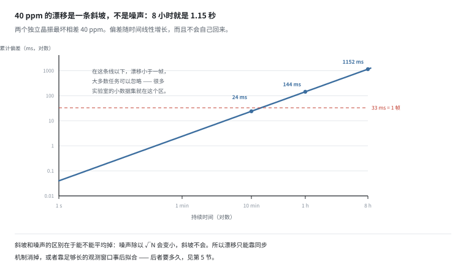
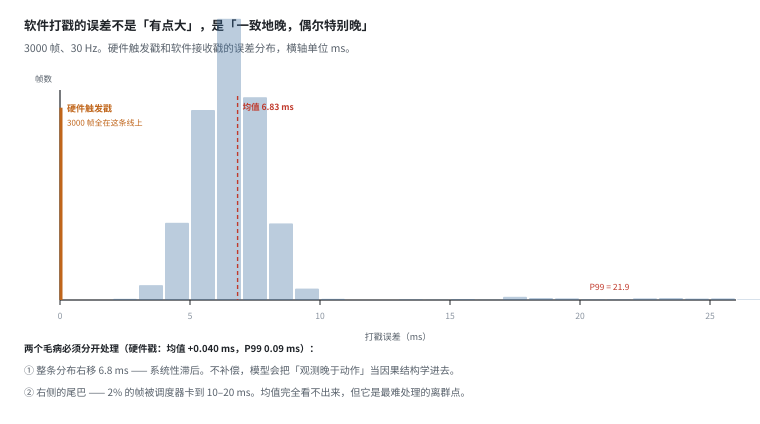
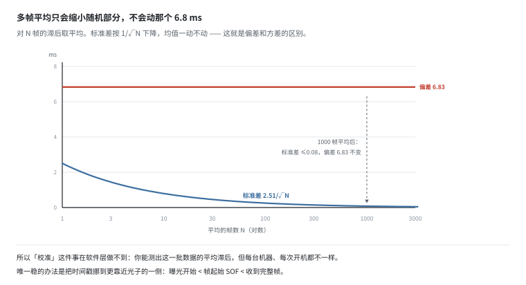
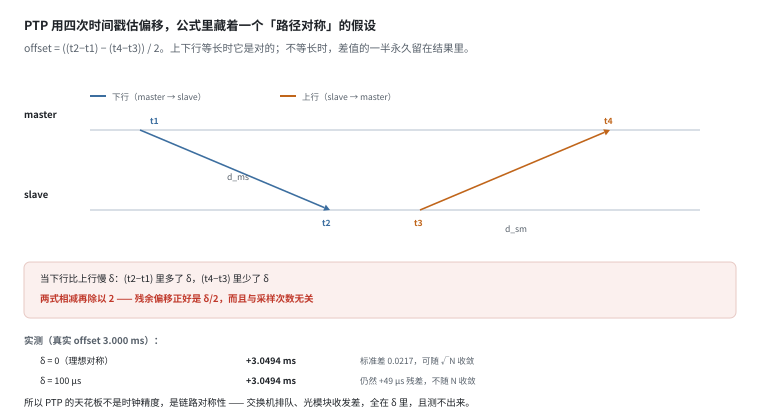
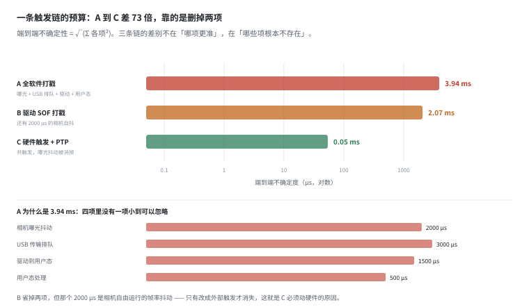
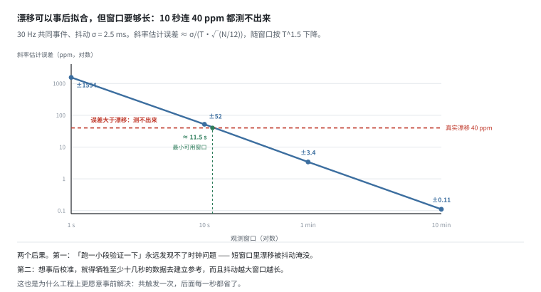

# 时钟与触发链：对齐误差能不能事后补

> 阶段 3 · 数据流水线 ｜ 写作时间 2026-11
>
> 配套实验：[`examples/03_data_pipeline/02_clock_and_trigger.py`](../examples/03_data_pipeline/02_clock_and_trigger.py)

## 1. 它解决什么问题

[02 章的时间同步](../02-sensor-data/time-sync.md)量化了对齐误差：30 Hz 相机配 100 Hz 关节，最近邻对齐平均误差 5 ms，插值后降到 0.2 mrad。那一篇的结论是“误差上限由被取值的一方决定”。

但那里有一个隐含假设：**时间戳本身是对的**。

如果时间戳来自系统时钟——软件在收到数据的那一刻打点——它带着 6.8 ms 的系统性滞后和一条 2% 的长尾。这时候插值再精细也没用：你在精确地定位一个错了 6.8 ms 的时刻。

这一篇讲三件事：漂移（斜坡误差）、抖动（单边误差）、以及把两者都压下去的工程手段（PTP 与触发链）。最后会回答一个更实际的问题：**这些误差能不能事后从数据里估出来补救？**答案比“不能”复杂——能估，但要用掉足够长的一段数据，长到你可能不愿意付。

## 2. 漂移是斜坡，不是噪声



普通晶振标称精度 ±20 ppm。两个独立时钟最坏相差 40 ppm：

```
  持续时间      40ppm 累计偏差        对 30Hz 相机相当于
  --------------------------------------------------------------------
  1 秒          0.040 ms              可忽略
  1 分钟        2.400 ms              可忽略
  10 分钟       24.0 ms               0.7 帧
  1 小时        144.0 ms              4.3 帧
  8 小时工作日  1152.0 ms             34.6 帧
```

关键不是偏差大小，而是**它的形状**：

- 噪声可以平均掉，斜坡不行。这一条是整篇的分水岭——第 4 节会证明，无论平均多少帧，那个 6.8 ms 都不会变小。
- 8 小时之后相机和关节的时钟差 1.15 秒。这不是“精度差一点”，是**数据报废**：你知道第 1000 帧画面对应的是第 1034 帧的关节角，任何插值都救不回来。
- 而且它不会自己回来。ppm 差是晶振的物理属性，恒定不变。

**实践含义**：一次采集超过 10 分钟，就必须有时钟同步机制。少于 10 分钟，累积漂移 24 ms 以内，对大多数任务可接受——这也是为什么很多实验室的小数据集“看起来没问题”。它们不是没问题，是没有跑到能暴露问题的时长。

## 3. 抖动：不是“有点大”，是“一致地晚，偶尔特别晚”



实验对比两种打戳方式（3000 帧，30 Hz）：

```
  硬件触发戳    均值   +0.040 ms   标准差  0.020 ms   P99   0.09 ms
  软件接收戳    均值   +6.826 ms   标准差  2.506 ms   P99  21.91 ms
```

差两个数量级，而且这是**两个独立的毛病**，必须分开处理：

**① 均值：6.83 ms 的系统性滞后。**这不是“不准”，是“一致地晚”。不补偿的后果不是误差变大，是**因果关系被写反**：训练时模型看到的是“观测比动作晚 6.8 ms”，它会把这个滞后学成物理规律，在真机上表现就是提前量过大。

**② 尾部：2% 的帧被调度器卡到 10–20 ms。**均值完全看不出来（P99 是 21.91，而均值只有 6.83），但它是最难处理的离群点——一帧错配就污染一个训练样本，而且这种样本在数据集里是随机分布的，清洗不掉。

所以时间戳必须在**采集端硬件**打点，越接近光子越准：

```
  曝光开始（硬件） < 帧起始 SOF（驱动） < 收到完整帧（用户态）
```

每往右挪一格，就多叠一层操作系统的调度延迟。而操作系统保证不了任何东西。

## 4. 平均救不了偏差



最常见的误解是“多帧平均一下，滞后就抵消了”。实验直接否掉了。对每个 N 随机抽 200 组，看“N 帧平均”这个估计量本身有多准：

```
  帧数 N    平均滞后      200 组之间的标准差
  --------------------------------------------------------
  1         6.745 ms      2.3995 ms
  10        6.863 ms      0.8203 ms
  100       6.830 ms      0.2514 ms
  1000      6.828 ms      0.0610 ms
```

标准差从 2.40 ms 缩到 0.06 ms，约 1/√N 的量级——这部分确实变好了。但**平均滞后一直停在 6.8 ms**，一格都没动。

这就是偏差（bias）和方差（variance）的区别：平均只压缩方差，对偏差无能为力。你可以把估计量变得很稳，稳地停在错误的位置上。

推论很硬：**“校准”这件事在软件层做不到。**你能测出这一批数据的平均滞后，但每台机器、每次开机、每个 USB 控制器都不一样。唯一的办法是把打点位置挪到更靠近物理事件的一侧，也就是动硬件。

## 5. PTP：能平均的是抖动，不能平均的是不对称



PTP 的做法是四次时间戳：

```
  master ──t1──────────────▶ slave       t2 = t1 + d_ms + offset
  master ◀──────────────t4── slave       t4 = t3 + d_sm - offset

  offset = ((t2 - t1) - (t4 - t3)) / 2
  delay  = ((t4 - t1) + (t3 - t2)) / 2
```

注意 `offset` 的公式默认了 `d_ms == d_sm`——上下行路径等长。现实中它们不等。

实验设 100 µs 的下行不对称（交换机排队、光模块收发延迟差），真实 offset 3.000 ms：

```
  样本数    估计均值        估计标准差
  ------------------------------------------------
  1         +3.0487 ms      0.0000 ms
  100       +3.0519 ms      0.0206 ms
  1000      +3.0494 ms      0.0217 ms
```

两件事同时发生，但只有一件会变好：

- **标准差**随 √N 收敛到 0.02 ms 左右——多测几次确实更准。
- **均值**稳定偏 +49 µs——100 µs 的不对称被除以 2，永久留在结果里。

**这是 PTP 精度的天花板**：不是时钟精度，不是采样次数，而是“上下行路径有多不对称”。交换机排队、非对称 PHY、光模块差异，全在这 δ 里，而且从协议内部测不出来。

## 6. 不对称有多要命

把上一节的结论写成一个表：残余偏移 = δ/2。

```
  上下行不对称 δ    残余偏移      典型成因
  ------------------------------------------------------------------------
  10 µs             5 µs          同型号光模块，链路对称
  100 µs            50 µs         交换机排队、收发延迟差
  1000 µs           500 µs        非对称 PHY、上下行带宽不同
```

这个误差的性质和抖动完全不同：**它不在噪声里，在公式的结构里。**所以它不随采样次数收敛，也不服从任何统计规律——你没法通过“多测几次”发现它，因为每一次测出来的都是同一个偏了的答案。

PTP 的定位要摆正：它把误差从毫秒级压到微秒级，但不是零。要求亚微秒级绝对对齐时，只能放弃“测”，改成“共触发”——让两个传感器共用一根线。

## 7. 触发链：一条可预算的链路



端到端不确定性 = 各环节误差的平方和开根（假设独立）：

```
  A 全软件打戳（相机、关节都靠主机时钟）：
    相机曝光抖动            2000 µs
    USB 传输排队            3000 µs
    驱动到用户态            1500 µs
    用户态处理               500 µs
    合计（RMS）             3937 µs  （= 3.94 ms）

  B 驱动 SOF 打戳（固件给帧起始打点，仍用主机时钟）：
    相机曝光抖动            2000 µs
    SOF→驱动读取             200 µs
    主机时钟自身偏移         500 µs
    合计（RMS）             2071 µs  （= 2.07 ms）

  C 硬件触发 + PTP（相机与关节共用同一触发源）：
    触发信号抖动              20 µs
    PTP 残余偏移              50 µs
    相机内部延迟               5 µs
    合计（RMS）               54 µs  （= 0.05 ms）
```

C 相对 A 好了 **73 倍**。但注意这个 73 倍是怎么来的：**不是把某一项优化了 73 倍，是删掉了两项。**

A 的四项里，没有一项小到可以忽略：最小的用户态处理也有 500 µs，占 RMS 的 13%。这就是为什么“换个更好的驱动”救不了 A——你把 1500 µs 砍到 500 µs，总 RMS 也只从 3937 降到 3700。

再看 B 的短板：那个 2000 µs 的曝光抖动，在 A 和 B 里都存在，因为它是**相机自由运行时的帧率抖动**，不是打戳方式的问题。只有把相机改成外部触发（不再自由运行），这一项才消失。这就是为什么 C 必须动硬件。

## 8. 漂移能不能事后估出来



第 2 节说“漂移是斜坡，事后无法恢复”。这句话需要修正：**斜坡可以事后拟合**，只要你有足够的观测。问题在于“足够”是多长。

假设有 N 个共同事件（同一触发源，或通过内容匹配得到的对应点），每个事件的观测带 σ = 2.5 ms 的抖动。拟合 `t_slave = a·t_master + b`，斜率 a 偏离 1 的量就是相对漂移。斜率估计的标准差约为 `σ / (T · √(N/12))`——窗口越长、事件越多、抖动越小，斜率才估得准。

实测（真实漂移 40 ppm，30 Hz 共同事件）：

```
  窗口 T      事件数 N    一次估计的误差    折算成 ppm
  ----------------------------------------------------------------
  1 s         30          1.55e-03          ± 1553.9 ppm
  10 s        300         5.18e-05          ± 51.8 ppm
  60 s        1800        3.40e-06          ± 3.4 ppm
  600 s       18000       1.15e-07          ± 0.1 ppm
```

三个结论：

- **1 秒窗口的误差是漂移本身的 39 倍**——你完全测不出来，甚至分不清是漂移还是抖动。
- **10 秒窗口误差 ±52 ppm，仍然比 40 ppm 大**——只能说“可能有漂”，说不出有多少。
- **误差要降到漂移以下，至少要 11.5 秒**（图中曲线的交点）。想反过来校准，得几十秒到几分钟。

这解释了一个常见现象：**“跑一小段验证一下”永远发现不了时钟问题。**短窗口里漂移被抖动完全淹没，看起来一切正常；等采到一小时，误差已经长到 144 ms，而这时数据已经录完了。

也解释了为什么工程上更愿意事前解决：共触发一次，后面每一秒都省了；事后拟合要牺牲至少十几秒的数据去建立参考，而且抖动越大窗口越长。

## 9. 怎么选

| 场景 | 最低要求 | 为什么 |
|---|---|---|
| 多机多传感器长时间采集 | PTP + 共触发源 | 漂移是斜坡，事后只能靠长窗口拟合，代价高 |
| 单机 10 分钟级采集 | 驱动 SOF 打戳 | 累计漂移 < 24 ms，可接受 |
| 相机与关节要对齐 | 同一触发源，或 PTP | 软件戳的 6.8 ms 滞后是系统性的，学得进去 |
| 相机与 IMU 要对齐 | IMU 戳 + 相机 SOF | IMU 频率高，插值误差小 |
| 跨天 / 跨场地合并 | 绝对时间 + 时区记录 | 否则 episode 顺序都排不出来 |

按任务周期判断更直接：

- 任务周期 > 1 s（抓取搬运、开抽屉）→ **B 够用**，误差 2 ms 量级
- 任务周期 100 ms ~ 1 s（插拔、倒水）→ **必须 C**
- 只做语言条件的行为克隆（VLA 粗粒度）→ A 也能训，但别指望精细操作

最后一行最容易被忽略：**跨天合并时，如果只有相对时间（从 0 开始），你连“这两批数据谁先录的”都答不上来。**所以时间戳的存储格式必须是「绝对时间（ns since epoch）+ 时钟域标识」，缺一不可。

## 10. 和数据平台有什么关系

五条，按重要性排：

1. **时钟域必须作为元数据存下来。**同一个 bag 里的数据可能来自 2–3 个时钟域（主机、相机内部、MCU）。不记录，别人拿到数据无法复现你的对齐，也无法判断这批数据能不能和别的批次合并。

2. **时间戳的“来源”比“数值”更重要。**`1700000000.123456789` 这个数，是曝光时刻、SOF 时刻还是收到时刻？三者差 6.8 ms。这个信息必须进 schema，不能只写在文档里——文档会丢，schema 不会。

3. **质检要能发现时钟跳变，而且要按 `ORDER BY id`。**这一条在 [录制格式](recording.md) 第 7 节展开过：用被怀疑的时间戳去排序，等于让证据自己决定顺序。

4. **不要试图用算法补系统性偏差。**可以补一个已知常量（比如统一减 6.8 ms），但补不了“每台机器不一样、每次开机不一样”的偏差。这类误差只能从硬件层消除。

5. **“同步好了”这个结论要带窗口长度。**如果有人说“我校准过了，漂移 0.1 ppm”，要问是在多长的数据上估的。1 秒窗口估出来的 ppm 没有意义（第 8 节：误差是漂移本身的 39 倍）。

> **反例的形状**：一批数据在采集时用软件打戳，后处理时做了精细插值对齐，评测指标看起来不错。但模型在真机上总是“提前动”——因为训练数据里观测永远比动作晚 6.8 ms。这个偏差不在任何一条 loss 里，只在部署之后才显形。

## 11. 自己跑一遍

```bash
python examples/03_data_pipeline/02_clock_and_trigger.py
```

七节输出，对应上面六张图：

| 输出 | 对应 |
|---|---|
| `[1]` 漂移表：1 秒到 8 小时 | §2 |
| `[2]` 两种打戳的均值/标准差/P99，以及平均救不了偏差 | §3 §4 |
| `[3]` PTP 偏移估计：对称 vs 不对称 | §5 |
| `[4]` 三条触发链的误差预算 | §7 |
| `[5]` 漂移估计精度 vs 观测窗口 | §8 |
| `[6]` 不对称量 → 残余偏移 | §6 |
| `[7]` 决策表 | §9 |

有几处值得改参数自己试：

- 把 `part1_drift(drift_ppm=5.0)` 跑一遍（换成 TCXO）：8 小时偏差从 1152 ms 降到 144 ms，**仍然是 4.3 帧**——好晶振只是把大问题变成中问题，不解决问题；
- 把 `part2_jitter(tail_prob=0.0)` 跑一遍（去掉长尾）：均值从 6.83 只降到 6.48 ms，但 P99 从 **21.91 掉到 9.30 ms**，标准差从 2.51 降到 1.21。**尾部是独立于均值的一个维度，改一个基本不动另一个**；
- 把 `part5_drift_estimate(jitter_ms=0.5)` 跑一遍：抖动缩小 5 倍，1 秒窗口的误差从 ±1554 ppm 降到 ±311 ppm，最小可用窗口从 11.5 秒缩到约 **3.9 秒**。注意不是缩小 5 倍——因为窗口是 T^1.5 的关系，T ∝ σ^(2/3)，所以只快 2.9 倍。

---

上一篇：[录制格式](recording.md) ｜ 下一篇：[标定](calibration.md)
