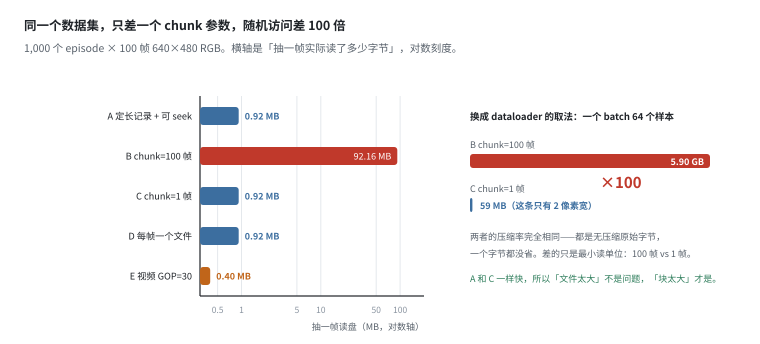
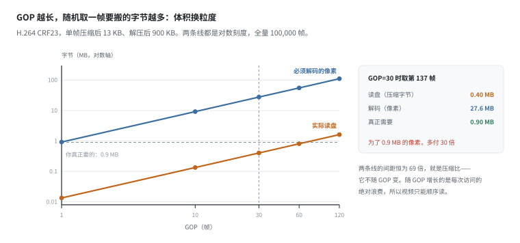
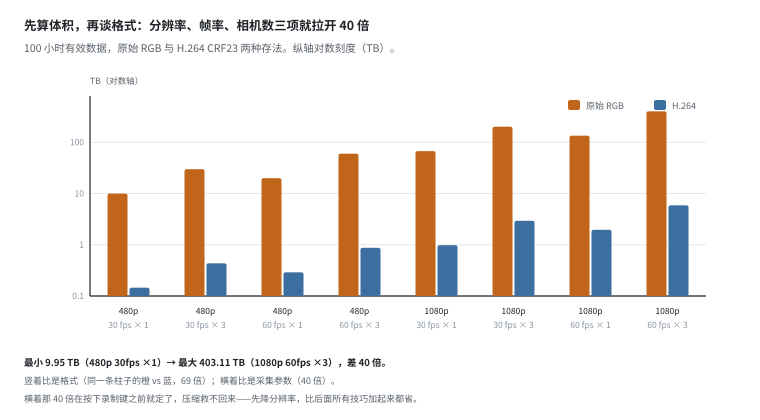
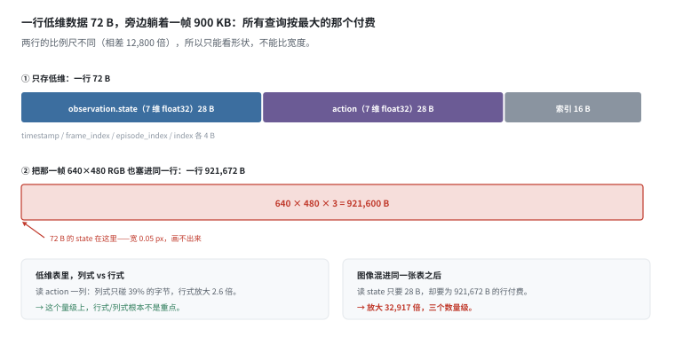
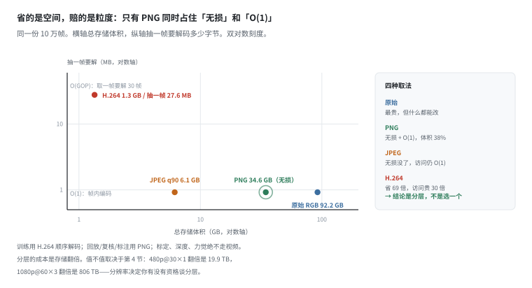
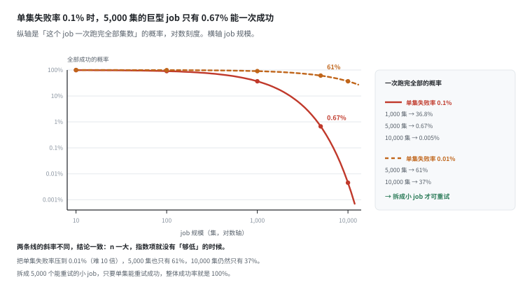

# 格式：这是块大小问题，不是压缩率问题

> 阶段 3 · 数据流水线 ｜ 写作时间 2026-11
>
> 配套实验：[`examples/03_data_pipeline/04_formats.py`](../examples/03_data_pipeline/04_formats.py)

## 1. 它解决什么问题

“用 HDF5 还是 Parquet 还是 LeRobotDataset”——这类讨论经常停在压缩率上：H.264 比原始小 69 倍，所以图像都该用视频。

但真正决定训练速度的不是压缩率。看这个场景：

> 同一个数据集（1000 个 episode，每个 100 帧 640×480 RGB），一个人 `for f in dataset` 跑得飞快，换成 `random.sample(dataset, 64)` 之后一个 batch 要读 5.9 GB。查了 CPU、worker 数、磁盘型号、文件系统，全部正常。

差异来自一个参数：`chunks=(100, 480, 640, 3)` 还是 `chunks=(1, 480, 640, 3)`。前者是 HDF5 的常见默认写法，后者是“我知道自己在干什么”。

这一篇要把四件事分开算清楚，因为它们经常被混成一件：

1. **读取粒度**（块大小）——决定随机访问的代价，最容易被忽略
2. **压缩比**——决定存储成本，代价是解码量和不可逆
3. **数据布局**（行式 / 列式 / 分桶）——决定“只读需要的部分”能不能做到
4. **转换成本**——决定你敢不敢改格式

先说结论：**这四件事里只有第一件不能让**。其余都是可以换算的取舍，而粒度错了，后面全白搭。

## 2. 抽一帧要读多少字节



数据集：1000 个 episode × 100 帧，单帧原始 900 KB，一集 92.2 MB。

```
  布局                              抽一帧读盘    解码像素      说明
  ----------------------------------------------------------------------------------
  A 定长记录 + 可 seek（.npy 式）   0.92 MB       0.92 MB       一个大文件完全没问题
  B HDF5 chunk=100 帧               92.16 MB      92.16 MB      读一个块 = 读整集
  C HDF5 chunk=1 帧                 0.92 MB       0.92 MB       最小读单位 = 一帧
  D 每帧一个文件                    0.92 MB       0.92 MB       字节相同，元数据另算
  E 视频 H.264 GOP=30               0.40 MB       27.65 MB      盘读 0.40 MB，但要解 30 帧
```

先说一个反直觉的：**A 和 C 一样快。**一段定长记录、能算出偏移，一个大文件没有任何问题。所以“文件太大”不是问题，“块太大”才是。

这是这一篇最重要的一句。它同时否掉了两个流行说法：“必须拆成很多小文件”和“必须上列式存储”。真正约束你的是**最小读单位**：HDF5 一次读一个 chunk，Parquet 一次读一个 row group，对象存储一次读一个对象——无论哪个，随机抽一帧的代价都是这个单位的大小，不是那一帧的大小。

B 和 C 只差一个参数：

```
  B chunk=100 帧：一帧 92.16 MB，一个 batch 64 个样本 5.90 GB
  C chunk=1 帧　：一帧 0.92 MB，一个 batch 64 个样本 59 MB
```

**100 倍**，而两者的字节数一个都没变——都是无压缩原始字节，压缩率完全相同。

### 为什么这个错很难被发现

因为**顺序读的时候两者一样快**。整个 episode 都是 92.2 MB，从头读到尾，B 和 C 的耗时差不到 10%。

这解释了它为什么总在训练时才炸：

```
for f in dataset: ...            # 顺序，飞快，测不出问题
random.sample(dataset, 64)       # 随机，慢 100 倍，但代码看起来一样正常
```

`benchmark` 脚本通常写成前者，`dataloader` 天生是后者。**所以“我在本地测过，很快”这句话对随机访问没有任何信息量。**

> 这一节是模型，不是跑分：假设最小读单位 = chunk 大小。真实文件系统有预读和页缓存，会让 B 好看一点，但不会好 100 倍——一个 92 MB 的块，缓存也放不下几个。

## 3. 视频把 O(1) 的随机访问变成 O(GOP)



先说清楚一件事：本仓库零依赖、不装编码器，所以下表的 bpp（每像素比特数）是**外部输入**，取自公开基准的量级，不是我们测的。但由它推出的一切都是算的，第 6 节会做敏感性检查，说明为什么结论不依赖它的具体取值。

```
  编码            bpp     单帧      全量 100,000 帧  相对原始
  ----------------------------------------------------------------
  原始 RGB        24.00   900 KB    92.16 GB  (1x)
  PNG（无损）     9.00    338 KB    34.56 GB  (3x)
  JPEG q90        1.60    60 KB     6.14 GB  (15x)
  H.264 CRF23     0.35    13 KB     1.34 GB  (69x)
  H.265 CRF23     0.25    9 KB      0.96 GB  (96x)
```

只看体积，结论是“必须用 H.264”。但代价在另一列：帧间编码里第 k 帧依赖前面的关键帧，取一帧要解整个 GOP。

```
  GOP     读盘        必须解码      相对「只解一帧」
  ------------------------------------------------------------
  1       0.01 MB     0.9 MB        1 倍
  10      0.13 MB     9.2 MB        10 倍
  30      0.40 MB     27.6 MB       30 倍
  60      0.81 MB     55.3 MB       60 倍
  120     1.61 MB     110.6 MB      120 倍
```

“读盘”和“解码”的比值恒为 69 倍（就是压缩比），随 GOP 增长的是**每次访问的绝对浪费**：GOP=30 时为了取一帧，要搬 0.40 MB 压缩字节、解 27.6 MB 像素，而真正要的只有 0.9 MB。

所以视频的正确用法是**顺序读**：按 episode 从头播一遍，每帧的解码成本摊到 GOP 上接近 1。一旦开始按帧随机采样，GOP 就变成惩罚。这也是为什么这类数据集读视频总是“整段解码”，而不是“取第 137 帧”。

| 维度 | 帧内编码（PNG/JPEG） | 帧间编码（H.264/265） |
|---|---|---|
| 解一帧的代价 | O(1) | 平均 O(GOP/2) |
| 硬件解码器 | 不需要 | 需要，且并发数有限 |
| 字节级随机访问 | 可以 | 不行，只能按 GOP 边界切 |
| 无损还原 | 是（PNG） | 否，高频细节永久丢失 |

## 4. 先算体积，再谈格式



100 小时有效数据，两种存法：

```
  分辨率      帧率    相机数    原始          H.264
  ----------------------------------------------------------------------
  480p        30      1         9.95 TB       145 GB
  480p        30      3         29.86 TB      435 GB
  480p        60      1         19.91 TB      290 GB
  480p        60      3         59.72 TB      871 GB
  1080p       30      1         67.18 TB      980 GB
  1080p       30      3         201.55 TB     2939 GB
  1080p       60      1         134.37 TB     1960 GB
  1080p       60      3         403.11 TB     5879 GB
```

同一句“100 小时数据”，体积从 9.95 TB 到 403 TB，**差 40 倍**——而格式还没开始选。

这张表应该在**采集之前**算，因为它决定三件事：采一周要多少盘、训练时一个 epoch 要从存储读多少字节、以及**你有没有资格谈“存多份”**（第 6 节）。

一个常被忽略的推论：分辨率不只是画质选择，它是**成本杠杆**。1080p@60×3 比 480p@30×1 贵 40 倍，而后者在很多抓取任务上已经够用。先降分辨率，比后面所有压缩技巧加起来都省。

## 5. 为什么图像不能进 Parquet



一帧低维数据（7 维 state + 7 维 action + 4 个索引字段，float32）：

```
  字段                          字节      占行宽
  ------------------------------------------------------
  observation.state（7 维）     28        39%
  action（7 维）                28        39%
  4 个索引字段                  16        22%
  合计                          72
```

索引字段是 `timestamp` / `frame_index` / `episode_index` / `index`，各 4 B。

Parquet 是列式：读 action 那一列只碰 39% 的字节。行式（SQLite / CSV）读一列要把整行读出来，放大 2.6 倍——**不算夸张**。所以在这个量级上，“列式 vs 行式”根本不是重点。

真正的灾难在图像上。假如把那一帧 640×480 RGB 也塞进同一张表：

```
  行宽                      921672 B
  只想读 state              28 B
  读放大                    32917 倍
```

**三个数量级。**这才是 LeRobotDataset 把图像拎出去走 mp4 的真正原因——不是因为视频压缩率高，而是因为**一张表里混两种量级的数据，会让所有查询按最大的那个付费**。

据此得到布局的第一原则：**按数据形态分工，不按“统一好管理”分工。**低维数值适合列式，高维图像适合视频，点云适合专用编码。硬塞进一种格式，两头都不讨好。

## 6. 保真：唯一「无损 + 可随机」的位置



同一份 10 万帧的数据，四种放法：

```
  存法                体积        抽一帧的代价      能不能还原
  ------------------------------------------------------------------------
  原始 RGB（分帧）    92.2 GB     0.9 MB            是
  PNG 无损            34.6 GB     0.9 MB            是
  JPEG q90            6.1 GB      0.9 MB            否，有损
  H.264 GOP=30        1.3 GB      27.6 MB           否，有损
```

两列要一起读。原始 → H.264：体积从 92.2 GB 降到 1.3 GB（省 69 倍），但抽一帧从 0.9 MB 涨到 27.6 MB（贵 30 倍）。**省的是空间，赔的是粒度。**

PNG 那一行值得单独看：体积只有原始的 38%，抽一帧还是 0.9 MB（帧内编码，O(1)），而且完全可逆。它是**唯一同时满足“无损 + 随机访问”的档位**——所以它适合做“回放/复核/标注”这一层，不适合做训练主力（38% 还是太贵）。

合理的做法不是选一个，是**分层**：

- **训练**：H.264 视频，顺序解码，便宜
- **回放 / 复核 / 标注**：PNG 或更高码率，随机访问不卡
- **标定、深度、力觉**：绝不走视频，用原始或无损

分层的成本就是存储翻倍。值不值，取决于第 4 节那张表：480p@30×1 的 100 小时是 9.95 TB，翻一倍也是 19.91 TB，可以接受；1080p@60×3 是 403 TB，翻一倍就不可能了。**分辨率决定你有没有资格分层。**

### 那个 bpp 到底靠不靠谱

既然 bpp 是外部输入，就做一个敏感性检查：

```
  H.264 bpp     压缩比        100 小时 480p@30×1
  --------------------------------------------------------
  0.25          96 倍         103.7 GB
  0.35          69 倍         145.2 GB
  1.00          24 倍         414.7 GB
  1.60          15 倍         663.6 GB
```

bpp 在 0.25~1.6 之间摆动，压缩比从 96 倍到 15 倍，体积差 6 倍——但**“视频比原始小一个数量级以上”这个结论不动**。

这是处理外部输入的通用姿势：**量级可以用，倍数要标条件。**写“省 69 倍”的时候，最好顺手写上是哪个 CRF。

## 7. 转换要多久，以及巨型 job 为什么几乎必然失败



规模：5000 个 episode × 300 帧 × 3 路相机，450 万帧，相当于单台机器人跑 14 小时的有效数据。

```
  总帧数                      4,500,000 帧
  原始体积（RGB）             4.15 TB
  H.264 CRF23 之后            60 GB
  压缩比                      69 倍
```

转换耗时（必须按**原始体积**读，编码器要先看到原始帧）：

```
  读+编码吞吐     总耗时      说明
  ----------------------------------------------------
  200 MB/s        5.8 小时    单机单线程
  800 MB/s        1.4 小时    多线程预取
  2000 MB/s       0.6 小时    NVMe + 并行编码
```

一天采集换几小时转换，这个比例可以接受。真正的问题是**它会失败**：

```
  假设跑 5.2 小时的时候挂了（磁盘满、OOM、一个坏文件）：
    · 整体重跑：再花 5.8 小时，之前 90% 的算力全丢
      均匀分布的失败点，期望浪费 2.9 小时（= 总时长的一半）
    · 按 episode 续跑：只重跑没完成的那一集，4.1 秒
  两者差 2500 倍。
```

而“必定失败”这件事可以算出来。假设单个 episode 转换失败的概率是 0.1%（已经相当乐观）：

```
  job 规模（集）  全部成功的概率
  --------------------------------------------------------
  10              99.00%
  100             90.48%
  1,000           36.77%
  5,000           0.67%
  10,000          0.005%
```

**0.67%——巨型 job 几乎必然失败。**而按 episode 处理、失败就重试，只要单集能重试成功，整体成功率就是 100%。

这不是可靠性工程，是概率论：**把一个 5000 集的大 job 拆成 5000 个独立的小 job，失败就从“必然”变成“可重试”。**

由此得到转换层的三条硬约束：

1. **幂等**：按 episode 粒度续跑，不要从头来
2. **可跳过**：产物存在就跳过，不要“一个 job 处理全部”
3. **记版本**：CRF、GOP、分辨率写进 `info.json`。改一次参数整个数据集就换了，不记版本，两次训练结果不可比

## 8. 元数据是数据：三个不起眼的文件

```
  meta/info.json                                                总帧数、fps、每个 feature 的 shape/dtype
  meta/episodes.jsonl                                           每个 episode 的起止帧号、任务文本
  meta/stats.json                                               每个 feature 的 mean/std/min/max（全局）
  meta/tasks.jsonl                                              任务文本去重后的表
  data/chunk-000/episode_000000.parquet                         低维：state/action/timestamp
  videos/chunk-000/observation.images.top/episode_000000.mp4    图像走视频
```

三个设计决策，每个都对应前面的一条结论：

**① 图像不进 Parquet，走 mp4。** ← 第 5 节：一行 72 B 旁边躺着 900 KB，所有查询按最大的那个付费。

**② `stats.json` 存全局 mean/std。** 归一化统计量必须训练和推理完全一致。每次现算，换一批数据、换个采样顺序，统计量就变了——模型在真机上直接崩。存下来，等于把“数据预处理”变成了数据集的一部分。**这是数据平台的核心职责：把隐含在代码里的约定，变成显式的数据。**

**③ `chunk-000` / `chunk-001` 分桶。** ← 第 9 节：单目录文件数有阈值。

还有一个小细节：meta 用 **jsonl 而不是 json**。一行一条，可以流式读、可以 grep、可以被 map-reduce 切分。十万个 episode 的单个 json 数组要整体载入内存——没有必要。

和 RLDS 的对比，差别不在好坏，在栈：

| 维度 | RLDS / TFRecord | LeRobotDataset |
|---|---|---|
| 存储单元 | episode 级 tfrecord 分片 | 帧级 parquet + 视频 |
| 随机访问 | 受分片大小限制 | 帧级，粒度更细 |
| 生态 | TF / JAX 为主 | PyTorch 为主 |
| schema | 必须显式声明 | 从 parquet 推断 + info.json |
| 灵活度 | 低（改 schema 要重写） | 高（加一列即可） |

**跨生态转换是有成本的，而且往往在转换中丢元数据**——这是选栈时最该算进去、也最常被漏掉的一项。

## 9. 分桶：文件数量级

```
  分桶策略          每集文件数  单目录文件数    说明
  ----------------------------------------------------------------------
  不分桶            2 个        200,000         ext4 / S3 LIST 都开始难受
                    4 个        400,000         ext4 / S3 LIST 都开始难受
  每 1000 集一个桶  2 个        2,000           固定上限，与总量无关
                    4 个        4,000           固定上限，与总量无关
```

经验阈值是“单目录一万个上下”。它不是文件系统的硬限制，而是三件事的共同作用：目录项要线性扫描、`ls` / LIST 要一次返回全部、并行遍历的元数据请求数跟着文件数涨。

分桶还有个副作用，恰好是好事：**桶号可以由 episode 号直接算出来**（`chunk = ep // 1000`），所以“第 3721 集在哪”是一次除法和一次拼接，不需要任何索引。布局本身就是索引。

这也是第 2 节那个结论的另一面：**好的布局让你不需要索引，坏的布局让你必须建索引，而索引本身又是一个要读的块。**

## 10. 和数据平台有什么关系

五条，按重要性排：

1. **先定读取粒度，再选格式。**最小读单位必须等于你随机访问的最小单位（一帧、或一个 episode）。这一条错了，压缩率、列式、索引全都救不回来——它们优化的是另一个维度。

2. **按模态分工，不要一种格式装所有东西。**低维走列式、图像走视频、点云走专用编码。混装的代价不是“不优雅”，是 32917 倍的读放大。

3. **转换必须幂等、可跳过、可追溯。**不是工程洁癖：5000 集的任务一次成功率 0.67%，你的流水线一定要能重试到 100%。

4. **把编码参数写进数据集元数据。**CRF、GOP、分辨率、bpp，缺一个都无法复现。这些参数一变，数据集就是另一个数据集。

5. **统计量随数据集存。**`mean/std` 不是训练的临时变量，是数据集的一部分，要带版本、要能追溯到是哪一批数据算出来的。

> **反例的形状**：一个平台把 RGB、深度、关节角、IMU 全部塞进同一个 HDF5，chunk 用的是“文件大小的 1/100”。它看起来非常整洁：一个 episode 一个文件，一条 `h5ls` 就能看全部内容。但训练时抽一帧要读 92 MB，而真正需要的只有 72 B 的 state——**读放大三个数量级**。这个问题不会报错，只会让 epoch 时间从 12 分钟变成 4 小时，然后所有人都在怀疑是模型太大。

## 11. 自己跑一遍

```bash
python examples/03_data_pipeline/04_formats.py
```

九节输出，对应上面六张图：

| 输出 | 对应 |
|---|---|
| `[1]` 五种布局抽一帧的代价、batch 账 | §2 |
| `[2]` bpp → 体积，以及 GOP 对随机访问的影响 | §3 |
| `[3]` 体积估算器：分辨率 × 帧率 × 相机数 | §4 |
| `[4]` 一帧的字段分解、图像进表的读放大 | §5 |
| `[5]` 三档保真的体积与代价、bpp 敏感性 | §6 |
| `[6]` 转换耗时与失败概率 | §7 |
| `[7]` LeRobotDataset 目录、RLDS 对比 | §8 |
| `[8]` 分桶后的文件数 | §9 |
| `[9]` 决策表 | §10 |

有几处值得改参数自己试：

- `part1_layouts(chunk_frames=10)`：读放大从 100 倍降到 10 倍，但**仍然不是 1**。10 帧一块意味着你永远在读 9 帧不需要的数据——**块大小只要不是 1，就一直在付这笔钱**；
- `part2_gop(gops=(1,))`：视频退化成帧内编码（相当于 MJPEG），体积回到原始字节但随机访问变成 O(1)。这就是很多机器人数据集用 MJPEG 而不是 H.264 的原因——**用空间换粒度，在训练侧经常是划算的**；
- `part6_conversion(fail_per_ep=0.0001)`：单集失败率从 0.1% 降到 0.01%，5,000 集的成功率从 0.67% 升到 61%，10,000 集仍然只有 37%。**规模一大，指数项就没有“够低”的时候**——这是必须拆 job 的数学理由，不是风格理由。

---

上一篇：[标定](calibration.md) ｜ 下一篇：[存储与版本](storage-and-versioning.md)
