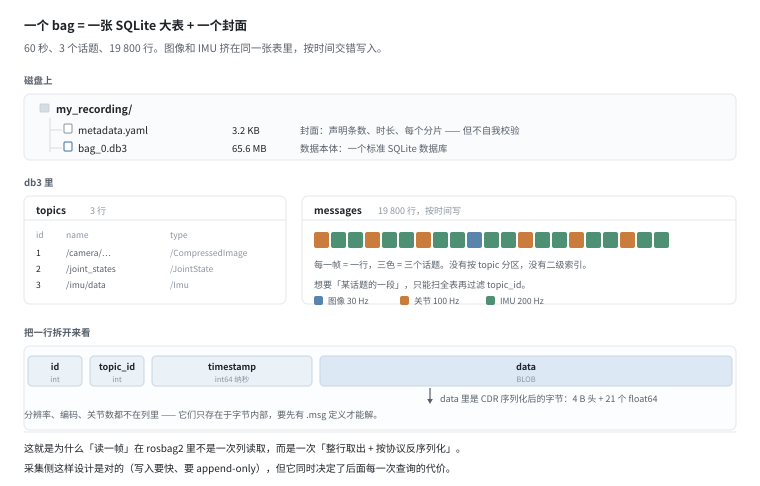
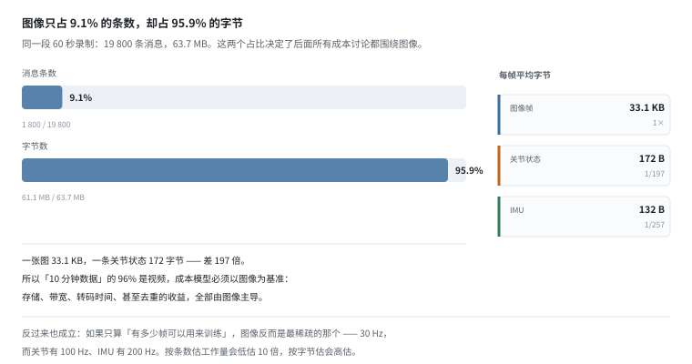
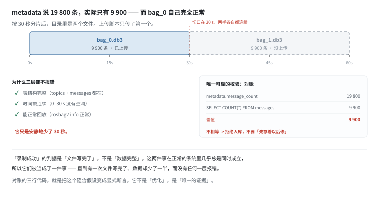
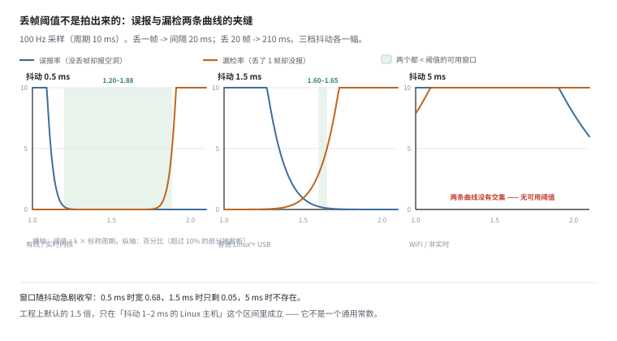
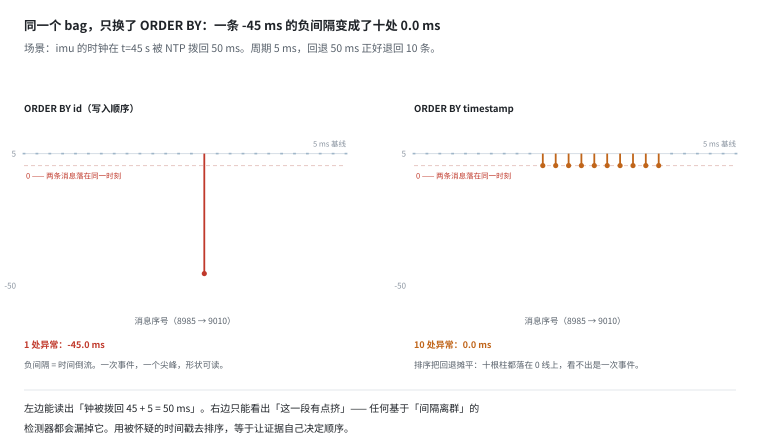
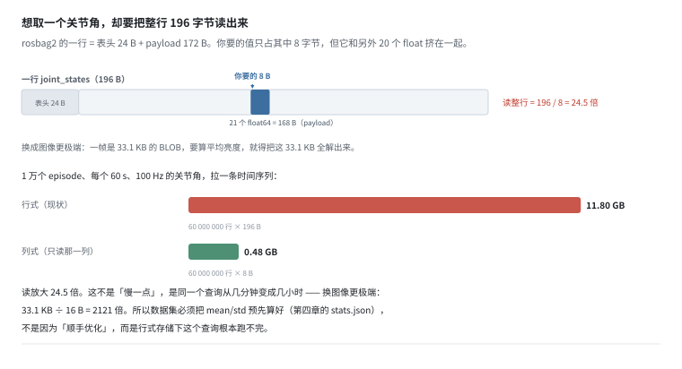

# 录制格式：rosbag2 到底是什么，以及它为什么不能当训练集

> 阶段 3 · 数据流水线 ｜ 写作时间 2026-11
>
> 配套实验：[`examples/03_data_pipeline/01_rosbag2_layout.py`](../examples/03_data_pipeline/01_rosbag2_layout.py)

## 1. 它解决什么问题

你从机器人上抓下来的第一份数据，大概率长这样：

```
my_recording/
├── metadata.yaml      3.2 KB
└── bag_0.db3          65.6 MB
```

一个 3 KB 的文本文件，加一个几十 GB 的二进制文件。新手通常会做两件事之一：把它当成“视频”直接拿去训练，或者当成“数据库”随便查两下就以为懂了。**两条路都会出错**，而且错得不明显——文件能打开、能回放、时间戳连续，就是训练效果莫名其妙地差。

这一篇要回答三个问题：

1. 一帧图像，到底存在这个文件的哪一列的哪个字节里？
2. 为什么 `metadata.yaml` 说 60 秒，你实际拿到的可能只有 30 秒？
3. 在一台没装 ROS 的机器上，怎么用纯 Python 把它读出来？

回答完之后，你会得到一个更重要的结论：**rosbag2 是录制格式，不是数据集格式。**它的设计目标是在机器人上低延迟、不丢地把字节写进磁盘；用训练集的眼光要求它，是错位的。中间那一层转换必须由数据平台补上——补什么，就是这一篇和后面五篇要讲的事。

## 2. 一个 bag 就是两张表



`.db3` 是标准的 SQLite 数据库，不是自定义格式、不是二进制协议、不需要任何 ROS 库。表结构固定为两张：

```sql
CREATE TABLE topics(
  id INTEGER PRIMARY KEY, name TEXT NOT NULL, type TEXT NOT NULL,
  serialization_format TEXT NOT NULL, offered_qos_profiles TEXT NOT NULL);

CREATE TABLE messages(
  id INTEGER PRIMARY KEY, topic_id INTEGER NOT NULL,
  timestamp INTEGER NOT NULL, data BLOB NOT NULL);
```

就这么多。`topics` 是话题清单，一个话题一行；`messages` 是数据本体，**每来一条消息就追加一行**。

于是有了第一个反直觉的事实：**图像、关节角、IMU、点云全部挤在同一张表里**。没有按 topic 分区，没有二级索引（只有 `id` 主键），没有列式存储。一条 33 KB 的图像消息和一条 132 字节的 IMU 消息是平等的两行，按到达时间交错排在一起。

第二个反直觉的事实：`data` 列是一个**不透明的 BLOB**。它里面是什么，取决于 `topics.type` 指向的消息定义（`.msg`），再按 CDR 规则解字节。库本身不告诉你这张图多少分辨率、什么编码、有没有畸变——**这些信息只存在于字节流内部**。

第三条容易忽略：`timestamp` 的单位是**纳秒**，int64。它装得下 1677 年到 2262 年，看起来绰绰有余，但这也意味着所有跟时间有关的代码都得小心整数溢出和单位换算。

所以“读一帧”在 rosbag2 里不是一次列读取，而是一次**整行取出 + 按协议反序列化**。采集侧这样设计是对的（写入要快、要 append-only、要能中途断电），但它同时决定了后面每一次查询的代价——这一点在第 8 节会算给你看。

## 3. 96% 的重量是图像

实验里造了一个 60 秒、3 个话题的 bag，量级如下：

```
topic                                   Hz        条数          总量
----------------------------------------------------------------
/camera/image_raw/compressed            30      1800     61.08MB
/joint_states                          100      6000      1.03MB
/imu/data                              200     12000      1.58MB
```



图像只占**消息条数的 9.1%**（1800 / 19800），却占了**字节数的 95.9%**（61.1 MB / 63.7 MB）。每帧 33.1 KB，而一条关节状态只有 172 字节——**差 197 倍**。

这个数字是整章的地基，因为它决定了三件截然不同的事：

- **存储与带宽成本**几乎完全是图像的成本。算盘要按图像打，不是按“条数”打。
- **压缩与去重的收益**也几乎完全来自图像。对 JSON 字段做字典编码能省的那点字节，在 96% 面前是噪声。
- **质量控制的重心**同理：丢一帧图像比丢一百帧 IMU 严重得多。

但反过来也成立：如果问题是“有多少帧能用来训练”，图像反而是最稀疏的那一路——30 Hz，而关节有 100 Hz、IMU 有 200 Hz。**按条数估工作量会低估近 10 倍，按字节估又会高估。**两个占比都得记着，用哪个取决于你在算什么。

## 4. metadata 是封面，不是凭证

`metadata.yaml` 记录每个 topic 多少条、每个分片起止时间、整体时长。rosbag2 靠它做索引，不用打开 `.db3` 就能报出“这个包 60 秒、19800 条”。它的结构大致是这样（缩进做了压缩，真实输出每个字段一行）：

```yaml
rosbag2_bagfile_information:
  version: 5
  duration: {nanoseconds: 60000000000}      # 60 s
  starting_time: {nanoseconds_since_epoch: 1700000000000000000}
  message_count: 19800                       # 全包条数，不是分片条数
  topics_with_message_count:
    - topic_metadata: {name: /joint_states, type: sensor_msgs/msg/JointState}
      message_count: 6000
  relative_file_paths: [bag_0.db3, bag_1.db3]
  files:
    - path: bag_0.db3
      duration: {nanoseconds: 30000000000}   # 单片时长
      message_count: 9900                    # 单片条数
```

四个数字里有两个是“全包级”的（`duration`、`message_count`），两个是“分片级”的（`files[].duration`、`files[].message_count`）。**事故就藏在这个层级差里**：`message_count` 说的是 19800，而你手里的 `bag_0.db3` 只有 9900。

它的危险在于：**这是自我声明，从来没有被校验过。**



实验里开启 30 秒分片，目录变成两个文件：

```
bag_0.db3      30.0s     9900 条
bag_1.db3      30.0s     9900 条
```

`metadata.yaml` 老老实实写着 `message_count: 19800`。但如果上传脚本只传了 `bag_0.db3`——按文件名 glob 时漏了、传到一半超时了、S3 分片上传少传了一片——会发生什么？

- `bag_0.db3` **自身完全自洽**：表结构完整、`topics` 三行都在、时间戳从 0 连续到 30 秒、`rosbag2 info` 正常。
- 它只是安静地少了 30 秒。
- 三层都不会报错：录制层报 success、文件系统报写入完成、SQLite 报完整性 OK。

这是数据平台最常见的一类事故，根因是一句话：**“录制成功”的判据是“文件写完了”，不是“数据完整”。**这两件事在正常系统里几乎总是同时成立，所以被当成了一件事——直到有一次不成立，而没有任何一层报错。

唯一可靠的校验是拿封面和内容对账：

```python
expected = metadata["message_count"]                  # 19800
actual   = cur.execute("SELECT COUNT(*) FROM messages").fetchone()[0]   # 9900
assert actual == expected, "bag 不完整，拒绝入库"
```

三行代码，挡掉一整类事故。时间跨度同理：`MAX(timestamp) - MIN(timestamp)` 应该等于 metadata 里的 `duration`，实验里是 30.0 秒对 60 秒，一眼就能看出来。

注意这里的动作是**拒绝入库**，不是“先存着以后修”。因为一个残缺的 bag 在平台上和完整的 bag 长得一样，一旦进了库，后面所有统计、切分、训练都会把它当完整的用。**质检的价值不在于发现问题，在于让问题没有机会流到下游。**

## 5. 三种不会报错的缺陷

除了分片缺失，bag 里还有三类更隐蔽的问题。实验分别埋了一遍：

| 缺陷 | 成因 | 现象 |
|---|---|---|
| 丢帧 | DDS QoS 配错、网络拥塞、订阅者太慢 | `/joint_states` 在 t=30.0 s 处有 210 ms 空洞（正常 10 ms） |
| 时钟前跳 | NTP 把钟拨快、切换时钟源 | `/imu/data` 在 t=45 s 后整体 +50 ms，相邻间隔从 5 ms 变成 **55 ms** |
| 时钟回退 | NTP 校正过头、时钟源回切 | 同样位置整体 −50 ms，相邻间隔变成 **−45 ms** |

三者的共同点：**都不会让录制失败**。rosbag2 照常写盘、照常关闭、照常返回成功。但它们会变成训练集里 200 ms 的动作-观测错配，或者 20 帧的静默丢帧——而 loss 曲线看不出来。

丢帧的检测方式是“相邻间隔超过阈值”，听起来简单，但阈值取多少是个真问题。下一节单独算。

## 6. 丢帧阈值不是常数



100 Hz 采样，标称周期 10 ms。丢一帧，间隔变成 20 ms；丢 20 帧，变成 210 ms。所以判据是“间隔 > k × 10 ms”，问题只剩 k 取多少。

两个约束把它夹在中间：

- **下界：不能被采样抖动触发。**间隔 = 两个时间戳之差，抖动会叠加成噪声，k 太小就天天误报。
- **上界：必须能抓住“只丢一帧”。**丢一帧的间隔正好是 2 倍周期，所以 k 必须小于 2——这是硬上界，跟抖动无关。

两万帧实测（每档 10000 个间隔）：

| 抖动 std | k=1.2 误报 | k=1.5 误报 | k=1.8 误报 | k=2.0 误报 | k=1.5 漏检 |
|---|---|---|---|---|---|
| 0.5 ms | 17 | 0 | 0 | 0 | 0.0% |
| 1.5 ms | 1710 | 100 | 0 | 0 | 0.9% |
| 5.0 ms | 3946 | 2407 | 1276 | 750 | 24.1% |

把它读成三句话：

- **抖动 0.5 ms**（有线、实时内核）：k=1.2 只误报 17 次/万帧，漏检 0%——这是唯一能用激进阈值的环境。
- **抖动 1.5 ms**（普通 Linux + USB 相机）：k=1.2 已经误报 1710 次，必须退到 k=1.5（误报 100 次，漏检 0.9%）。**工程上默认的 1.5 就是从这一档来的。**
- **抖动 5 ms**（WiFi、非实时）：k=1.5 误报 2407 次（约四分之一），退到 k=2.0 误报还有 750 次，而漏检已经 50%。**没有任何阈值能用。**

把“误报 < 1% 且漏检 < 5%”当作可用标准，可用窗口的宽度是：0.5 ms 时 **0.68**（k ∈ [1.20, 1.88]），1.5 ms 时只剩 **0.05**（[1.60, 1.65]），5 ms 时窗口消失。

真正决定窗口的不是抖动、也不是周期，而是两者的比值 **σ/T**：0.05 时窗口宽 0.68，0.15 时只剩 0.05，0.3 时消失。所以“提高采样率能不能救”这个问题的答案是——**不能**。把 100 Hz 提到 200 Hz，T 减半、σ/T 翻倍，窗口反而没了：同一份抖动下，200 Hz 的误报从每万帧 100 次变成 1177 次。时间戳里带的关于“帧数”的信息量，只取决于噪声占周期的比例。

这引出一个更本质的结论：**用时间推断“应该有几帧”这件事，本身就是在拿抖动当噪声。**真正零噪声的判据是**序号**——消息带一个自增 seq，丢帧就等于 seq 不连续，与抖动完全无关。麻烦在于 ROS 2 的 `sensor_msgs` 去掉了 ROS 1 时代的 `header.seq`，所以这件事必须自己做：录制侧加一列计数，或者在 DDS 层读 `sample_lost` 统计。

这就是“质检规则要白名单式”的具体含义：**预期什么，就断言什么。**不要用“间隔看起来正常”这种间接证据去推断“帧数应该对”。

## 7. 查 id，不查 timestamp



上一节的检测要按顺序算“相邻间隔”。按哪个顺序？直觉是按 `timestamp`，但这是错的。

实验里把同一份 bag 的钟**拨回** 50 ms（周期 5 ms，所以相当于退回 10 条），然后用两种排序各算一遍：

```
ORDER BY id        ->  1 处异常：-45.0 ms × 1
ORDER BY timestamp -> 10 处异常：+0.0 ms × 10
```

按 `id`：一条 **−45 ms** 的负间隔。负间隔意味着时间倒流，读者一眼就能读出“钟被拨回了 45 + 5 = 50 ms”，连数值都能反推出来。

按 `timestamp`：变成十处 **0.0 ms**。因为排序把回退的十条整体挪到了前面，与旧位置的消息两两并列，间隔全被摊平成零。检测器看到的只是“这一段有点挤”，看不出这是一次时钟事件。

**用被怀疑的量去排序，等于让证据自己决定顺序。**`id` 是写入顺序（硬件到达顺序），`timestamp` 是待检验的对象，两者不能混用。

这里有个容易形成错觉的细节：如果钟是**往前跳**（+50 ms），两种排序的结果完全一样，都是 55 ms 的尖峰。因为单向跳变是单调的，排序不改变顺序。所以“排序无关紧要”这个印象很容易建立起来——直到第一次遇到回退。**质检规则必须对跳变和回退同时成立**，而跳变只需要一条规则，回退需要另一条。

## 8. 想取一个关节角，要读 196 字节



`messages` 表的一行 = 表头 24 B（`id` / `topic_id` / `timestamp`）+ payload 172 B。payload 里是 21 个 float64：7 个位置、7 个速度、7 个力矩。

现在你想取**第 3 个关节角**，8 字节。SQLite 没有列存，所以它必须把这一行 196 字节整个读出来，再从中取那 8 个。**读放大 24.5 倍。**

小数据量下这不叫事。但把它乘以真实规模：1 万个 episode、每个 60 秒、100 Hz，一共 6000 万行。

| 方式 | 读多少 | 总量 |
|---|---|---|
| 行式（现状） | 60 000 000 × 196 B | **11.8 GB** |
| 列式（只读那一列） | 60 000 000 × 8 B | **0.48 GB** |

同一个查询，从 0.48 GB 变成 11.8 GB。不是“慢一点”，是从几分钟变成几小时。

换图像更极端。要统计“这一帧的平均亮度”，你必须把 33.1 KB 的 BLOB 全部解出来——33.1 KB ÷ 16 B（两个 float64）= **2121 倍**。这就是为什么第四章要讲的那个 `stats.json` 必须预先算好：不是因为“顺手优化”，而是行式存储下这个查询根本跑不完。

## 9. 所以它不能当训练集

不是因为“不好”，是因为**设计目标不同**。用训练集的眼光要求它，每一条都对不上：

| 需求 | rosbag2 的能力 | 训练集需要什么 |
|---|---|---|
| 随机访问单帧 | 差：BLOB 整行读，无法只取某一维 | 分块布局 / 分片 Parquet |
| 跨 episode 查询 | 差：每个 bag 是独立库，无全局索引 | 数据集清单 + 索引文件 |
| 压缩 | 无（ZSTD 只能压整个文件） | 按模态分别编码 |
| 增量写入 | 好：append 一行即可 | （训练集不需要） |
| 元数据 | 只有 topic 名和类型 | 标定、任务、成功率、语言指令 |
| 版本与血缘 | 无 | 内容哈希 + manifest |

表格里唯一打“好”的那一行——增量写入——恰好是训练集不需要的能力。这不是巧合：**录制格式为“写得快”优化，数据集格式为“读得省”优化，两者天然对立。**

正确的分工是：rosbag2 负责采集，转换层负责重排成列式 + 索引 + 元数据。下一章要讲的每一种数据集格式，本质上都是在这个“重排”上做不同的取舍。

## 10. 和数据平台有什么关系

五条，按重要性排：

1. **入库前必须对账。**`metadata.message_count` 和 `SELECT COUNT(*)` 必须相等，时间跨度必须等于 `duration`。不通过就拒绝入库，不要“先存着以后修”。

2. **时长的真值是时间跨度，不是文件大小。**60 秒的 bag 因为分片可能只有 30 秒；反过来，一个 30 秒的分片也可能因为重复写入有 40 秒的时间跨度。只有 `MAX(timestamp) - MIN(timestamp)` 说的算。

3. **质检要查“没发生的事”。**丢帧、跳变、回退、分片缺失都不会报错，只能主动断言。所以规则必须是白名单式的：预期什么，就断言什么。

4. **所有时间相关的查询都走 `ORDER BY id`。**`timestamp` 是被检验的对象，不能同时当排序依据。这一条要写进团队的查询模板，否则新人一定会写错。

5. **别在原始 bag 上训练。**哪怕只是临时跑个 baseline。因为一旦有人拿 baseline 结果做决策，这份原始数据就得永远保留不被清理——而它占的空间是转换后的 70 倍，随机访问还慢 24 倍。

> **反例的形状**：一个只做了“文件是否写完”检查的平台，能顺利接收一百个 bag，全部显示“已入库”。它们的 `message_count` 加起来很好看，但其中若干个只有一半时长——而这个问题要到训练出模型、在真机上发现某类场景总失败时，才会被追溯到。

## 11. 自己跑一遍

```bash
python examples/03_data_pipeline/01_rosbag2_layout.py
```

七节输出，对应上面六张图：

| 输出 | 对应 |
|---|---|
| `[1]` 生成 bag、三个话题的量级 | §2 §3 |
| `[2]` 拆开 db3、两张表、前三条图像 | §2 |
| `[3]` 分片与 metadata 对账 | §4 |
| `[4]` 三种缺陷的检测 | §5 §7 |
| `[5]` 丢帧阈值的误报/漏检 | §6 |
| `[6]` 随机访问的读放大 | §8 |
| `[7]` 为什么不能当训练集 | §9 |

有几处值得改参数自己试：

- 把 `create_bag(split_s=30.0)` 改成 `20.0`，目录变成三个文件，`metadata.yaml` 的 `files` 列表也跟着变长——但如果你只上传第一个，对账永远会失败，不管分几片；
- 把 `part4_quality_check` 里的 `jump_ms` 从 `-50.0` 改成 `-5.0`：回退正好等于一个周期，负间隔变成 **0.0**，两种排序给出完全一样的结果——方向信息消失了，你只能看出“这里有一条零间隔”，看不出钟是往前跳还是往回跳。这是这类检测的盲区；
- 把 `part5_gap_threshold(period=5.0)` 跑一遍（200 Hz 采样）：σ/T 翻倍，可用窗口直接消失——1.5 ms 抖动下 k=1.5 的误报从 100 次/万帧涨到 1177 次。**提高采样率不会让丢帧检测更容易，只会更难。**

---

上一篇：[传感器数据 · 动作与状态](../02-sensor-data/action-and-state.md) ｜ 下一篇：[时钟与触发链](clock-and-trigger.md)
