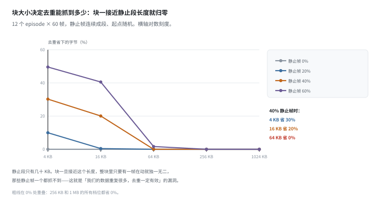
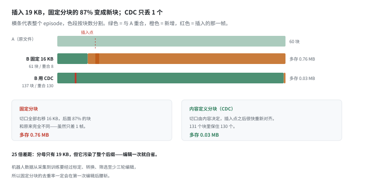
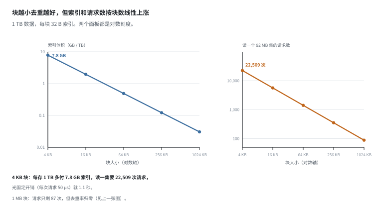
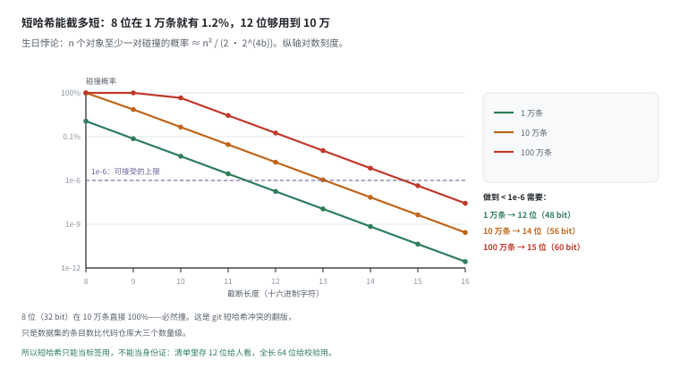
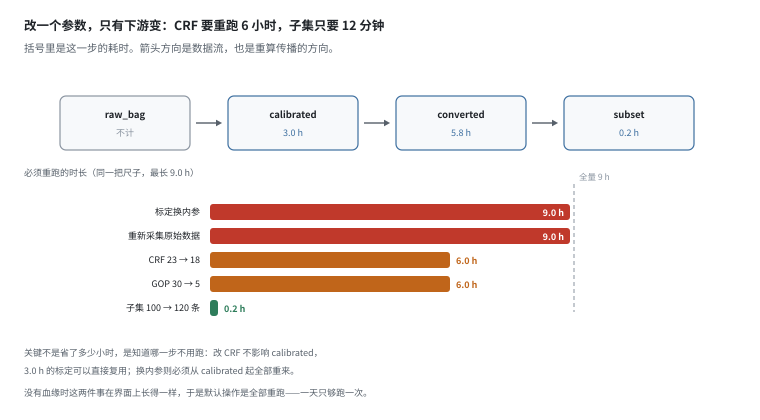
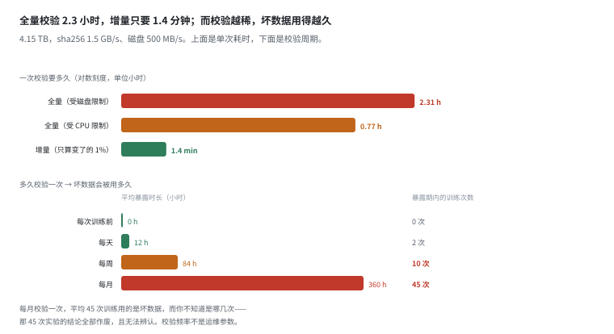
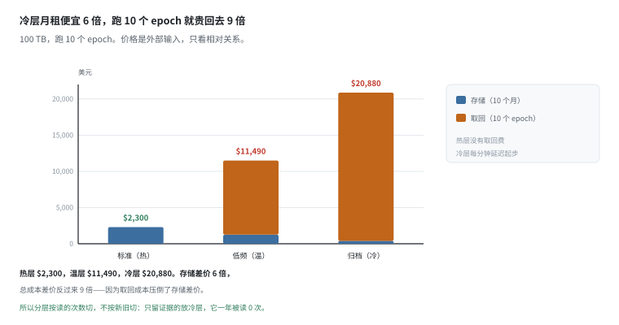

# 存储与版本：这一份到底是哪一份

> 阶段 3 · 数据流水线 ｜ 写作时间 2026-11
>
> 配套实验：[`examples/03_data_pipeline/05_storage_versioning.py`](../examples/03_data_pipeline/05_storage_versioning.py)

## 1. 它解决什么问题

前面几篇都在解决“数据对不对”。这一篇解决“数据是哪一份”。

机器人数据有两个难受的性质：**大**（TB 级）、**重复**（遥操作时大量静止段）。再加上一个工程现实：同一批原始数据会被加工成十几个不同用途的子集。

没有版本管理时，典型场景是这样：

> 两周前训了个模型，指标不错。今天想复现，发现数据集目录被覆盖了；或者目录还在，但不知道当时用的是哪个转换参数。

这不是小问题。它让“实验”变成不可累积的事情——每次都要重新验证一切。而“重新验证一切”在 TB 级上是不可承受的：把 4.15 TB 全量校验一遍要 2.3 小时（[6] 会算）。

这一篇讲五件事：去重能省多少（可算，但强依赖块大小）、血缘怎么记（很便宜）、校验要花多少时间（比想象贵）、子集该复制还是引用、以及 manifest 到底能挡住什么。

## 2. 去重：省多少取决于块大小

重复量的主要来源是**静止段**：遥操作时“回到起始位”“等下一步”，这些帧在不同 episode 之间字节完全相同。

实验造 12 个 episode × 60 帧，40% 的帧是静止帧，静止帧连续成段（4~10 帧一组，起点随机），然后按不同块大小切块、算 sha256、相同哈希只存一份。



```
  块大小      idle 0%     20%         40%         60%
  --------------------------------------------------------------
  4 KB        0%          10%         30%         50%
  16 KB       0%          0%          20%         41%
  64 KB       0%          0%          0%          2%
  256 KB      0%          0%          0%          0%
  1024 KB     0%          0%          0%          0%
```

三个结论，每个都能推翻一句流行说法。

**一、0% 那一行全是 0。** 去重不会凭空变出压缩，它只做一件事：把字节级相同的内容只存一次。所以“上了去重能省 60%”这句话，必须先说清楚数据长什么样。

**二、块越大省得越少，而且是断崖式的。** 40% 的静止帧，4 KB 块省 30%，16 KB 块省 20%，64 KB 块省 0%。原因是静止段只有几十 KB：块一旦接近静止段长度，整块里只要有一帧在动，这块就独一无二，那些静止帧一个都没抓到。

**三、块大小的收益是递减的。** 4 KB → 16 KB 掉 10 个百分点，但 [3] 会看到索引体积涨了 4 倍。所以块大小不是“越细越省”的单向旋钮，它是个平衡点。

> 这里有个容易被忽略的前提：静止段在不同 episode 里的**字节偏移不同**。如果偏移总是对齐的，4 KB 和 16 KB 会得到完全一样的结果，实验会错误地得出“块大小无所谓”。真实数据里偏移就是不同的——这也是 [3] 分块要解决的问题。

## 3. 插入一帧，去重率腰斩

上一节的去重率有个隐含前提：数据是**只追加**的。而机器人数据几乎总是在中间被编辑：

- 删掉失败片段
- 补采一段
- 重新对齐时间轴
- 换一版标定重算

固定分块对这些操作的抵抗力是零。



```
  A：60 帧 / 0.97 MB。B：在 A 的第 10 帧后插入 1 帧 / 19 KB。
  只有 19 KB 不同，占总量的 2.1%。

  分块方式            A 块数    B 块数    重合块      B 去重后    多存
  ------------------------------------------------------------------------------
  固定 16 KB          60        61        8           0.89 MB     0.76 MB
  内容定义（CDC）     131       137       130         0.99 MB     0.03 MB
```

固定分块只保住插入点之前的 8 个块。插入 19 KB 之后，**后面 87% 的切口全部右移 16 KB**，切出来的字节和原来完全不同——虽然内容只差了一帧。

CDC（内容定义分块）切在“内容特征满足条件”的位置，所以插入点之后很快就重新对齐，131 个块里保住 130 个。

多存 0.76 MB vs 0.03 MB，**25 倍**。分母只有 19 KB，但它污染了整个后缀。

这就是“固定分块只能给只追加的数据用”的原因。而机器人数据从采集到训练要经过标定、转换、筛选至少三轮编辑——**只要会插入或删除，固定分块的去重率就会在第一次编辑后腰斩。**

## 4. 元数据不是免费的

块越小去重越好，但每块都要一条索引：哈希、偏移、长度，假设 32 B。



```
  1 TB 数据，每块一条索引（32 B：16 B 哈希 + 8 B 偏移 + 8 B 长度）：

  块大小      块数            索引体积      读一个 92 MB 集   请求开销
  ----------------------------------------------------------------------------------
  4 KB        244,140,625 块  7.8 GB        22,509 次         1.13 秒
  16 KB       61,035,156 块   2.0 GB        5,627 次          0.28 秒
  64 KB       15,258,789 块   0.5 GB        1,406 次          0.07 秒
  256 KB      3,814,697 块    0.1 GB        351 次            0.02 秒
  1024 KB     953,674 块      0.0 GB        87 次             0.00 秒
```

4 KB 块：去重抓得最细，但每存 1 TB 要多付 7.8 GB 索引，读一集要 22,509 次请求，光固定开销就 1.1 秒。1 MB 块：请求只有 87 次，但去重率已经归零（[2] 那张表）。

真实系统取中间：CDC 平均块 8~64 KB。

所以**块大小不是压缩参数，是索引参数**。它同时决定三件事——去重率、索引体积、每次读的请求数——三个方向互相拉扯。这也是为什么“我们的去重率是 60%”这种宣传数字，不问块大小就没有信息量。

还有一个常被忽略的：如果把每块存成一个对象（对象存储的一个 key），1 TB / 4 KB = **2.44 亿个对象**。对象数本身就是配额，很多系统先撞这个墙，而不是先撞容量墙。

> 索引项 32 B 和每次请求 50 µs 是**外部输入**，不是我们测的。但两者都只是线性缩放：换成 64 B 索引，7.8 GB 变 15.6 GB；换成 20 µs，1.13 秒变 0.45 秒。结论“4 KB 块的元数据开销不可忽略”不动。

## 5. 哈希截多少位

清单里存 sha256 的前 b 个十六进制字符，人眼好比对。但截断就有碰撞。

生日悖论下，n 个对象至少一对碰撞的概率约为 n² / (2 · 2^(4b))：



```
  截断位数      空间          10,000 条       100,000 条      1,000,000 条
  ------------------------------------------------------------------------------
  8 位          4.3e+09       1.16%           100%            100%
  10 位         1.1e+12       4.5e-05         0.45%           45.47%
  12 位         2.8e+14       1.8e-07         1.8e-05         0.18%
  14 位         7.2e+16       6.9e-10         6.9e-08         6.9e-06
  16 位         1.8e+19       2.7e-12         2.7e-10         2.7e-08
```

8 位（32 bit）在 1 万条就有 1.2%，10 万条直接 100%——**必然撞**。这就是 git 短哈希冲突的翻版，只是数据集的条目数比代码仓库大三个数量级。

要做碰撞概率 < 1e-6，需要的最少位数是：

- 1 万条 → 12 个十六进制字符（48 bit）
- 10 万条 → 14 个（56 bit）
- 100 万条 → 15 个（60 bit）

推论：**短哈希只能当标签用，不能当身份证。**清单里同时存 12 位（给人看）和全长 64 位（给校验用），两者不冲突，各管一件事。

## 6. 血缘：谁要重算

一条最小的血缘链，括号里是这一步的耗时：

```
raw_bag ──▶ calibrated(3.0 h) ──▶ converted(5.8 h) ──▶ subset(0.2 h)
```

每个节点的哈希由“输入哈希 + 处理参数”算出：

```
H(node) = sha256( H(inputs) || canonical_json(params) )
```

于是改一个参数，只有下游变：



```
  变体                  变了的节点                必须重跑
  ------------------------------------------------------------------------------------
  原始版本              （无）                    不用跑（9.0 h 全免）
  标定换内参            cali / conv / subs        9.0 h
  CRF 23 → 18           conv / subs               6.0 h（全量 9.0 h）
  GOP 30 → 5            conv / subs               6.0 h（全量 9.0 h）
  子集 100 → 120 条     subs                      0.2 h（全量 9.0 h）
```

（raw 采集不计入耗时，所以“换内参”等于全部）

关键不是“省了多少小时”，是**知道哪一步不用跑**。改 CRF 不影响 `calibrated`，所以 3.0 h 的标定可以直接复用；换内参则必须从 `calibrated` 起全部重来。

没有血缘时，这两件事在界面上长得一模一样：都是“数据集好像不对”。于是默认操作是全部重跑——而全量重跑要 9.0 h，一天只够跑一次。

血缘的成本也可以算：每个节点一行 JSON（哈希 + 参数 + 上游哈希），几十字节。**记录成本是毫秒级，不记录的成本是小时级。**

## 7. 校验是要花时间的

哈希能抓损坏，但抓的前提是**读一遍全部字节**。这个成本经常被忽略。



```
  4.15 TB，sha256 单核 1.5 GB/s，磁盘 500 MB/s：

  全量 sha256（受 CPU 限制）      0.77 小时
  全量 sha256（受磁盘限制）       2.31 小时
```

2.3 小时。**“训练前校验一遍”这件事，在 TB 级上是不成立的**：一天 3 次训练就是 6.9 小时纯校验。

三个让它变得可行的办法：

**① 只算变了的。** 采集是追加的，用 `mtime + size` 先筛，每天新增 1% 的文件，校验时间从 2.31 h 降到 1.4 min。

**② Merkle 树。** 4.15 TB / 1 MB = 396 万个叶子，树高 22。改一个块只重算 22 个哈希，不是 396 万个；读一次只要 22 × 32 B = 704 B 的证明。

**③ 把校验放在写入时，不放在训练前。** 转换产物落盘就验一次，坏文件当场重转。训练时只查清单版本号。

然后是一个更少被讨论的问题：**多久校验一次**。

```
  假设每天 3 次训练：

  校验周期      平均暴露      暴露期内训练次数
  --------------------------------------------------------
  每次训练前    0.0 小时      0 次
  每天          12.0 小时     2 次
  每周          84.0 小时     10 次
  每月          360.0 小时    45 次
```

每月校验一次，意味着**平均有 45 次训练用的是坏数据**，而你不知道是哪几次。这不是“多花点钱”的问题：那 45 次实验的结论全部作废，且无法辨认。

**校验频率不是运维参数，是实验有效性的前提。**

> sha256 吞吐 1.5 GB/s 和磁盘 500 MB/s 是外部输入。换成 3 GB/s 的 AVX 实现，CPU 侧降到 0.39 h，但磁盘侧仍然是 2.31 h——**瓶颈在 IO 时，哈希优化没用**。这也正是“增量校验”比“更快的哈希”更重要的原因。

## 8. 子集：复制还是引用

```
  数据集：5000 个 episode × 4.0 MB = 20 GB

  子集            物理复制        引用（共享底数据）
  --------------------------------------------------------------
  全量            20.0 GB         0 GB（只存指针）
  成功样本        15.2 GB         0 GB（只存指针）
  长程任务        4.8 GB          0 GB（只存指针）
  消融 A          2.4 GB          0 GB（只存指针）
  消融 B          2.4 GB          0 GB（只存指针）
  --------------------------------------------------------------
  合计            44.8 GB         20 GB
```

复制多花 25 GB（2.2 倍），而且每次改编码都要重做 5 份拷贝。引用只花一个几百 KB 的清单。

但引用不是免费的，两个坑：

- **删除**：删底数据会让所有子集一起坏。必须引用计数 + 禁止直接删。
- **权限**：子集 A 和 B 共享底数据后，谁能看 A 就能推出 B 的内容。多团队共用存储时，这个坑会变成安全事故。

折中是“逻辑删除 + 物理回收”：标记删除，引用计数归零后再真删。中间的窗口多长？等于“误删到发现”的时间。**回收站的 30 天不是习惯，是事故响应时间的上界。**

判断标准很简单：子集之间只是**过滤条件**不同 → 引用；涉及**内容修改**（统一裁剪、重采样、换编码）→ 那是新数据，必须复制。

## 9. 冷热分层：按读的次数，不按新旧

> 这一节的价格是**外部输入**（对象存储公开牌价），量级对，具体数字随供应商和区域变。结论只看相对关系。

100 TB 的账：



```
  层              $/GB/月     月成本        取回 $/GB   取回延迟
  --------------------------------------------------------------------------
  标准（热）      0.0230      $2,300        0.000       毫秒
  低频（温）      0.0125      $1,250        0.010       毫秒
  归档（冷）      0.0040      $400          0.020       分钟到小时
```

全放热层 $2,300/月，一年 $27,600；全放冷层 $400/月，差 6 倍——看起来冷层完胜。

但训练要读。一个 epoch 全量读一遍，100 TB 从冷层取回：

- 取回费：100 × 1024 × $0.02 = **$2,048（一次）**
- 延迟：12 小时起，而且要先解冻，不是流式的

跑 10 个 epoch：热层 $2,300 存储 + $0 取回；冷层 $400 存储 + $20,480 取回。**冷层此刻贵 9.1 倍。**

取回成本压倒了存储差价。所以分层的切法不是按“新旧”，是按**读的次数**：

- 正在训的、要反复读的 → 热层。省下的取回费远超存储差价
- 训完的、只留证据的 → 冷层。一年被读 0 次，取回费也是 0
- 中间态（回放、审计、复现）→ 温层

一个常见的错：把“训完的”也放热层，理由是“说不定还要用”。100 TB 一年就是 $27,600 的“说不定”。

## 10. manifest 的边界

一个最小的 manifest：

```json
{
  "dataset": "demo-v1",
  "created": "2026-11-03",
  "converter": {"codec": "h264", "crf": 23, "gop": 30},
  "episodes": [{"path": "episode_000.bin", "bytes": 630946,
                "sha256": "da1506ed5d4ba1b7f0eb952c..."}]
}
```

校验时逐个文件算哈希对比。实验里把某个文件翻了**一个 bit**：

```
  校验全部文件：
    OK   episode_000.bin
    OK   episode_001.bin
    OK   episode_002.bin
  -> 3/3 通过

  翻转 1 bit 之后：
    FAIL episode_001.bin  <- 内容与清单不符
```

只翻 1 个 bit 就抓到了。这就是哈希的作用：**文件“能打开”和文件“是对的”是两件完全不同的事**。

但它挡不住什么，也要说清楚：

| 问题 | 能发现吗 | 为什么 |
|---|---|---|
| 传输损坏 / 静默写坏 | 能 | 字节变了 |
| 误覆盖 | 能 | 字节变了 |
| 漏传整个文件 | 能 | 清单里有、目录里没有 |
| 清单本身被改 | 不能 | 没有签名，改清单和改数据一样容易 |
| 语义错误（标签错了） | 不能 | 字节完全正确 |
| 采集时丢帧 | 不能 | 包本身是合法的，见 [recording.md](recording.md) |
| 标定漂移 | 不能 | 几何错了，字节没错，见 [calibration.md](calibration.md) |

所以质检必须分层：

```
哈希      -> 字节对不对
对账      -> 条数/时长对不对
几何检查  -> 物理量对不对
```

三层各管一段，任何一层单独用都不够。**“我们有 checksum”不能作为“数据没问题”的论据。**

## 11. 和数据平台有什么关系

1. **内容寻址，哈希做 ID。** `episode_000.mp4` 这种名字会变；`sha256:abc123...` 不会。用哈希做 ID，天然免疫覆盖和重名。

2. **会被编辑的数据必须用 CDC。** 固定分块只适合只追加的场景，而机器人数据从采集到训练要经过至少三轮编辑。

3. **块大小是索引参数，不是压缩参数。** 它同时约束去重率、索引体积、请求数。定块大小之前先把 [4] 那张表算一遍。

4. **校验频率决定实验有效性，不只是运维细节。** 每月校验一次等于每月有 45 次训练在赌运气。增量校验（mtime 预筛 + Merkle）是唯一在 TB 级上可行的方案。

5. **可复现性 = 代码版本 + 数据哈希 + 处理参数。** 三者缺一，两周后就说不清“当时用的是什么”。这三样必须一起进实验记录。

> **反例的形状**：一个团队上了去重，块大小选了 1 MB（“块大好管理”），省了 2%。于是结论是“去重没用”，把系统拆了。真实原因是他们的静止段只有几十 KB，1 MB 的块把动帧和静帧捆在一起，永远匹配不上。**去重失败通常不是算法问题，是块大小选错了——而这个错误不会报错，只会让收益看起来是 0。**

## 12. 自己跑一遍

```bash
python examples/03_data_pipeline/05_storage_versioning.py
```

十节输出，对应上面六张图：

| 输出 | 对应 |
|---|---|
| `[1]` 块大小 × idle 占比的去重率 | §2 |
| `[2]` 插入一帧后固定分块与 CDC 的重合率 | §3 |
| `[3]` 块数 → 索引体积、请求数 | §4 |
| `[4]` 截断位数 → 碰撞概率、所需位数 | §5 |
| `[5]` 变体 → 受影响节点、重跑成本 | §6 |
| `[6]` 全量校验耗时、增量方案、校验周期 | §7 |
| `[7]` 子集复制 vs 引用的存储账 | §8 |
| `[8]` 热/温/冷的月成本与取回成本 | §9 |
| `[9]` manifest 校验、翻 1 bit 的检出、边界表 | §10 |
| `[10]` 决策表 | §11 |

有几处值得改参数自己试：

- `part1_dedup(idle_ratios=(0.8,))`：80% 静止帧下 4 KB 块省 71%，但 64 KB 块只剩 9%、256 KB 归零。**重复率再高，块选错了也拿不到**——这就是“我们的数据重复很多，所以去重一定有效”这句话的漏洞；
- `part2_shift(insert_at=0)`：在开头插入，固定分块的重合块直接归零，多存 0.97 MB（整集）。插入点越靠前，污染面越大；
- `part6_verify(sha_gbps=3.0)`：把哈希吞吐翻倍，CPU 侧从 0.77 h 降到 0.38 h，但受磁盘限制的 2.31 h 一动没动——**IO 是瓶颈时，换算法没有用**，只有增量校验有用。

---

上一篇：[格式](formats.md) ｜ 下一篇：[标注](annotation.md)
