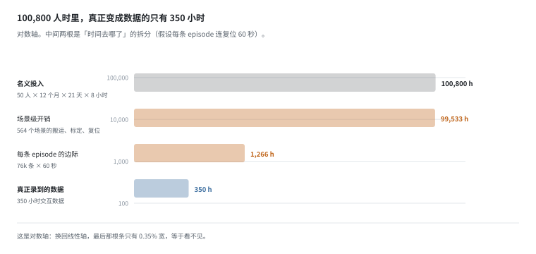
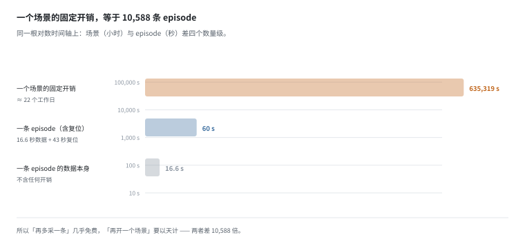
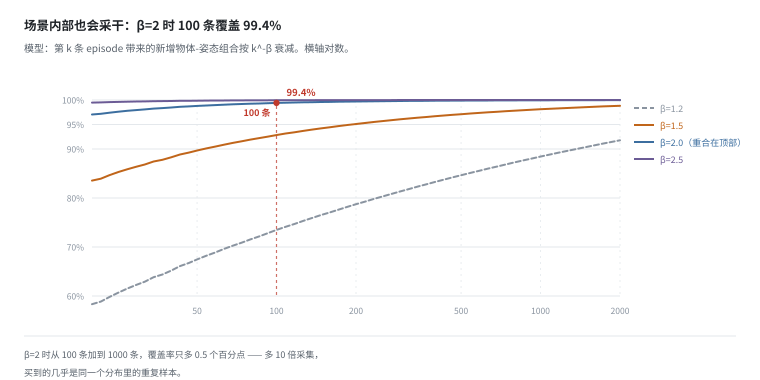
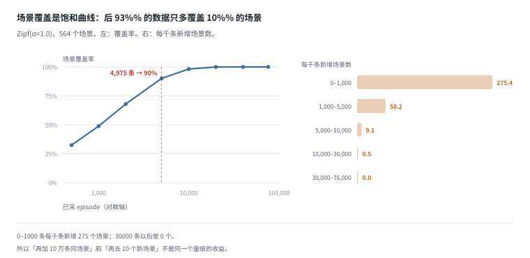
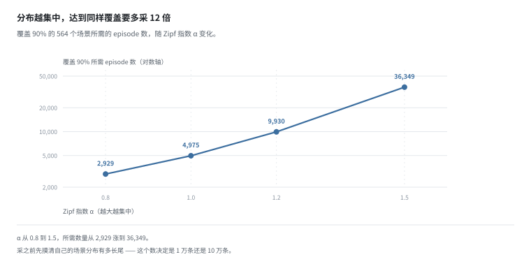
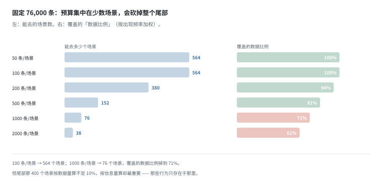
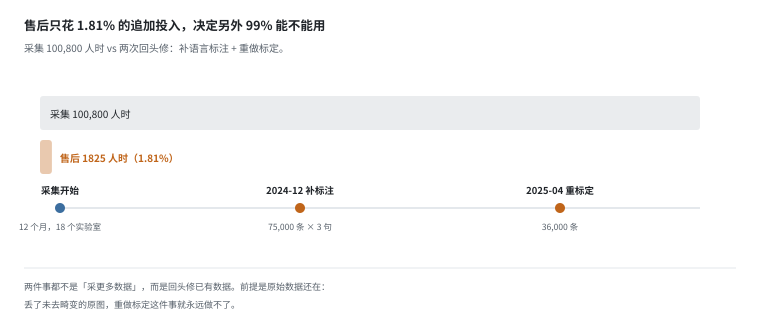

# DROID：把采集摊到 18 个实验室，换来了什么

> 阶段 4 · 公开数据集 ｜ 写作时间 2026-11
>
> 配套实验：[`examples/04_datasets/02_collection_cost.py`](../examples/04_datasets/02_collection_cost.py)

## 1. 它解决什么问题

OXE 把 60 个已有数据集拼在一起，解决了"格式不统一"。但它解决不了另一件事：**这些数据几乎全在实验室桌面上采的**。

桌面场景的共同特征：光照稳定、背景干净、物体固定、相机位置固定。在这样的数据上训出来的策略，换一个厨房、换一种台面高度、换一种光照，成功率掉得很厉害。这不是模型的问题，是**数据里没有那些变化**。

DROID 的思路很直接：如果多样性来自场景，就带着机器人去不同的场景里采——564 个真实室内场景（厨房、办公室、客厅、卧室、卫生间、走廊），分布在 52 栋建筑里。

代价是需要 18 个实验室同时采，于是必须解决一个工程问题：**不同人、不同城市、不同时间采的数据怎么可比？** 答案是硬件完全统一——同一型号的臂、同一套相机、同样的安装位姿、同样的 15 Hz。

这一篇不讲模型，讲这笔投入的成本结构。因为它是目前唯一一个把"采集成本"摊开到能算的数据集，而算完会发现几件很反直觉的事：**钱不是花在采数据上**，**多采 10 倍只多买 0.5 个百分点**，**决定数据集能不能用的那部分工作，只占总投入的 1.81%**。

## 2. 先对账：76k / 350h / 564 三个数放一起

公开的项目页和论文给出的数字：

| 项目 | 数值 |
|---|---|
| 轨迹数 | **76k**（另有约 16k 条失败轨迹） |
| 交互数据时长 | **350 小时** |
| 场景 | **564** 个 |
| 任务（动词类别） | 86 |
| 建筑 | 52 栋 |
| 采集员 | 50 人 |
| 实验室 / 机构 | 18 / 13（北美、亚洲、欧洲） |
| 采集周期 | 12 个月 |
| 记录频率 | **15 Hz** |
| 相机 | **3 路立体**（2 台外部 ZED 2 + 1 台腕部 ZED Mini） |
| 相机视角总数 | 1,417 个 |
| 许可 | CC-BY 4.0 |

互相除一下，得到几个更有用的量：

| 派生指标 | 数值 | 怎么算的 |
|---|---|---|
| 平均每条轨迹 | **16.6 秒** | 350h ÷ 76k |
| 每条轨迹的帧数 | 249 帧 | 16.6s × 15 Hz |
| 总帧数（单路） | 18.9 M | 算存储和训练步数都要用 |
| 总图像帧数 | **56.7 M** | × 3 路相机 |
| 每场景平均轨迹数 | 135 条 | 76k ÷ 564 |
| 每场景平均数据量 | **37 分钟** | 350h ÷ 564 |
| 每任务平均轨迹数 | 884 条 | 76k ÷ 86（任务分布是长尾，平均值意义不大） |
| 每栋建筑平均场景数 | 10.8 个 | 564 ÷ 52 |

**这里有一处内部不一致，值得单独说。**

官方描述是"每人每场景最多 100 条轨迹，约 20 分钟数据"，隐含每条 12 秒、每场景 20 分钟。但：

- 76k ÷ 564 = **135 条/场景**（不是 100）
- 350h ÷ 564 = **37 分钟/场景**（不是 20）
- 350h ÷ 76k = **16.6 秒/条**（不是 12）

按 135 条 × 12 秒算应该是 27 分钟，不是 37 分钟。三种口径两两对不上，**差 38%**。

这不是谁算错了，而是这类数字本来就是估算量级：350h 可能四舍五入，76k 是成功轨迹数（失败的不算），"20 分钟"是口语。

> **教训：拿公开数据集的统计量做容量规划，先自己对账一遍。** 差 38% 在存储预算上就是几十 TB。

## 3. 人力效率：每 288 小时人力，产出 1 小时数据



名义投入：50 人 × 12 个月 × 21 工作日 × 8 小时 = **100,800 人时**。实际产出：350 小时交互数据。

```
有效率 = 350 / 100,800 = 0.35%
```

也就是**每 288 小时人力，产出 1 小时数据**。换个说法：一名采集员一天产出 6.0 条轨迹，合计 100 秒有效数据，占 8 小时工作时间的 0.35%。

按场景摊：100,800 ÷ 564 = **179 人时/场景**，折合 **22.3 个工作日**——一个人干一个月，换来 37 分钟数据。

剩下 99.7% 的时间去哪了？官方流程里写得清楚：

| 开销项 | 说明 |
|---|---|
| 把平台推到新场景 | 搬运、调平、布线 |
| 相机外参标定 | 每个场景用棋盘格重标一次 |
| 录入任务清单 | 手工输入或从列表选择 |
| 试采 + 调整视角 | 找到能拍到有效行为的机位 |
| 失败重采 | 约 16k 条失败轨迹，不进成功集 |
| 复位与场景增强 | 移底座、改光照、增删物品 |

注意这些项的**共同点**：它们全部与"场景"绑定，没法和"多采一条"分摊。这是下一节的核心。

还有一件常被搞混的事：**存储和带宽不是瓶颈**。350 小时 × 15 Hz × 3 路 = 56.7 M 帧图像，按每帧 0.3 MB 粗估约 17 TB——一块大容量硬盘的量级。瓶颈是**人在场景里的时间**：100,800 人时不可压缩、不可并行、不可事后补。

## 4. 时间几乎全在场景上：≥96%，单价差 10,588 倍



把总时间拆成两项：

```
T = 场景数 × 每场景固定开销 + 轨迹数 × 每条边际开销
```

公开数字只给了 T、场景数、轨迹数，**没给这个拆分**。但可以把它框住：每条轨迹的边际开销不可能低于它的数据时长 16.6 秒。

| 每条边际开销 | 边际合计 | 场景级合计 | 场景级占全部时间 |
|---|---|---|---|
| 17 秒 | 350 h | 100,450 h | **99.7%** |
| 60 秒 | 1,267 h | 99,533 h | **98.7%** |
| 180 秒 | 3,800 h | 97,000 h | **96.2%** |

**无论怎么假设，场景级开销都占 96% 以上。** 这不是精度问题，是量级问题：一条轨迹 16.6 秒，一个场景 3 天。

取中间假设（每条 60 秒，含复位）：每场景固定开销 176 人时，是单条边际开销的 **10,588 倍**。

这个比值决定了所有采集策略：

- 开一个新场景 = 放弃 10,588 条已有场景的 episode；
- 所以只要一个场景还能教出新东西，就该继续在它身上采；
- 一旦它教不出新东西，多留一分钟都是纯损失。

**瓶颈不在钱，在"这个场景还有没有新东西"。** 这句话必须量化，否则它只是一句正确但没用的废话。

## 5. 每场景 100 条从哪来：不是成本，是信息饱和



成本账说"场景太贵，应该在一个场景里狠狠采"。但实际采了 135 条/场景，接近官方的"最多 100 条"。为什么不再翻十倍？

模型（明确标出是假设）：同一个场景里，第 k 条 episode 带来的**新增**物体-姿态组合按 k^-β 衰减。β 越大，场景越快被"采干"。

| β | k=50 | k=100 | k=200 | k=500 | k=1000 |
|---|---|---|---|---|---|
| 1.2 | 67.5% | 73.5% | 78.7% | 84.6% | 88.5% |
| 1.5 | 89.7% | 92.9% | 95.1% | 97.1% | 98.1% |
| **2.0** | 98.8% | **99.4%** | 99.7% | 99.9% | 99.9% |
| 2.5 | 99.9% | 100.0% | 100.0% | 100.0% | 100.0% |

β = 2.0 时：100 条覆盖 99.4%，1000 条覆盖 99.9%——**多 10 倍的采集，只多买到 0.5 个百分点**。

两边放在一起，结论反直觉：

- **成本**说：场景贵上千倍，所以应该在一个场景里采到远超 100 条；
- **信息**说：100 条之后场景基本被采干，再采是同分布重复样本；
- 所以真正的约束是**信息**，不是钱。DROID 的 100 条是信息边界。

这也解释了为什么"每场景条数"没有公式：β 是你自己数据的性质，只能看数据估。但在 β = 2 附近，100 这个量级是对的。

## 6. 场景覆盖是饱和曲线，不是直线



上一节问"一个场景采多少条"，这一节问"一共去多少个场景"。

模型假设：564 个场景的出现频率服从 Zipf(α = 1.0)。这**不是** DROID 的实测分布，但"长尾"这个形状在各类机器人数据集里是一致的：少数场景占掉大部分数据。

| 已采 episode | 期望覆盖场景 | 覆盖率 |
|---|---|---|
| 500 | 183 | 32.5% |
| 1,000 | 275 | 48.8% |
| 2,000 | 384 | 68.0% |
| 5,000 | 508 | 90.1% |
| 10,000 | 554 | 98.2% |
| 20,000 | 564 | 99.9% |
| 40,000 | 564 | 100.0% |
| 76,000 | 564 | 100.0% |

边际收益掉得极快：

| 区间 | 新增场景 | 每千条新增 |
|---|---|---|
| 0 – 1,000 | 275 个 | 275.4 个 |
| 1,000 – 5,000 | 233 个 | 58.2 个 |
| 5,000 – 10,000 | 46 个 | 9.1 个 |
| 10,000 – 30,000 | 10 个 | 0.5 个 |
| 30,000 – 76,000 | 0 个 | 0.0 个 |

覆盖 50% 需要 **1,045 条**；覆盖 90% 需要 **4,975 条**。实际采了 76,000 条——**后 71,025 条（占 93% 的数据）只多覆盖了最后 10% 的场景**。

这看起来很浪费，但它是**对的**："覆盖多少场景"和"覆盖哪些场景"是两件事。尾部场景按数据量算不足 10%，按信息量算是最重要的——因为那 10% 里的行为，在头部场景里根本不存在。

## 7. 长尾形状决定你要 1 万条还是 10 万条



上面所有数都挂在一个假设上：α = 1.0。这个假设值多少钱？

| α | 覆盖 90% 所需 | 含义 |
|---|---|---|
| 0.8 | **2,929 条** | 较均匀，好采 |
| 1.0 | 4,975 条 | 基准（Zipf） |
| 1.2 | 9,930 条 | 很集中，尾部难碰到 |
| 1.5 | **36,349 条** | 极集中 |

α 从 0.8 到 1.5，所需数量差 **12 倍**——一个数量级的预算差异，全压在一个没法从原理推出来的形状参数上。

所以在设计采集计划之前，**先摸清自己的场景分布有多长尾**：把你已经去过的场景按 episode 数排个序，画一条累计曲线，估一个 α。这个数决定你需要 1 万条还是 10 万条，其余都是细节。

## 8. 总量固定时的取舍：564 个场景，还是 76 个



前两节分别定"每场景多少条"和"一共多少条"，但现实中总量是先定的。固定 76,000 条，问：每个场景花多少条？

| 每场景预算 | 能去场景数 | 覆盖的数据比例 |
|---|---|---|
| 50 条 | 564 个 | 100.0% |
| 100 条 | 564 个 | 100.0% |
| 200 条 | 380 个 | 94.3% |
| 500 条 | 152 个 | 81.1% |
| 1,000 条 | **76 个** | **71.1%** |
| 2,000 条 | 38 个 | 61.2% |

从 100 条/场景 降到 1000 条/场景：场景数从 564 掉到 76，覆盖的数据比例从 100% 掉到 71%。

但这个百分比是**按出现频率加权**的：它衡量"你见过多少数据"，不衡量"你见过多少种罕见行为"。尾部 400 个场景按频率算不足 10%，可是"在窄柜子里叠衣服"这种行为只存在于尾部。

所以取舍不是"覆盖率最大化"，而是**分层分配**：

- 头部场景 → 少量多条，把基础动作学扎实；
- 尾部场景 → 每个都要去，哪怕只采几十条（§6：覆盖 90% 场景只要 4,975 条，不需要 76,000 条）。

平均主义在这里是双重浪费：头部采不够，尾部去不了。

## 9. 失败数据几乎免费，却是唯一"怎么失败"的标签

失败轨迹 16,000 条 / 总数 92,000 条 = **17.4%** 失败率。

它的**时间成本**：按每条 60 秒的边际开销算，失败样本只多吃掉 **267 小时**，占总投入 **0.26%**。

**失败数据在时间上几乎免费。** 丢掉它省不下钱——省下的是 0.26%，换来的是永久失去"怎么失败"这一类标签。

而且这类标签的信息量恰恰最高：成功的轨迹大多相似（抓住、抬起、放下），失败的轨迹各有各的原因（抓偏、打滑、碰撞、目标被遮挡）。一个只有成功样本的数据集，学出来的是"这个任务总会成功"，部署时第一次失败就没有任何参照。

这也解释了为什么 DROID 的 16k 条失败轨迹虽然"不进成功集"，但仍在数据集里：**它不是训练样本，是诊断样本。**

## 10. 售后只花 1.81%，决定另外 99% 能不能用



DROID 发布后做过两次大规模回头修：

| 更新 | 规模 | 折算人时 |
|---|---|---|
| 2024-12 补语言标注 | 75,000 条 × 3 句 | 625 h |
| 2025-04 重做标定 | 36,000 条 | 1,200 h |

两笔加起来 **1,825 小时**，是采集投入（100,800 小时）的 **1.81%**。

但第一笔决定了这 75,000 条 episode 能不能用于**语言条件**模型——没有指令，整个数据集对 VLA 就是无用的。第二笔让 36k 条的多视角几何重新可用。

两件事都不是"采更多数据"，而是**回头修已有数据**。而它们能成立有一个前提：**原始数据还在**。如果在转换阶段就把未去畸变的原始图像丢了（§4 就说过，转换是剪枝），重做标定这件事就永远做不了。

这条对自采数据同样成立，而且更狠：你自己就是那个"上游"，没有别人替你保管原图。

## 11. 和数据平台有什么关系

DROID 的成本结构，落到平台上是一组具体的决策：

- **按"人来不来"算成本，不按"字节多少"算。** 有效率 0.35%，179 人时/场景。任何"再采一点"的需求，报价单位都是人日，不是 GB——用存储单价去估采集成本，会差三个数量级；
- **场景是采集计划的第一级对象，不是 episode。** 场景级开销 ≥96%，所以平台的数据模型里，"场景"必须是一等公民（有 id、有外参、有标定时间、有去过的次数），而不是 episode 上的一个字符串标签；
- **每场景条数要有饱和判据，不能拍脑袋。** 100 条这个量级来自信息饱和（β≈2 时 99.4%），不是成本最优。平台应该能答"这个场景再加一条还有多少新信息"，至少能画出覆盖曲线；
- **长尾分布要早估。** α 从 0.8 到 1.5，所需条数差 12 倍。采集计划做完才发现尾部没碰到，返工成本等于重来一遍；
- **失败样本必须留，而且要能检索。** 它只占 0.26% 的时间，却是唯一的诊断数据。平台里"失败"应该是一个可查询的字段（带原因码），而不是被过滤掉的脏数据；
- **原始数据保留期 ≥ 数据集寿命。** 售后 1.81% 的前提是原图还在。这是存储策略问题，不是采集问题——但它决定了两年后你有没有修复能力。

> **反例的形状**：一个采集平台按"每天产出多少条 episode"考核采集员，于是大家挤在最近的几个场景里猛采。总数很好看，564 个场景只去了 76 个，尾部的"窄柜子叠衣服""湿滑台面"一条都没有。评测时策略在这类场景上全军覆没，而数据报告上写的是"覆盖 100%"——因为那个百分比是按出现频率加权的。同时失败轨迹被当成脏数据删掉了，出问题时连"它以前怎么失败的"都查不到。

## 12. 自己跑一遍

```bash
python examples/04_datasets/02_collection_cost.py
```

八节输出对应 §2 到 §10：`[1]` 数字对账、`[2]` 人力效率、`[3]` 固定/边际拆分、`[4]` 场景内饱和、`[5]` 覆盖曲线、`[6]` 长尾敏感度、`[7]` 预算取舍、`[8]` 失败与售后。

几处值得改参数自己试：

- `part3_fixed_vs_marginal(per_ep_options=(30.0, 120.0))`：把边际开销的两端收紧，场景级占比变成 **99.4% / 97.5%**，结论一个字不改。**这个 96% 的下界很稳**，因为它是量级推出来的（16.6 秒 vs 3 天），不是拟合出来的；
- `part4_within_scene(betas=(1.0, 3.0))`：β 从 2.0 放到 1.0，100 条覆盖从 99.4% 掉到 **49.5%**——这时"100 条就够"完全不成立，必须采上千条。**β 是这套算法里唯一真正重要的参数**，而它只能从你自己的数据估；
- `part5_coverage_curve(alpha=0.8)`：α 从 1.0 降到 0.8，覆盖 90% 所需从 4,975 条掉到 **2,929 条**，而"后 96% 的数据只多覆盖 10%"这个结构还在（后 73,071 条）。**长尾的尾巴多长会变，"收益饱和"这件事不变**；
- `part8_failure_and_service(per_ep_s=180.0)`：把每条边际开销从 60 秒提到 180 秒，失败样本的时间占比从 0.26% 涨到 **0.79%**——还是不到 1%。**失败数据便宜这件事对假设不敏感**，所以"要不要留失败样本"根本不是成本问题；
- `part6_alpha(target=0.95)`：把目标从覆盖 90% 提到 95%，α = 1.0 时所需条数从 4,975 涨到 **6,956 条**（涨 40%），而 α 的两端从 2,929 / 36,349 变成 4,034 / 52,610。**提高 5 个百分点的覆盖率要付 40% 的预算**，而且长尾越极端，这 5 个百分点越贵。

---

上一篇：[多本体聚合](open-x-embodiment.md) ｜ 下一篇：[自采数据](self-collected.md)

延伸阅读：

- [DROID 项目页](https://droid-dataset.github.io/) —— 数据集下载与工具链
- [论文 arXiv:2403.12945](https://arxiv.org/abs/2403.12945) —— 2024 年的采集与策略评估
- [03/录制](../03-data-pipeline/recording.md) —— 采集流程设计与失败处理
- [04/自采数据](self-collected.md) —— 你自己采的时候，这七项检查必须跑
