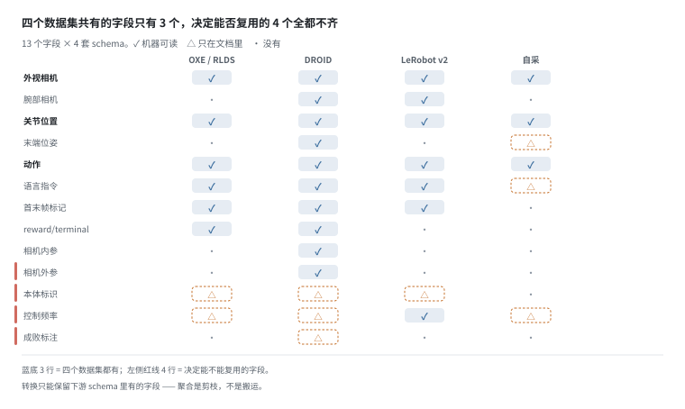
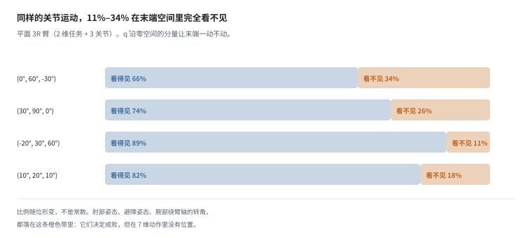
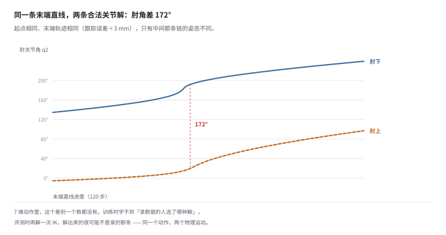
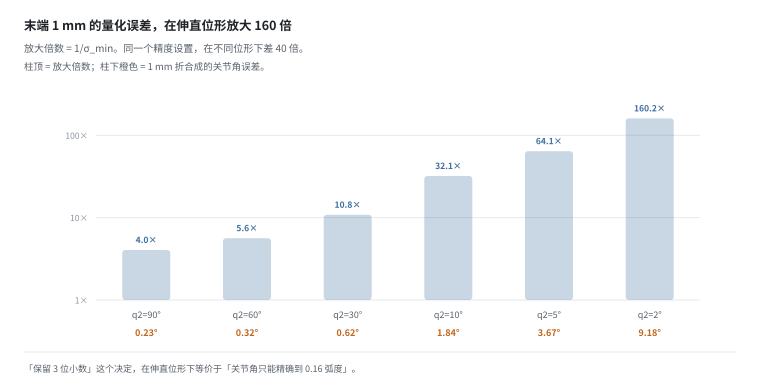
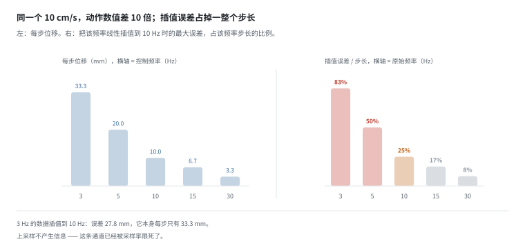
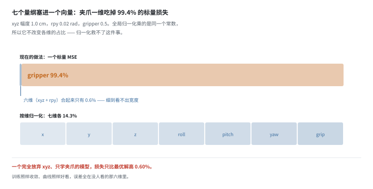
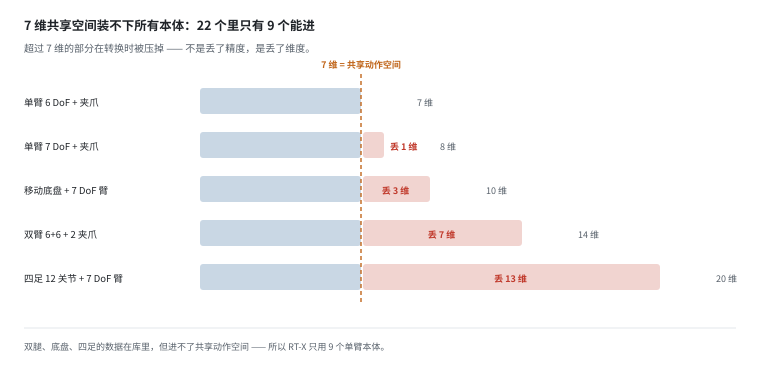

# 多本体聚合：OXE 统一了什么，代价在哪

> 阶段 4 · 公开数据集 ｜ 写作时间 2026-11
>
> 配套实验：[`examples/04_datasets/01_schema_alignment.py`](../examples/04_datasets/01_schema_alignment.py)

## 1. 它解决什么问题

2023 年之前，机器人学习的数据状况是这样的：每个实验室一台机器人、一套相机布置、一种动作定义、一个自家格式，采几万条演示，训一个只在这台机器上有效的策略。

于是有个问题谁也回答不了：**数据多了到底会不会变好？** 不是"应该会吧"，是没有人有过足够多的数据去验证。

Open X-Embodiment（OXE）的做法很笨也很硬：把 34 个实验室的 60 个已有数据集，全部转换成一个格式，然后问一句——混着训，每台机器人会变好还是变坏？

结果是有条件的好。这一篇不讲模型，只讲**转换这一步到底做了什么、代价落在哪里**。因为只要你做数据平台，这件事你迟早要做一遍，而代价全藏在细节里。

先说结论的形状：转换不是搬运，是**按目标 schema 剪枝**；统一动作空间不是压缩，是**把多值映射压成单值**。第一句由 §4 的一张字段矩阵撑住，第二句由 §5–§7 的三个实验撑住。

## 2. 先把规模摆清楚

| 项目 | 数值 |
|---|---|
| 本体（embodiments） | **22** 种 |
| 原始数据集 | 60 个，来自 34 个实验室 / 21 个机构 |
| 轨迹总数 | **1M+** |
| 技能（skills） | 527 |
| 任务（tasks） | 160,266 |
| 统一后的格式 | RLDS（基于 TensorFlow Datasets 的 episode 格式） |
| RT-X 训练实际用到的本体 | **9 个单臂** |

最后一行是整篇的引子：**库里有 22 个本体，训练只用了 9 个。** 剩下 13 个的数据在硬盘上躺着，进不了共享动作空间。

不是没人想用，是装不下。第 10 节把这件事算到底。

## 3. 统一动作空间：不是"统一"，是"选了一个代表"

OXE 的方案是：所有本体的动作都映射成同一个 **7 维向量**。

```
[x, y, z, roll, pitch, yaw, gripper]
```

三点必须说清楚，否则会误以为这是无损转换：

1. **表达在夹爪坐标系下**，不是基座坐标系。同一个物理动作，在不同姿态的机器人上数值不同。
2. 它是**位移/旋转增量，或者它们的速率**（原文："or the rates of these quantities"）。到底是增量还是速率，取决于原数据集——这一点没有被统一。
3. 某个本体用不到的维度，**训练时填 0**。

好处很直接：一套输出头就能控制 22 种机器人，不必为每个本体设计 head。

代价接下来七节全部可计算。第一个代价甚至不在动作上，而在字段上。

## 4. 代价一：转换是剪枝，字段交集只有 3/13



拿四种常见的机器人数据集 schema 逐字段对一遍：OXE/RLDS、DROID、LeRobot v2、以及一个典型的自采格式。

十三个字段里，**四个都有字段的只有 3 个**：外视相机、关节位置、动作。至少一个有的 11 个。

真正要命的是另外四个字段——它们决定一份数据能不能被复用：

| 字段 | 有机器可读字段的数据集 | 缺了会怎样 |
|---|---|---|
| 相机外参 | 1 个（DROID） | 多视角几何算不出来，点云无法融合 |
| 本体标识 | **0 个** | 无法按本体分组归一化 |
| 控制频率 | 1 个（LeRobot v2） | 动作没有物理量纲（第 8 节） |
| 成败标注 | **0 个** | 无法过滤失败样本、算不了成功率 |

本体标识和成败标注，**没有任何一个数据集把它们做成字段**，只写在论文或 README 里。人读得懂，机器读不到。

而 OXE 的 60 个数据集是被**转换**到统一 schema 的。转换只能保留下游 schema 里有的字段——原数据集里的标定、采集元数据、失败记录，在转换那一步就永久消失了，而且不会有人回去重转 60 个数据集。

> 实践建议：设计自己的 schema 时宁可多留字段。删字段很容易（读的时候忽略就行），补字段要重采。

## 5. 代价二：7 维动作有一个看不见的零空间



6 自由度臂映射到 6 维位姿是**局部无损**的：方阵，雅可比可逆（奇异位形除外）。7 自由度臂有 1 维冗余，那一维在映射里消失了。

拿平面 3R 臂（2 维任务 + 3 个关节，同样多 1 维）量化：给一个关节速度 q̇，它有多大比例落在**零空间**里——关节在动，末端完全不动？

| 位形 (q1, q2, q3) | 零空间占比 | 末端速度 |
|---|---|---|
| (0°, 60°, −30°) | **34%** | 1.686 m/s |
| (30°, 90°, 0°) | 26% | 1.530 m/s |
| (−20°, 30°, 60°) | 11% | 1.453 m/s |
| (10°, 20°, 10°) | 18% | 1.769 m/s |

11%–34% 的关节运动在末端空间里不存在，而且这个比例**随位形变化**，不是常数。

肘部姿态、避障时的绕行、腕部绕臂轴的转角——这些"末端看不出但决定成败"的自由度，7 维动作一个都表达不了。抓取时肘部抬高一点可以避开桌面，末端轨迹一模一样，数据里却只有一串相同的数字。

## 6. 代价三：同一条末端直线，两条合法解差 172°

零空间说的是"末端不动时关节在动"。反过来更麻烦：**末端动的时候，关节解不唯一**。

起点 (0.35, 0.25) m，终点 (0.12, 0.02) m，走直线，120 步。起点处两个肘部朝向各给一个解，各自沿直线积分：

| 解 | 起点关节角 | 末端跟踪误差 |
|---|---|---|
| 肘下 | (10°, 135°, −140°) | 3.1 mm |
| 肘上 | (10°, −5°, 140°) | 2.7 mm |

两条路径的末端跟踪误差都在 3 mm 以内（一阶积分的残差），可以认为走的是**同一条末端直线**。



最大关节差：**q1 8°、q2 172°、q3 80°**。

末端轨迹一模一样，肘关节差 172°——几乎是把手臂翻了个面。而在 7 维动作里，这个差别**一个数都没有**。

后果是三重的：

- 训练时模型学不到"录数据的人选了哪种解"，它只看到末端增量；
- 评测时必须自己再解一次 IK，解出来的很可能不是录数据时那条；
- 于是"同一个动作"在训练和部署时是两个不同的物理运动，而 loss 不会告诉你。

这就是"统一动作空间"最容易被忽略的代价：它不是压缩，是**把多值映射压成单值**，而压掉的正是决定成败的那一维。

## 7. 代价四：末端 1 mm，回到关节空间是 9.18°



7 维动作要被离散化才能输出（连续回归也有精度上限）。末端空间的误差回到关节空间，放大倍数 = 1/σ_min，也就是雅可比最小奇异值的倒数：

| q2 | σ_min | 放大 1/σ_min | 末端 1 mm → 关节角误差 |
|---|---|---|---|
| 90° | 0.2472 | 4.0× | 0.23° |
| 60° | 0.1776 | 5.6× | 0.32° |
| 30° | 0.0925 | 10.8× | 0.62° |
| 10° | 0.0312 | 32.1× | 1.84° |
| 5° | 0.0156 | 64.1× | 3.67° |
| 2° | 0.0062 | **160.2×** | **9.18°** |

同一个 1 mm：q2 = 90° 时是 0.23°，q2 = 2° 时是 9.18°，**放大 40 倍**。

换句话说，"保留 3 位小数"这个决定，在伸直位形下等价于"关节角只能精确到 0.16 弧度"。真机上表现为接近奇异时抖动、抓不准——而这在数据里完全看不出来，因为数据本身看起来精度很高。

所以精度上限由**最坏位形**决定，不由平均位形决定。按平均位形定的精度，会在最需要精度的那批样本上系统性失准。

## 8. 代价五：同一段物理运动，3 Hz 和 30 Hz 的动作数值差 10 倍



末端以 10 cm/s 匀速移动，动作是"每步的位移增量"：

| 数据集频率 | 每步时长 | 动作数值 | 1 秒运动切成几步 |
|---|---|---|---|
| 3 Hz | 333 ms | 33.3 mm | 3 步 |
| 5 Hz | 200 ms | 20.0 mm | 5 步 |
| 10 Hz | 100 ms | 10.0 mm | 10 步 |
| 15 Hz | 67 ms | 6.7 mm | 15 步 |
| 30 Hz | 33 ms | 3.3 mm | 30 步 |

物理上是同一个运动，数值上差 10 倍。而观测里**没有任何东西**告诉模型"这条样本来自几 Hz"：图像里看不出帧率，状态量纲又都一样。这是不可辨识的歧义——**频率不写进 schema，动作就是无量纲浮点数**。

能不能靠重采样补救？上采样不产生信息。取 a = 2 m/s²，线性插值的最大误差约 a·T²/8：

| 原始频率 | T | 插值误差 | 占该频率的动作步长 |
|---|---|---|---|
| 3 Hz | 333 ms | 27.8 mm | **83%** |
| 5 Hz | 200 ms | 10.0 mm | 50% |
| 10 Hz | 100 ms | 2.5 mm | 25% |
| 15 Hz | 67 ms | 1.1 mm | 17% |
| 30 Hz | 33 ms | 0.3 mm | 8% |

3 Hz 的数据插到 10 Hz：误差 27.8 mm，而它本身每一步只有 33.3 mm——**误差接近一整个动作步长**。这条通道已经被采样率限死了，任何插值都只是在编造中间态。

## 9. 代价六：七个量纲塞进一个向量，gripper 一维吃掉 99.4% 的损失



7 维动作里装的是三种单位：米、弧度、开关量。假设各维的动作幅度（标准差）是 xyz 1.0 cm、rpy 0.02 rad、gripper 0.50（0/1 开关），问一句：用一个标量 MSE 训练，损失被谁主导？

| 维度 | 标准差 | 占损失份额 |
|---|---|---|
| x / y / z | 0.010 | 各 0.04% |
| roll / pitch / yaw | 0.020 | 各 0.16% |
| **gripper** | 0.500 | **99.40%** |

注意全局归一化乘的是**同一个常数**，它不改变各维占比——所以"归一化过了"不能解决这个问题。

gripper 一维占 99.40%，xyz 三维合计 0.12%。这意味着：**一个完全放弃 xyz、只学夹爪的模型，损失只比最优解高 0.60%。**

也就是说"位置差了 1 cm"这件事，在一个标量损失里几乎看不见。训练照样收敛，曲线照样好看，误差全在没人看的维度里。

按维归一化之后，7 维各占 1/7 = 14.3%。这才是"每一维都算数"。所以 schema 这件事不是预处理细节：**它决定模型能不能看到某一维**。

## 10. 代价七：7 维空间装不下的那些本体



| 本体 | 原生维度 | 装入 7 维 | 后果 |
|---|---|---|---|
| 单臂 6 DoF + 夹爪 | 7 | 装得下 | 无损 |
| 单臂 7 DoF + 夹爪 | 8 | 丢 1 维 | 冗余自由度被丢弃 |
| 移动底盘 + 7 DoF 臂 | 10 | 丢 3 维 | 底盘运动无处安放 |
| 双臂 6+6 + 2 夹爪 | 14 | 丢 7 维 | 只能压成单臂，另一半信息消失 |
| 四足 12 关节 + 7 DoF 臂 | 20 | 丢 13 维 | 腿的接触与步态信息没有维度 |

这就解释了 OXE 的"22 个本体、1M+ 轨迹，但 RT-X 只用 9 个单臂本体训练"：22 个里只有 **41%** 能进共享动作空间。

后来的 VLA 都在重新设计动作表示：按本体分组输出头，或者把动作离散成 token，把维度问题推到序列长度上。**没有人真正解决了统一，只是换了个地方付账。**

## 11. 统一是有回报的，但不是免费午餐

只讲代价不公平。OXE 的实验结果：

| 指标 | 结果 |
|---|---|
| RT-1-X 在小数据本体上 | 比各实验室自己的方法 / 单数据集 RT-1 **高约 50%** |
| RT-2-X 在新技能（emergent skills）上 | 约为单数据集训练的 **3 倍** |
| 大模型 vs 大数据的取舍 | 小模型在数据充足的本体上**欠拟合**（Bridge 上 27% vs 原方法 40%），大模型才吃得住 |

最后一行值得单独看：**跨本体数据不是免费的**。数据少的本体受益最大，数据多的本体反而可能被稀释——除非模型容量够。

推论：把 60 个数据集"聚合起来"这一个动作，对数据少的本体是净收益，对数据多的本体可能要先加容量才划算。所以"多采数据"和"加模型容量"必须一起考虑，单做一件都可能是负收益。

## 12. 和数据平台有什么关系

这一篇的每一条代价，落到平台上都是一行具体的字段决策：

- **转换前先定 schema，不是转换后补字段。** 字段交集 3/13，说明"聚合"这个动作本身在扔信息，而且扔的是标定、本体、成败这些最难重采的东西。schema 评审发生在转 60 个数据集之前，成本差三个数量级；
- **控制频率必须是字段，不是 README 里的一句话。** 3 Hz 与 30 Hz 差 10 倍，插值补不回来。没有这个字段，动作就是无量纲浮点数，跨数据集训练等于让模型去猜量纲；
- **按维归一化写进流水线，不留给人。** gripper 一维吃掉 99.4% 的损失，全局归一化救不了（同一个常数不改变占比）。这一条不做，后面所有"位置精度不够"的排查都会走错方向——因为 loss 曲线不会报警；
- **精度按最坏位形定，不按平均位形定。** 末端 1 mm 在伸直位形放大 160 倍。数据校验里的"动作精度"阈值如果按平均值算，最需要精度的那批样本会静默通过；
- **本体标识要能被 join。** 它是分组归一化的唯一依据。没有它，22 个本体的数据只能共享一套统计量，而各本体的动作幅度差一个数量级以上；
- **动作空间设计比数据量更关键。** 22 个里 41% 能进共享空间。如果你的目标是多样性而不是规模，先问"我丢的是哪几维"，再问"我有多少条"。

> **反例的形状**：一个"聚合了 22 个本体、1M 轨迹"的数据平台，看起来规模很大。但接口只有一个 7 维 head，于是 13 个本体永远进不了训练；动作没有频率字段，混着 3 Hz 和 30 Hz 的样本训，模型学到的是"动作幅度和相机帧率的神秘相关性"；损失用全局归一化的 MSE，gripper 吃掉 99.4%，位置精度怎么调都上不去，而所有监控指标都是绿的。

## 13. 自己跑一遍

```bash
python examples/04_datasets/01_schema_alignment.py
```

七节输出对应 §4 到 §10：`[1]` 字段矩阵、`[2]` 零空间、`[3]` 两条 IK 解、`[4]` 量化放大、`[5]` 频率与插值、`[6]` 损失份额、`[7]` 维度阶梯。`[2]`/`[3]` 的曲线画在 §5、§6 的图里，`[5]` 的两组数画在 §8 的图里。

几处值得改参数自己试：

- `part2_nullspace(qdots=(0.0, 1.0, 0.0))`：只让肘关节动。零空间占比从 11%–34% 涨到 **0%–73%**，最高那一格 73%——**"丢了多少"取决于手臂在做什么动作**，不是本体的固有属性。默认的 `(1,1,1)` 是三个关节同速，恰好是个乐观的假设；
- `part3_two_solutions(q1_deg=0.0)`：把起点位形转回 0°，最大关节差从 q1 8° / q2 172° / q3 80° 变成 **q1 13° / q2 152° / q3 101°**。差得最多的是哪个关节、差多少度，全都随位形变——**"两条解差 172°"是个例子，不是常数**；
- `part4_quantization(step_mm=2.0)`：末端精度从 1 mm 放宽到 2 mm，每一格的关节误差翻倍（q2 = 2° 从 9.18° 到 **18.35°**），而**放大倍数列一个字不变**（还是 160.2×）。放大倍数是几何属性，跟编码精度无关——所以提高精度只能线性改善，改变不了"最坏位形最差"这个结构；
- `part5_frequency(speed_cm_s=50.0)`：末端速度从 10 cm/s 提到 50 cm/s，3 Hz 的步长从 33.3 mm 变成 **166.7 mm**，但插值误差占步长的比例从 83% 掉到 **17%**。这条反直觉：**动作越快，低频反而越够用**——因为误差是二阶的、步长是一阶的。慢速精细操作才是低频数据的死穴；
- `part6_loss_share(sig_grip=1.0)`：夹爪标准差从 0.5 调到 1.0，它的份额从 99.40% 涨到 **99.85%**，xyz 合计从 0.12% 掉到 0.03%，"完全放弃 xyz"的代价从 0.60% 降到 0.15%。夹爪幅值越大，位置维度越不可见——**这就是二值开关和连续量放进同一个向量最贵的地方**。

---

上一篇：[第三章 数据流水线](../03-data-pipeline/README.md) ｜ 下一篇：[DROID：一场 12 个月、18 个实验室的采集](droid.md)

延伸阅读：

- [Open X-Embodiment 项目页](https://robotics-transformer-x.github.io/) —— 数据集与模型索引
- [论文 arXiv:2310.08864](https://arxiv.org/abs/2310.08864) —— ICRA 2024 最佳论文
- [02/动作与状态](../02-sensor-data/action-and-state.md) —— 动作表示的物理含义
- [03/格式](../03-data-pipeline/formats.md) —— RLDS 与 LeRobotDataset 的结构对比
