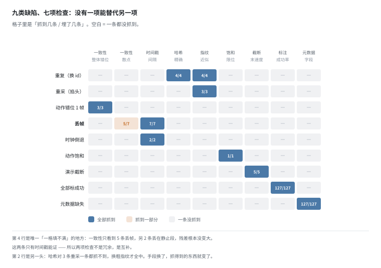
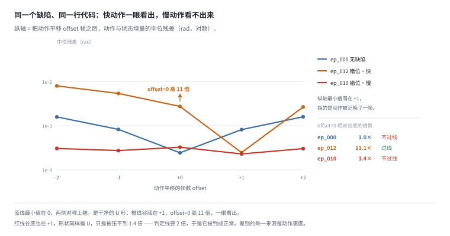
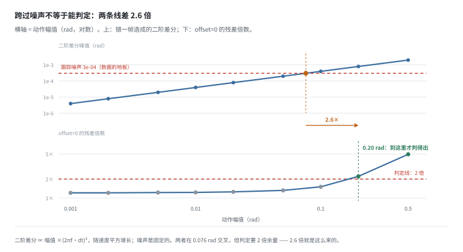
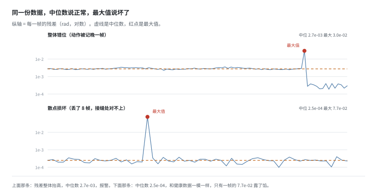
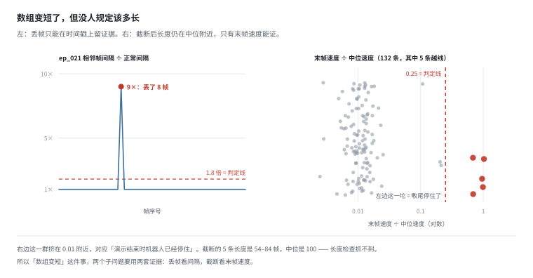
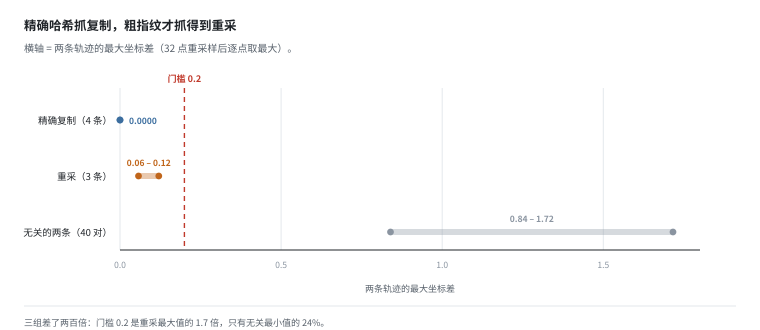
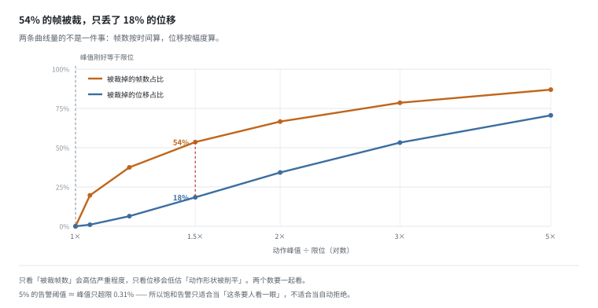

# 自采数据：七项自检，和它们各自能抓到什么

> 阶段 4 · 公开数据集 ｜ 写作时间 2026-11
>
> 配套实验：[`examples/04_datasets/03_dataset_linter.py`](../examples/04_datasets/03_dataset_linter.py)

## 1. 它解决什么问题

自己采的数据集出问题，几乎从来不报错。

文件能读、形状对、数值范围合理、训练 loss 照样往下走。然后在真机上你会发现策略"总是慢半拍"，或者"快成功时提前松手"，或者"换个台面高度就废了"。你怀疑模型、怀疑超参、怀疑数据量，唯独不会怀疑**数据本身有结构性缺陷**。

因为这类缺陷不改变数据的形状，只改变数据的**含义**。

这一篇把七类最常见的缺陷变成可计算的检查。为了验证检查真的有效，配套脚本先造一个**每个缺陷都埋了**的数据集（127 条 episode、7 自由度、30 Hz、单步动作限幅 ±0.05 rad、跟踪噪声 3e-4 rad），再让 linter 去跑，最后核对"检测到的"和"埋进去的"是否一致。

这一篇的重点不是"我写了七个函数"，而是三件更少被讨论的事：**多慢的动作就抓不到了**、**检查的粒度决定了能不能定性**、**每项检查的边界在哪儿**。抓得到和抓不到之间是一条有斜率的曲线，不是一个开关。

## 2. 先造一个坏数据集：九类缺陷



埋进去的九类缺陷，都是"真实采集里最常见、又最不容易发现"的：

| 缺陷 | 条数 | 为什么难发现 |
|---|---|---|
| A 重复 episode | 4 | 文件数对、总数对，只是同一条算了两遍 |
| A2 重采（近似重复） | 3 | 掐掉开头几帧，哈希对不上 |
| B 动作错位 1 帧 | 3 | 形状、范围、loss 全正常 |
| C 丢帧 | 7 | 数组变短了，但没人规定该多长 |
| D 时钟倒退 | 2 | 时间戳仍是单调递增的（直到那一点） |
| E 动作饱和 | 1 | 数值合法，只是顶在限位上 |
| F 演示被截断 | 5 | 长度各不相同，截断的也"像是"正常长度 |
| G 全部标成功 | 127 | 成功率 100% 听起来是好事 |
| H 元数据缺失 | 127 | 文档里有，字段里没有 |

**共同点：没有一个会报错。** 数据能读、形状对、训练能跑。

覆盖关系大体是一条**对角线**——这恰恰是重点：每一类缺陷基本只有一两项检查看得见。三处例外值得盯着看：

- **丢帧那一行填不满**：一致性只看到 5 条，时间戳看到 7 条。剩下 2 条丢在静止段，残差根本没变大——这两条只有时间戳能证；
- **重采那一行，哈希是空的**：4 条精确复制全中，3 条重采一条没抓到；换成粗指纹才全中；
- **动作错位、时钟倒退、饱和、截断**各自只有一项检查能抓，**没有任何一项检查能替代另一项**。

这就是"七项检查"不是一个清单而是一组互补关系的理由。下面逐项拆。

## 3. 检查一：动作和状态，到底谁错了



`delta` 动作的定义就是 `state[t+1] − state[t]`。这是**恒等式，不是近似**——只要动作是"相邻两帧状态的差"，那么没出错时残差应该是零，只剩跟踪噪声。

所以扫一遍 `offset ∈ [−2, +2]`，看残差在哪一格最小，就知道动作是不是被记晚/记早了：

```
   ep_000      中位单步动作 0.0123 rad
     offset  中位残差     最大残差
     -2      1.59e-03     1.60e-02
     -1      8.28e-04     1.60e-02
     +0      2.44e-04     5.19e-04  <- 最小
     +1      8.16e-04     1.61e-02
     +2      1.60e-03     1.61e-02
```

干净的一条 U 形：谷底在 0，两侧对称上翘，翘上去的原因是"错一帧"的残差约等于动作的**二阶差分**。

现在看两条同样错位的：

| episode | 中位单步动作 | offset=0 的中位残差 | 相对谷底 |
|---|---|---|---|
| ep_000（无缺陷） | 0.0123 rad | 2.44e-04 | 1.0× |
| ep_010（错位·慢） | 0.0014 rad | 3.27e-04 | **1.4×** |
| ep_012（错位·快） | 0.0293 rad | 2.74e-03 | **11.1×** |

同一个缺陷、同一行代码：ep_012 一眼看出（11.1 倍），ep_010 几乎看不出来（1.4 倍）。

差别不在算法，在**动作有多快**。下一节把它算出来。

## 4. 可检测性下限：动作多慢就抓不到



错一帧造成的残差 ≈ 动作的**二阶差分**，它随速度平方增长：

```
二阶差分 ∝ 幅值 × (2πf·dt)²
```

而跟踪噪声是固定的 3e-04 rad。两者的比值决定能不能看出来。下面每一行都是真的跑了一遍偏移扫描（f = 0.3 Hz）：

| 幅值 | 步长 | 二阶/噪声 | 实测倍数 | 判定 |
|---|---|---|---|---|
| 0.0010 | 6.28e-05 | 0.01 | 1.2× | 看不出 |
| 0.0020 | 1.26e-04 | 0.03 | 1.2× | 看不出 |
| 0.0050 | 3.14e-04 | 0.07 | 1.2× | 看不出 |
| 0.0100 | 6.28e-04 | 0.13 | 1.2× | 看不出 |
| 0.0200 | 1.26e-03 | 0.26 | 1.3× | 看不出 |
| 0.0500 | 3.14e-03 | 0.66 | 1.3× | 看不出 |
| 0.1000 | 6.28e-03 | 1.32 | 1.5× | 看不出 |
| **0.2000** | 1.26e-02 | 2.63 | **2.2×** | 能确诊 |
| 0.5000 | 3.14e-02 | 6.58 | 5.0× | 能确诊 |

可检测的下限在幅值 **0.200 rad** 附近。再往下，二阶差分被跟踪噪声淹没——**数据里根本没有这个信息**，不是算法不够好。

这里有两个门槛，别混在一起：

- **跨过噪声**：模型算出来的二阶差分等于噪声地板，发生在 **0.076 rad**。低于这个幅值，信号物理上不存在；
- **能判定**：offset=0 的残差要比谷底高 2 倍，才敢说"这是错位而不是抖动"，发生在 **0.2 rad**。

两者差 **2.6 倍**，正好等于 0.2 rad 处的信噪比 2.63。也就是说：**判定线的本质是"信噪比 ≥ 2.6"，不是"≥ 1"。** 想留余量，就得付出 2.6 倍的幅值。

实践含义：不要对整个数据集报一个"一致性 OK"。要么按速度分段判定，要么只对快动作段下结论——**慢动作段的"通过"是没有信息量的通过**。

## 5. 一个数字不够：全身扫描 vs 逐关节


偏移扫描只告诉你"动作和状态差了一帧"，不告诉你**谁错了**。两种完全不同的情况会给出同一个签名：

- **记录 bug**：动作被存晚了一步 → 该改采集代码；
- **伺服滞后**：指令发出去了，关节晚一帧才动 → 该改控制器参数。

如果一律当成记录 bug 去"平移修正"，就会把一个真实的控制延迟抹掉。

| 构造 | 全身最佳 offset | 逐关节最佳 offset |
|---|---|---|
| ① 无缺陷 | +0 | +0 +0 +0 +0 +0 +0 +0 |
| ② 全关节滞后 1 帧 | +1 | +1 +1 +1 +1 +1 +1 +1 |
| ③ 只有 3 个关节滞后 | **+0** | **+1 +1 +1** +0 +0 +0 +0 |

全身扫描对 ③ **完全瞎了**：4 个正常关节把中位数拉回 +0，检查报 PASS。逐关节一看，问题立刻现形。

这就不只是"灵敏度"问题了，是**能不能定性**的问题：

- 全身一个数字 → 只能抓"所有关节一起错"，而且只能说"不一致"；
- 逐关节 → 抓得到"只错了一部分"，并且能区分病灶：全 7 个 +1 是全局性的（记录/时间对齐），只有 3 个 +1 是按关节的（那三个关节的伺服、负载或标定）。

所以排查顺序不是可选项：**先做逐关节，再做结论**。一份只写"一致性 FAIL"的报告，下一个人还是得从头查一遍。

## 6. 两类异常，处理方式完全不同



把 127 条都扫一遍，输出分两类：

| episode | 最佳 offset | 动作幅值 | 倍数 | 判定 |
|---|---|---|---|---|
| ep_010 | +1 | 0.0014 | 1.4× | 待确认：差值太小 |
| ep_011 | +1 | 0.0071 | 1.7× | 待确认：差值太小 |
| ep_012 | +1 | 0.0293 | 11.1× | 确诊：整体错位 |
| ep_020 | 0 | 0.0071 | — | 散点损坏：最大残差 2.2e-02 |
| ep_021 | 0 | 0.0089 | — | 散点损坏：最大残差 7.7e-02 |
| ep_022 | 0 | 0.0100 | — | 散点损坏：最大残差 6.3e-02 |
| ep_023 | 0 | 0.0111 | — | 散点损坏：最大残差 5.7e-02 |
| ep_024 | 0 | 0.0094 | — | 散点损坏：最大残差 5.8e-02 |

- **最佳 offset ≠ 0** → 整体性错位（1 条确诊、2 条待确认）。形状对、范围对、loss 也降，只是时间对应整体偏了。这类必须修：动作错一帧，策略学到的是系统性提前量；
- **中位正常、最大残差很大** → 个别帧坏了（5 条）。中位数永远抓不到，必须看最大值或高分位数。

上面那张图的对比很扎眼：ep_012 的中位数 2.7e-03 报警，ep_021 的中位数 2.5e-04 和健康数据（2.44e-04）一模一样，**但它的最大值 7.7e-02 比 ep_012 的最大值还大 2.6 倍**。

同一份数据，两个统计量给出相反结论。所以"一致性检查"必须同时输出中位数和最大值——只报一个，等于只做了一半。

后者正是丢帧留下的：三路数组一起删，接缝上那个动作还是按"原第 k 帧到 k+1 帧"算的，但后面已经换成第 k+drop 帧了。

## 7. 丢帧：时间戳是唯一直接证据



判定规则：相邻间隔 > 1.8 倍中位数 = 丢帧；间隔 ≤ 0 = 时钟跳变。

这个数据集里丢帧 7 处、时钟倒退 2 处：

| episode | 第几帧后 | 间隔倍数 / 异常值 |
|---|---|---|
| ep_020 | 18 | 4 倍（丢 3 帧） |
| ep_021 | 19 | **9 倍**（丢 8 帧） |
| ep_022 | 45 | 6 倍（丢 5 帧） |
| ep_023 | 31 | 7 倍（丢 6 帧） |
| ep_024 | 44 | 7 倍（丢 6 帧） |
| ep_025 | 112 | 5 倍（丢 4 帧） |
| ep_026 | 69 | 5 倍（丢 4 帧） |
| ep_030 | 49 | −1.467 秒 |
| ep_031 | 40 | −1.467 秒 |

对照 §6：**ep_025、ep_026 的丢帧没有出现在"散点损坏"里**。因为丢在减速段，前后状态本来就接近，残差没被拉大。所以两项检查不是冗余：一项抓"错位"，一项抓"缺帧"。

为什么丢帧比想象中严重：动作是按帧存的，丢一帧就跳过 33 ms 的物理过程。如果丢的那帧正好在接触瞬间，这条演示的因果链就断了——但数据看起来完全正常。

顺带一条工程细节：检查时钟异常**不能**用 `ORDER BY timestamp`。跳变之后顺序就错了，你得先按文件里的原始顺序读，再看差分。

## 8. 截断：数组变短的另一种形态

同样"变短"，但证据完全不同。判定：末帧速度 > 中位速度的 25% = 没有收尾，疑似截断。

**前提假设（必须写出来）**：任务完成时机器人停在静止状态。抓取、放置、开门成立；"推着物体一直走"不成立——那类任务要单独处理。

| episode | 末帧速度 / 中位速度 |
|---|---|
| ep_050 | 103% |
| ep_051 | 99% |
| ep_052 | 96% |
| ep_053 | 69% |
| ep_054 | 68% |

正常演示的这个比值长什么样？中位数 0.012，90% 分位 0.020。也就是说正常收尾的演示，末帧速度是中位速度的 1%–2%；这 5 条是 68%–103%，差两个数量级。

**长度本身不是证据**。这 5 条被砍到原来的 60%，长度 54–84 帧，而中位长度是 100 帧（3.3 秒）——长度检查的门槛是 <30 帧或 >250 帧，一条都不会报。所以"数组变短"这件事，两个子问题要用两套证据：丢帧看间隔，截断看末帧速度。

截断的演示最坑：它把"动作做了一半"当成完整轨迹。部署时表现为提前松手。根因几乎总是采集中断（超时、误触停止、磁盘满）。

写检查时一定要把假设写出来——否则别人套到不成立的场景上会得到一堆假警报，然后整个工具被弃用。§13 里有一个正是这么触发的例子。

## 9. 重复：哈希抓复制，指纹才抓重采



对动作序列算 sha256，相同就是同一段演示。4 条精确复制全部命中（`da79646b9beb1fcd` 等四个指纹）。

但 3 条"重采"（掐掉开头几帧 + 微小噪声）**一条都没抓到**——因为它们不是逐字节相同。这是哈希的边界。

换成粗指纹：把状态轨迹按时间等分成 32 个点，比最大坐标差：

| 组 | 最大坐标差 | 区间 |
|---|---|---|
| 精确复制 | 0.0000 | 0.0000 – 0.0000 |
| 重采 | **0.1204** | 0.0575 – 0.1204 |
| 无关的两条 | **1.7161** | 0.8396 – 1.7161 |

三组之间差了两个数量级。门槛取 **0.2**：是重采最大值的 1.7 倍，又只有无关最小值的 24%——两边都留了余量。

这个门槛不是原理推出来的，是**看自己数据的两端**定的。换一个本体、换一种任务，"重采"的距离会变，0.2 就得重算。

危害不是"浪费空间"，是这些样本在训练里被**加权两倍**，等于悄悄改了数据分布。而且它是静默的——你只会看到"这个任务过拟合得特别快"。

## 10. 饱和：两个数要一起看



模型：动作是正弦，峰值 A，限位 L。逐帧算 |a| > L 的比例，以及**被裁掉的那部分位移**占原本应走位移的比例：

| 峰值/限位 | 被裁帧数 | 丢失位移 |
|---|---|---|
| 1.00 | 0.0% | 0.0% |
| 1.05 | 19.7% | 1.0% |
| 1.20 | 37.5% | 6.5% |
| 1.50 | **53.6%** | **18.5%** |
| 2.00 | 66.7% | 34.2% |
| 3.00 | 78.6% | 53.2% |
| 5.00 | 86.9% | 70.6% |

峰值超限 1.5 倍时：54% 的帧被裁，但只丢了 18% 的位移。两个数差这么多，因为它们量的不是一件事：**帧数按时间算，位移按幅度算**。

只看"被裁帧数"会高估严重程度；只看位移，会低估"动作形状被削平"。

顺带一个反直觉的算式：如果告警阈值定在"饱和比例 > 5%"，它等价于**峰值只超限 0.31%**。因为正弦在峰值附近停留时间长（被裁比例 = 1 − 2/π·asin(1/r)，解 5% 得 r = 1.0031），稍微超一点就有很多帧被裁。

所以饱和告警不适合当自动拒绝，更适合当"这条要人看一眼"。

本例里的实际命中（阈值 5%）：`ep_040` 饱和比例 **64.4%**。

饱和意味着"机器人想要更快，但被限位挡住了"。这类数据学出来的是"一直输出最大值"，到了不限位的场景就过冲。正确做法是丢掉饱和段或重采慢一点，**不要用归一化把它压回去**——被截断的动作和真实动作不是一回事。

## 11. 标注与元数据：两条看起来没问题的

成功率 **100%（127 条）**。听起来是好事，实际是三个问题：

- 无法做"只训成功样本"的筛选——本来就没得选；
- 无法估计真实成功率——数据集里的成功率不是策略的成功率；
- 丢掉的全是**最有信息量**的样本：失败的边界情况。

元数据这边，三个"必须有"的字段里：

| 字段 | 缺失 | 后果 |
|---|---|---|
| `control_hz` | 0 / 127（通过） | —— |
| `extrinsics` | **127 / 127** | 多视角几何算不出来，点云无法融合 |
| `embodiment` | **127 / 127** | 无法按本体分组归一化 |

注意 `control_hz` 是**通过**的，因为它是唯一一个"写在文档里就很容易被当成已有"的字段——它恰好被脚本设上了。另外两个全缺。

这三个字段缺失的后果在 [第一篇](open-x-embodiment.md)里量化过：没有频率，动作没有物理量纲（3 Hz 与 30 Hz 差 10 倍）；没有外参，多视角几何算不出来；没有本体标识，按本体分组归一化做不到。

## 12. 和数据平台有什么关系

七项检查不该是一个离线脚本，它应该是**入库流水线的一道闸门**：

- **检查要跑在入库时，不是训练前。** 缺陷不报错、只改含义，所以必须在数据进来的那一刻就记录它的"体检结果"。等训完发现策略慢半拍，你已经没法回溯是哪个场景、哪一天、哪台机器采的；
- **判定要分级，不要二元。** "确诊 / 待确认 / 散点损坏"这三档比 PASS/FAIL 有用得多：确诊的自动拦，待确认的进人工队列，散点的只标记不拦。追求"全自动确诊"会把整条流水线堵死；
- **检查的粒度写进报告。** 全身一个 offset 对"3 个关节滞后"直接报 PASS。报告里必须有逐关节的表，否则下一个人看不出病灶在哪；
- **每项检查都要写清前提假设。** "完成时静止"对抓放成立，对"推着走"不成立。假设不写在代码和文档里，别人套上去就会得到一堆假警报，然后整个工具被弃用——这比不检查更糟；
- **阈值要看自己数据的两端定，并留档。** 指纹门槛 0.2 是从 0.12 和 0.84 中间取的，换数据集就得重算。平台应该把"当时为什么取这个值"和数据集版本绑在一起；
- **原始数据 + 检查结果要一起版本化。** 检查结果本身也是数据：同一批 episode，换了门槛就是另一个结论。这和 [`storage-and-versioning.md`](../03-data-pipeline/storage-and-versioning.md) 里的血缘是同一件事。

> **反例的形状**：一个采集流程只检查"文件能不能读、形状对不对、有没有 NaN"，全部通过，于是 127 条数据顺利入库。里面 3 条动作错一帧、7 条丢了帧、5 条做了一半、4 条重复算了两遍、成功率 100%。训练 loss 漂亮，真机上策略慢半拍、提前松手、同一个动作做了两遍。你回头查数据，发现每一项都是"合法"的——因为没有任何一个检查在看**含义**。

## 13. 自己跑一遍

```bash
python examples/04_datasets/03_dataset_linter.py
```

十二节输出对应 §2 到 §11：`[1]` 数据集与九类缺陷、`[2]` 残差 U 形、`[3]` 可检测性下限、`[4]` 全身 vs 逐关节、`[5]` 两类异常、`[6]` 时间戳、`[7]` 重复、`[8]` 饱和、`[9]` 截断、`[10]` 标注与元数据、`[11]` 汇总与召回核对、`[12]` 结论。

几处值得改参数自己试：

- `part3_detectability(freq=1.0)`：动作频率从 0.3 Hz 提到 1.0 Hz，可检测下限从 **0.200 rad 掉到 0.020 rad**，改善 10 倍。因为二阶差分 ∝ f²，频率乘 3.3，灵敏度乘 11。**"能不能查出错位"取决于你的数据动得多快，不取决于检查写得好不好**；
- `check_action_state(eps, ratio_thresh=1.5)`：门槛从 0.5 放到 1.5，两条"待确认"（ep_010、ep_011）变成确诊，确诊数从 1 涨到 **3**。代价是慢动作的噪声也会开始越过 1.5 倍——**这个门槛是在"漏报快动作"和"误报慢动作"之间选的，没有免费的一侧**；
- `check_truncation(eps, settle_ratio=0.1)`：门槛从 0.25 降到 0.1，命中从 5 条涨到 **8 条**，多出来的 3 条是 `ep_near00`–`02`（那三条重采）——它们不是截断，只是恰好结束在运动相位上，末帧速度到了 10% 以上。**这就是"前提假设不成立就变成假警报"的现场演示**；
- `part4_lag_vs_offset(seed=1)` / `seed=2025`：三种构造的逐关节 offset 表**完全不变**（+0 / 全 +1 / 前三个 +1）。这个检查抓的是结构性错位，不依赖具体轨迹，所以它能做成一条稳定的回归测试；
- `part3_detectability()` 里每一条探针都已经把动作后移了一帧（同一个人为破坏）。0.5 rad 那条给出 **5.0×**，判"能确诊"；0.02 rad 那条只有 **1.3×**，判"看不出"。**同一个破坏，结论取决于数据本身**——这也是为什么 §4 那条曲线比这七项检查的名字更重要。

---

上一篇：[DROID](droid.md) ｜ 下一篇：[第五章 从数据到策略](../05-learning-from-data/README.md)

延伸阅读：

- [03/标注](../03-data-pipeline/annotation.md) —— kappa 一致性、阈值敏感性
- [03/存储与版本](../03-data-pipeline/storage-and-versioning.md) —— 内容寻址与血缘
- [open-x-embodiment.md](open-x-embodiment.md) —— 缺字段的后果：频率、外参、本体标识
- [02/动作与状态](../02-sensor-data/action-and-state.md) —— 为什么 `delta` 动作满足 `state[t+1] − state[t]`
