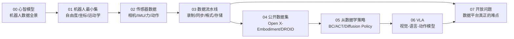

# robot-data-handbook · 机器人数据手册

> 从零理解机器人大脑的**上游**：机器人会产生哪些数据、这些数据长什么样、怎么存、怎么流、又怎么被用来训练出 VLA 这样的策略模型。

一份以**数据**为主线、面向软件工程师和数据分析背景读者的机器人学习手册。

---

## 为什么写这份手册

我做软件和数据出身，目标是搭一个机器人大脑的上游数据平台。真正开始找资料时才发现一个尴尬的空缺：

- **算法教程很多** —— 讲 Diffusion Policy、讲 RL、讲 VLA 微调的博客和仓库一抓一大把；
- **仿真教程很多** —— MuJoCo / Isaac Lab / Gazebo 的中文教程也不少；
- **但没人系统讲数据** —— 一台机器人在跑的时候到底吐出哪些数据？频率各是多少？时间戳怎么对齐？一段 demonstration 存成什么格式？为什么换个机器人数据就不能用了？

这些问题恰恰是数据平台的全部工作量。不把它讲清楚，所谓"上游数据平台"就只能是个上传下载的网盘。

所以这份手册的写法是：**以数据为骨架，机器人学、控制、学习都只讲理解数据所必需的部分**。终点是能看懂 VLA（Vision-Language-Action）在做什么、需要喂它什么。

## 适合谁读

| 适合 | 不适合 |
|---|---|
| 软件 / 后端 / 数据工程师，想切入具身智能 | 想直接找模型跑 inference 的 |
| 正在做或打算做机器人数据平台的人 | 找硬件选型、机械结构教程的 |
| 有 ML 基础但不懂机器人的人 | 需要发论文级理论推导的 |
| 想建立完整心智模型的学生 | 只想要一个 awesome 链接列表的 |

不需要机器人基础，但需要：会写代码、看得懂 Python、知道什么是张量和梯度。

## 知识地图

## 目录

| 章节 | 主题 | 关键问题 | 状态 |
|---|---|---|---|
| [00](00-mental-model/) | 心智模型 | 机器人数据到底分几类？和互联网数据差在哪？ | 🚧 进行中 |
| [01](01-robotics-primer/) | 机器人最小集 | 什么是自由度、坐标系、正逆运动学？ | 📝 计划 |
| [02](02-sensor-data/) | 传感器数据 | 每种传感器输出的数据结构、频率、噪声特性 | 📝 计划 |
| [03](03-data-pipeline/) | 数据流水线 | 录制、时间同步、标定、格式、版本化、标注 | 📝 计划 |
| [04](04-datasets/) | 公开数据集 | 业界在用什么数据，规模和坑 | 📝 计划 |
| [05](05-learning-from-data/) | 从数据学策略 | 模仿学习怎么把数据变成策略 | 📝 计划 |
| [06](06-vla/) | VLA | 它是什么、架构长什么样、动作怎么表示 | 📝 计划 |
| [07](07-open-problems/) | 开放问题 | 数据平台上真正没被解决的问题 | 📝 计划 |

辅助文档：

- [ROADMAP.md](ROADMAP.md) —— 阶段划分、前置依赖、当前进度
- [GLOSSARY.md](GLOSSARY.md) —— 中英名词对照表（**领域最大的门槛是黑话**）

## 三条阅读路径

**A. 只想搞懂 VLA 在干嘛**（约 2 小时）
`00` → `02/action-and-state.md` → `05/action-representation.md` → `06/`

**B. 要做数据平台**（推荐主线）
按 `00 → 01 → 02 → 03 → 04` 顺序，`05`、`06` 可先略读，重点在 `03` 和 `07`。

**C. 系统入门机器人**（最慢但最完整）
全部按顺序读完，`01` 不要跳——跳过坐标系，后面所有数据都对不齐。

## 写作约定

每篇笔记固定四段结构，不为凑字数而写：

1. **它解决什么问题** —— 这个概念为什么存在，不用它会怎样
2. **软件工程里的对应物** —— 用已知的东西类比未知的
3. **最小示例** —— 一段数据结构、一段伪代码或一条真实记录
4. **和数据平台有什么关系** —— 读完这篇，做平台的人该记住什么

第 4 段是这份手册和"个人学习笔记"的分界线。写不出来，说明还没真懂。

## 关于 VLA 和数据的关系

一句话概括这份手册的核心主张：

> VLA 的瓶颈不在模型结构，在**数据**。

模型结构在收敛（视觉编码器 + 语言主干 + 动作头，动作表示在 discrete token 和 flow matching 之间摇摆），但数据侧的问题几乎没动过：真机数据采集成本极高、不同本体之间数据无法直接复用、成功/失败标注靠人眼、评测没有统一基准。

这也是为什么这份手册把 2/3 的篇幅留给数据。理解了数据，模型部分只是薄薄一层。

## 许可

文档采用 [CC BY 4.0](https://creativecommons.org/licenses/by/4.0/) 许可，代码片段采用 MIT。
欢迎 issue 纠错 —— 尤其是术语翻译和事实性错误，这个领域变化很快，笔记里会标注写作时间。
